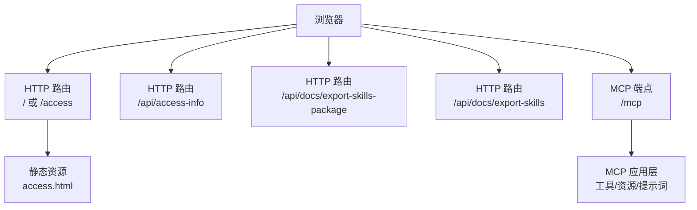
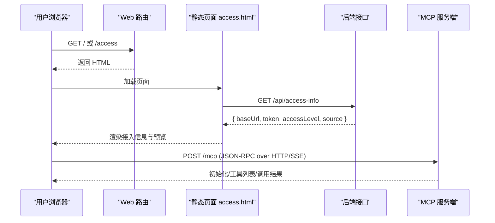
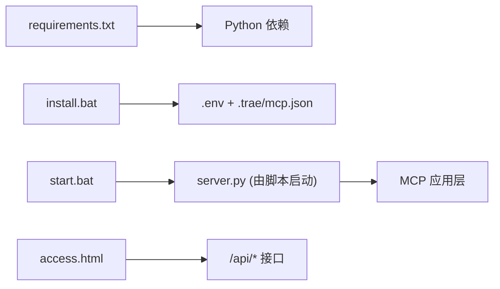

# API 接口参考

<cite>
**本文引用的文件**
- [access.html](file://mcp_server/static/access.html)
- [requirements.txt](file://mcp_server/requirements.txt)
- [start.bat](file://mcp_server/start.bat)
- [install.bat](file://mcp_server/install.bat)
- [mcp server部署.md](file://mcp server部署.md)
- [规约管理MCP服务化Spec.md](file://规约管理MCP服务化Spec.md)
</cite>

## 目录
1. [简介](#简介)
2. [项目结构](#项目结构)
3. [核心组件](#核心组件)
4. [架构总览](#架构总览)
5. [详细接口说明](#详细接口说明)
6. [依赖关系分析](#依赖关系分析)
7. [性能与可用性](#性能与可用性)
8. [故障排除指南](#故障排除指南)
9. [结论](#结论)
10. [附录](#附录)

## 简介
本参考文档面向接入方，系统化说明 PCA MCP Server 提供的 HTTP 端点与 MCP 协议端点的功能、请求/响应格式、鉴权要求、错误处理与调用示例。重点覆盖：
- 接入页面：/ 与 /access（HTML 页面）
- 访问信息获取：/api/access-info
- Skills 包导出：/api/docs/export-skills-package
- Skills Markdown 摘要：/api/docs/export-skills
- MCP 协议端点：/mcp（JSON-RPC over HTTP/SSE）

## 项目结构
本项目提供静态接入页面与 MCP 服务启动脚本，并通过环境变量注入鉴权 Token。关键路径与职责如下：
- mcp_server/static/access.html：一键接入生成器前端，自动拉取服务器地址、Token、权限级别等信息，并生成各 IDE 的 MCP 配置文本与下载链接。
- mcp_server/start.bat：读取 .env 中的 MCP_AUTH_TOKEN，启动 Python 服务（server.py）。
- mcp_server/install.bat：创建虚拟环境、安装依赖、生成 Token、写入 .env 与 .trae/mcp.json。
- mcp_server/requirements.txt：声明运行依赖（MCP SDK、Uvicorn）。
- 部署与原理说明：mcp server部署.md
- 后端接口规划：规约管理MCP服务化Spec.md

图表来源
- [mcp server部署.md:74-79](file://mcp server部署.md#L74-L79)
- [access.html:401-417](file://mcp_server/static/access.html#L401-L417)

章节来源
- [access.html:1-562](file://mcp_server/static/access.html#L1-L562)
- [start.bat:15-41](file://mcp_server/start.bat#L15-L41)
- [install.bat:52-72](file://mcp_server/install.bat#L52-L72)
- [requirements.txt:1-3](file://mcp_server/requirements.txt#L1-L3)
- [mcp server部署.md:74-79](file://mcp server部署.md#L74-L79)

## 核心组件
- 接入页面（access.html）：自动检测服务器 IP、分配 Token、展示权限级别，按目标平台生成 MCP 配置与下载链接。
- 启动脚本（start.bat）：从 .env 读取 MCP_AUTH_TOKEN 并启动服务；若未设置则中止。
- 安装脚本（install.bat）：创建虚拟环境、安装依赖、生成 Token、写入 .env 与 .trae/mcp.json。
- 依赖声明（requirements.txt）：锁定 MCP SDK 与 Uvicorn 版本范围。
- 部署文档（mcp server部署.md）：说明 MCP 与 Uvicorn 的角色分工、ASGI 协议、SSE 长连接等。
- 规范文档（规约管理MCP服务化Spec.md）：定义 /api/access-info 与 /api/docs/export-skills-package 的预期行为。

章节来源
- [access.html:241-294](file://mcp_server/static/access.html#L241-L294)
- [access.html:401-417](file://mcp_server/static/access.html#L401-L417)
- [start.bat:15-41](file://mcp_server/start.bat#L15-L41)
- [install.bat:52-72](file://mcp_server/install.bat#L52-L72)
- [requirements.txt:1-3](file://mcp_server/requirements.txt#L1-L3)
- [mcp server部署.md:74-79](file://mcp server部署.md#L74-L79)
- [规约管理MCP服务化Spec.md:1206-1214](file://规约管理MCP服务化Spec.md#L1206-L1214)

## 架构总览
整体交互由浏览器发起 HTTP 请求，静态页面通过 /api/access-info 获取接入信息，并在本地拼装各 IDE 的 MCP 配置与 Skills 下载链接。MCP 客户端通过 /mcp 使用 JSON-RPC 与服务器通信，支持 SSE 长连接。

图表来源
- [access.html:401-417](file://mcp_server/static/access.html#L401-L417)
- [mcp server部署.md:74-79](file://mcp server部署.md#L74-L79)

## 详细接口说明

### 通用说明
- 基础 URL：http://服务器IP:端口（默认端口见启动输出）
- 鉴权：
  - 接入页面与导出接口通常无需额外鉴权头，但会基于来源 IP 判定权限级别。
  - MCP 调用需在请求头中携带 Authorization: Bearer <token>。
- 权限模型：
  - localhost 访问：系统级（读写）
  - 其他 IP：用户级（只读）
- 字符编码：UTF-8
- 内容类型：JSON 或 text/markdown 或 application/octet-stream（视接口而定）

章节来源
- [install.bat:52-72](file://mcp_server/install.bat#L52-L72)
- [mcp server部署.md:655-663](file://mcp server部署.md#L655-L663)
- [access.html:424-431](file://mcp_server/static/access.html#L424-L431)

### 端点：/ 与 /access（HTML 接入页）
- 方法：GET
- 描述：返回“一键接入生成器”页面，自动检测服务器地址、分配 Token、展示权限级别，并提供各 IDE 的配置文本与 Skills 下载链接。
- 请求头：无特殊要求
- 响应体：HTML 文档
- 行为要点：
  - 页面在加载时调用 /api/access-info 获取 baseUrl、token、accessLevel、source。
  - 根据选择的目标平台生成 MCP 配置与下载链接。
- 典型调用示例
  - 请求：GET http://localhost:8765/ 或 http://localhost:8765/access
  - 响应：HTML 页面
- 错误处理
  - 若无法访问 /api/access-info，页面将显示错误提示并要求通过服务器地址访问。

章节来源
- [access.html:241-294](file://mcp_server/static/access.html#L241-L294)
- [access.html:401-417](file://mcp_server/static/access.html#L401-L417)

### 端点：/api/access-info
- 方法：GET
- 描述：返回当前会话的接入信息，供接入页面渲染状态卡片与生成配置。
- 请求头：无特殊要求
- 响应体（JSON）：
  - baseUrl: string — 服务器基础地址
  - token: string — 临时 Token
  - accessLevel: string — "system" 或 "user"
  - source: string — 请求来源 IP
  - serverIPs: array<string> — 可选，服务器网络地址列表
- 典型调用示例
  - 请求：GET http://localhost:8765/api/access-info
  - 响应示例：
    - { "baseUrl": "http://192.168.1.100:8765", "token": "metam_pat_xxx", "accessLevel": "user", "source": "192.168.1.101", "serverIPs": ["192.168.1.100"] }
- 错误处理
  - 若服务未启动或路由未实现，返回 HTTP 错误（如 404/500），页面将提示失败原因。

章节来源
- [access.html:401-417](file://mcp_server/static/access.html#L401-L417)
- [规约管理MCP服务化Spec.md:1206-1214](file://规约管理MCP服务化Spec.md#L1206-L1214)

### 端点：/api/docs/export-skills-package
- 方法：GET
- 描述：导出 Skills 打包文件（ZIP），供用户在 IDE 中解压安装。
- 查询参数：
  - baseUrl: string — 必填，用于生成可访问的下载链接
- 请求头：无特殊要求
- 响应体：application/octet-stream（ZIP 二进制流）
- 典型调用示例
  - 请求：GET http://localhost:8765/api/docs/export-skills-package?baseUrl=http%3A%2F%2F192.168.1.100%3A8765
  - 响应：ZIP 文件流
- 错误处理
  - 缺少 baseUrl 或打包失败时返回相应 HTTP 错误码。

章节来源
- [access.html:475-477](file://mcp_server/static/access.html#L475-L477)
- [规约管理MCP服务化Spec.md:1206-1214](file://规约管理MCP服务化Spec.md#L1206-L1214)

### 端点：/api/docs/export-skills
- 方法：GET
- 描述：导出 Skills 的 Markdown 摘要，便于阅读与分享。
- 查询参数：
  - baseUrl: string — 必填，用于生成可访问的下载链接
- 请求头：无特殊要求
- 响应体：text/markdown
- 典型调用示例
  - 请求：GET http://localhost:8765/api/docs/export-skills?baseUrl=http%3A%2F%2F192.168.1.100%3A8765
  - 响应：Markdown 文本
- 错误处理
  - 缺少 baseUrl 或生成失败时返回相应 HTTP 错误码。

章节来源
- [access.html:475-477](file://mcp_server/static/access.html#L475-L477)

### 端点：/mcp（MCP 协议）
- 方法：POST（HTTP）或 SSE（Server-Sent Events）
- 描述：MCP 协议主端点，承载 JSON-RPC 消息，支持工具调用、资源访问与提示词。
- 请求头：
  - Authorization: Bearer <token> — 必需
- 请求体：JSON-RPC 消息（具体字段遵循 MCP 协议规范）
- 响应：
  - HTTP 模式：JSON-RPC 响应
  - SSE 模式：事件流
- 典型调用示例
  - 初始化：
    - 请求：POST /mcp，头部 Authorization: Bearer <token>，体为 MCP 初始化消息
    - 响应：初始化成功消息
  - 工具列表：
    - 请求：POST /mcp，发送 list_tools 消息
    - 响应：工具列表
  - 工具调用：
    - 请求：POST /mcp，发送 call_tool 消息
    - 响应：工具执行结果
- 错误处理
  - 鉴权失败：返回认证相关错误
  - 消息格式错误：返回参数校验错误
  - 服务不可用：返回 5xx

章节来源
- [mcp server部署.md:74-79](file://mcp server部署.md#L74-L79)
- [mcp server部署.md:110-125](file://mcp server部署.md#L110-L125)

## 依赖关系分析
- 运行时依赖
  - MCP SDK：提供 MCP 协议能力（工具、资源、提示词）
  - Uvicorn：ASGI 服务器，承载 HTTP 与 SSE
- 启动流程依赖
  - install.bat：创建虚拟环境、安装依赖、生成 Token、写入 .env 与 .trae/mcp.json
  - start.bat：读取 .env 中的 MCP_AUTH_TOKEN 并启动服务
- 前端依赖
  - access.html：依赖 /api/access-info 与 /api/docs/* 接口完成接入引导

图表来源
- [requirements.txt:1-3](file://mcp_server/requirements.txt#L1-L3)
- [install.bat:52-72](file://mcp_server/install.bat#L52-L72)
- [start.bat:15-41](file://mcp_server/start.bat#L15-L41)

章节来源
- [requirements.txt:1-3](file://mcp_server/requirements.txt#L1-L3)
- [install.bat:52-72](file://mcp_server/install.bat#L52-L72)
- [start.bat:15-41](file://mcp_server/start.bat#L15-L41)

## 性能与可用性
- 高性能：Uvicorn 基于 uvloop 与 httptools，适合高并发 I/O 场景。
- 异步：原生 async/await，避免阻塞事件循环。
- 多协议：支持 HTTP/1.1、WebSocket、SSE。
- 建议：
  - 生产环境使用反向代理（Nginx）+ HTTPS
  - 启用日志审计与限流
  - 合理设置超时与重试策略

章节来源
- [mcp server部署.md:86-100](file://mcp server部署.md#L86-L100)
- [mcp server部署.md:110-125](file://mcp server部署.md#L110-L125)

## 故障排除指南
常见问题与解决思路：
- 未设置 MCP_AUTH_TOKEN
  - 现象：启动脚本提示未设置 Token
  - 处理：运行 install.bat 自动生成或手动在 .env 中设置
- 端口被占用
  - 现象：启动时报端口绑定失败
  - 处理：查找并结束占用进程，或修改端口
- 移动项目后虚拟环境失效
  - 现象：activate.bat 路径失效
  - 处理：删除旧 .venv 并重新运行 install.bat
- 无法访问 /api/access-info
  - 现象：接入页面提示获取失败
  - 处理：确认通过服务器地址访问页面，检查路由是否实现

章节来源
- [start.bat:15-27](file://mcp_server/start.bat#L15-L27)
- [mcp server部署.md:599-642](file://mcp server部署.md#L599-L642)
- [access.html:401-417](file://mcp_server/static/access.html#L401-L417)

## 结论
本参考文档梳理了 PCA MCP Server 的关键 HTTP 端点与 MCP 协议端点，覆盖了接入页面、访问信息获取、Skills 导出以及 MCP 通信的基本用法与注意事项。实际使用中请结合部署环境与权限模型进行配置与调试。

## 附录

### 错误码与含义（通用）
- 400：请求参数缺失或格式错误（例如缺少 baseUrl）
- 401：鉴权失败（MCP 调用缺少或无效 Token）
- 403：权限不足（非 localhost 尝试写入操作）
- 404：路由未实现或服务未启动
- 500：服务器内部错误（打包失败、I/O 异常等）

章节来源
- [mcp server部署.md:655-663](file://mcp server部署.md#L655-L663)
- [规约管理MCP服务化Spec.md:1206-1214](file://规约管理MCP服务化Spec.md#L1206-L1214)

### 鉴权与权限控制
- Token 来源：install.bat 自动生成或手动设置于 .env
- 传递方式：Authorization: Bearer <token>
- 权限级别：
  - localhost → 系统级（读写）
  - 其他 IP → 用户级（只读）

章节来源
- [install.bat:52-72](file://mcp_server/install.bat#L52-L72)
- [mcp server部署.md:655-663](file://mcp server部署.md#L655-L663)

### 调用示例速查
- 获取接入信息
  - GET /api/access-info
  - 响应：{ baseUrl, token, accessLevel, source }
- 下载 Skills 包
  - GET /api/docs/export-skills-package?baseUrl=...
  - 响应：ZIP 流
- 导出 Skills 摘要
  - GET /api/docs/export-skills?baseUrl=...
  - 响应：Markdown
- MCP 调用
  - POST /mcp，头部 Authorization: Bearer <token>
  - 消息：JSON-RPC（初始化、list_tools、call_tool 等）

章节来源
- [access.html:401-417](file://mcp_server/static/access.html#L401-L417)
- [access.html:475-477](file://mcp_server/static/access.html#L475-L477)
- [mcp server部署.md:74-79](file://mcp server部署.md#L74-L79)