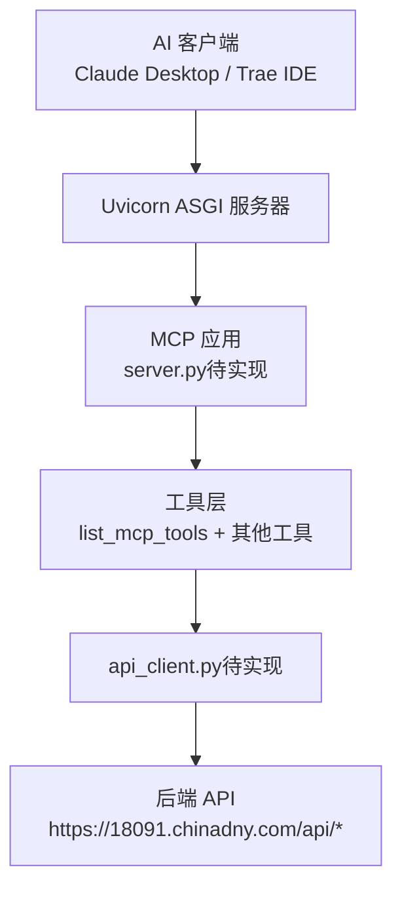
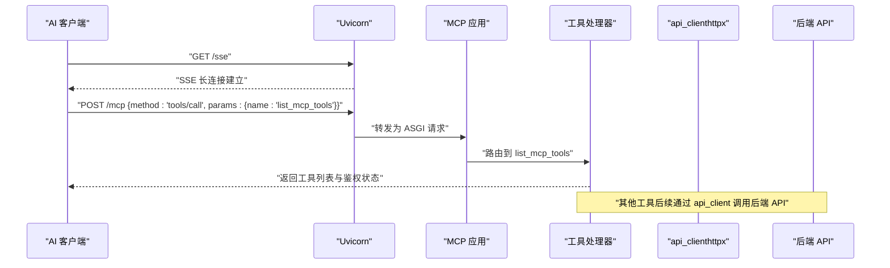
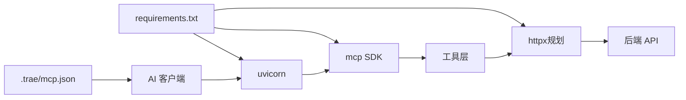

# MCP 工具参考

<cite>
**本文引用的文件**
- [mcp server部署.md](file://mcp server部署.md)
- [规约管理MCP服务化Spec.md](file://规约管理MCP服务化Spec.md)
- [规约管理基础数据模块Spec.md](file://规约管理基础数据模块Spec.md)
- [.trae/mcp.json](file://.trae/mcp.json)
- [mcp_server/requirements.txt](file://mcp_server/requirements.txt)
- [mcp_server/static/access.html](file://mcp_server/static/access.html)
</cite>

## 目录
1. [简介](#简介)
2. [项目结构](#项目结构)
3. [核心组件](#核心组件)
4. [架构总览](#架构总览)
5. [详细组件分析](#详细组件分析)
6. [依赖关系分析](#依赖关系分析)
7. [性能考虑](#性能考虑)
8. [故障排查指南](#故障排查指南)
9. [结论](#结论)
10. [附录](#附录)

## 简介
本参考文档面向 MCP（Model Context Protocol）服务端与调用方，系统化说明当前仓库中 MCP 工具的现状、注册机制、动态路由、API 规范、错误处理、权限要求、生命周期管理与扩展方式。重点覆盖已实现的 list_mcp_tools 探测工具，以及其余 6 个桩工具的状态；同时给出后续将实现的 39 个规约管理相关 MCP 工具的完整清单与调用流程。

## 项目结构
- mcp_server：MCP 服务代码与静态资源所在目录，包含依赖声明、安装与启动脚本、接入页面等。
- .trae：IDE 配置与 Skills 示例，其中 mcp.json 描述了客户端如何连接 MCP 服务并携带鉴权头。
- openspec：变更与任务规划，用于指导 MCP 后端原子工具与权限、写入保护等增强任务的落地。
- 规约管理 Spec：定义 MCP 工具与后端 API 的映射关系、参数与响应格式、典型调用流程。

图表来源
- [mcp server部署.md:110-280](file://mcp server部署.md#L110-L280)
- [规约管理MCP服务化Spec.md:44-66](file://规约管理MCP服务化Spec.md#L44-L66)

章节来源
- [mcp server部署.md:25-125](file://mcp server部署.md#L25-L125)
- [mcp_server/requirements.txt:1-3](file://mcp_server/requirements.txt#L1-L3)
- [.trae/mcp.json:1-1](file://.trae/mcp.json#L1-L1)

## 核心组件
- 服务进程与协议栈
  - Uvicorn：ASGI 服务器，负责网络 I/O、SSE 长连接、HTTP 请求转发。
  - MCP 框架：提供工具注册、JSON-RPC 消息处理、工具路由与生命周期管理。
- 鉴权与中间件
  - TokenManager/AuthMiddleware：基于 Bearer Token 的 MCP 接入鉴权，校验请求头中的 Authorization。
- 工具层
  - list_mcp_tools：探测工具，返回可用工具列表与鉴权探测结果。
  - 其余 6 个桩工具：当前仅返回 not_implemented，未调用任何后端 API。
- 业务 API 客户端（规划）
  - api_client.py：封装 httpx 异步 HTTP 客户端，统一构造请求头、超时、错误归一化与响应解析。
- 静态资源
  - access.html：一键生成 MCP 接入配置与验证流程的引导页，演示如何通过 Skill 调用 list_mcp_tools 完成接入验证。

章节来源
- [mcp server部署.md:110-280](file://mcp server部署.md#L110-L280)
- [规约管理MCP服务化Spec.md:18-41](file://规约管理MCP服务化Spec.md#L18-L41)
- [mcp_server/static/access.html:314-487](file://mcp_server/static/access.html#L314-L487)

## 架构总览
MCP 服务采用“网络层（Uvicorn）+ 应用层（MCP 工具）+ 业务层（后端 API）”的分层架构。工具通过装饰器注册到 MCP 框架，由框架根据 JSON-RPC 方法名进行动态路由。鉴权在中间件层完成，业务 Token 作为工具参数透传到后端 API。

图表来源
- [mcp server部署.md:163-261](file://mcp server部署.md#L163-L261)
- [规约管理MCP服务化Spec.md:56-66](file://规约管理MCP服务化Spec.md#L56-L66)

## 详细组件分析

### 工具注册机制与动态路由系统
- 工具注册
  - 使用 MCP 框架提供的装饰器将函数注册为工具，函数签名即参数契约，返回值即响应体。
  - 工具按功能域分组命名，便于调用方识别与编排。
- 动态路由
  - MCP 框架根据 JSON-RPC method 字段（如 tools/call）与工具名称进行路由分发。
  - 中间件在请求进入工具前执行鉴权，确保只有持有有效 Bearer Token 的请求可访问工具。
- 生命周期
  - 工具函数为异步函数，避免阻塞事件循环。
  - 工具内部可创建或复用 httpx 客户端，注意连接池与超时配置。

章节来源
- [规约管理MCP服务化Spec.md:247-285](file://规约管理MCP服务化Spec.md#L247-L285)
- [mcp server部署.md:110-280](file://mcp server部署.md#L110-L280)

### 已实现工具：list_mcp_tools
- 功能
  - 列出所有可用工具及其元信息（名称、类型、描述）。
  - 进行鉴权探测，确认 MCP 接入 Token 是否有效。
- 参数
  - 无业务参数；鉴权由中间件基于请求头 Authorization: Bearer <token> 完成。
- 返回值
  - 工具列表与鉴权状态，供客户端验证连接与权限。
- 使用示例
  - 通过 Skill 或 MCP 客户端调用 tools/call，方法名为 list_mcp_tools。
  - 可在接入页面中自动执行该调用以验证连接。
- 错误处理
  - 若鉴权失败，返回认证错误；若工具不可用，返回未找到或不可调用错误。
- 权限要求
  - 需要有效的 MCP 接入 Bearer Token。

章节来源
- [mcp server部署.md:25-125](file://mcp server部署.md#L25-L125)
- [mcp_server/static/access.html:314-487](file://mcp_server/static/access.html#L314-L487)
- [规约管理MCP服务化Spec.md:132-139](file://规约管理MCP服务化Spec.md#L132-L139)

### 其余 6 个桩工具状态
- 现状
  - 当前存在 6 个桩工具，仅返回 not_implemented，未调用任何后端 API。
- 计划
  - 按照规约管理 MCP 服务化 Spec，删除这些桩工具，替换为真实业务工具。
  - 保留 list_mcp_tools 用于探测与鉴权验证。
- 影响
  - 工具列表更干净，避免误导调用方；后续新增工具需遵循统一的注册与路由机制。

章节来源
- [规约管理MCP服务化Spec.md:18-41](file://规约管理MCP服务化Spec.md#L18-L41)
- [规约管理MCP服务化Spec.md:247-285](file://规约管理MCP服务化Spec.md#L247-L285)

### 规约管理 MCP 工具清单（规划）
- 分类与数量
  - 探测 + 登录：2 个（list_mcp_tools、login）。
  - 大类管理：4 个。
  - 设备类型管理：4 个。
  - 品牌管理：4 个。
  - 型号管理：4 个。
  - 规约信息管理：5 个。
  - 数据项管理：4 个。
  - 脚本管理：4 个。
  - 系数管理：4 个。
  - 感知管理：4 个。
  - 规约类型/字典：3 个。
  - 功能项管理：3 个。
  - 导出 + 文件删除：3 个。
  - 合计：39 个工具。
- 工具命名与类型
  - 查询类工具：get_*_list、get_*、export_*。
  - 写入类工具：add_*、update_*、del_*、save_*、upload_protocol_file、gen_script。
- 权限标记
  - 写入类工具统一标记为 write，并在系统级权限检查后放行。
- 典型调用流程
  - 先调用 login 获取业务 Token。
  - 后续工具传入 token 参数，由 api_client 注入到后端请求头。
  - 成功响应 code=20000，分页 data.rows 结构。

章节来源
- [规约管理MCP服务化Spec.md:132-245](file://规约管理MCP服务化Spec.md#L132-L245)
- [规约管理MCP服务化Spec.md:295-319](file://规约管理MCP服务化Spec.md#L295-L319)
- [规约管理基础数据模块Spec.md:304-337](file://规约管理基础数据模块Spec.md#L304-L337)

### 工具 API 规范（通用约定）
- 请求
  - 所有工具通过 MCP JSON-RPC 调用，方法名为 tools/call，参数包含工具名与业务参数。
  - MCP 接入鉴权：Authorization: Bearer <token>。
  - 业务 Token：作为工具参数传入，由 api_client 注入到后端请求头。
- 响应
  - 统一结构：{ code, data, message }。
  - 分页列表：data.rows 数组，data.total 总数。
  - 成功码：code=20000；认证失效：code=40100；业务异常：code=40000。
- 错误处理
  - 网络异常：error=true，code=NETWORK_ERROR。
  - 后端非 20000：error=true，code=API_ERROR，message 携带业务信息。
  - Token 无效/过期：error=true，code=AUTH_ERROR。
  - HTTP 状态异常：error=true，code=HTTP_ERROR。

章节来源
- [规约管理MCP服务化Spec.md:323-336](file://规约管理MCP服务化Spec.md#L323-L336)
- [规约管理MCP服务化Spec.md:123-131](file://规约管理MCP服务化Spec.md#L123-L131)

### 工具调用示例与响应格式
- 探测连接
  - 调用 list_mcp_tools，验证工具列表与鉴权状态。
- 登录与后续操作
  - 调用 login(phoneNum, code)，返回 token。
  - 使用 token 调用查询或写入工具，例如 get_brand_list、add_brand。
- 响应格式
  - 成功：{ code: 20000, data: {...}, message: "成功" }。
  - 分页：data.rows 为列表，data.total 为总数。
  - 错误：{ error: true, code: "...", message: "..." }。

章节来源
- [规约管理MCP服务化Spec.md:295-319](file://规约管理MCP服务化Spec.md#L295-L319)
- [规约管理基础数据模块Spec.md:329-337](file://规约管理基础数据模块Spec.md#L329-L337)

### 生命周期管理与扩展机制
- 生命周期
  - 工具函数为异步，避免阻塞事件循环。
  - api_client 维护 httpx.AsyncClient 连接池，支持超时与重试策略。
- 扩展机制
  - 新增工具：在 server.py 中注册新函数，保持命名与类型一致。
  - 新增 API：在 api_client.py 中封装对应请求方法，统一错误处理。
  - 权限控制：写入工具标记为 write，并在中间件或工具内执行系统级权限检查。

章节来源
- [规约管理MCP服务化Spec.md:247-285](file://规约管理MCP服务化Spec.md#L247-L285)
- [openspec/changes/enhance-modbus-mcp-workflow/tasks.md:1-14](file://openspec/changes/enhance-modbus-mcp-workflow/tasks.md#L1-L14)

### 工具开发指南（添加新 MCP 工具）
- 步骤
  1. 在 server.py 中新增 async 工具函数，使用 @mcp.tool() 装饰器注册。
  2. 在 api_client.py 中新增对应后端 API 调用方法，统一错误处理。
  3. 更新 requirements.txt 引入必要依赖（如 httpx）。
  4. 通过 list_mcp_tools 验证工具可见性与类型。
  5. 编写调用示例与单元测试，覆盖成功、网络异常、业务错误、认证失败场景。
- 注意事项
  - 参数校验：在工具函数中进行输入校验，减少后端压力。
  - 错误归一化：统一返回 error/code/message 结构。
  - 权限标记：写入工具标记为 write，并在系统级权限检查后放行。
  - 日志审计：记录工具调用与错误信息，便于问题定位。

章节来源
- [规约管理MCP服务化Spec.md:247-285](file://规约管理MCP服务化Spec.md#L247-L285)
- [mcp_server/requirements.txt:1-3](file://mcp_server/requirements.txt#L1-L3)
- [openspec/changes/enhance-modbus-mcp-workflow/tasks.md:1-14](file://openspec/changes/enhance-modbus-mcp-workflow/tasks.md#L1-L14)

## 依赖关系分析
- 外部依赖
  - mcp：MCP 协议 SDK，提供工具注册、JSON-RPC 处理。
  - uvicorn：ASGI 服务器，运行 MCP 应用。
  - httpx（规划）：异步 HTTP 客户端，用于调用后端 API。
- 配置文件
  - .trae/mcp.json：客户端连接配置，包含 URL 与 Authorization 头。
- 静态资源
  - access.html：接入引导页，演示 Skill 调用 list_mcp_tools 的流程。

图表来源
- [mcp_server/requirements.txt:1-3](file://mcp_server/requirements.txt#L1-L3)
- [.trae/mcp.json:1-1](file://.trae/mcp.json#L1-L1)
- [规约管理MCP服务化Spec.md:44-66](file://规约管理MCP服务化Spec.md#L44-L66)

章节来源
- [mcp_server/requirements.txt:1-3](file://mcp_server/requirements.txt#L1-L3)
- [.trae/mcp.json:1-1](file://.trae/mcp.json#L1-L1)
- [mcp server部署.md:38-108](file://mcp server部署.md#L38-L108)

## 性能考虑
- 异步 I/O
  - 工具函数与 api_client 均使用异步模式，避免阻塞事件循环。
- 连接池与超时
  - httpx.AsyncClient 复用连接，设置合理超时时间，防止长时间占用资源。
- 并发模型
  - Uvicorn 基于事件循环，高并发下仍保持低延迟。
- 错误隔离
  - 每个工具独立处理错误，避免级联失败。

[本节为通用指导，不直接分析具体文件]

## 故障排查指南
- 常见问题
  - Python 版本过低：确保 3.10+。
  - 虚拟环境创建失败：检查权限与磁盘空间。
  - 依赖安装失败：检查网络与 pip 版本。
  - 找不到虚拟环境：重新运行 install.bat。
  - Token 未配置：运行 install.bat 或手动创建 .env。
  - 端口被占用：结束占用进程或修改端口。
- 安全建议
  - 生产环境更换认证方式、启用 HTTPS、使用进程管理、添加日志审计、限制访问来源。

章节来源
- [mcp server部署.md:505-674](file://mcp server部署.md#L505-L674)

## 结论
当前 MCP 服务已具备基础的网络层与鉴权能力，list_mcp_tools 工具可用于探测与鉴权验证。其余 6 个桩工具将在后续改造中被真实业务工具替代。通过统一的工具注册机制、动态路由系统与 api_client 封装，可实现高效、可扩展的 MCP 工具生态。建议按规约管理 MCP 服务化 Spec 逐步落地全部 39 个工具，并完善权限与写入保护。

[本节为总结，不直接分析具体文件]

## 附录
- 快速命令参考
  - 首次安装：mcp_server\install.bat
  - 启动服务：mcp_server\start.bat
  - 停止服务：Ctrl+C
  - 手动激活虚拟环境：.venv\Scripts\activate.bat
  - 退出虚拟环境：deactivate
  - 手动启动服务：python mcp_server\server.py

章节来源
- [mcp server部署.md:677-687](file://mcp server部署.md#L677-L687)