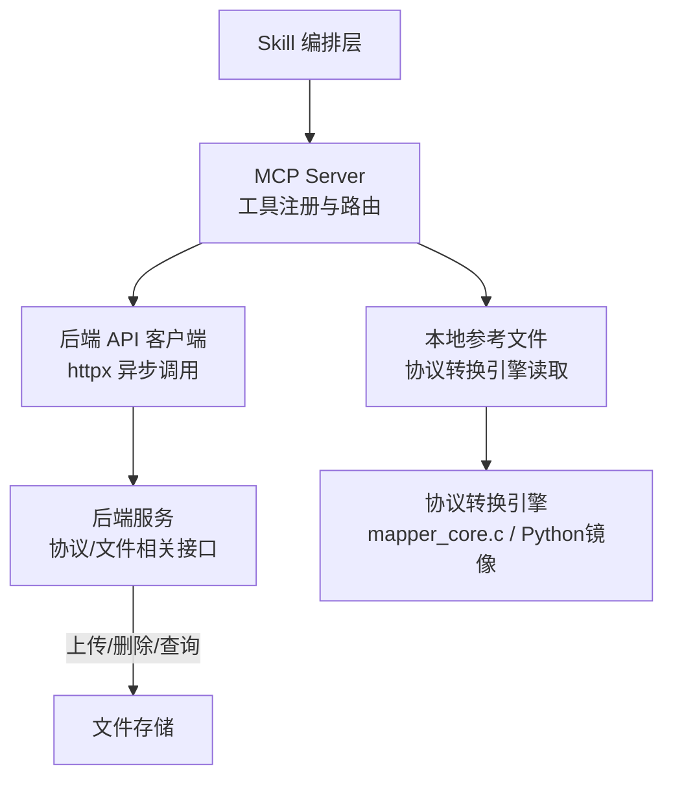
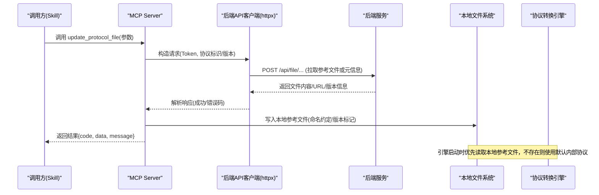
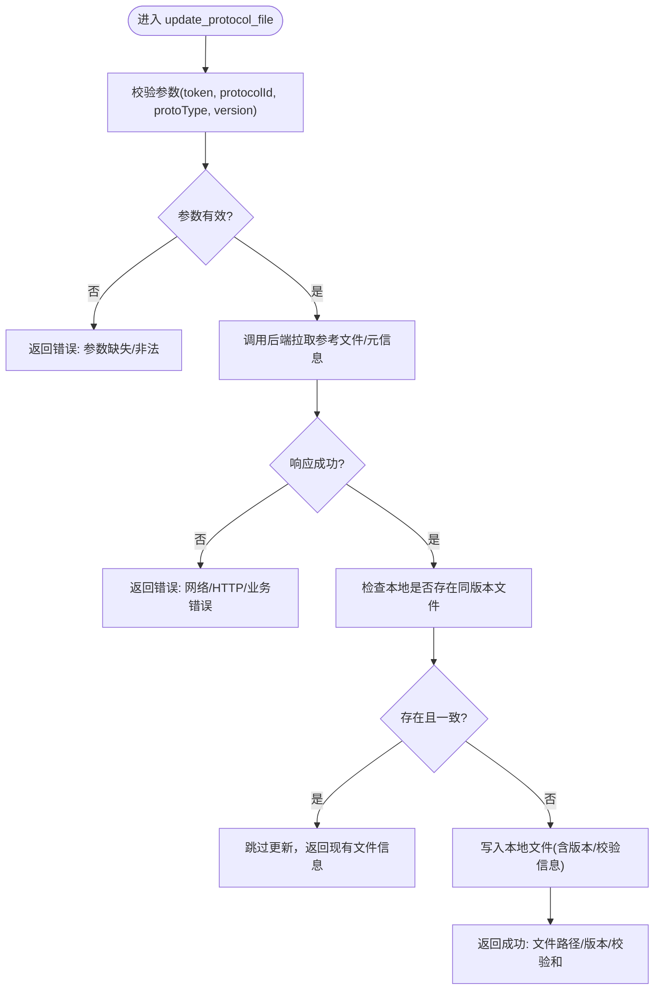
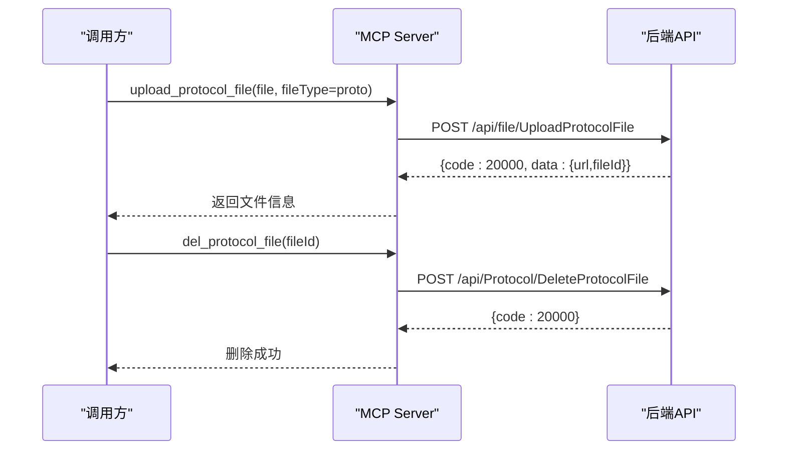
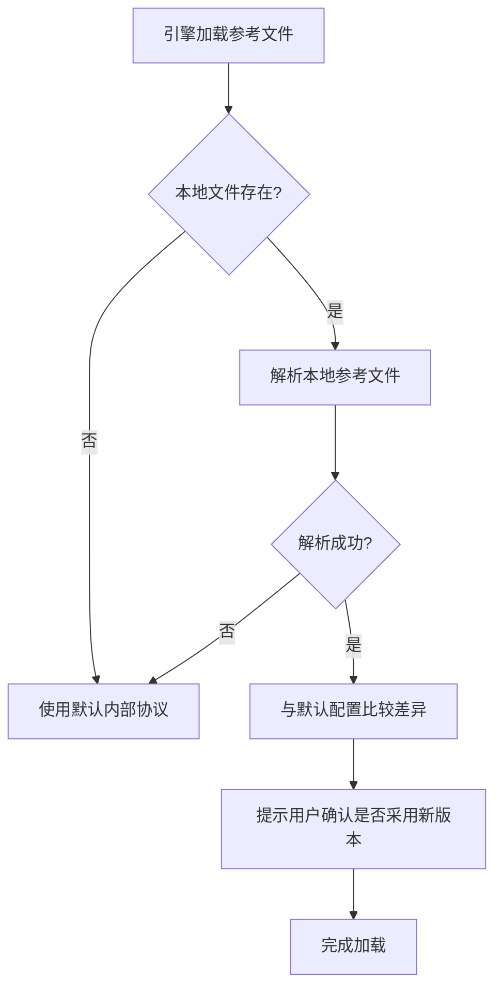
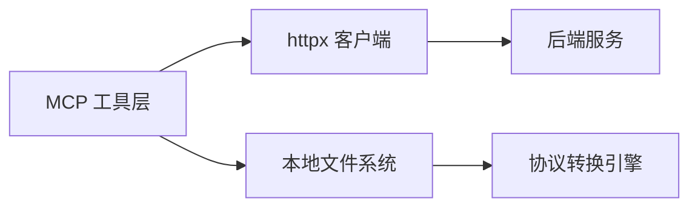

# 协议文件工具

<cite>
**本文引用的文件**
- [规约管理MCP服务化Spec.md](file://规约管理MCP服务化Spec.md)
- [mcp server部署.md](file://mcp server部署.md)
- [规约管理基础数据模块Spec.md](file://规约管理基础数据模块Spec.md)
- [.trae/skills/protocol-conversion/SKILL.md](file://.trae/skills/protocol-conversion/SKILL.md)
</cite>

## 目录
1. [简介](#简介)
2. [项目结构](#项目结构)
3. [核心组件](#核心组件)
4. [架构总览](#架构总览)
5. [详细组件分析](#详细组件分析)
6. [依赖关系分析](#依赖关系分析)
7. [性能与可靠性](#性能与可靠性)
8. [故障排除指南](#故障排除指南)
9. [结论](#结论)
10. [附录：API 规范与使用示例](#附录api-规范与使用示例)

## 简介
本文件面向“协议文件工具”，重点说明 update_protocol_file（或等价能力）在 MCP 服务中的职责边界、调用流程、版本控制与冲突处理策略，以及与协议转换引擎的集成方式。当前仓库中未包含该工具的源代码实现，但通过多个 Spec 文档可以明确其设计目标与上下游接口约定：
- 作为 MCP 工具，负责从后端服务器拉取并更新本地参考文件，供协议转换引擎读取；
- 与上传/删除协议文件的 API 协同，形成“上传—同步—引用”的闭环；
- 提供统一的错误码与响应格式，便于上层 Skill 编排与自动化流程。

## 项目结构
- mcp_server：MCP 服务端代码与启动脚本（部署说明见部署文档）。
- openspec：变更与规格文档。
- .trae/skills：Skill 定义与脚本，其中 protocol-conversion 定义了参考文件机制与默认内部协议。
- 根目录 Spec 文档：统一描述 MCP 工具清单、后端 API 映射、鉴权与错误处理等。

图表来源
- [规约管理MCP服务化Spec.md:123-131](file://规约管理MCP服务化Spec.md#L123-L131)
- [mcp server部署.md:285-305](file://mcp server部署.md#L285-L305)
- [.trae/skills/protocol-conversion/SKILL.md:359-374](file://.trae/skills/protocol-conversion/SKILL.md#L359-L374)

章节来源
- [mcp server部署.md:285-305](file://mcp server部署.md#L285-L305)
- [规约管理MCP服务化Spec.md:123-131](file://规约管理MCP服务化Spec.md#L123-L131)

## 核心组件
- MCP 工具层：以细粒度工具暴露能力，如 upload_protocol_file、del_protocol_file、get_protocol_info_list 等，用于对接后端协议与文件管理 API。
- 后端 API 客户端：基于 httpx 的异步封装，统一构造请求头、处理网络异常、业务错误码与鉴权失败。
- 参考文件机制：协议转换引擎优先读取本地参考文件，若不存在则回退到默认内部协议；update_protocol_file 负责将服务器上的最新参考文件同步到本地。
- 文件管理 API：上传、删除、查询协议文档，返回文件访问路径与 ID，供后续引用。

章节来源
- [规约管理MCP服务化Spec.md:177-245](file://规约管理MCP服务化Spec.md#L177-L245)
- [规约管理MCP服务化Spec.md:942-1000](file://规约管理MCP服务化Spec.md#L942-L1000)
- [.trae/skills/protocol-conversion/SKILL.md:359-374](file://.trae/skills/protocol-conversion/SKILL.md#L359-L374)

## 架构总览

图表来源
- [规约管理MCP服务化Spec.md:123-131](file://规约管理MCP服务化Spec.md#L123-L131)
- [规约管理MCP服务化Spec.md:942-1000](file://规约管理MCP服务化Spec.md#L942-L1000)
- [.trae/skills/protocol-conversion/SKILL.md:359-374](file://.trae/skills/protocol-conversion/SKILL.md#L359-L374)

## 详细组件分析

### 组件A：update_protocol_file（参考文件更新）
- 职责：根据协议标识/版本从后端拉取参考文件并保存到本地，供协议转换引擎读取。
- 输入参数（建议）：token、protocolId、protoType、version（可选）、targetPath（可选）。
- 输出格式：遵循统一响应 { code, data, message }，data 可包含文件路径、版本号、校验和等。
- 错误处理：网络异常、HTTP 状态异常、业务错误码（非 20000）、鉴权失败（Token 无效/过期）。
- 版本控制：建议在本地文件名或同级目录中包含版本号或时间戳，避免覆盖历史版本；支持对比差异后提示用户确认。
- 冲突处理：当本地已存在同版本文件时，可选择跳过、覆盖或生成差异报告；若后端返回新版本的 checksum 与本地不一致，应触发更新。

图表来源
- [规约管理MCP服务化Spec.md:123-131](file://规约管理MCP服务化Spec.md#L123-L131)
- [.trae/skills/protocol-conversion/SKILL.md:359-374](file://.trae/skills/protocol-conversion/SKILL.md#L359-L374)

章节来源
- [规约管理MCP服务化Spec.md:123-131](file://规约管理MCP服务化Spec.md#L123-L131)
- [规约管理MCP服务化Spec.md:942-1000](file://规约管理MCP服务化Spec.md#L942-L1000)
- [.trae/skills/protocol-conversion/SKILL.md:359-374](file://.trae/skills/protocol-conversion/SKILL.md#L359-L374)

### 组件B：文件上传与删除（upload_protocol_file / del_protocol_file）
- 上传：multipart/form-data，携带 fileType='proto' 与二进制文件；返回文件访问路径与 fileId。
- 删除：按 fileId 删除协议文档。
- 用途：为 update_protocol_file 提供源文件来源，或用于前端/后端直接管理协议文档。

图表来源
- [规约管理MCP服务化Spec.md:942-1000](file://规约管理MCP服务化Spec.md#L942-L1000)

章节来源
- [规约管理MCP服务化Spec.md:942-1000](file://规约管理MCP服务化Spec.md#L942-L1000)

### 组件C：协议转换引擎集成
- 参考文件优先级：本地参考文件 > 默认内部协议。
- 读取时机：引擎启动或执行映射前，先尝试加载本地参考文件；若失败则回退到 defaults 中的内部协议。
- 差异提示：当本地参考文件与默认配置存在差异时，应在调用端提示用户确认，避免误用旧版本。

图表来源
- [.trae/skills/protocol-conversion/SKILL.md:359-374](file://.trae/skills/protocol-conversion/SKILL.md#L359-L374)

章节来源
- [.trae/skills/protocol-conversion/SKILL.md:359-374](file://.trae/skills/protocol-conversion/SKILL.md#L359-L374)

## 依赖关系分析
- MCP Server 依赖 httpx 进行异步 HTTP 调用，统一封装后端 API。
- 工具层与后端 API 解耦，通过 api_client.py 集中管理请求与错误处理。
- 参考文件机制依赖本地文件系统与协议转换引擎的读取逻辑。

图表来源
- [规约管理MCP服务化Spec.md:123-131](file://规约管理MCP服务化Spec.md#L123-L131)
- [mcp server部署.md:285-305](file://mcp server部署.md#L285-L305)

章节来源
- [规约管理MCP服务化Spec.md:123-131](file://规约管理MCP服务化Spec.md#L123-L131)
- [mcp server部署.md:285-305](file://mcp server部署.md#L285-L305)

## 性能与可靠性
- 并发模型：基于 asyncio + httpx 的异步 I/O，适合高并发场景下的批量参考文件更新。
- 超时与重试：建议设置合理的超时时间与重试策略，避免网络抖动导致失败。
- 缓存与幂等：对同一版本文件进行幂等写入，避免重复下载与覆盖。
- 资源清理：定期清理过期版本文件，释放磁盘空间。

[本节为通用指导，不直接分析具体文件]

## 故障排除指南
- Token 无效/过期：检查登录流程与 Token 传递，确保每次请求携带正确的 Token。
- 网络异常：检查网络连通性与代理设置，必要时启用重试。
- 业务错误码：当后端返回非 20000 时，记录 raw 响应以便定位问题。
- 文件解析失败：确认本地参考文件格式正确，必要时回退到默认内部协议。
- 端口占用/启动失败：参考部署文档排查端口与虚拟环境问题。

章节来源
- [规约管理MCP服务化Spec.md:123-131](file://规约管理MCP服务化Spec.md#L123-L131)
- [mcp server部署.md:505-632](file://mcp server部署.md#L505-L632)

## 结论
update_protocol_file 作为协议文件工具的核心能力，实现了从后端拉取参考文件并同步到本地的流程，配合上传与删除 API，形成完整的协议文件生命周期管理。通过与协议转换引擎的集成，确保引擎始终能获取到最新且一致的参考文件，提升转换质量与可维护性。建议在实现中强化版本控制与冲突处理，并提供清晰的错误码与日志，便于自动化编排与问题定位。

[本节为总结性内容，不直接分析具体文件]

## 附录：API 规范与使用示例

### 通用约定
- 所有接口均为 POST 方法。
- 请求头携带 Token（由 MCP api_client 统一注入）。
- 统一响应结构：{ code: number, data: object, message: string }。
- 分页列表响应 data 结构：{ rows: array, total: number }。
- code === 20000 表示成功；code === 40100 表示登录失效；code === 40000 表示业务异常。

章节来源
- [规约管理MCP服务化Spec.md:327-335](file://规约管理MCP服务化Spec.md#L327-L335)

### 文件上传接口（UploadProtocolFile）
- 后端路径：POST /api/file/UploadProtocolFile
- 请求格式：multipart/form-data
- 额外参数：
  - fileType: 'proto'
  - file: binary
- 响应参数：
  - code: number（20000=成功）
  - data.url: string（文件访问路径）
  - data.fileId: number（文件ID）
  - data.uploadType: string（上传类型标识）
  - message: string（提示信息）

章节来源
- [规约管理MCP服务化Spec.md:942-968](file://规约管理MCP服务化Spec.md#L942-L968)

### 删除协议文件接口（DeleteProtocolFile）
- 后端路径：POST /api/Protocol/DeleteProtocolFile
- 请求参数：
  - fileId: number（必填）
- 响应参数：标准 { code, message }

章节来源
- [规约管理MCP服务化Spec.md:740-752](file://规约管理MCP服务化Spec.md#L740-L752)

### 参考文件机制（Engine 集成）
- 步骤：
  1. 调用 MCP 工具 update_reference_file 更新本地参考文件。
  2. 根据标识从本地参考文件读取协议格式。
     - 读取成功：使用参考文件中的协议格式。
     - 读取失败：使用 defaults/ 默认配置。
  3. 与默认配置比较，有差异时提示用户确认。
- MCP 工具职责边界：
  - MCP 工具：参考文件更新、内部参数查询。
  - 本地执行：文档解析、映射设计、脚本生成。
- 默认内部协议：当 MCP 未就绪时，直接使用 skill 中的默认内部协议。

章节来源
- [.trae/skills/protocol-conversion/SKILL.md:359-374](file://.trae/skills/protocol-conversion/SKILL.md#L359-L374)

### 使用示例（Skill 视角）
- 典型调用流程（节选）：
  1. login(phoneNum, code) → 返回 token。
  2. get_protocol_info_list(token, 过滤条件) → 查询协议列表。
  3. upload_protocol_file(token, file, fileType='proto') → 上传协议文档。
  4. update_protocol_file(token, protocolId, protoType, version?) → 拉取并更新本地参考文件。
  5. gen_script(token, protocolId, protoType) → 生成脚本文件。

章节来源
- [规约管理MCP服务化Spec.md:295-319](file://规约管理MCP服务化Spec.md#L295-L319)
- [规约管理MCP服务化Spec.md:942-1000](file://规约管理MCP服务化Spec.md#L942-L1000)