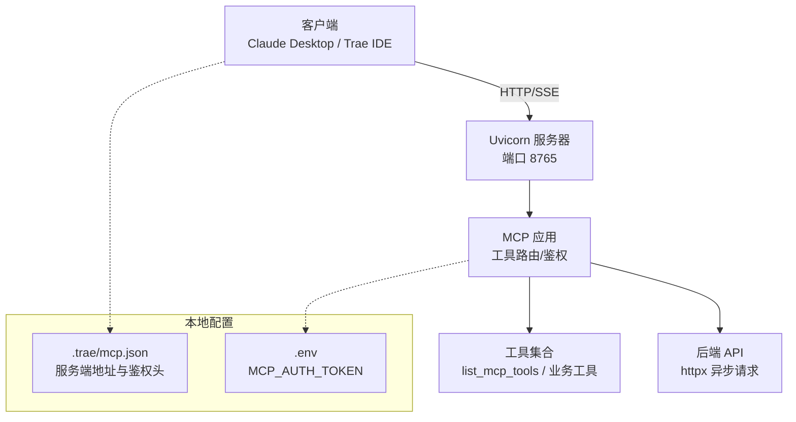
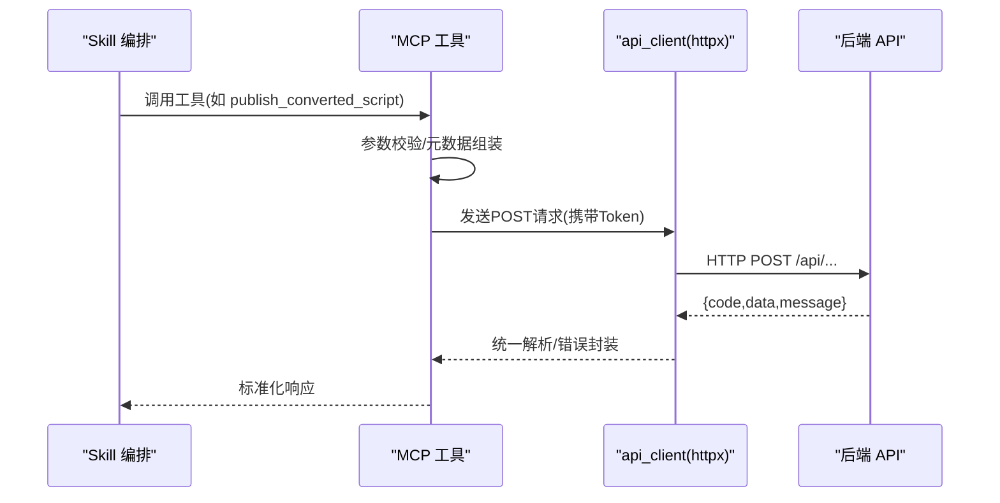
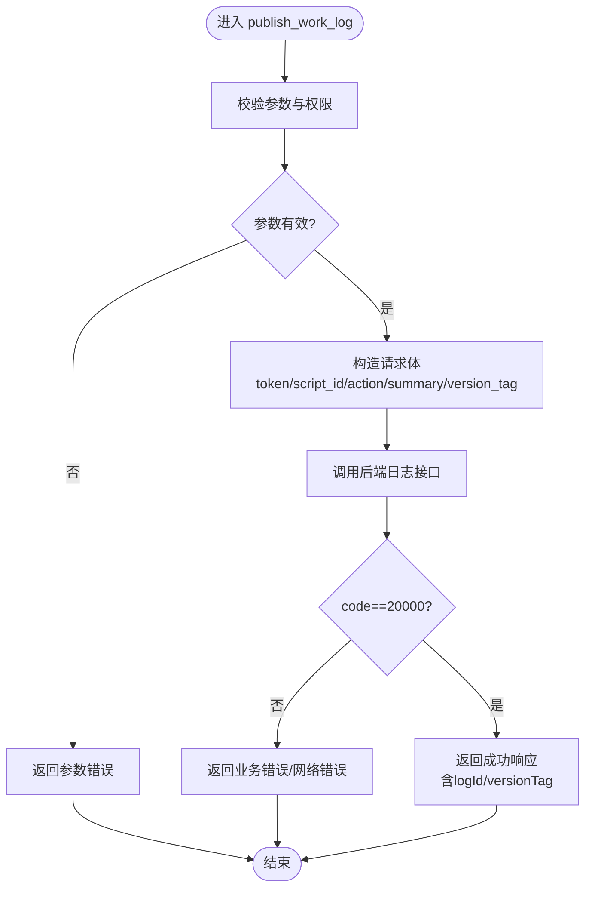
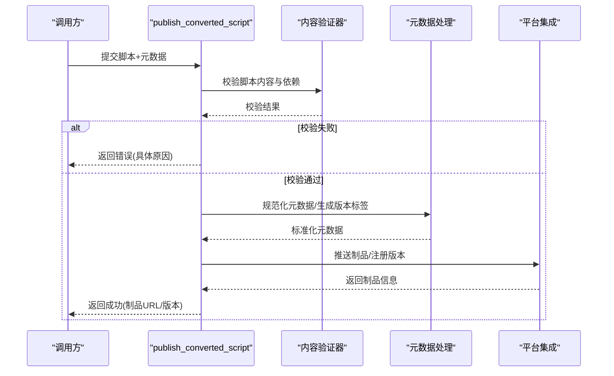
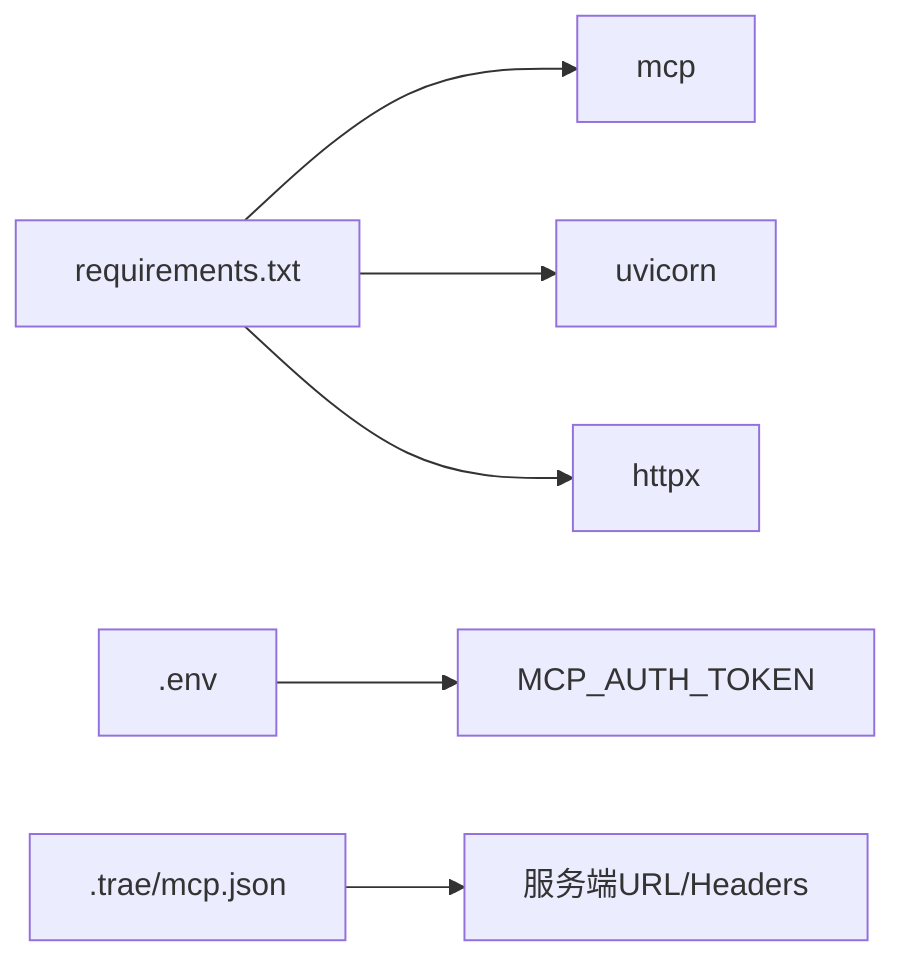

# 脚本发布工具

<cite>
**本文引用的文件**
- [mcp server部署.md](file://mcp server部署.md)
- [规约管理MCP服务化Spec.md](file://规约管理MCP服务化Spec.md)
- [规约管理基础数据模块Spec.md](file://规约管理基础数据模块Spec.md)
- [mcp.json](file://.trae/mcp.json)
</cite>

## 目录
1. [简介](#简介)
2. [项目结构](#项目结构)
3. [核心组件](#核心组件)
4. [架构总览](#架构总览)
5. [详细组件分析](#详细组件分析)
6. [依赖关系分析](#依赖关系分析)
7. [性能考虑](#性能考虑)
8. [故障排查指南](#故障排查指南)
9. [结论](#结论)
10. [附录：API 规范与调用示例](#附录api-规范与调用示例)

## 简介
本文件面向“脚本发布工具”的文档目标，聚焦两个关键工具：
- publish_work_log：工作日志记录（审计追踪、版本管理）
- publish_converted_script：已转换脚本的发布（内容验证、元数据处理、平台集成）

当前仓库中，这两个工具在 MCP Server 改造计划中被明确列为需要删除的桩实现。因此，本文档以“现状说明 + 未来设计建议”的方式组织：先说明现有能力边界与安全/权限模型，再给出符合项目整体架构的工作日志与脚本发布流程设计、API 规范、权限与安全要求、以及完整的调用示例与错误处理方案。

## 项目结构
本项目为基于 MCP（Model Context Protocol）的服务端，使用 Uvicorn 提供 ASGI 服务，并通过 MCP 协议暴露工具（Tools）。部署与启动由 Windows 批处理脚本完成，客户端通过 .trae/mcp.json 配置连接与服务鉴权头。

图表来源
- [mcp server部署.md:165-261](file://mcp server部署.md#L165-L261)
- [mcp server部署.md:285-305](file://mcp server部署.md#L285-L305)
- [mcp server部署.md:415-459](file://mcp server部署.md#L415-L459)
- [.trae/mcp.json:1-1](file://.trae/mcp.json#L1-L1)

章节来源
- [mcp server部署.md:165-261](file://mcp server部署.md#L165-L261)
- [mcp server部署.md:285-305](file://mcp server部署.md#L285-L305)
- [mcp server部署.md:415-459](file://mcp server部署.md#L415-L459)
- [.trae/mcp.json:1-1](file://.trae/mcp.json#L1-L1)

## 核心组件
- MCP 工具层：负责参数校验、调用后端 API、统一错误封装与返回。
- 认证中间件：基于 Token 的访问控制，区分本地与远程访问策略。
- HTTP 客户端：使用 httpx 异步调用后端 API，统一注入 Token 头并处理网络/业务错误。
- 部署脚本：install.bat/start.bat 负责环境初始化、Token 生成与加载、服务启动。

章节来源
- [规约管理MCP服务化Spec.md:79-131](file://规约管理MCP服务化Spec.md#L79-L131)
- [mcp server部署.md:309-380](file://mcp server部署.md#L309-L380)
- [mcp server部署.md:415-459](file://mcp server部署.md#L415-L459)

## 架构总览
MCP 工具作为原子操作对外暴露，Skill 编排业务流程；每个工具内部调用 api_client 进行后端交互，统一错误码与响应格式。

图表来源
- [规约管理MCP服务化Spec.md:56-67](file://规约管理MCP服务化Spec.md#L56-L67)
- [规约管理MCP服务化Spec.md:105-131](file://规约管理MCP服务化Spec.md#L105-L131)

## 详细组件分析

### 组件 A：publish_work_log（工作日志记录）
- 现状：该工具在当前 MCP 改造计划中被标记为删除的桩实现，未接入后端 API。
- 设计建议（与项目架构一致）：
  - 职责：记录每次脚本发布的关键事件（操作人、时间、脚本ID、变更摘要、结果），用于审计追踪与版本回溯。
  - 输入：token、script_id、action、summary、version_tag、extra_meta。
  - 输出：标准响应 { code, message, data }，data 包含 logId/versionTag。
  - 错误处理：网络异常、Token 无效、业务错误码统一封装。
  - 幂等性：同一 version_tag 重复提交应去重或追加版本链。
  - 安全：仅允许具备写权限的用户/角色写入；本地可放宽，远程只读。

图表来源
- [规约管理MCP服务化Spec.md:123-131](file://规约管理MCP服务化Spec.md#L123-L131)

章节来源
- [规约管理MCP服务化Spec.md:247-286](file://规约管理MCP服务化Spec.md#L247-L286)
- [规约管理MCP服务化Spec.md:123-131](file://规约管理MCP服务化Spec.md#L123-L131)

### 组件 B：publish_converted_script（已转换脚本发布）
- 现状：该工具在当前 MCP 改造计划中被标记为删除的桩实现，未接入后端 API。
- 设计建议（与项目架构一致）：
  - 职责：对已转换脚本进行内容验证、元数据处理，并推送到平台（存储/制品库/执行环境）。
  - 输入：token、script_id、content_hash、metadata（名称、版本、作者、描述）、platform_target、config_overrides。
  - 输出：标准响应 { code, message, data }，data 包含发布ID、制品URL、状态。
  - 验证：脚本语法/依赖/资源完整性校验；元数据必填项检查。
  - 幂等：基于 content_hash 去重，避免重复发布相同内容。
  - 回滚：支持按版本回滚到历史制品。
  - 安全：仅允许具备发布权限的角色；限制目标平台范围。

图表来源
- [规约管理MCP服务化Spec.md:105-131](file://规约管理MCP服务化Spec.md#L105-L131)

章节来源
- [规约管理MCP服务化Spec.md:247-286](file://规约管理MCP服务化Spec.md#L247-L286)
- [规约管理MCP服务化Spec.md:123-131](file://规约管理MCP服务化Spec.md#L123-L131)

### 组件 C：MCP 工具与后端 API 集成
- 工具清单：规划中包含登录、大类/设备类型/品牌/型号/规约/数据项/脚本/系数/感知/字典/功能项/导出等工具，全部通过 httpx 异步调用后端 API。
- 统一约定：
  - 所有接口 POST，请求头携带 Token。
  - 统一响应 { code, data, message }，code=20000 表示成功。
  - 分页列表 data.rows 结构。
- 错误处理：网络异常、HTTP 异常、业务错误码、Token 失效统一封装。

章节来源
- [规约管理MCP服务化Spec.md:132-245](file://规约管理MCP服务化Spec.md#L132-L245)
- [规约管理MCP服务化Spec.md:323-336](file://规约管理MCP服务化Spec.md#L323-L336)
- [规约管理MCP服务化Spec.md:123-131](file://规约管理MCP服务化Spec.md#L123-L131)

## 依赖关系分析
- 外部依赖：mcp、uvicorn、httpx。
- 运行时依赖：Python 3.10+，虚拟环境 .venv。
- 配置依赖：.env 中的 MCP_AUTH_TOKEN，.trae/mcp.json 中的服务端地址与鉴权头。

图表来源
- [mcp server部署.md:40-60](file://mcp server部署.md#L40-L60)
- [mcp server部署.md:351-380](file://mcp server部署.md#L351-L380)
- [.trae/mcp.json:1-1](file://.trae/mcp.json#L1-L1)

章节来源
- [mcp server部署.md:40-60](file://mcp server部署.md#L40-L60)
- [mcp server部署.md:351-380](file://mcp server部署.md#L351-L380)
- [.trae/mcp.json:1-1](file://.trae/mcp.json#L1-L1)

## 性能考虑
- 异步 I/O：MCP 工具与 httpx 异步调用避免阻塞事件循环，提升并发能力。
- 连接复用：httpx.AsyncClient 复用连接，减少握手开销。
- 超时与重试：合理设置超时，必要时对幂等 GET 请求增加重试。
- 大对象处理：导出/上传采用流式传输，避免一次性加载大对象到内存。
- 缓存策略：对频繁读取的字典/分类数据可引入短期缓存（注意一致性）。

[本节为通用指导，不直接分析具体文件]

## 故障排查指南
- Python 未安装或版本过低：确保 3.10+ 并加入 PATH。
- 虚拟环境创建失败：检查权限与磁盘空间。
- 依赖安装失败：检查网络或使用国内镜像源。
- 启动时找不到虚拟环境：运行 install.bat 重新创建。
- Token 未配置：运行 install.bat 或手动创建 .env。
- 端口被占用：查找并结束占用进程或修改端口。
- 移动项目后虚拟环境失效：删除旧 .venv 并重新安装。

章节来源
- [mcp server部署.md:505-642](file://mcp server部署.md#L505-L642)

## 结论
- 当前仓库中 publish_work_log 与 publish_converted_script 为待删除的桩工具，尚未实现实际逻辑。
- 建议按照项目既有的 MCP + httpx 架构模式，将工作日志与脚本发布拆分为细粒度工具，统一错误处理与鉴权机制。
- 通过 Skill 编排实现端到端的自动化流程，结合审计追踪与版本管理，满足合规与可追溯需求。

[本节为总结，不直接分析具体文件]

## 附录：API 规范与调用示例

### 通用约定
- 方法：POST
- 请求头：Token（由 MCP api_client 注入）
- 响应结构：{ code, data, message }
- 成功码：code === 20000
- 分页：data.rows 数组，data.total 总数

章节来源
- [规约管理MCP服务化Spec.md:323-336](file://规约管理MCP服务化Spec.md#L323-L336)

### 工具：publish_work_log
- 作用：记录脚本发布相关的工作日志，支持审计追踪与版本管理。
- 参数：
  - token: string（登录后获取）
  - script_id: number（脚本ID）
  - action: string（动作：create/update/publish/rollback）
  - summary: string（变更摘要）
  - version_tag: string（版本标签，建议语义化版本）
  - extra_meta: object（扩展元数据，可选）
- 响应：
  - code: number
  - message: string
  - data: { logId: number, versionTag: string }
- 错误：
  - NETWORK_ERROR：网络异常
  - AUTH_ERROR：Token 无效
  - API_ERROR：业务错误
  - HTTP_ERROR：HTTP 状态异常

调用示例（概念性）
- 步骤：
  1) 调用 login 获取 token
  2) 调用 publish_work_log 记录一次发布动作
  3) 根据返回的 logId/versionTag 进行后续追踪

章节来源
- [规约管理MCP服务化Spec.md:123-131](file://规约管理MCP服务化Spec.md#L123-L131)
- [规约管理MCP服务化Spec.md:295-319](file://规约管理MCP服务化Spec.md#L295-L319)

### 工具：publish_converted_script
- 作用：对已转换脚本进行内容验证、元数据处理，并发布到平台。
- 参数：
  - token: string
  - script_id: number
  - content_hash: string（内容哈希，用于去重）
  - metadata: object（name/version/author/description）
  - platform_target: string（目标平台标识）
  - config_overrides: object（覆盖配置，可选）
- 响应：
  - code: number
  - message: string
  - data: { publishId: number, artifactUrl: string, status: string }
- 错误：
  - VALIDATION_ERROR：内容或元数据校验失败
  - UPLOAD_ERROR：平台上传失败
  - AUTH_ERROR：Token 无效
  - API_ERROR：业务错误

调用示例（概念性）
- 步骤：
  1) 调用 login 获取 token
  2) 计算脚本 content_hash
  3) 调用 publish_converted_script 提交发布
  4) 根据返回的 publishId/artifactUrl 进行下载或部署

章节来源
- [规约管理MCP服务化Spec.md:123-131](file://规约管理MCP服务化Spec.md#L123-L131)
- [规约管理MCP服务化Spec.md:295-319](file://规约管理MCP服务化Spec.md#L295-L319)

### 权限与安全
- 本地访问（localhost）：系统级权限（读/写）
- 远程访问：用户级权限（只读）
- 其他用户：自动分配 Token，通过访问页面获取
- 生产建议：
  - 更换更强认证（OAuth2/JWT）
  - 启用 HTTPS
  - 多进程模式（Gunicorn + Uvicorn）
  - 日志审计与访问来源限制

章节来源
- [mcp server部署.md:645-674](file://mcp server部署.md#L645-L674)

### 完整调用流程（Skill 视角）
- 登录：login(phoneNum, code) → 返回 token
- 查询：get_brand_list(token, deviceTypeId) → 检查是否存在
- 新增：add_brand(token, nameCN, name, code, deviceTypeId) → 成功
- 生成脚本：gen_script(token, ...) → 生成脚本文件
- 发布：publish_converted_script(token, ...) → 发布制品
- 记录日志：publish_work_log(token, ...) → 记录审计

章节来源
- [规约管理MCP服务化Spec.md:295-319](file://规约管理MCP服务化Spec.md#L295-L319)