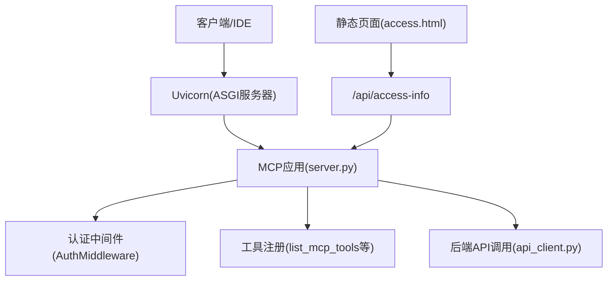
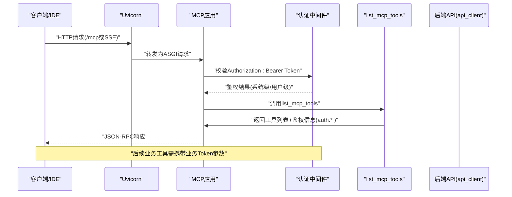
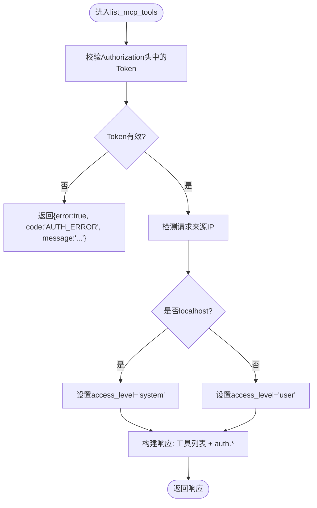
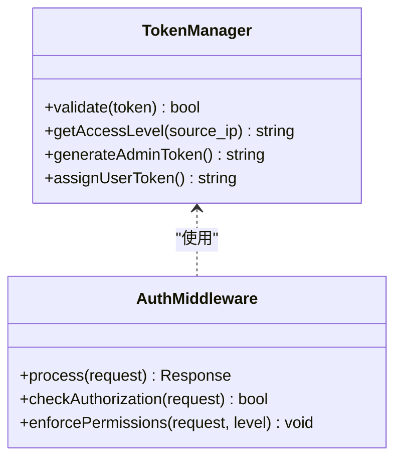
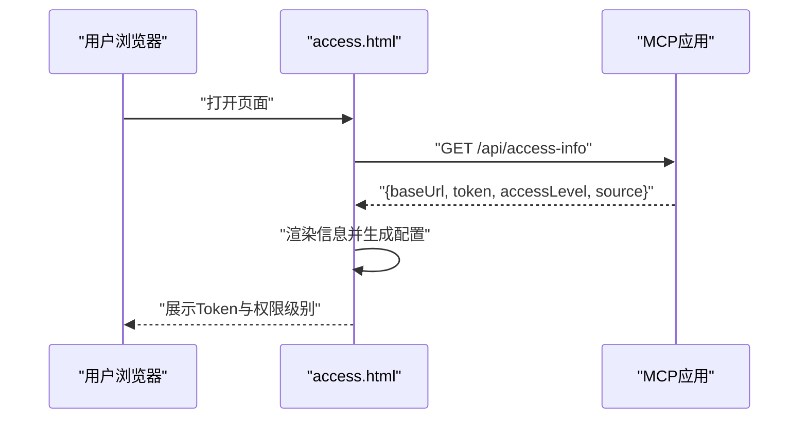
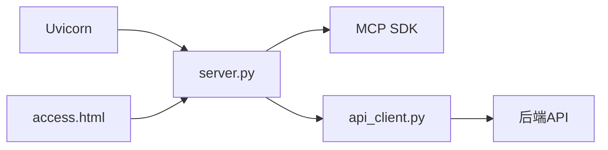

# 认证工具

<cite>
**本文引用的文件**
- [mcp server部署.md](file://mcp server部署.md)
- [规约管理MCP服务化Spec.md](file://规约管理MCP服务化Spec.md)
- [access.html](file://mcp_server/static/access.html)
- [install.bat](file://mcp_server/install.bat)
- [start.bat](file://mcp_server/start.bat)
</cite>

## 目录
1. [简介](#简介)
2. [项目结构](#项目结构)
3. [核心组件](#核心组件)
4. [架构总览](#架构总览)
5. [详细组件分析](#详细组件分析)
6. [依赖关系分析](#依赖关系分析)
7. [性能与安全考虑](#性能与安全考虑)
8. [故障排查指南](#故障排查指南)
9. [结论](#结论)
10. [附录：API 规范与调用示例](#附录api-规范与调用示例)

## 简介
本文件聚焦于 MCP 服务器的“认证工具”能力，重点说明 list_mcp_tools 工具的完整实现与作用、Token 管理机制（管理员 Token 与用户 Token）、localhost 与非 localhost 访问的权限差异（system vs user），并提供完整的 API 规范、错误处理策略以及实际调用示例。该文档基于仓库中的部署说明、规格文档与接入页面进行整理，确保读者在不深入源码的情况下也能理解并正确使用认证与鉴权流程。

## 项目结构
当前仓库中与认证和工具探测相关的核心内容分布在以下位置：
- 部署与启动脚本：负责环境初始化、Token 生成与加载、服务启动
- 接入页面：提供自动检测 IP、分配临时 Token、生成接入配置的能力
- 规格文档：定义工具清单、鉴权方式、权限模型与后端 API 约定
- 部署文档：解释 MCP/Uvicorn 工作原理、常见问题与安全建议

图表来源
- [mcp server部署.md:110-260](file://mcp server部署.md#L110-L260)
- [规约管理MCP服务化Spec.md:44-66](file://规约管理MCP服务化Spec.md#L44-L66)
- [access.html:401-417](file://mcp_server/static/access.html#L401-L417)

章节来源
- [mcp server部署.md:25-125](file://mcp server部署.md#L25-L125)
- [规约管理MCP服务化Spec.md:44-66](file://规约管理MCP服务化Spec.md#L44-L66)

## 核心组件
- 认证中间件与 Token 管理
  - 通过环境变量 MCP_AUTH_TOKEN 注入管理员 Token，用于本地系统级访问
  - 非 localhost 访问时，通过接入页面 /api/access-info 获取临时用户 Token
  - 权限级别由访问来源决定：localhost → system（读写），其他 IP → user（只读）
- 工具探测与鉴权探测
  - list_mcp_tools 不仅列出可用工具，还返回鉴权状态（auth.token_valid、auth.access_level、auth.source）
  - 作为 Skill 安装后的连通性与鉴权验证入口
- 接入页面与临时 Token
  - access.html 自动检测服务器地址与来源 IP，分配临时 Token，并生成各 IDE 的配置文本
  - 支持复制与下载 Markdown 文档，便于分发与接入

章节来源
- [mcp server部署.md:645-674](file://mcp server部署.md#L645-L674)
- [规约管理MCP服务化Spec.md:132-140](file://规约管理MCP服务化Spec.md#L132-L140)
- [access.html:263-282](file://mcp_server/static/access.html#L263-L282)
- [access.html:419-443](file://mcp_server/static/access.html#L419-L443)

## 架构总览
下图展示了从客户端到后端 API 的完整调用链路，包括认证中间件、工具路由、后端 API 封装与响应处理。

图表来源
- [mcp server部署.md:163-260](file://mcp server部署.md#L163-L260)
- [规约管理MCP服务化Spec.md:74-78](file://规约管理MCP服务化Spec.md#L74-L78)

## 详细组件分析

### list_mcp_tools 工具（鉴权探测机制）
- 作用
  - 列出所有可用工具，供 Skill 或客户端发现
  - 返回鉴权探测字段：auth.token_valid、auth.access_level、auth.source
  - 作为安装后连接与鉴权的验证入口
- 行为要点
  - 不执行写操作，仅探测与列举
  - 根据访问来源判断权限级别：localhost 为 system，其他为 user
  - 若 Token 无效或未提供，返回 token_valid=false 并提示重新登录或检查配置

图表来源
- [规约管理MCP服务化Spec.md:132-140](file://规约管理MCP服务化Spec.md#L132-L140)
- [mcp server部署.md:655-664](file://mcp server部署.md#L655-L664)

章节来源
- [规约管理MCP服务化Spec.md:132-140](file://规约管理MCP服务化Spec.md#L132-L140)
- [mcp server部署.md:655-664](file://mcp server部署.md#L655-L664)

### Token 管理机制（管理员 Token 与用户 Token）
- 管理员 Token
  - 通过 install.bat 生成或手动输入，写入 mcp_server/.env 的 MCP_AUTH_TOKEN
  - 用于本地开发环境与系统级访问（localhost）
  - 格式示例：metam_pat_ + 随机十六进制字符串
- 用户 Token
  - 通过 access.html 的 /api/access-info 接口自动分配临时 Token
  - 用于非 localhost 访问，权限为只读（user）
  - 临时 Token 明文展示在页面中，便于一键复制与分发
- 权限控制
  - localhost 访问 → system（读写）
  - 其他 IP 访问 → user（只读）
  - 写入类工具对普通用户返回 FORBIDDEN

图表来源
- [mcp server部署.md:645-674](file://mcp server部署.md#L645-L674)
- [规约管理MCP服务化Spec.md:74-78](file://规约管理MCP服务化Spec.md#L74-L78)

章节来源
- [mcp server部署.md:645-674](file://mcp server部署.md#L645-L674)
- [install.bat:52-72](file://mcp_server/install.bat#L52-L72)
- [access.html:263-282](file://mcp_server/static/access.html#L263-L282)

### 权限差异：localhost vs 非 localhost
- localhost（系统级）
  - 可调用读写工具
  - 适合本地开发与调试
- 非 localhost（用户级）
  - 仅允许只读操作
  - 写入操作将返回权限不足
- 接入页面会显示权限级别与来源 IP，便于确认当前会话权限

章节来源
- [mcp server部署.md:655-664](file://mcp server部署.md#L655-L664)
- [access.html:419-443](file://mcp_server/static/access.html#L419-L443)

### 接入页面与临时 Token 流程
- 打开 access.html，自动检测服务器地址与来源 IP
- 调用 /api/access-info 获取 baseUrl、token、accessLevel、source
- 选择目标平台（Trae/Cursor/VS Code/Claude/Windsurf/Cline/Kimi），生成对应配置
- 支持复制到剪贴板或下载 Markdown，便于分发与接入

图表来源
- [access.html:401-417](file://mcp_server/static/access.html#L401-L417)
- [access.html:419-443](file://mcp_server/static/access.html#L419-L443)

章节来源
- [access.html:401-417](file://mcp_server/static/access.html#L401-L417)
- [access.html:419-443](file://mcp_server/static/access.html#L419-L443)

## 依赖关系分析
- 运行时依赖
  - Uvicorn：ASGI 服务器，处理 HTTP/SSE
  - MCP SDK：工具注册、协议解析、JSON-RPC 处理
- 模块依赖
  - server.py：工具注册与 ASGI 路由
  - api_client.py：后端 API 调用封装（httpx 异步）
  - access.html：静态页面，提供接入信息与配置生成
- 外部依赖
  - 后端 API：统一 Token 请求头，code=20000 表示成功

图表来源
- [mcp server部署.md:110-125](file://mcp server部署.md#L110-L125)
- [规约管理MCP服务化Spec.md:44-66](file://规约管理MCP服务化Spec.md#L44-L66)

章节来源
- [mcp server部署.md:110-125](file://mcp server部署.md#L110-L125)
- [规约管理MCP服务化Spec.md:44-66](file://规约管理MCP服务化Spec.md#L44-L66)

## 性能与安全考虑
- 性能
  - 使用 httpx 异步客户端避免阻塞事件循环
  - Uvicorn 高并发处理，适合 I/O 密集型任务
- 安全
  - Token 明文存储在 .env，仅限本地开发；生产环境建议使用更强认证机制
  - 启用 HTTPS、限制访问来源、添加日志审计
  - 临时 Token 不要提交仓库或写入日志

章节来源
- [mcp server部署.md:665-674](file://mcp server部署.md#L665-L674)
- [规约管理MCP服务化Spec.md:123-131](file://规约管理MCP服务化Spec.md#L123-L131)

## 故障排查指南
- Python 未安装或版本过低
  - 解决方案：安装 Python 3.10+，并确保加入 PATH
- 虚拟环境创建失败
  - 可能原因：Python 版本过低、权限不足、磁盘空间不足
- 依赖安装失败
  - 可能原因：网络问题、pip 版本过低；可使用国内镜像源
- 启动时找不到虚拟环境
  - 解决方案：运行 install.bat 创建虚拟环境
- Token 未配置
  - 解决方案：运行 install.bat 生成 Token，或手动创建 .env
- 端口被占用
  - 解决方案：查找并结束占用进程，或修改端口号

章节来源
- [mcp server部署.md:505-632](file://mcp server部署.md#L505-L632)

## 结论
list_mcp_tools 作为 MCP 服务的探测与鉴权入口，既能列出可用工具，又能返回鉴权状态与权限级别，帮助 Skill 快速验证连接与权限。Token 管理分为管理员 Token（系统级）与用户 Token（临时、只读），并通过访问来源区分权限。配合接入页面，可实现一键生成配置与分发，提升集成效率。生产环境应加强认证、加密与审计措施。

## 附录：API 规范与调用示例

### 通用约定
- 所有后端接口为 POST
- 请求头携带 Token（由 api_client 统一注入）
- 统一响应结构：{ code: number, data: object, message: string }
- code=20000 表示成功；code=40100 表示登录失效；code=40000 表示业务异常

章节来源
- [规约管理MCP服务化Spec.md:327-335](file://规约管理MCP服务化Spec.md#L327-L335)

### list_mcp_tools 调用示例
- 请求
  - 方法：POST（通过 MCP JSON-RPC）
  - 路径：/mcp
  - 头部：Authorization: Bearer <Token>
  - 参数：无
- 响应
  - tools：工具列表
  - auth：
    - token_valid：Token 是否有效
    - access_level："system" 或 "user"
    - source：请求来源 IP
- 错误处理
  - 网络异常：{ error: true, code: "NETWORK_ERROR", message: "..." }
  - 后端非 20000：{ error: true, code: "API_ERROR", message: "...", raw: {...} }
  - Token 无效/过期：{ error: true, code: "AUTH_ERROR", message: "Token无效，请重新登录" }
  - HTTP 状态码异常：{ error: true, code: "HTTP_ERROR", message: "..." }

章节来源
- [规约管理MCP服务化Spec.md:123-131](file://规约管理MCP服务化Spec.md#L123-L131)
- [access.html:487-492](file://mcp_server/static/access.html#L487-L492)

### 接入页面 /api/access-info 调用示例
- 请求
  - 方法：GET
  - 路径：/api/access-info
- 响应
  - baseUrl：服务器地址
  - token：临时用户 Token
  - accessLevel：权限级别（system/user）
  - source：来源 IP
- 用途
  - 前端渲染接入信息，生成各 IDE 的配置文本

章节来源
- [access.html:401-417](file://mcp_server/static/access.html#L401-L417)
- [access.html:419-443](file://mcp_server/static/access.html#L419-L443)

### 管理员 Token 生成与加载
- 生成
  - 通过 install.bat 自动生成或手动输入，写入 mcp_server/.env 的 MCP_AUTH_TOKEN
- 加载
  - start.bat 读取 .env 中的 MCP_AUTH_TOKEN，并打印启动信息
- 注意
  - 仅用于本地开发；生产环境建议更换认证方式

章节来源
- [install.bat:52-72](file://mcp_server/install.bat#L52-L72)
- [start.bat:15-27](file://mcp_server/start.bat#L15-L27)
- [mcp server部署.md:351-363](file://mcp server部署.md#L351-L363)