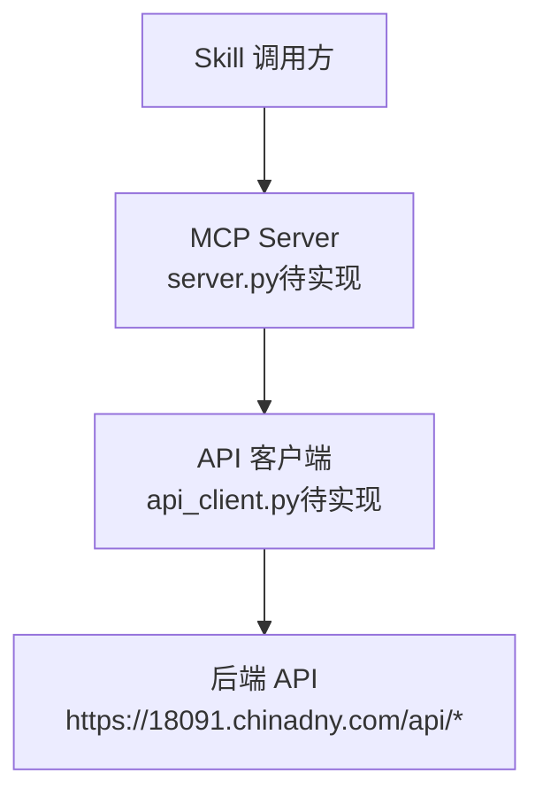
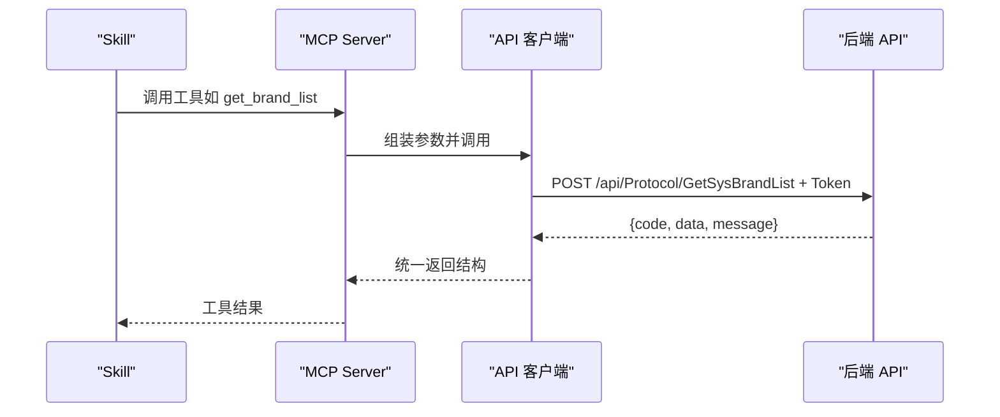
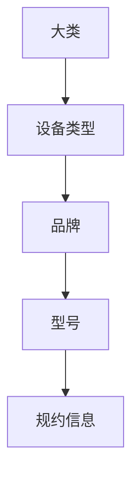
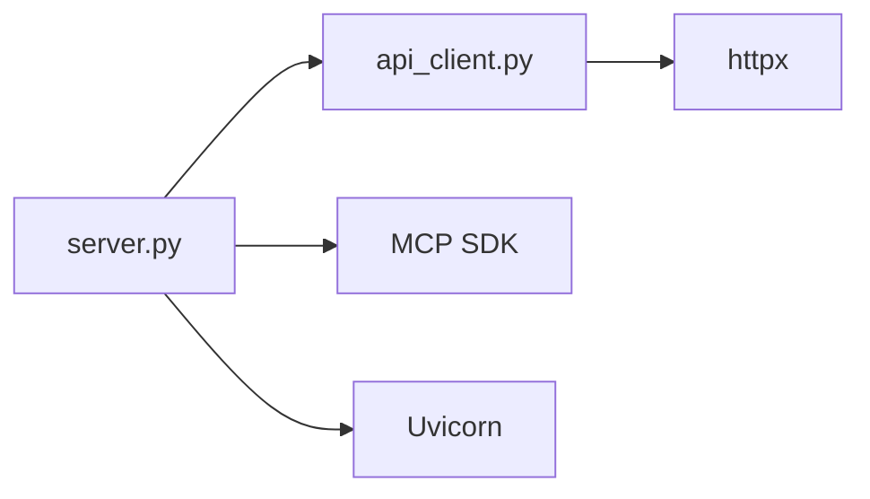

# 设备管理工具

<cite>
**本文引用的文件**
- [规约管理MCP服务化Spec.md](file://规约管理MCP服务化Spec.md)
- [规约管理基础数据模块Spec.md](file://规约管理基础数据模块Spec.md)
- [mcp server部署.md](file://mcp server部署.md)
- [tasks.md](file://openspec/changes/enhance-modbus-mcp-workflow/tasks.md)
- [proposal.md](file://openspec/changes/enhance-modbus-mcp-workflow/proposal.md)
</cite>

## 目录
1. [简介](#简介)
2. [项目结构](#项目结构)
3. [核心组件](#核心组件)
4. [架构总览](#架构总览)
5. [详细组件分析](#详细组件分析)
6. [依赖关系分析](#依赖关系分析)
7. [性能考虑](#性能考虑)
8. [故障排查指南](#故障排查指南)
9. [结论](#结论)
10. [附录](#附录)

## 简介
本文件聚焦“设备管理工具”的文档，覆盖以下目标：
- 说明当前仓库中相关工具的实现状态与计划（特别是 query_device_classes、add_device_class、check_script_exists）。
- 梳理设备类管理的业务逻辑与四级分类层级关系（大类→设备类型→品牌→型号→规约信息）。
- 给出完整的 API 规范与使用示例（以 MCP 原子工具为粒度）。
- 明确写入操作的权限要求与错误处理机制。
- 提供工具状态说明（implemented vs stub）与开发计划。

## 项目结构
本项目是一个基于 MCP 协议的服务端工程，用于将运维平台后端 API 封装为细粒度的 MCP 工具，供 Skill 编排调用。当前仓库包含：
- 规划与设计文档：规约管理 MCP 服务化 Spec、基础数据模块 Spec、MODBUS Skill 增强任务与提案。
- 部署与运行说明：MCP Server 部署文档。
- 运行时目录：mcp_server（包含启动脚本、静态页面等）。

图表来源
- [规约管理MCP服务化Spec.md:44-78](file://规约管理MCP服务化Spec.md#L44-L78)

章节来源
- [mcp server部署.md:25-35](file://mcp server部署.md#L25-L35)
- [规约管理MCP服务化Spec.md:44-78](file://规约管理MCP服务化Spec.md#L44-L78)

## 核心组件
- MCP 工具层（server.py）：负责注册工具、参数校验、调用 api_client。
- API 客户端层（api_client.py）：统一构造请求头、发送异步 HTTP 请求、统一错误归一化。
- 后端 API：运维平台提供的 RESTful API，采用自定义 Token 鉴权，成功码 20000。

当前状态
- server.py 与 api_client.py 尚未在仓库中落地，属于“待实施”范围。
- 现有仓库仅包含规划文档与部署说明，未包含实际 Python 源码。

章节来源
- [规约管理MCP服务化Spec.md:44-78](file://规约管理MCP服务化Spec.md#L44-L78)
- [mcp server部署.md:25-35](file://mcp server部署.md#L25-L35)

## 架构总览
MCP 工具通过 httpx 异步调用后端 API，遵循统一的错误处理策略；Skill 侧通过 MCP 工具编排完成设备类管理流程。

图表来源
- [规约管理MCP服务化Spec.md:56-78](file://规约管理MCP服务化Spec.md#L56-L78)

## 详细组件分析

### 设备类管理工具现状与状态
- 当前仓库中的 server.py 存在 6 个桩工具，仅返回 not_implemented，未调用任何后端 API。
- 根据规划，这些桩工具将被删除，替换为真实实现的 MCP 原子工具。

涉及工具
- query_device_classes：桩工具，当前返回 not_implemented；规划中删除。
- add_device_class：桩工具，当前返回 not_implemented；规划中删除。
- check_script_exists：桩工具，当前返回 not_implemented；规划中删除。

章节来源
- [规约管理MCP服务化Spec.md:18-18](file://规约管理MCP服务化Spec.md#L18-L18)
- [规约管理MCP服务化Spec.md:247-254](file://规约管理MCP服务化Spec.md#L247-L254)

### 设备类管理业务逻辑与四级分类
设备类管理遵循四级分类层级：
- 大类（Classification）
- 设备类型（DeviceType）
- 品牌（Brand）
- 型号（Model）
- 规约信息（Protocol）

每一级既独立管理自身 CRUD，又作为下一级的下拉数据源。最终消费页面汇聚四级分类与规约类型，并提供数据项配置、脚本生成、感知结构生成等功能。

图表来源
- [规约管理基础数据模块Spec.md:9-15](file://规约管理基础数据模块Spec.md#L9-L15)

章节来源
- [规约管理基础数据模块Spec.md:9-15](file://规约管理基础数据模块Spec.md#L9-L15)

### 品牌管理工具（get_brand_list / add_brand / update_brand / del_brand）
- 只读工具：get_brand_list
  - 作用：查询品牌列表，支持按中文名称、编码、设备类型ID筛选与分页。
  - 典型响应：data.rows 中包含 id、nameCN、name、code、deviceTypeId、deviceTypeName。
- 写入工具：add_brand、update_brand、del_brand
  - 作用：新增、更新、删除品牌记录。
  - 权限：标记为 write，需系统级用户或具备相应权限。

章节来源
- [规约管理MCP服务化Spec.md:159-175](file://规约管理MCP服务化Spec.md#L159-L175)
- [规约管理MCP服务化Spec.md:490-567](file://规约管理MCP服务化Spec.md#L490-L567)

### 型号管理工具（get_model_list / add_model / update_model / del_model）
- 只读工具：get_model_list
  - 作用：查询型号列表，支持按名称、品牌ID筛选与分页。
  - 典型响应：data.rows 中包含 id、name、brandId、brandName。
- 写入工具：add_model、update_model、del_model
  - 作用：新增、更新、删除型号记录。
  - 权限：标记为 write，需系统级用户或具备相应权限。

章节来源
- [规约管理MCP服务化Spec.md:168-175](file://规约管理MCP服务化Spec.md#L168-L175)
- [规约管理MCP服务化Spec.md:568-636](file://规约管理MCP服务化Spec.md#L568-L636)

### 脚本相关工具（gen_script / get_script_list / get_json_detail / del_script）
- 只读工具：get_script_list、get_json_detail
  - 作用：查询脚本列表、获取 JSON 详情。
- 写入工具：gen_script、del_script
  - 作用：生成脚本、删除脚本。
  - 权限：标记为 write，需系统级用户或具备相应权限。

章节来源
- [规约管理MCP服务化Spec.md:196-203](file://规约管理MCP服务化Spec.md#L196-L203)

### 登录与探测工具（list_mcp_tools / login）
- list_mcp_tools：探测工具，列出所有可用工具及鉴权探测能力。
- login：登录工具，手机号+验证码登录，返回 Token 供后续工具调用。

章节来源
- [规约管理MCP服务化Spec.md:134-139](file://规约管理MCP服务化Spec.md#L134-L139)

### 权限与写入保护
- 所有写入类工具标记为 write，包括 add_*、update_*、del_*、save_*、upload_protocol_file、gen_script。
- 普通用户调用任一写入工具应返回 FORBIDDEN；系统级用户可调用但仅返回后端实际结果，不在服务端自动重试。
- 查询工具在普通用户和系统级用户下均可调用，且失败不应伪装为空结果。

章节来源
- [tasks.md:9-14](file://openspec/changes/enhance-modbus-mcp-workflow/tasks.md#L9-L14)
- [规约管理MCP服务化Spec.md:247-254](file://规约管理MCP服务化Spec.md#L247-L254)

### 错误处理机制
- 网络异常：返回 { error: True, code: "NETWORK_ERROR", message: "..." }
- 后端非 20000：返回 { error: True, code: "API_ERROR", message: "...", raw: {...} }
- Token 无效/过期：返回 { error: True, code: "AUTH_ERROR", message: "Token无效，请重新登录" }
- HTTP 状态码异常：返回 { error: True, code: "HTTP_ERROR", message: "..." }

章节来源
- [规约管理MCP服务化Spec.md:123-131](file://规约管理MCP服务化Spec.md#L123-L131)

### 完整 API 规范与使用示例
以下为关键工具的 API 规格摘要（请求参数、必填字段、响应结构要点）：

- 查询品牌列表（get_brand_list）
  - 方法：POST
  - 路径：/api/Protocol/GetSysBrandList
  - 请求参数：nameCN（否）、code（否）、deviceTypeId（否）、pageIndex（是）、pageSize（是）
  - 响应：data.rows 包含品牌条目

- 新增品牌（add_brand）
  - 方法：POST
  - 路径：/api/Protocol/AddSysBrand
  - 请求参数：nameCN（是）、name（是）、code（是）、deviceTypeId（是）
  - 响应：标准 { code, message }

- 查询型号列表（get_model_list）
  - 方法：POST
  - 路径：/api/Protocol/GetProtocolModelList
  - 请求参数：name（否）、brandId（否）、pageIndex（是）、pageSize（是）
  - 响应：data.rows 包含型号条目

- 新增型号（add_model）
  - 方法：POST
  - 路径：/api/Protocol/AddProtocolModel
  - 请求参数：name（是）、brandId（是）
  - 响应：标准 { code, message }

- 查询脚本列表（get_script_list）
  - 方法：POST
  - 路径：/api/Protocol/GetDataScriptList
  - 请求参数：protocolId（是）、protoType（是）
  - 响应：data.rows 包含脚本条目

- 生成脚本（gen_script）
  - 方法：POST
  - 路径：/api/ProtocolDataItem/GenDataScript
  - 请求参数：依据具体业务字段（由 Skill 编排决定）
  - 响应：标准 { code, message }

- 登录（login）
  - 方法：POST
  - 路径：/api/Auth/LoginByCode
  - 请求参数：phoneNum（是）、code（是）
  - 响应：{ token, user }

章节来源
- [规约管理MCP服务化Spec.md:134-203](file://规约管理MCP服务化Spec.md#L134-L203)
- [规约管理MCP服务化Spec.md:490-636](file://规约管理MCP服务化Spec.md#L490-L636)
- [规约管理MCP服务化Spec.md:769-800](file://规约管理MCP服务化Spec.md#L769-L800)

### 工具状态说明与开发计划
- 当前状态
  - 桩工具：query_device_classes、add_device_class、check_script_exists 均处于 stub/not_implemented 状态。
  - 规划变更：删除上述桩工具，替换为真实 MCP 原子工具。
- 开发计划
  - 新增 api_client.py，实现异步 HTTP 请求、Token 注入、超时与错误归一化。
  - 在 server.py 注册 47 个 async 工具函数（除 list_mcp_tools 外），每个工具模式为参数校验后调用 api_client。
  - 将所有写入类工具标记为 write，接入系统级权限检查。
  - 保留 list_mcp_tools、TokenManager、AuthMiddleware、CompositeApp、ASGI 鉴权中间件、接入页面路由、Skills 下载路由。

章节来源
- [规约管理MCP服务化Spec.md:247-285](file://规约管理MCP服务化Spec.md#L247-L285)
- [tasks.md:1-14](file://openspec/changes/enhance-modbus-mcp-workflow/tasks.md#L1-L14)

## 依赖关系分析
- 外部依赖
  - httpx>=0.27.0：用于异步 HTTP 请求。
  - mcp>=1.0.0,<2.0.0：MCP SDK。
  - uvicorn>=0.30.0：ASGI 服务器。
- 内部依赖
  - server.py 依赖 api_client.py。
  - api_client.py 依赖 httpx。

图表来源
- [规约管理MCP服务化Spec.md:287-293](file://规约管理MCP服务化Spec.md#L287-L293)
- [mcp server部署.md:40-55](file://mcp server部署.md#L40-L55)

章节来源
- [规约管理MCP服务化Spec.md:287-293](file://规约管理MCP服务化Spec.md#L287-L293)
- [mcp server部署.md:40-55](file://mcp server部署.md#L40-L55)

## 性能考虑
- 使用 httpx 异步客户端，避免阻塞事件循环。
- 设置合理超时（默认 30s），防止长连接占用资源。
- 统一错误处理，减少重复逻辑与异常分支开销。
- 工具粒度细化，错误隔离，便于定位与优化。

[本节为通用指导，不直接分析具体文件]

## 故障排查指南
- 常见问题
  - Python 未安装或版本过低：确保 3.10+。
  - 虚拟环境创建失败：检查权限与磁盘空间。
  - 依赖安装失败：检查网络或使用国内镜像。
  - 启动时找不到虚拟环境：先运行 install.bat。
  - Token 未配置：运行 install.bat 或手动创建 .env。
  - 端口被占用：查找并结束占用进程或修改端口。
- 权限问题
  - 普通用户调用写入工具返回 FORBIDDEN。
  - 系统级用户调用写入工具仅返回后端实际结果，不自动重试。
- 网络与认证
  - Token 无效/过期：提示重新登录。
  - 后端非 20000：返回 API_ERROR 并附带原始响应。

章节来源
- [mcp server部署.md:505-631](file://mcp server部署.md#L505-L631)
- [规约管理MCP服务化Spec.md:123-131](file://规约管理MCP服务化Spec.md#L123-L131)
- [tasks.md:9-14](file://openspec/changes/enhance-modbus-mcp-workflow/tasks.md#L9-L14)

## 结论
- 当前仓库中设备管理类工具（query_device_classes、add_device_class、check_script_exists）均为桩实现，计划删除并替换为真实 MCP 原子工具。
- 设备类管理遵循四级分类层级，品牌、型号、规约信息逐级关联。
- 规划明确了 API 规范、权限控制、错误处理与开发步骤，为后续实施提供清晰指引。
- 建议优先完成 api_client.py 与 server.py 的工具注册，确保写入操作受权限保护，查询失败不伪装为空结果。

[本节为总结性内容，不直接分析具体文件]

## 附录
- 典型调用流程（Skill 视角）
  - 登录获取 Token。
  - 查询品牌/型号/脚本等只读工具。
  - 执行写入工具（新增品牌/型号/规约、生成脚本）。
  - 展示返回值，不自动重试。

章节来源
- [规约管理MCP服务化Spec.md:295-319](file://规约管理MCP服务化Spec.md#L295-L319)