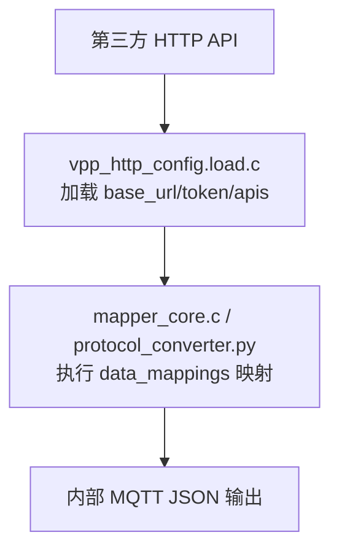
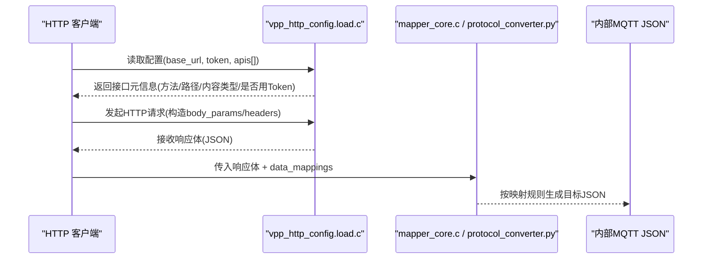
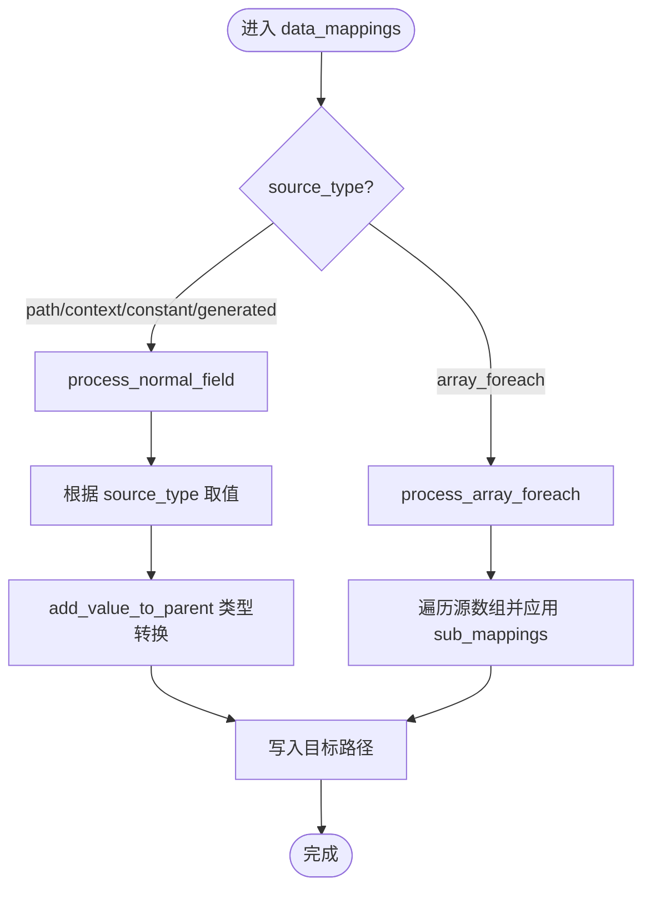
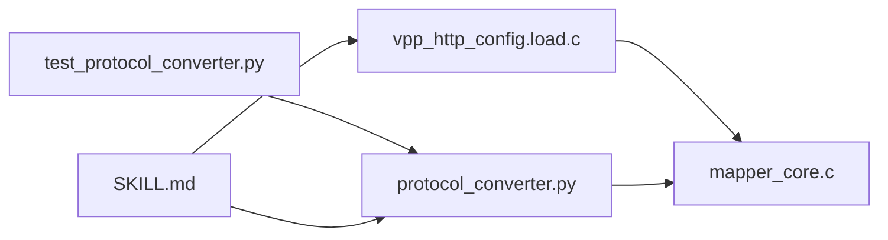

# HTTP 协议转换

<cite>
**本文引用的文件**
- [SKILL.md](file://.trae/skills/http-conversion/SKILL.md)
- [protocol_mapping_output_20260826_110500.json](file://.trae/skills/http-conversion/scripts/protocol_mapping_output_20260826_110500.json)
- [protocol_converter.py](file://.trae/skills/protocol-conversion/scripts/protocol_converter.py)
- [mapper_core.c](file://.trae/skills/protocol-conversion/scripts/mapper_core.c)
- [build_pack.py](file://.trae/skills/protocol-conversion/scripts/build_pack.py)
- [test_protocol_converter.py](file://.trae/skills/protocol-conversion/scripts/test_protocol_converter.py)
</cite>

## 目录
1. [简介](#简介)
2. [项目结构](#项目结构)
3. [核心组件](#核心组件)
4. [架构总览](#架构总览)
5. [详细组件分析](#详细组件分析)
6. [依赖关系分析](#依赖关系分析)
7. [性能与优化建议](#性能与优化建议)
8. [故障排查指南](#故障排查指南)
9. [结论](#结论)
10. [附录：配置字段规范与示例](#附录：配置字段规范与示例)

## 简介
本技术文档面向“HTTP 到目标协议（内部 MQTT JSON）”的协议转换，聚焦以下目标：
- 明确 HTTP 配置文件格式规范（base_url、token{}、apis[] 等字段的定义与用法）。
- 解释从 HTTP 请求构建、响应解析到数据映射的完整流程。
- 提供可复用的配置示例（RESTful API、认证处理、数据转换）。
- 说明与共享映射核心的集成方式及规则复用。
- 给出错误处理与重试机制的配置建议，以及性能优化与最佳实践。

## 项目结构
该仓库围绕“协议转换”能力组织，HTTP 转换相关的关键位置如下：
- http-conversion SKILL：描述 HTTP 配置格式、工作流程、校验规则与示例。
- protocol-conversion 共享核心：提供统一的映射引擎（Python 镜像与 C 实现），被 HTTP/MQTT 共用。
- scripts：包含已生成的 HTTP 配置样例与测试脚本。

图表来源
- [SKILL.md:23-31](file://.trae/skills/http-conversion/SKILL.md#L23-L31)
- [build_pack.py:279-286](file://.trae/skills/protocol-conversion/scripts/build_pack.py#L279-L286)

章节来源
- [SKILL.md:23-31](file://.trae/skills/http-conversion/SKILL.md#L23-L31)
- [build_pack.py:134-152](file://.trae/skills/protocol-conversion/scripts/build_pack.py#L134-L152)

## 核心组件
- 配置加载层（HTTP 特有）：读取并解析 base_url、timeout、domain、token、apis[]。
- 映射执行层（共享核心）：统一的路径取值、类型转换、数组遍历、生成器、模板替换等。
- 工具与验证：Python 镜像用于本地测试；C 实现用于生产运行。

章节来源
- [SKILL.md:33-87](file://.trae/skills/http-conversion/SKILL.md#L33-L87)
- [protocol_converter.py:32-45](file://.trae/skills/protocol-conversion/scripts/protocol_converter.py#L32-L45)
- [mapper_core.c:90-135](file://.trae/skills/protocol-conversion/scripts/mapper_core.c#L90-L135)

## 架构总览
HTTP 协议转换的整体调用链：
- vpp_http_config.load.c 负责加载 HTTP 配置（base_url/token/apis）。
- mapper_core.c（或 Python 镜像 protocol_converter.py）负责执行 data_mappings 映射。
- 最终产出内部 MQTT JSON 结构。

图表来源
- [SKILL.md:23-31](file://.trae/skills/http-conversion/SKILL.md#L23-L31)
- [protocol_converter.py:569-601](file://.trae/skills/protocol-conversion/scripts/protocol_converter.py#L569-L601)

## 详细组件分析

### 配置加载与 Token 管理（HTTP 特有）
- 根对象字段：
  - base_url：基础 URL（含 API 前缀）。
  - timeout：请求超时毫秒（默认值见文档）。
  - domain：从 base_url 提取的主机名（IPv4 填 IP，否则空串）。
  - token：可选，登录路径、方法、内容类型、token 路径、Header 名称、有效期、登录参数。
  - apis[]：API 列表，每个 API 包含 name/method/path/content_type/use_token/interval* 扩展字段/body_params/data_mappings 等。
- Token 流程：
  - 使用 login_path/login_method 获取 token。
  - 通过 token_path 定位响应中的 token。
  - 后续请求在指定 header 中携带 token。
  - expires_in 控制有效期。

章节来源
- [SKILL.md:33-87](file://.trae/skills/http-conversion/SKILL.md#L33-L87)
- [protocol_mapping_output_20260826_110500.json:1-16](file://.trae/skills/http-conversion/scripts/protocol_mapping_output_20260826_110500.json#L1-L16)

### 请求构建与 body_params
- body_params 用于构造请求体参数，支持：
  - source_type: context（运行时上下文变量）、constant（常量）、path（从上游上下文取）。
  - type 类型系统（string/int/double/bool/object/substitute 等）。
  - preprocess 预处理函数（如 url_to_base64）。
- HTTP 场景常用 context 注入 startTime/endTime/pageNo 等。

章节来源
- [SKILL.md:77-87](file://.trae/skills/http-conversion/SKILL.md#L77-L87)
- [protocol_mapping_output_20260826_110500.json:32-36](file://.trae/skills/http-conversion/scripts/protocol_mapping_output_20260826_110500.json#L32-L36)

### 响应解析与 data_mappings
- data_mappings 将 HTTP 响应映射为内部 MQTT JSON。
- 关键能力：
  - 路径取值 get_value_by_path（支持 a.b.c、a[0]、a[*]、"." 根对象）。
  - 数组遍历 array_foreach（target 含 @，需 item_type 与 sub_mappings）。
  - 类型转换 add_value_to_parent（int/double/long/bool/object/string/substitute）。
  - 生成器 generate_value（uuid、timestamp_*、datetime_*、random_string、md5_sign、batch_id、sequence）。
  - 模板替换 template_substitute（MQTT 专用，HTTP 通常用 context）。

图表来源
- [protocol_converter.py:379-565](file://.trae/skills/protocol-conversion/scripts/protocol_converter.py#L379-L565)
- [mapper_core.c:90-135](file://.trae/skills/protocol-conversion/scripts/mapper_core.c#L90-L135)

章节来源
- [protocol_converter.py:49-118](file://.trae/skills/protocol-conversion/scripts/protocol_converter.py#L49-L118)
- [protocol_converter.py:206-236](file://.trae/skills/protocol-conversion/scripts/protocol_converter.py#L206-L236)
- [protocol_converter.py:269-376](file://.trae/skills/protocol-conversion/scripts/protocol_converter.py#L269-L376)
- [protocol_converter.py:379-565](file://.trae/skills/protocol-conversion/scripts/protocol_converter.py#L379-L565)

### 共享映射核心与复用
- 共享核心由 protocol-conversion 提供，HTTP 与 MQTT 共用同一套映射逻辑。
- 差异仅在配置加载层（HTTP 用 vpp_http_config.load.c，MQTT 用 config_loader.c）。
- 复用点：路径语法、类型系统、数组遍历准则、生成器、模板替换。

章节来源
- [build_pack.py:134-152](file://.trae/skills/protocol-conversion/scripts/build_pack.py#L134-L152)
- [build_pack.py:279-286](file://.trae/skills/protocol-conversion/scripts/build_pack.py#L279-L286)
- [protocol_converter.py:32-45](file://.trae/skills/protocol-conversion/scripts/protocol_converter.py#L32-L45)

### 链式调用与调度
- next_api：用于多个 API 依次调用的场景，指向下一个 API 的 name。
- interval/interval_type/interval_offset/skip_on_interval：频率型调度与错峰。
- topic_pattern：用于输出 Topic 模板（若需要）。

章节来源
- [SKILL.md:57-75](file://.trae/skills/http-conversion/SKILL.md#L57-L75)
- [protocol_mapping_output_20260826_110500.json:17-51](file://.trae/skills/http-conversion/scripts/protocol_mapping_output_20260826_110500.json#L17-L51)

### 真实配置示例解读
以已生成的配置为例，展示：
- base_url、timeout、domain 的设置。
- token 登录参数与 Header 注入。
- 两个 API 的链式调用（get_customer_list → get_records）。
- data_mappings 中的数组遍历与 key_value 模式。
- 图片 URL 转 base64 的预处理。

章节来源
- [protocol_mapping_output_20260826_110500.json:1-89](file://.trae/skills/http-conversion/scripts/protocol_mapping_output_20260826_110500.json#L1-L89)

## 依赖关系分析
- HTTP 配置加载层依赖 vpp_http_config.load.c（不在本仓库内，但被 SKILL 文档引用）。
- 映射执行层依赖 mapper_core.c（C 实现）或 protocol_converter.py（Python 镜像）。
- 测试覆盖来自 test_protocol_converter.py，验证 HTTP 转换行为。

图表来源
- [SKILL.md:23-31](file://.trae/skills/http-conversion/SKILL.md#L23-L31)
- [protocol_converter.py:32-45](file://.trae/skills/protocol-conversion/scripts/protocol_converter.py#L32-L45)
- [test_protocol_converter.py:621-806](file://.trae/skills/protocol-conversion/scripts/test_protocol_converter.py#L621-L806)

章节来源
- [build_pack.py:279-286](file://.trae/skills/protocol-conversion/scripts/build_pack.py#L279-L286)
- [test_protocol_converter.py:621-806](file://.trae/skills/protocol-conversion/scripts/test_protocol_converter.py#L621-L806)

## 性能与优化建议
- 合理设置 timeout：默认 30000ms，针对特定平台（如 meter2）可按需调整。
- 避免过度嵌套的数组遍历：尽量扁平化数据结构，减少深层递归。
- 使用 context 传递高频变量，减少重复解析。
- 对大字段（如图片）采用预处理（url_to_base64）时注意内存与带宽。
- 利用 interval/skip_on_interval 降低调用频率，避免对上游造成压力。
- 在 mapping 中使用精确路径与固定索引（如 data.list[0]）以减少不必要遍历。

章节来源
- [SKILL.md:396-420](file://.trae/skills/http-conversion/SKILL.md#L396-L420)
- [protocol_converter.py:206-236](file://.trae/skills/protocol-conversion/scripts/protocol_converter.py#L206-L236)

## 故障排查指南
- 常见校验失败项：
  - array_foreach 不完整：target 含 @ 但未正确配置 sub_mappings 与 item_type。
  - 冗余映射：父/子层重复映射同一目标字段。
  - int 常量未修正：type 为 int 且 constant 为字符串数字时需转为数值。
  - url_to_base64 缺失：photo/image/url 字段应添加预处理。
  - domain 提取错误：非 IPv4 应为空串。
- 调试建议：
  - 使用 Python 镜像进行本地验证（transform_http）。
  - 逐步缩小问题范围：先验证路径取值，再检查类型转换，最后确认数组遍历。
  - 参考测试用例对比期望与实际输出。

章节来源
- [SKILL.md:331-345](file://.trae/skills/http-conversion/SKILL.md#L331-L345)
- [test_protocol_converter.py:621-806](file://.trae/skills/protocol-conversion/scripts/test_protocol_converter.py#L621-L806)

## 结论
HTTP 协议转换通过“配置加载层 + 共享映射核心”解耦了 HTTP 业务细节与通用映射逻辑，既保证了灵活性，又提升了可维护性。借助标准化的配置格式与严格的校验规则，可以快速对接第三方 REST API 并稳定输出内部 MQTT JSON。结合合理的调度策略与性能优化手段，可在复杂场景中保持高可用与高效能。

## 附录：配置字段规范与示例

### 根对象字段
- base_url：必填，基础 URL（含 API 前缀）。
- timeout：可选，请求超时毫秒。
- domain：可选，从 base_url 提取主机名（IPv4 填 IP，否则空串）。
- token：可选，认证配置对象。
- apis[]：必填，API 列表。

章节来源
- [SKILL.md:33-43](file://.trae/skills/http-conversion/SKILL.md#L33-L43)

### Token 配置字段
- login_path：登录接口路径（相对 base_url）。
- login_method：POST/GET。
- content_type：请求内容类型。
- token_path：响应中 Token 的 JSON 路径。
- token_header：后续请求携带 Token 的 Header 名称。
- expires_in：Token 有效期秒。
- login_params：登录参数列表（同 body_params 规则）。

章节来源
- [SKILL.md:45-56](file://.trae/skills/http-conversion/SKILL.md#L45-L56)
- [protocol_mapping_output_20260826_110500.json:5-16](file://.trae/skills/http-conversion/scripts/protocol_mapping_output_20260826_110500.json#L5-L16)

### API 配置字段
- name：API 唯一标识。
- method：GET/POST/PUT/DELETE。
- path：接口路径（相对 base_url）。
- content_type：默认 application/json。
- use_token：是否使用 Token。
- interval/interval_type/interval_offset/skip_on_interval：调度相关。
- param_process/after_process/topic_pattern/next_api：扩展字段。
- body_params：请求参数配置。
- data_mappings：响应数据映射配置。

章节来源
- [SKILL.md:57-75](file://.trae/skills/http-conversion/SKILL.md#L57-L75)
- [protocol_mapping_output_20260826_110500.json:17-87](file://.trae/skills/http-conversion/scripts/protocol_mapping_output_20260826_110500.json#L17-L87)

### 映射规则字段（body_params / data_mappings）
- target：目标字段路径。
- source_type：path/context/constant/generated/array_foreach。
- source：源路径或数组路径（支持 a.b.c、a[0]、a[*]、"."）。
- type：string/int/double/long/bool/object/substitute。
- constant：常量值。
- scale：缩放系数。
- preprocess：预处理函数（如 url_to_base64）。
- item_type：object/key_value（数组遍历时使用）。
- sub_mappings：子映射规则（数组遍历时必需）。

章节来源
- [SKILL.md:77-87](file://.trae/skills/http-conversion/SKILL.md#L77-L87)
- [protocol_converter.py:269-376](file://.trae/skills/protocol-conversion/scripts/protocol_converter.py#L269-L376)

### 错误处理与重试机制（配置层面建议）
- 超时控制：通过 timeout 限制单次请求耗时。
- 频率控制：通过 interval/interval_type/interval_offset/skip_on_interval 控制调用节奏。
- 链式调用：通过 next_api 串联多步操作，便于分阶段错误处理。
- 预处理与类型转换：利用 preprocess 与 type 保证数据质量，减少下游异常。
- 日志与监控：建议在业务层记录关键节点（登录、请求、响应、映射结果）以便定位问题。

章节来源
- [SKILL.md:396-420](file://.trae/skills/http-conversion/SKILL.md#L396-L420)
- [protocol_mapping_output_20260826_110500.json:17-51](file://.trae/skills/http-conversion/scripts/protocol_mapping_output_20260826_110500.json#L17-L51)