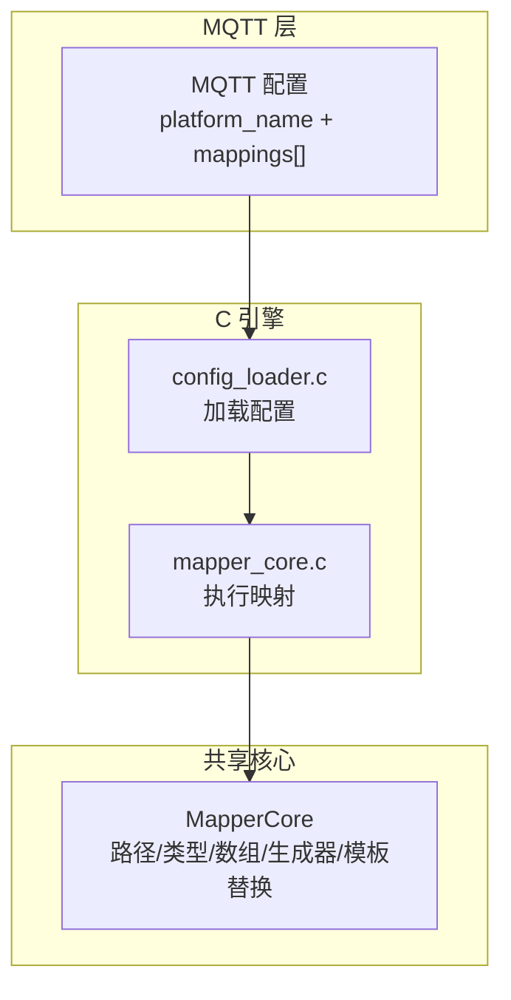
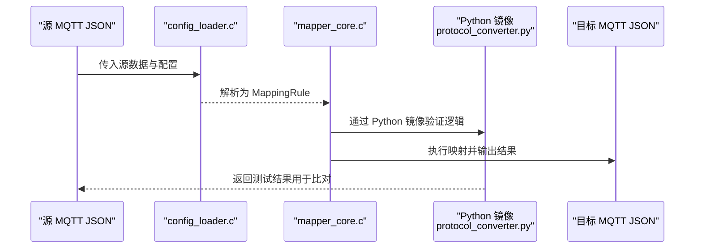
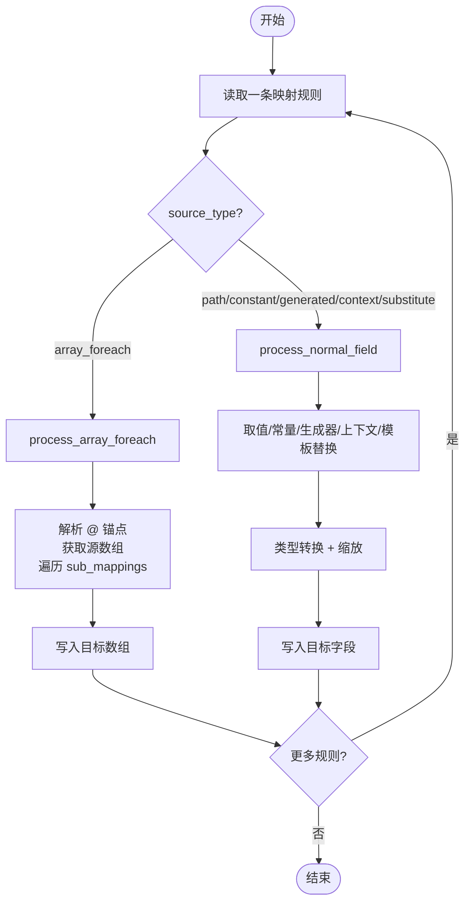
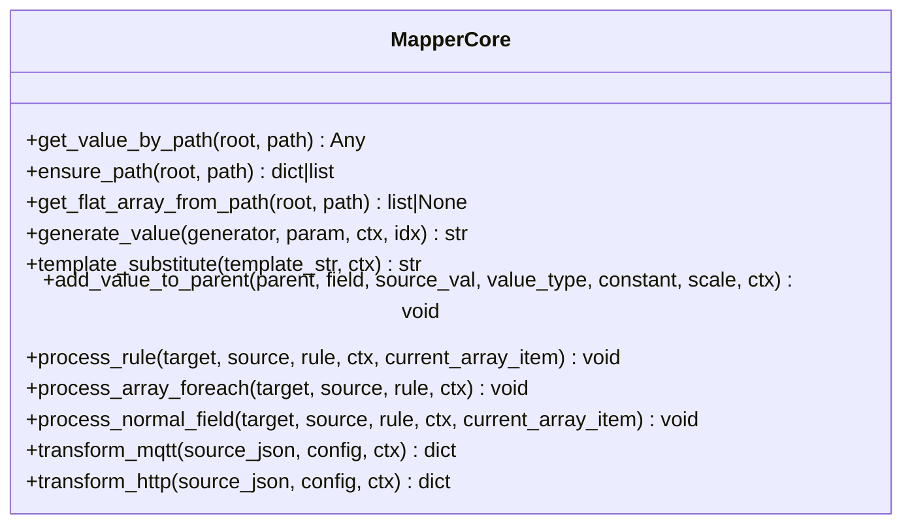
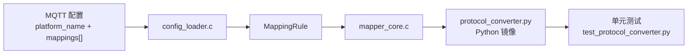

# MQTT 协议转换

<cite>
**本文引用的文件**
- [mqtt_mapper_202608261100.json](file://.trae/skills/mqtt-conversion/scripts/mqtt_mapper_202608261100.json)
- [protocol_converter.py](file://.trae/skills/protocol-conversion/scripts/protocol_converter.py)
- [SKILL.md（mqtt-conversion）](file://.trae/skills/mqtt-conversion/SKILL.md)
- [SKILL.md（protocol-conversion）](file://.trae/skills/protocol-conversion/SKILL.md)
- [test_protocol_converter.py](file://.trae/skills/protocol-conversion/scripts/test_protocol_converter.py)
- [mapper_core.h](file://.trae/skills/protocol-conversion/scripts/mapper_core.h)
</cite>

## 目录
1. [简介](#简介)
2. [项目结构](#项目结构)
3. [核心组件](#核心组件)
4. [架构总览](#架构总览)
5. [详细组件分析](#详细组件分析)
6. [依赖关系分析](#依赖关系分析)
7. [性能考虑](#性能考虑)
8. [故障排查指南](#故障排查指南)
9. [结论](#结论)
10. [附录](#附录)

## 简介
本技术文档面向“MQTT 协议转换”场景，聚焦以下目标：
- 明确 MQTT 配置格式规范，包括 platform_name、topic_pattern、mappings[] 等字段的定义与用法。
- 解释从源数据解析到目标格式生成的完整转换流程。
- 提供简单映射、复杂嵌套、数组处理等典型场景的配置示例与说明。
- 说明与共享映射核心的集成方式，以及如何复用映射规则。
- 给出调试技巧、常见问题解决方案、性能优化建议与最佳实践。

## 项目结构
本项目围绕“统一映射核心 + 协议特定外层”的架构组织：
- mqtt-conversion：负责 MQTT 特有的外层配置（platform_name、mappings[]），以及生成供 C 引擎读取的 JSON 配置文件。
- protocol-conversion：提供共享映射核心（路径语法、类型系统、数组遍历、生成器、模板替换等），并包含 Python 镜像实现用于本地测试验证。
- 运行时由 C 引擎加载配置并执行映射；Python 镜像用于开发与验证。

图表来源
- [SKILL.md（mqtt-conversion）:23-31](file://.trae/skills/mqtt-conversion/SKILL.md#L23-L31)
- [SKILL.md（protocol-conversion）:23-35](file://.trae/skills/protocol-conversion/SKILL.md#L23-L35)
- [protocol_converter.py:1-16](file://.trae/skills/protocol-conversion/scripts/protocol_converter.py#L1-L16)

章节来源
- [SKILL.md（mqtt-conversion）:23-31](file://.trae/skills/mqtt-conversion/SKILL.md#L23-L31)
- [SKILL.md（protocol-conversion）:23-35](file://.trae/skills/protocol-conversion/SKILL.md#L23-L35)
- [protocol_converter.py:1-16](file://.trae/skills/protocol-conversion/scripts/protocol_converter.py#L1-L16)

## 核心组件
- 共享映射核心 MapperCore：提供路径取值、路径创建、类型转换、生成器、模板替换、数组遍历、普通字段处理、MQTT/HTTP 转换入口等能力。
- MQTT 配置：以 platform_name 和 mappings[] 为核心，描述如何将源 MQTT JSON 转换为平台要求的 MQTT JSON。
- 配置样例：mqtt_mapper_202608261100.json 展示了 action、msgId、devId、data.terdata 等多层级映射与数组遍历。

章节来源
- [protocol_converter.py:32-602](file://.trae/skills/protocol-conversion/scripts/protocol_converter.py#L32-L602)
- [mqtt_mapper_202608261100.json:1-98](file://.trae/skills/mqtt-conversion/scripts/mqtt_mapper_202608261100.json#L1-L98)

## 架构总览
MQTT 转换的整体流程如下：
- 输入：源 MQTT JSON + MQTT 配置（platform_name + mappings[]）。
- 加载：config_loader.c 将配置解析为内部 MappingRule 结构。
- 执行：mapper_core.c 按规则执行路径取值、类型转换、数组遍历、生成器调用、模板替换，输出目标 MQTT JSON。
- 验证：使用 Python 镜像 protocol_converter.py 进行本地测试与回归验证。

图表来源
- [SKILL.md（mqtt-conversion）:23-31](file://.trae/skills/mqtt-conversion/SKILL.md#L23-L31)
- [protocol_converter.py:569-583](file://.trae/skills/protocol-conversion/scripts/protocol_converter.py#L569-L583)
- [mapper_core.h:36-51](file://.trae/skills/protocol-conversion/scripts/mapper_core.h#L36-L51)

## 详细组件分析

### MQTT 配置格式规范
- 根对象字段
  - platform_name：平台标识（仅元数据用途）。
  - topic_pattern：MQTT Topic 模板，支持 {field} 占位符替换。
  - post_process：全局后处理函数名（当前 C 引擎实现待完成）。
  - mappings：映射规则列表，遵循共享映射规则字段定义。
- mappings 规则字段（通用）
  - target：目标 JSON 路径，支持 .、[index]、@ 锚点。
  - source_type：path / constant / generated / array_foreach / context。
  - source：源路径，支持 .、[index]、[*]、$item、$idx（path/array_foreach 时必填）。
  - type：string / double / int / long / bool / object / substitute。
  - constant：常量值（source_type=constant 时必填）。
  - generator：生成器名称（source_type=generated 时必填）。
  - scale：数值缩放因子（默认 1.0）。
  - post_process：字段级后处理函数名（当前 C 引擎实现待完成）。
  - preprocess：预处理函数名（当前 C 引擎实现待完成）。
  - item_type：array_foreach 时必填，object 或 key_value。
  - sub_mappings：子规则（对象嵌套或数组元素映射，递归结构）。
- MQTT 特有
  - 模板变量替换：通过 source_type="constant" + type="substitute" 组合触发。
  - $item/$idx：在数组遍历中引用当前元素与索引。
  - 嵌套 [*] 展平：如 a[*].b[*] 可被展平为一维数组。

章节来源
- [SKILL.md（mqtt-conversion）:33-54](file://.trae/skills/mqtt-conversion/SKILL.md#L33-L54)
- [SKILL.md（protocol-conversion）:37-55](file://.trae/skills/protocol-conversion/SKILL.md#L37-L55)
- [SKILL.md（protocol-conversion）:58-124](file://.trae/skills/protocol-conversion/SKILL.md#L58-L124)
- [SKILL.md（protocol-conversion）:170-194](file://.trae/skills/protocol-conversion/SKILL.md#L170-L194)

### 转换流程详解（从源数据到目标格式）
- 单条规则处理入口：process_rule 根据 source_type 决定走数组遍历或普通字段处理。
- 数组遍历：process_array_foreach 解析 @ 锚点，获取源数组（支持 .、[*] 展平），逐元素应用 sub_mappings，构建目标数组。
- 普通字段：process_normal_field 解析目标路径，按 source_type 取值（path/constant/generated/context/substitute），并进行类型转换与缩放。
- 类型转换：add_value_to_parent 统一处理 string/double/int/long/bool/object/substitute，支持 scale 缩放与空值跳过。
- 生成器：generate_value 支持 uuid、时间戳、日期字符串、随机串、签名、批次号、序列号等。
- 模板替换：template_substitute 对 constant 中的 $var$ 进行上下文替换，支持嵌套路径。
- 引擎入口：transform_mqtt 遍历 mappings，依次执行 process_rule，最终返回目标对象。

图表来源
- [protocol_converter.py:379-566](file://.trae/skills/protocol-conversion/scripts/protocol_converter.py#L379-L566)
- [protocol_converter.py:569-583](file://.trae/skills/protocol-conversion/scripts/protocol_converter.py#L569-L583)

章节来源
- [protocol_converter.py:379-583](file://.trae/skills/protocol-conversion/scripts/protocol_converter.py#L379-L583)

### 配置示例与场景说明
- 简单映射
  - 常量字段：action = "devData"。
  - 生成器字段：msgId = uuid，msgTime = datetime_compact。
  - 模板替换：devId = $ssl_mqtt_server.gatewayID$。
- 复杂嵌套与数组处理
  - 设备层遍历：target=data.terdata[0].terdata.@，source=businessObjList[0].dataObj.dataItemList[0].itemBody[*]，item_type=object。
  - 测点层遍历：target=terdata.@，source=item[*]，item_type=object。
  - 字段映射：Ua/Ia/P/Q 等 double 类型，dataTime 使用 post_process 格式化。
- 参考配置
  - 见 mqtt_mapper_202608261100.json，展示完整的 mappings 结构与嵌套遍历。

章节来源
- [mqtt_mapper_202608261100.json:1-98](file://.trae/skills/mqtt-conversion/scripts/mqtt_mapper_202608261100.json#L1-L98)
- [SKILL.md（mqtt-conversion）:365-440](file://.trae/skills/mqtt-conversion/SKILL.md#L365-L440)

### 与共享映射核心的集成与复用
- 共享规则库：路径语法、类型系统、数组遍历准则、生成器清单、模板替换机制均定义在 protocol-conversion 中。
- 复用方式：mqtt-conversion 直接引用这些规则设计映射，避免重复定义；同一套规则可用于 HTTP 转换。
- 测试镜像：protocol_converter.py 作为 mapper_core.c 的 Python 镜像，便于本地快速验证与回归测试。

章节来源
- [SKILL.md（protocol-conversion）:1-21](file://.trae/skills/protocol-conversion/SKILL.md#L1-L21)
- [SKILL.md（protocol-conversion）:301-338](file://.trae/skills/protocol-conversion/SKILL.md#L301-L338)

### 类图（代码级关系）

图表来源
- [protocol_converter.py:32-602](file://.trae/skills/protocol-conversion/scripts/protocol_converter.py#L32-L602)

## 依赖关系分析
- 配置加载：config_loader.c 负责将 MQTT 配置解析为 MappingRule。
- 映射执行：mapper_core.c 提供统一的映射执行能力。
- Python 镜像：protocol_converter.py 镜像 C 引擎逻辑，用于测试与验证。
- 数据结构：MappingRule 定义映射规则的字段与结构。

图表来源
- [SKILL.md（mqtt-conversion）:23-31](file://.trae/skills/mqtt-conversion/SKILL.md#L23-L31)
- [mapper_core.h:36-51](file://.trae/skills/protocol-conversion/scripts/mapper_core.h#L36-L51)
- [protocol_converter.py:569-602](file://.trae/skills/protocol-conversion/scripts/protocol_converter.py#L569-L602)
- [test_protocol_converter.py:1-24](file://.trae/skills/protocol-conversion/scripts/test_protocol_converter.py#L1-L24)

章节来源
- [SKILL.md（mqtt-conversion）:23-31](file://.trae/skills/mqtt-conversion/SKILL.md#L23-L31)
- [mapper_core.h:36-51](file://.trae/skills/protocol-conversion/scripts/mapper_core.h#L36-L51)
- [protocol_converter.py:569-602](file://.trae/skills/protocol-conversion/scripts/protocol_converter.py#L569-L602)
- [test_protocol_converter.py:1-24](file://.trae/skills/protocol-conversion/scripts/test_protocol_converter.py#L1-L24)

## 性能考虑
- 优先使用声明式字段：scale、constant、substitute、generated，减少硬编码后处理函数依赖。
- 合理使用数组遍历：仅在目标要求 Array 时使用 array_foreach + @，避免不必要的遍历开销。
- 控制嵌套深度：多层嵌套 [*] 会进行展平计算，需评估数据规模与性能影响。
- 生成器选择：uuid、时间戳等生成器成本较低，但频繁调用仍需关注整体吞吐。
- 测试驱动优化：利用 Python 镜像与单元测试快速定位瓶颈与回归问题。

## 故障排查指南
- 常见错误
  - 引擎引用错误：MQTT 应使用 config_loader.c + mapper_core.c，而非 HTTP 引擎。
  - 误用数组遍历：目标为 Object 却使用了 @ 遍历，应改为固定索引或直接字段映射。
  - 常量键名错误：JSON 键名为 constant，非 constant_value。
  - substitute 配置错误：应使用 source_type="constant" + type="substitute"，而非旧的 substitute source_type。
  - 过度依赖 post_process：优先使用 scale 等声明式字段。
- 调试技巧
  - 使用 Python 镜像运行转换，打印中间结果与目标结构。
  - 逐步缩小范围：先验证路径取值与类型转换，再验证数组遍历与嵌套。
  - 对比期望与实际：构造最小化测试用例，逐项比对字段与类型。
- 参考测试
  - 路径取值、路径创建、类型转换、生成器、模板替换、数组遍历、MQTT/HTTP 完整转换、边界条件等覆盖全面。

章节来源
- [SKILL.md（protocol-conversion）:408-452](file://.trae/skills/protocol-conversion/SKILL.md#L408-L452)
- [test_protocol_converter.py:27-200](file://.trae/skills/protocol-conversion/scripts/test_protocol_converter.py#L27-L200)
- [test_protocol_converter.py:597-618](file://.trae/skills/protocol-conversion/scripts/test_protocol_converter.py#L597-L618)

## 结论
- MQTT 协议转换基于“共享映射核心 + 协议特定外层”的清晰架构，具备高内聚、低耦合特性。
- 配置格式规范明确，支持简单映射、复杂嵌套与数组处理，满足多场景需求。
- 通过 Python 镜像与完备测试套件，可实现高效开发与持续验证。
- 遵循最佳实践与性能建议，可在保证正确性的同时提升转换效率与可维护性。

## 附录
- 配置示例路径
  - [mqtt_mapper_202608261100.json](file://.trae/skills/mqtt-conversion/scripts/mqtt_mapper_202608261100.json)
- 核心实现路径
  - [protocol_converter.py](file://.trae/skills/protocol-conversion/scripts/protocol_converter.py)
  - [mapper_core.h](file://.trae/skills/protocol-conversion/scripts/mapper_core.h)
- 技能文档路径
  - [SKILL.md（mqtt-conversion）](file://.trae/skills/mqtt-conversion/SKILL.md)
  - [SKILL.md（protocol-conversion）](file://.trae/skills/protocol-conversion/SKILL.md)
- 测试套件路径
  - [test_protocol_converter.py](file://.trae/skills/protocol-conversion/scripts/test_protocol_converter.py)