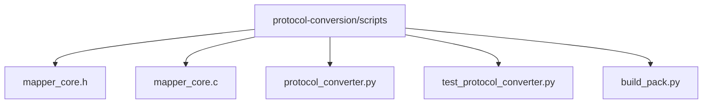
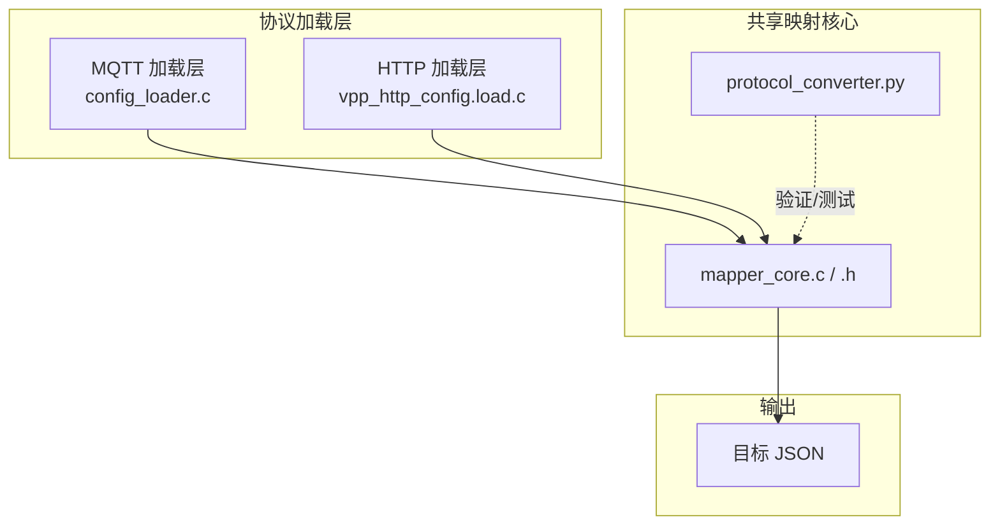
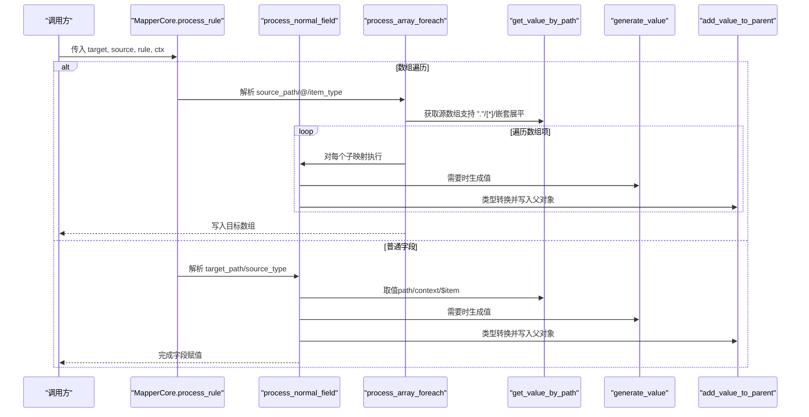
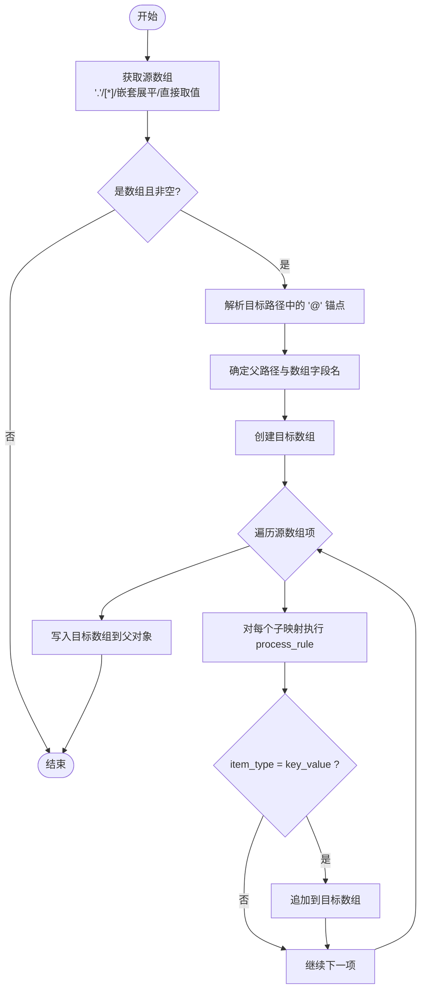
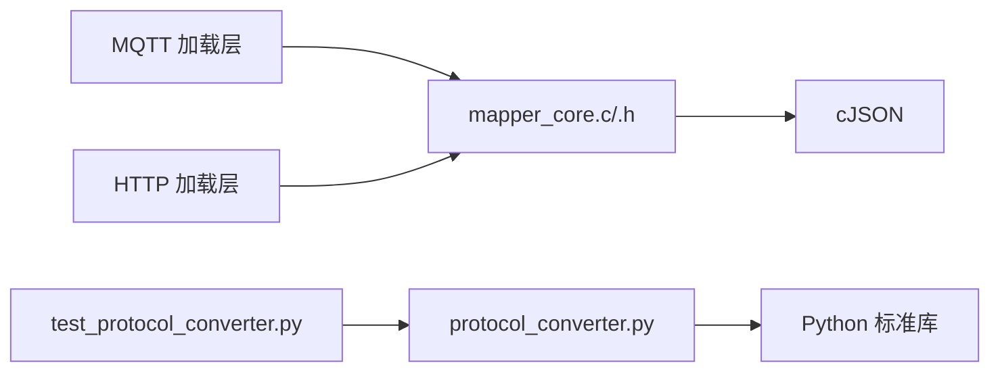

# 共享映射核心

<cite>
**本文引用的文件**
- [mapper_core.h](file://.trae/skills/protocol-conversion/scripts/mapper_core.h)
- [mapper_core.c](file://.trae/skills/protocol-conversion/scripts/mapper_core.c)
- [protocol_converter.py](file://.trae/skills/protocol-conversion/scripts/protocol_converter.py)
- [test_protocol_converter.py](file://.trae/skills/protocol-conversion/scripts/test_protocol_converter.py)
- [build_pack.py](file://.trae/skills/protocol-conversion/scripts/build_pack.py)
</cite>

## 目录
1. [简介](#简介)
2. [项目结构](#项目结构)
3. [核心组件](#核心组件)
4. [架构总览](#架构总览)
5. [详细组件分析](#详细组件分析)
6. [依赖关系分析](#依赖关系分析)
7. [性能考虑](#性能考虑)
8. [故障排查指南](#故障排查指南)
9. [结论](#结论)
10. [附录：配置示例与转换结果](#附录配置示例与转换结果)

## 简介
本技术文档围绕“共享映射核心”展开，聚焦统一协议映射引擎（C 实现与 Python 镜像）的映射规则、路径语法、类型系统、数组遍历、模板变量替换与生成器清单等关键能力。该核心将 MQTT 与 HTTP 两类协议的重复映射逻辑合并为单一实现，提供一致的规则表达与执行语义，降低维护成本并提升一致性。

## 项目结构
共享映射核心位于 protocol-conversion 技能中，包含 C 头文件与实现、Python 镜像实现以及测试脚本；打包脚本用于生成包清单与说明文档。

图表来源
- [build_pack.py:27-39](file://.trae/skills/protocol-conversion/scripts/build_pack.py#L27-L39)

章节来源
- [build_pack.py:27-39](file://.trae/skills/protocol-conversion/scripts/build_pack.py#L27-L39)

## 核心组件
- 统一映射规则结构：MappingRule，描述单条映射规则的字段定义与行为。
- 映射上下文：MappingContext，承载序列号计数器、HTTP 链式调用上下文、模板变量表。
- 路径工具：get_value_by_path、get_string_by_path、ensure_path、get_flat_array_from_path。
- 类型转换：add_value_to_parent，支持 string/int/double/long/bool/object/substitute 七种目标类型。
- 生成器：generate_value，支持 uuid、时间戳、日期串、随机串、签名、批次号、序列等。
- 映射处理：process_rule/process_normal_field/process_array_foreach，统一入口与分支。
- 模板替换：template_substitute，支持 $var$ 形式的变量替换。

章节来源
- [mapper_core.h:26-64](file://.trae/skills/protocol-conversion/scripts/mapper_core.h#L26-L64)
- [mapper_core.h:70-164](file://.trae/skills/protocol-conversion/scripts/mapper_core.h#L70-L164)
- [mapper_core.c:23-208](file://.trae/skills/protocol-conversion/scripts/mapper_core.c#L23-L208)
- [mapper_core.c:210-317](file://.trae/skills/protocol-conversion/scripts/mapper_core.c#L210-L317)
- [mapper_core.c:319-437](file://.trae/skills/protocol-conversion/scripts/mapper_core.c#L319-L437)
- [mapper_core.c:439-740](file://.trae/skills/protocol-conversion/scripts/mapper_core.c#L439-L740)

## 架构总览
MQTT 与 HTTP 两种协议通过各自的加载层将配置转换为统一的 MappingRule，再交由 mapper_core.c 执行映射。Python 镜像 protocol_converter.py 提供等价逻辑用于本地验证与测试。

图表来源
- [build_pack.py:278-286](file://.trae/skills/protocol-conversion/scripts/build_pack.py#L278-L286)
- [mapper_core.h:6-18](file://.trae/skills/protocol-conversion/scripts/mapper_core.h#L6-L18)

章节来源
- [build_pack.py:278-286](file://.trae/skills/protocol-conversion/scripts/build_pack.py#L278-L286)
- [mapper_core.h:6-18](file://.trae/skills/protocol-conversion/scripts/mapper_core.h#L6-L18)

## 详细组件分析

### 映射规则字段定义与使用场景
- target：目标 JSON 路径，支持点号访问与数组索引，数组遍历时可包含 @ 锚点表示插入位置。
- source_type：取值来源类型，包括 path、constant、generated、array_foreach、context、substitute。
- type：目标值类型，包括 string、int、double、long、bool、object、substitute。
- constant：当 source_type 为 constant 或 substitute 时使用的常量字符串。
- generator：当 source_type 为 generated 时使用的生成器名称。
- generator_param：生成器参数（如格式、长度等）。
- scale_factor：数值缩放因子，应用于 int/double/long 类型转换。
- preprocess/post_process：预处理/后处理函数名（预留扩展点，当前未实现具体逻辑）。
- item_type：数组遍历模式 object 或 key_value。
- is_array_foreach：显式标记是否为数组遍历规则。
- sub_mappings：子映射规则列表，用于 object 类型嵌套或数组项内映射。
- source：源路径或特殊占位符（如 "."、"$item"、"$idx"）。

章节来源
- [mapper_core.h:36-51](file://.trae/skills/protocol-conversion/scripts/mapper_core.h#L36-L51)
- [mapper_core.c:667-715](file://.trae/skills/protocol-conversion/scripts/mapper_core.c#L667-L715)
- [protocol_converter.py:480-566](file://.trae/skills/protocol-conversion/scripts/protocol_converter.py#L480-L566)

### 路径语法规范
- 点号访问：a.b.c 逐级取对象属性。
- 数组索引：a[0]、a[1] 精确访问元素。
- 通配符遍历：a[*] 返回整个数组；在数组遍历规则中结合 @ 锚点写入目标数组。
- 根对象引用："." 表示当前 source 本身（HTTP 特有），在 process_array_foreach 中作为单元素数组源。
- 嵌套展平：dataObj.itemBody[*].item[*] 支持多层 [*] 递归展平（MQTT 特有）。
- 锚点 @：target 路径中的 @ 表示数组插入位置，解析出父路径与字段名后创建目标数组。

章节来源
- [mapper_core.c:41-88](file://.trae/skills/protocol-conversion/scripts/mapper_core.c#L41-L88)
- [mapper_core.c:161-208](file://.trae/skills/protocol-conversion/scripts/mapper_core.c#L161-L208)
- [mapper_core.c:458-604](file://.trae/skills/protocol-conversion/scripts/mapper_core.c#L458-L604)
- [protocol_converter.py:49-118](file://.trae/skills/protocol-conversion/scripts/protocol_converter.py#L49-L118)
- [protocol_converter.py:161-202](file://.trae/skills/protocol-conversion/scripts/protocol_converter.py#L161-L202)
- [protocol_converter.py:395-479](file://.trae/skills/protocol-conversion/scripts/protocol_converter.py#L395-L479)

### 类型系统工作原理
- string：默认类型，从 source_val 或 constant 转为字符串；空字符串不添加字段。
- int/double/long：从 number/string 转换，支持 scale_factor 缩放；constant 优先于 source_val。
- bool：从 boolean/number/string 转换，支持 "true"/"1" 等布尔化。
- object：深拷贝 source_val 或解析 constant JSON；为空时创建空对象。
- substitute：对 constant 进行模板变量替换 $var$，从 ctx.template_vars 中按路径取值。

章节来源
- [mapper_core.c:332-437](file://.trae/skills/protocol-conversion/scripts/mapper_core.c#L332-L437)
- [protocol_converter.py:269-376](file://.trae/skills/protocol-conversion/scripts/protocol_converter.py#L269-L376)

### 数组遍历准则
- 源数组获取：
  - "." 将当前 source 视为单元素数组。
  - 含 [*] 的路径通过 get_flat_array_from_path 进行嵌套展平。
  - 其他路径直接取值，若结果为数组则进入遍历。
- 目标数组构建：
  - 解析 target 中的 @ 锚点，确定父路径与数组字段名。
  - 根据 item_type 决定每个元素的构造方式：
    - object：每项为一个对象，内部由 sub_mappings 填充。
    - key_value：每项独立生成一个对象，适用于键值对集合。
- 变量替换：
  - $idx：在遍历过程中替换为当前索引。
  - $item：在子映射中指向当前数组项，便于读取其字段。

章节来源
- [mapper_core.c:458-604](file://.trae/skills/protocol-conversion/scripts/mapper_core.c#L458-L604)
- [protocol_converter.py:395-479](file://.trae/skills/protocol-conversion/scripts/protocol_converter.py#L395-L479)

### ensure_path 自动建路径机制
- 作用：确保目标路径存在，不存在则按需创建对象或数组。
- 行为：
  - 遇到 a.b.c 逐级创建对象。
  - 遇到 a[0] 创建数组并确保索引存在，缺失元素填充为空对象。
  - 支持嵌套路径与数组路径组合。

章节来源
- [mapper_core.c:111-153](file://.trae/skills/protocol-conversion/scripts/mapper_core.c#L111-L153)
- [protocol_converter.py:120-159](file://.trae/skills/protocol-conversion/scripts/protocol_converter.py#L120-L159)

### 模板变量替换机制
- 语法：$var$，其中 var 可为嵌套路径（如 ssl_mqtt_server.gatewayID）。
- 数据源：ctx.template_vars（MQTT 使用）或 Python 镜像中的 ctx。
- 行为：逐次查找匹配项，用对应值替换；未找到则保留原占位符。

章节来源
- [mapper_core.c:273-317](file://.trae/skills/protocol-conversion/scripts/mapper_core.c#L273-L317)
- [protocol_converter.py:238-265](file://.trae/skills/protocol-conversion/scripts/protocol_converter.py#L238-L265)

### 生成器清单使用方法
- 支持的生成器：
  - uuid：生成唯一标识。
  - current_timestamp/timestamp_sec：秒级时间戳。
  - current_timestamp_ms/timestamp_ms：毫秒级时间戳。
  - datetime_compact：紧凑日期串（YYYYMMDDHHMMSS）。
  - datetime_str：可读日期串（YYYY-MM-DD HH:MM:SS）。
  - random_string：随机字符串。
  - md5_sign：基于时间的 MD5 签名。
  - batch_id：批次 ID。
  - sequence：序列号，支持 idx 或上下文计数器。
- 使用方式：
  - source_type=generated，指定 generator 与可选 generator_param。
  - 在普通字段或数组遍历的子映射中使用。

章节来源
- [mapper_core.c:210-271](file://.trae/skills/protocol-conversion/scripts/mapper_core.c#L210-L271)
- [protocol_converter.py:204-236](file://.trae/skills/protocol-conversion/scripts/protocol_converter.py#L204-L236)

### 映射处理流程（序列图）

图表来源
- [mapper_core.c:717-740](file://.trae/skills/protocol-conversion/scripts/mapper_core.c#L717-L740)
- [mapper_core.c:458-604](file://.trae/skills/protocol-conversion/scripts/mapper_core.c#L458-L604)
- [mapper_core.c:617-715](file://.trae/skills/protocol-conversion/scripts/mapper_core.c#L617-L715)
- [protocol_converter.py:379-566](file://.trae/skills/protocol-conversion/scripts/protocol_converter.py#L379-L566)

### 复杂逻辑流程图（数组遍历）

图表来源
- [mapper_core.c:458-604](file://.trae/skills/protocol-conversion/scripts/mapper_core.c#L458-L604)
- [protocol_converter.py:395-479](file://.trae/skills/protocol-conversion/scripts/protocol_converter.py#L395-L479)

## 依赖关系分析
- 模块耦合：
  - mapper_core.c/.h 提供核心能力，被 MQTT/HTTP 加载层调用。
  - protocol_converter.py 镜像 C 实现，供测试与验证。
  - build_pack.py 聚合相关文件并生成包清单与说明。
- 外部依赖：
  - cJSON：JSON 操作库（C 实现）。
  - Python 标准库：json、re、uuid、time、hashlib（Python 镜像）。

图表来源
- [build_pack.py:278-286](file://.trae/skills/protocol-conversion/scripts/build_pack.py#L278-L286)
- [mapper_core.h:24-24](file://.trae/skills/protocol-conversion/scripts/mapper_core.h#L24-L24)

章节来源
- [build_pack.py:278-286](file://.trae/skills/protocol-conversion/scripts/build_pack.py#L278-L286)
- [mapper_core.h:24-24](file://.trae/skills/protocol-conversion/scripts/mapper_core.h#L24-L24)

## 性能考虑
- 路径解析：
  - 避免不必要的深层嵌套；合理使用 [*] 与嵌套展平以减少中间结构。
  - 对于频繁访问的字段，尽量扁平化数据结构。
- 类型转换：
  - 优先使用 constant 减少运行时计算；scale_factor 仅在必要时使用。
  - 大量 object 类型复制可能带来内存开销，注意控制对象大小。
- 数组遍历：
  - 大数组遍历时注意内存分配与释放；避免在循环中进行昂贵操作。
  - 合理使用 item_type=key_value 减少对象创建。
- 生成器：
  - 高频调用生成器（如 timestamp）应尽量减少系统调用开销（C 实现已优化）。
- 模板替换：
  - 模板变量过多会增加字符串处理成本，建议精简 template_vars。

## 故障排查指南
- 路径取值失败：
  - 检查路径是否存在拼写错误或缺失层级；确认数组索引是否越界。
  - 对于 "." 路径，确保在数组遍历规则中正确使用。
- 类型转换异常：
  - 确认 source_val 或 constant 的类型与目标类型兼容；注意 scale_factor 的影响。
  - 对于 bool 类型，确认输入是否为 "true"/"1" 或布尔/数字。
- 数组遍历无输出：
  - 检查 source_path 是否能解析为数组；确认 target 路径包含 @ 锚点。
  - 确认 item_type 与 sub_mappings 配置正确。
- 模板替换无效：
  - 确认 ctx.template_vars 中存在对应变量；检查 $var$ 语法是否正确闭合。
- 生成器未生效：
  - 确认 source_type=generated 且 generator 名称有效；检查 generator_param 是否符合要求。

章节来源
- [mapper_core.c:41-88](file://.trae/skills/protocol-conversion/scripts/mapper_core.c#L41-L88)
- [mapper_core.c:332-437](file://.trae/skills/protocol-conversion/scripts/mapper_core.c#L332-L437)
- [mapper_core.c:458-604](file://.trae/skills/protocol-conversion/scripts/mapper_core.c#L458-L604)
- [mapper_core.c:273-317](file://.trae/skills/protocol-conversion/scripts/mapper_core.c#L273-L317)
- [mapper_core.c:210-271](file://.trae/skills/protocol-conversion/scripts/mapper_core.c#L210-L271)

## 结论
共享映射核心通过统一规则结构与执行引擎，实现了 MQTT 与 HTTP 协议的映射逻辑合并，显著降低了维护成本并提升了功能一致性。其路径语法、类型系统、数组遍历、模板替换与生成器能力覆盖了常见转换场景，并通过完备测试保障稳定性。建议在业务侧遵循最佳实践，合理设计映射规则与数据结构，以获得更好的性能与可维护性。

## 附录：配置示例与转换结果
以下为典型配置片段与预期结果的说明（以路径与行为描述为主，避免直接粘贴代码内容）：

- 基本字段映射
  - 配置要点：target 为目标路径，source 为源路径，type 为目标类型。
  - 预期结果：source 的值经类型转换后写入 target。
  - 参考实现：process_normal_field、add_value_to_parent。

- 常量与生成器
  - 配置要点：source_type=constant 使用 constant 字段；source_type=generated 使用 generator。
  - 预期结果：constant 直接写入；generator 生成相应值（如 UUID、时间戳）。
  - 参考实现：process_normal_field、generate_value。

- 数组遍历
  - 配置要点：source_type=array_foreach，source 为数组路径或 "."，target 包含 @ 锚点，item_type 选择 object 或 key_value。
  - 预期结果：生成目标数组，每项由 sub_mappings 填充。
  - 参考实现：process_array_foreach、get_flat_array_from_path。

- 模板替换
  - 配置要点：value_type=substitute，constant 中包含 $var$，ctx.template_vars 提供变量。
  - 预期结果：变量被替换为实际值。
  - 参考实现：template_substitute、add_value_to_parent。

- 路径与自动建路径
  - 配置要点：target 可使用 ensure_path 自动创建；数组索引支持 [0]、[1] 等。
  - 预期结果：目标路径存在并可写入值。
  - 参考实现：ensure_path、get_value_by_path。

章节来源
- [test_protocol_converter.py:27-118](file://.trae/skills/protocol-conversion/scripts/test_protocol_converter.py#L27-L118)
- [test_protocol_converter.py:120-200](file://.trae/skills/protocol-conversion/scripts/test_protocol_converter.py#L120-L200)
- [protocol_converter.py:379-602](file://.trae/skills/protocol-conversion/scripts/protocol_converter.py#L379-L602)
- [mapper_core.c:41-208](file://.trae/skills/protocol-conversion/scripts/mapper_core.c#L41-L208)
- [mapper_core.c:332-437](file://.trae/skills/protocol-conversion/scripts/mapper_core.c#L332-L437)
- [mapper_core.c:458-604](file://.trae/skills/protocol-conversion/scripts/mapper_core.c#L458-L604)
- [mapper_core.c:617-715](file://.trae/skills/protocol-conversion/scripts/mapper_core.c#L617-L715)