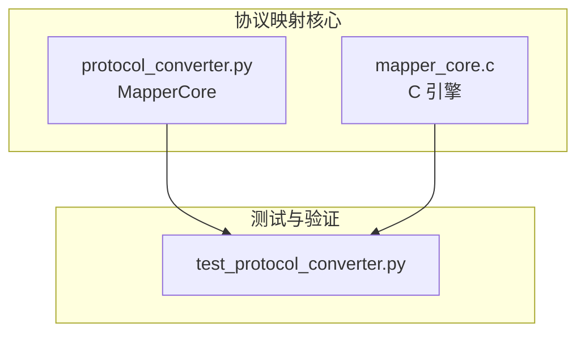
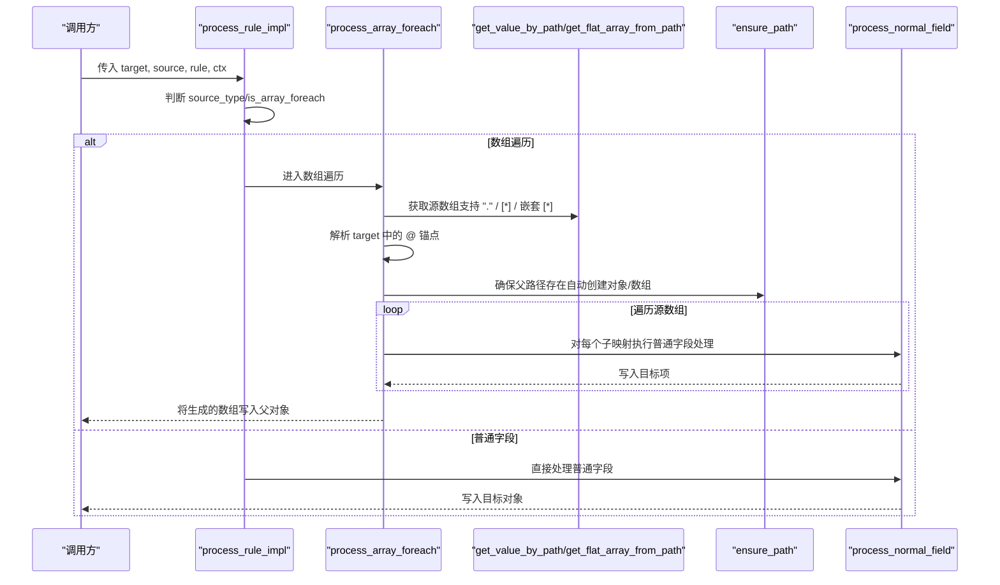
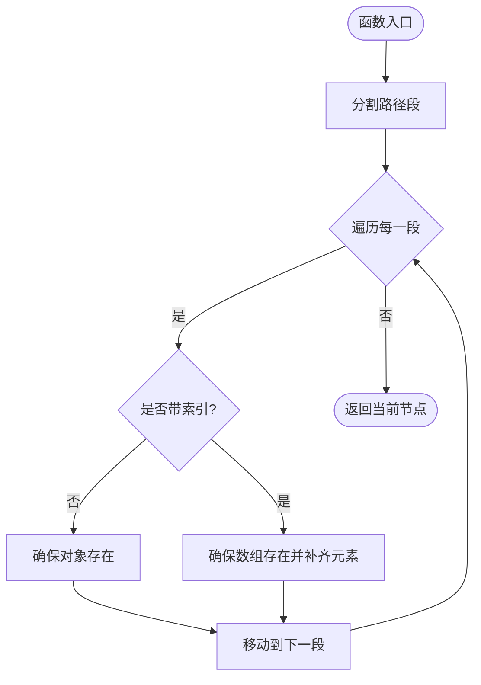
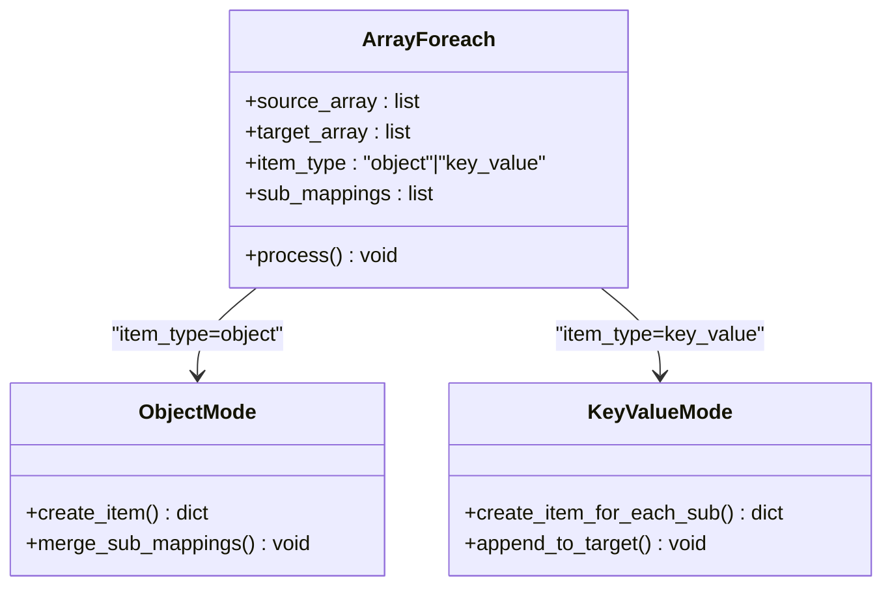
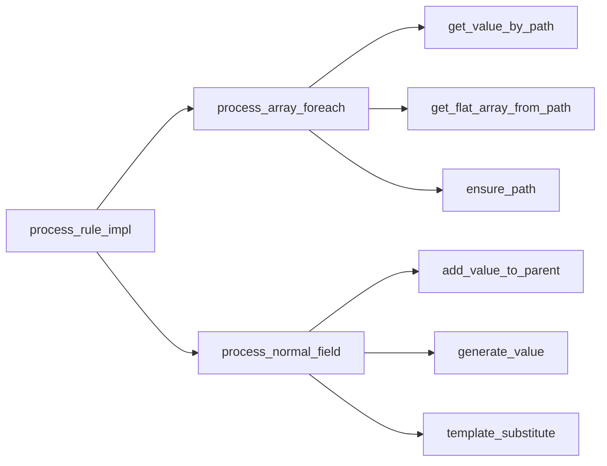

# 数组遍历机制

<cite>
**本文引用的文件**
- [protocol_converter.py](file://.trae/skills/protocol-conversion/scripts/protocol_converter.py)
- [mapper_core.c](file://.trae/skills/protocol-conversion/scripts/mapper_core.c)
- [test_protocol_converter.py](file://.trae/skills/protocol-conversion/scripts/test_protocol_converter.py)
</cite>

## 目录
1. [引言](#引言)
2. [项目结构](#项目结构)
3. [核心组件](#核心组件)
4. [架构总览](#架构总览)
5. [详细组件分析](#详细组件分析)
6. [依赖关系分析](#依赖关系分析)
7. [性能考虑](#性能考虑)
8. [故障排查指南](#故障排查指南)
9. [结论](#结论)
10. [附录：配置示例与最佳实践](#附录配置示例与最佳实践)

## 引言
本技术文档聚焦于“数组遍历机制”的实现原理与实践要点，覆盖以下关键主题：
- 遍历的首要判断依据是目标格式要求（是否必须输出数组），而非源数据是否存在数组。
- ensure_path 自动建路径机制的工作原理：路径检查、数组创建、元素补充。
- array_foreach 的 item_type 模式（object 与 key_value）的使用场景与差异。
- 多层嵌套 @ 锚点的处理逻辑。
- 丰富的配置示例，涵盖源有数组、源无数组、目标要求数组等边界情况。
- 性能考量与最佳实践。

该机制在 MQTT 与 HTTP 两个引擎中统一实现，Python 与 C 两套代码保持行为一致，并通过完备测试用例验证。

## 项目结构
本项目包含协议映射的核心实现与测试：
- Python 实现：protocol_converter.py（MapperCore 类）
- C 实现：mapper_core.c（统一映射核心）
- 测试：test_protocol_converter.py（覆盖路径取值、ensure_path、类型转换、生成器、模板替换、数组遍历、MQTT/HTTP 完整转换、边界条件等）

图表来源
- [protocol_converter.py:32-45](file://.trae/skills/protocol-conversion/scripts/protocol_converter.py#L32-L45)
- [mapper_core.c:1-13](file://.trae/skills/protocol-conversion/scripts/mapper_core.c#L1-L13)
- [test_protocol_converter.py:1-16](file://.trae/skills/protocol-conversion/scripts/test_protocol_converter.py#L1-L16)

章节来源
- [protocol_converter.py:32-45](file://.trae/skills/protocol-conversion/scripts/protocol_converter.py#L32-L45)
- [mapper_core.c:1-13](file://.trae/skills/protocol-conversion/scripts/mapper_core.c#L1-L13)
- [test_protocol_converter.py:1-16](file://.trae/skills/protocol-conversion/scripts/test_protocol_converter.py#L1-L16)

## 核心组件
- 路径取值 get_value_by_path：支持 a.b.c、a[0]、a[*]、"."（HTTP 特有返回根对象）。
- 路径创建 ensure_path：按路径逐级创建缺失的对象或数组，并补齐数组元素至指定索引。
- 扁平化数组 get_flat_array_from_path：支持嵌套 [*] 展平，如 dataObj.itemBody[*].item[*]。
- 值生成 generate_value：uuid、时间戳、随机串、序列号等。
- 模板替换 template_substitute：$var$ 语法，支持嵌套路径变量。
- 类型转换 add_value_to_parent：统一 string 比较，支持 int/double/long/bool/object/substitute/string。
- 规则分发 process_rule/process_rule_impl：根据 source_type 或 is_array_foreach 标志选择数组遍历或普通字段处理。
- 数组遍历 process_array_foreach：核心遍历逻辑，支持 $idx、item_type、"." 源路径、嵌套 [*] 展平。
- 普通字段处理 process_normal_field：支持 $item、context、post_process（预留）、object + sub_mappings 递归。

章节来源
- [protocol_converter.py:49-104](file://.trae/skills/protocol-conversion/scripts/protocol_converter.py#L49-L104)
- [protocol_converter.py:120-159](file://.trae/skills/protocol-conversion/scripts/protocol_converter.py#L120-L159)
- [protocol_converter.py:161-202](file://.trae/skills/protocol-conversion/scripts/protocol_converter.py#L161-L202)
- [protocol_converter.py:206-236](file://.trae/skills/protocol-conversion/scripts/protocol_converter.py#L206-L236)
- [protocol_converter.py:240-265](file://.trae/skills/protocol-conversion/scripts/protocol_converter.py#L240-L265)
- [protocol_converter.py:269-376](file://.trae/skills/protocol-conversion/scripts/protocol_converter.py#L269-L376)
- [protocol_converter.py:379-393](file://.trae/skills/protocol-conversion/scripts/protocol_converter.py#L379-L393)
- [protocol_converter.py:395-479](file://.trae/skills/protocol-conversion/scripts/protocol_converter.py#L395-L479)
- [protocol_converter.py:480-565](file://.trae/skills/protocol-conversion/scripts/protocol_converter.py#L480-L565)
- [mapper_core.c:41-88](file://.trae/skills/protocol-conversion/scripts/mapper_core.c#L41-L88)
- [mapper_core.c:116-153](file://.trae/skills/protocol-conversion/scripts/mapper_core.c#L116-L153)
- [mapper_core.c:161-208](file://.trae/skills/protocol-conversion/scripts/mapper_core.c#L161-L208)
- [mapper_core.c:223-271](file://.trae/skills/protocol-conversion/scripts/mapper_core.c#L223-L271)
- [mapper_core.c:282-317](file://.trae/skills/protocol-conversion/scripts/mapper_core.c#L282-L317)
- [mapper_core.c:332-437](file://.trae/skills/protocol-conversion/scripts/mapper_core.c#L332-L437)
- [mapper_core.c:458-604](file://.trae/skills/protocol-conversion/scripts/mapper_core.c#L458-L604)
- [mapper_core.c:617-715](file://.trae/skills/protocol-conversion/scripts/mapper_core.c#L617-L715)
- [mapper_core.c:723-739](file://.trae/skills/protocol-conversion/scripts/mapper_core.c#L723-L739)

## 架构总览
数组遍历的统一入口为 process_rule/process_rule_impl，当检测到 source_type="array_foreach" 或 is_array_foreach 时，进入 process_array_foreach；否则走 process_normal_field。

图表来源
- [protocol_converter.py:379-393](file://.trae/skills/protocol-conversion/scripts/protocol_converter.py#L379-L393)
- [protocol_converter.py:395-479](file://.trae/skills/protocol-conversion/scripts/protocol_converter.py#L395-L479)
- [protocol_converter.py:480-565](file://.trae/skills/protocol-conversion/scripts/protocol_converter.py#L480-L565)
- [mapper_core.c:458-604](file://.trae/skills/protocol-conversion/scripts/mapper_core.c#L458-L604)
- [mapper_core.c:617-715](file://.trae/skills/protocol-conversion/scripts/mapper_core.c#L617-L715)

## 详细组件分析

### 核心原则：遍历的首要判断依据是目标格式要求
- 设计原则：是否进行数组遍历，取决于目标格式是否要求输出数组（即 target 路径中包含 @ 锚点），而不是源数据是否天然为数组。
- 实现体现：
  - 若 target 不含 @，即使 source 是数组，也不会触发数组遍历逻辑，而是作为普通字段处理。
  - 若 target 含 @，则无论 source 是否为数组，都会尝试构造目标数组。
- 相关路径：
  - 目标路径解析与 @ 锚点定位：[protocol_converter.py:428-435](file://.trae/skills/protocol-conversion/scripts/protocol_converter.py#L428-L435)、[mapper_core.c:488-505](file://.trae/skills/protocol-conversion/scripts/mapper_core.c#L488-L505)
  - 源数组获取策略（"."、[*]、嵌套 [*]）：[protocol_converter.py:411-420](file://.trae/skills/protocol-conversion/scripts/protocol_converter.py#L411-L420)、[mapper_core.c:464-475](file://.trae/skills/protocol-conversion/scripts/mapper_core.c#L464-L475)

章节来源
- [protocol_converter.py:411-435](file://.trae/skills/protocol-conversion/scripts/protocol_converter.py#L411-L435)
- [mapper_core.c:464-505](file://.trae/skills/protocol-conversion/scripts/mapper_core.c#L464-L505)

### ensure_path 自动建路径机制
- 功能：按路径逐级创建缺失的对象或数组，并在遇到数组索引时补齐元素至指定索引。
- 行为细节：
  - 路径分段：以 "." 分割，逐段处理。
  - 对象创建：若键不存在，创建空对象 {}。
  - 数组创建与补齐：若键存在且非数组，强制转为数组；按需追加空对象 {} 直至满足索引需求。
  - 支持带索引的路径片段，如 items[2] 会确保 items 至少长度为 3。
- 复杂度：O(n)，n 为路径段数；空间复杂度 O(1)（不计结果结构）。
- 相关路径：
  - Python 实现：[protocol_converter.py:120-159](file://.trae/skills/protocol-conversion/scripts/protocol_converter.py#L120-L159)
  - C 实现：[mapper_core.c:116-153](file://.trae/skills/protocol-conversion/scripts/mapper_core.c#L116-L153)

图表来源
- [protocol_converter.py:120-159](file://.trae/skills/protocol-conversion/scripts/protocol_converter.py#L120-L159)
- [mapper_core.c:116-153](file://.trae/skills/protocol-conversion/scripts/mapper_core.c#L116-L153)

章节来源
- [protocol_converter.py:120-159](file://.trae/skills/protocol-conversion/scripts/protocol_converter.py#L120-L159)
- [mapper_core.c:116-153](file://.trae/skills/protocol-conversion/scripts/mapper_core.c#L116-L153)

### array_foreach 的 item_type 模式：object 与 key_value
- object 模式（默认）：
  - 每个源元素生成一个目标对象，所有 sub_mappings 的结果合并到该对象。
  - 适用场景：结构化实体映射，如设备信息、读数记录等。
- key_value 模式：
  - 每个 sub_mapping 独立生成一个目标对象，并追加到目标数组。
  - 适用场景：键值对展开，如将一对 (k,v) 拆成多个条目。
- 行为差异：
  - object：外层循环一次，内层循环多次，最终每个源元素对应一个对象。
  - key_value：外层循环一次，内层每次迭代创建一个新对象并加入数组，最终数组长度 = 源元素数 × sub_mappings 数。
- 相关路径：
  - Python：[protocol_converter.py:453-479](file://.trae/skills/protocol-conversion/scripts/protocol_converter.py#L453-L479)
  - C：[mapper_core.c:535-592](file://.trae/skills/protocol-conversion/scripts/mapper_core.c#L535-L592)
  - 测试用例：[test_protocol_converter.py:419-435](file://.trae/skills/protocol-conversion/scripts/test_protocol_converter.py#L419-L435)

图表来源
- [protocol_converter.py:453-479](file://.trae/skills/protocol-conversion/scripts/protocol_converter.py#L453-L479)
- [mapper_core.c:535-592](file://.trae/skills/protocol-conversion/scripts/mapper_core.c#L535-L592)
- [test_protocol_converter.py:419-435](file://.trae/skills/protocol-conversion/scripts/test_protocol_converter.py#L419-L435)

章节来源
- [protocol_converter.py:453-479](file://.trae/skills/protocol-conversion/scripts/protocol_converter.py#L453-L479)
- [mapper_core.c:535-592](file://.trae/skills/protocol-conversion/scripts/mapper_core.c#L535-L592)
- [test_protocol_converter.py:419-435](file://.trae/skills/protocol-conversion/scripts/test_protocol_converter.py#L419-L435)

### 多层嵌套 @ 锚点的处理逻辑
- 目标路径解析：
  - 找到第一个 @ 的位置，将其前的部分视为 parent_path，@ 后的部分在当前实现中未使用（数组字段名由 parent_path 的最后一段决定）。
  - 去除末尾的点，避免多余分隔符。
  - 通过最后一个 "." 确定数组字段名，并使用 ensure_path 创建父对象。
- 多层嵌套：
  - 若 parent_path 包含多级路径（如 data.devices），ensure_path 会逐级创建对象，最终在 devices 下写入数组。
  - 测试覆盖了多层嵌套的目标路径，如 data.devices.@。
- 相关路径：
  - Python：[protocol_converter.py:428-448](file://.trae/skills/protocol-conversion/scripts/protocol_converter.py#L428-L448)
  - C：[mapper_core.c:488-528](file://.trae/skills/protocol-conversion/scripts/mapper_core.c#L488-L528)
  - 测试用例：[test_protocol_converter.py:437-463](file://.trae/skills/protocol-conversion/scripts/test_protocol_converter.py#L437-L463)

章节来源
- [protocol_converter.py:428-448](file://.trae/skills/protocol-conversion/scripts/protocol_converter.py#L428-L448)
- [mapper_core.c:488-528](file://.trae/skills/protocol-conversion/scripts/mapper_core.c#L488-L528)
- [test_protocol_converter.py:437-463](file://.trae/skills/protocol-conversion/scripts/test_protocol_converter.py#L437-L463)

### 源数组获取策略与边界情况
- "." 源路径（HTTP 特有）：将当前 source 作为单元素数组处理，便于对单个对象进行遍历映射。
- 嵌套 [*] 展平（MQTT 特有）：通过 get_flat_array_from_path 递归展平，如 items[*].sub[*]。
- 通用路径取值：直接使用 get_value_by_path，支持 [*] 返回整个数组。
- 边界情况：
  - 源数组为空：不创建目标字段（测试验证）。
  - 源数组不存在：不创建目标字段（测试验证）。
- 相关路径：
  - Python：[protocol_converter.py:411-426](file://.trae/skills/protocol-conversion/scripts/protocol_converter.py#L411-L426)
  - C：[mapper_core.c:464-486](file://.trae/skills/protocol-conversion/scripts/mapper_core.c#L464-L486)
  - 测试用例：[test_protocol_converter.py:825-851](file://.trae/skills/protocol-conversion/scripts/test_protocol_converter.py#L825-L851)

章节来源
- [protocol_converter.py:411-426](file://.trae/skills/protocol-conversion/scripts/protocol_converter.py#L411-L426)
- [mapper_core.c:464-486](file://.trae/skills/protocol-conversion/scripts/mapper_core.c#L464-L486)
- [test_protocol_converter.py:825-851](file://.trae/skills/protocol-conversion/scripts/test_protocol_converter.py#L825-L851)

### 普通字段处理与上下文支持
- $item 替换：在数组遍历的子映射中，可通过 $item 访问当前源元素。
- context source_type（HTTP 特有）：从运行时上下文 ctx 取值，常用于链式调用传递参数。
- post_process（预留）：后处理钩子已定义但未实现，未来可扩展。
- 相关路径：
  - Python：[protocol_converter.py:480-565](file://.trae/skills/protocol-conversion/scripts/protocol_converter.py#L480-L565)
  - C：[mapper_core.c:617-715](file://.trae/skills/protocol-conversion/scripts/mapper_core.c#L617-L715)
  - 测试用例：[test_protocol_converter.py:732-745](file://.trae/skills/protocol-conversion/scripts/test_protocol_converter.py#L732-L745)

章节来源
- [protocol_converter.py:480-565](file://.trae/skills/protocol-conversion/scripts/protocol_converter.py#L480-L565)
- [mapper_core.c:617-715](file://.trae/skills/protocol-conversion/scripts/mapper_core.c#L617-L715)
- [test_protocol_converter.py:732-745](file://.trae/skills/protocol-conversion/scripts/test_protocol_converter.py#L732-L745)

## 依赖关系分析
- 模块耦合：
  - process_rule_impl 依赖 process_array_foreach 与 process_normal_field。
  - process_array_foreach 依赖 get_value_by_path、get_flat_array_from_path、ensure_path。
  - process_normal_field 依赖 get_value_by_path、add_value_to_parent、generate_value、template_substitute。
- 外部依赖：
  - JSON 操作（cJSON 在 C 实现中）。
  - 时间与随机数（Python 的 uuid、time；C 的 gettimeofday）。
- 潜在循环依赖：无，函数调用方向清晰。
- 接口契约：
  - 所有函数均接受 root/target/source 及路径字符串，返回或修改相应结构。
  - 错误处理：缺失路径返回 None/NULL，空数组不创建目标字段。

图表来源
- [protocol_converter.py:379-565](file://.trae/skills/protocol-conversion/scripts/protocol_converter.py#L379-L565)
- [mapper_core.c:458-715](file://.trae/skills/protocol-conversion/scripts/mapper_core.c#L458-L715)

章节来源
- [protocol_converter.py:379-565](file://.trae/skills/protocol-conversion/scripts/protocol_converter.py#L379-L565)
- [mapper_core.c:458-715](file://.trae/skills/protocol-conversion/scripts/mapper_core.c#L458-L715)

## 性能考虑
- 时间复杂度：
  - ensure_path：O(n)，n 为路径段数。
  - get_flat_array_from_path：O(N×M)，N 为外层数组大小，M 为内层展平深度。
  - process_array_foreach：O(S×K)，S 为源数组大小，K 为 sub_mappings 数量。
- 空间复杂度：
  - 扁平化数组可能产生额外副本，注意内存占用。
  - 大量嵌套 [*] 可能导致指数级增长，建议控制层级与规模。
- 优化建议：
  - 优先使用单层 [*] 简化路径，减少递归开销。
  - 合理设置 item_type：key_value 会产生更多对象，谨慎使用。
  - 避免过深的嵌套路径，必要时预处理数据。

## 故障排查指南
- 常见问题：
  - 目标字段未创建：检查 target 是否包含 @，以及 ensure_path 是否正确构建父路径。
  - 源数组为空或缺失：确认 source 路径有效，或改用 "." 将当前对象作为单元素数组。
  - item_type 误用：key_value 会导致每个 sub_mapping 生成独立对象，数量超出预期。
  - 嵌套 [*] 展平失败：检查路径语法与数据结构匹配。
- 调试方法：
  - 使用测试用例逐步验证：路径取值、ensure_path、类型转换、数组遍历。
  - 打印中间结果：在 process_array_foreach 中输出源数组与目标数组。
- 相关路径：
  - 测试用例覆盖：[test_protocol_converter.py:825-851](file://.trae/skills/protocol-conversion/scripts/test_protocol_converter.py#L825-L851)

章节来源
- [test_protocol_converter.py:825-851](file://.trae/skills/protocol-conversion/scripts/test_protocol_converter.py#L825-L851)

## 结论
本机制通过统一入口与模块化设计，实现了灵活的数组遍历能力，支持多种源数据形态与目标格式要求。ensure_path 提供了健壮的自动建路径能力，item_type 模式满足不同业务场景，嵌套 @ 锚点处理确保了复杂结构的正确映射。结合完备测试与性能优化建议，可在实际项目中稳定高效地应用。

## 附录：配置示例与最佳实践

### 示例一：源有数组，目标要求数组（object 模式）
- 场景：将业务列表映射为目标设备数组。
- 关键点：
  - source 使用 [*] 获取数组。
  - target 使用 @ 锚点指示数组位置。
  - item_type 默认为 object。
- 参考路径：
  - [test_protocol_converter.py:401-417](file://.trae/skills/protocol-conversion/scripts/test_protocol_converter.py#L401-L417)

### 示例二：源无数组，目标要求数组（"." 源路径）
- 场景：对单个对象进行遍历映射，生成单元素数组。
- 关键点：
  - source 使用 "." 表示当前对象。
  - target 使用 @ 锚点。
- 参考路径：
  - [test_protocol_converter.py:465-482](file://.trae/skills/protocol-conversion/scripts/test_protocol_converter.py#L465-L482)

### 示例三：嵌套 [*] 展平（MQTT 特有）
- 场景：多层嵌套数组展平为一维数组。
- 关键点：
  - source 使用嵌套 [*]，如 items[*].sub[*]。
  - 通过 get_flat_array_from_path 递归展平。
- 参考路径：
  - [test_protocol_converter.py:808-819](file://.trae/skills/protocol-conversion/scripts/test_protocol_converter.py#L808-L819)

### 示例四：key_value 模式（HTTP 特有）
- 场景：将键值对展开为多个条目。
- 关键点：
  - item_type 设置为 key_value。
  - 每个 sub_mapping 生成独立对象。
- 参考路径：
  - [test_protocol_converter.py:419-435](file://.trae/skills/protocol-conversion/scripts/test_protocol_converter.py#L419-L435)

### 示例五：空数组与缺失数组边界
- 场景：源数组为空或不存在时，不创建目标字段。
- 关键点：
  - 空数组：不创建目标字段。
  - 缺失数组：不创建目标字段。
- 参考路径：
  - [test_protocol_converter.py:825-851](file://.trae/skills/protocol-conversion/scripts/test_protocol_converter.py#L825-L851)

### 最佳实践
- 明确目标格式：优先根据目标要求决定是否遍历，而非依赖源数据形态。
- 合理使用 item_type：object 用于结构化实体，key_value 用于键值对展开。
- 控制嵌套层级：避免过深嵌套 [*]，提升性能与可维护性。
- 利用 ensure_path：简化路径创建，减少手动初始化。
- 充分测试：使用测试用例覆盖边界情况，确保稳定性。