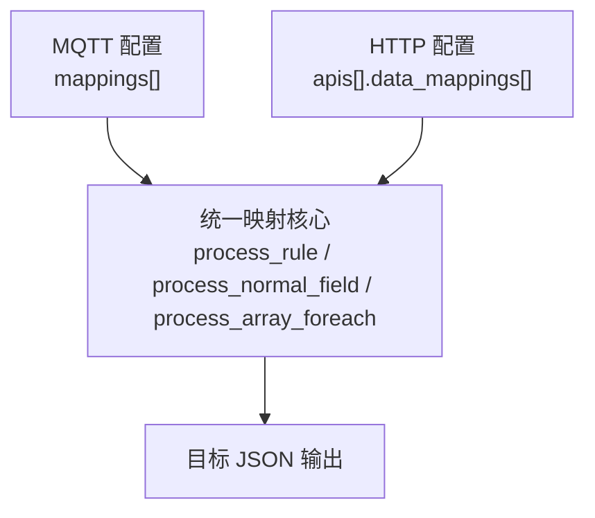
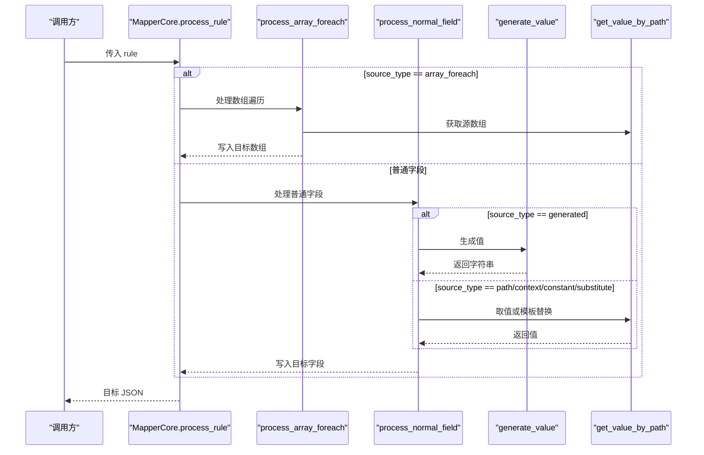
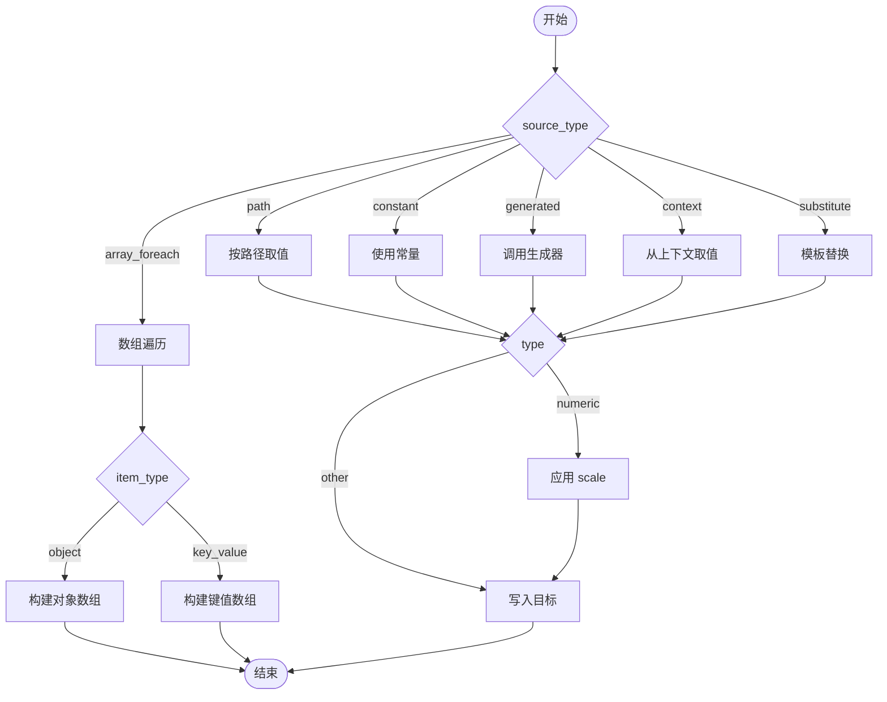

# 映射规则字段

<cite>
**本文引用的文件**
- [mapper_core.h](file://.trae/skills/protocol-conversion/scripts/mapper_core.h)
- [mapper_core.c](file://.trae/skills/protocol-conversion/scripts/mapper_core.c)
- [protocol_converter.py](file://.trae/skills/protocol-conversion/scripts/protocol_converter.py)
- [test_protocol_converter.py](file://.trae/skills/protocol-conversion/scripts/test_protocol_converter.py)
- [mqtt_mapper_202608261100.json](file://.trae/skills/mqtt-conversion/scripts/mqtt_mapper_202608261100.json)
- [protocol_mapping_output_20260826_110500.json](file://.trae/skills/http-conversion/scripts/protocol_mapping_output_20260826_110500.json)
</cite>

## 目录
1. [简介](#简介)
2. [项目结构](#项目结构)
3. [核心组件](#核心组件)
4. [架构总览](#架构总览)
5. [详细字段说明](#详细字段说明)
6. [依赖关系与组合使用](#依赖关系与组合使用)
7. [性能与复杂度](#性能与复杂度)
8. [故障排查指南](#故障排查指南)
9. [结论](#结论)
10. [附录：示例配置路径](#附录示例配置路径)

## 简介
本技术文档聚焦“映射规则”的字段定义、取值来源、类型转换、数组遍历、生成器、预处理/后处理等能力，结合 C 引擎与 Python 镜像实现，给出每条规则的必填条件、数据类型、默认值、行为语义、常见错误与最佳实践。读者可据此编写或调试 MQTT/HTTP 协议映射配置，确保源数据到目标 JSON 的稳定转换。

## 项目结构
- 统一映射核心（C）：定义 MappingRule 结构与公共函数接口，负责路径解析、类型转换、数组遍历、生成器、普通字段处理。
- Python 镜像实现：提供 MapperCore 类，逐一对应 C 引擎逻辑，便于本地测试与验证。
- 示例配置：MQTT 与 HTTP 两种场景下的 mapping 配置样例，覆盖常量、生成器、路径取值、数组遍历、模板替换、预处理等用法。

图表来源
- [mapper_core.h:36-51](file://.trae/skills/protocol-conversion/scripts/mapper_core.h#L36-L51)
- [protocol_converter.py:379-465](file://.trae/skills/protocol-conversion/scripts/protocol_converter.py#L379-L465)

章节来源
- [mapper_core.h:1-167](file://.trae/skills/protocol-conversion/scripts/mapper_core.h#L1-L167)
- [protocol_converter.py:1-602](file://.trae/skills/protocol-conversion/scripts/protocol_converter.py#L1-L602)

## 核心组件
- 统一映射规则结构 MappingRule：包含 target_path、source_path、source_type、value_type、constant_value、generator、generator_param、scale_factor、post_process、preprocess、item_type、is_array_foreach、sub_mappings、sub_mapping_count 等字段。
- 上下文 MappingContext：维护 sequence 计数器、HTTP 链式调用 context、MQTT substitute 模板变量表。
- 核心函数：
  - get_value_by_path：按 JSON 路径取值，支持 a.b.c、a[0]、a[*]、"."（HTTP）。
  - ensure_path：创建目标路径节点。
  - add_value_to_parent：按 value_type 进行类型转换并写入父对象，支持 scale 缩放。
  - generate_value：内置多种生成器（uuid、时间戳、随机串、md5、序列号等）。
  - process_rule：统一入口，分发 array_foreach 与普通字段。
  - process_array_foreach：数组遍历，支持 $idx、item_type object/key_value、"." 源路径、嵌套 [*] 展平。
  - process_normal_field：普通字段处理，支持 $item、context、object+sub_mappings 递归、template_substitute。

章节来源
- [mapper_core.h:36-64](file://.trae/skills/protocol-conversion/scripts/mapper_core.h#L36-L64)
- [mapper_core.h:70-152](file://.trae/skills/protocol-conversion/scripts/mapper_core.h#L70-L152)
- [mapper_core.c:41-104](file://.trae/skills/protocol-conversion/scripts/mapper_core.c#L41-L104)
- [mapper_core.c:507-661](file://.trae/skills/protocol-conversion/scripts/mapper_core.c#L507-L661)
- [protocol_converter.py:49-118](file://.trae/skills/protocol-conversion/scripts/protocol_converter.py#L49-L118)
- [protocol_converter.py:206-236](file://.trae/skills/protocol-conversion/scripts/protocol_converter.py#L206-L236)
- [protocol_converter.py:269-376](file://.trae/skills/protocol-conversion/scripts/protocol_converter.py#L269-L376)
- [protocol_converter.py:379-565](file://.trae/skills/protocol-conversion/scripts/protocol_converter.py#L379-L565)

## 架构总览
映射流程由统一入口 process_rule 驱动，根据 source_type 选择不同取值策略；数组遍历通过 process_array_foreach 完成；普通字段通过 process_normal_field 完成类型转换与写入；生成器与模板替换在相应分支中执行。

图表来源
- [protocol_converter.py:379-465](file://.trae/skills/protocol-conversion/scripts/protocol_converter.py#L379-L465)
- [protocol_converter.py:480-565](file://.trae/skills/protocol-conversion/scripts/protocol_converter.py#L480-L565)
- [protocol_converter.py:206-236](file://.trae/skills/protocol-conversion/scripts/protocol_converter.py#L206-L236)
- [protocol_converter.py:49-118](file://.trae/skills/protocol-conversion/scripts/protocol_converter.py#L49-L118)

## 详细字段说明
以下字段为单条映射规则（mapping）中的关键属性。每个字段均给出：含义、是否必填、数据类型、默认值、行为说明、典型使用场景与注意事项。

- target（目标 JSON 路径）
  - 含义：写入的目标位置，支持点号层级与数组锚点 @。
  - 必填：是。
  - 类型：字符串。
  - 默认：无。
  - 行为：若含 @，表示数组遍历写入；否则为普通字段路径。
  - 场景：如 "action"、"data.terdata.@"、"businessObjList[0].dataObj.dataItemList[0].itemBody.@"。
  - 注意：@ 前缀需存在且位于数组字段名之后；深层路径会被自动创建。
  - 参考：[protocol_converter.py:428-478](file://.trae/skills/protocol-conversion/scripts/protocol_converter.py#L428-L478)、[mapper_core.c:622-636](file://.trae/skills/protocol-conversion/scripts/mapper_core.c#L622-L636)

- source_type（取值来源类型）
  - 含义：决定如何获取值。
  - 必填：否（默认 "path"）。
  - 类型：字符串。
  - 可选值：path、constant、generated、array_foreach、context、substitute。
  - 行为：
    - path：从 source 路径取值。
    - constant：直接使用 constant 值。
    - generated：调用 generator 生成值。
    - array_foreach：进入数组遍历流程。
    - context：从上下文 ctx 取值（HTTP）。
    - substitute：对 constant 做模板替换（MQTT）。
  - 场景：见各示例配置。
  - 注意：array_foreach 通常配合 target 中的 @ 与 sub_mappings 使用。
  - 参考：[protocol_converter.py:388-393](file://.trae/skills/protocol-conversion/scripts/protocol_converter.py#L388-L393)、[protocol_converter.py:532-565](file://.trae/skills/protocol-conversion/scripts/protocol_converter.py#L532-L565)

- type（值类型）
  - 含义：目标字段的类型，用于类型转换。
  - 必填：否（默认 "string"）。
  - 类型：字符串。
  - 可选值：string、int、double、long、bool、object、substitute。
  - 行为：
    - int/double/long：数值转换，支持 scale 缩放。
    - bool：布尔转换。
    - object：复制子对象或解析 JSON 字符串。
    - substitute：模板替换结果作为字符串写入。
  - 场景：数值精度控制、布尔标志、对象嵌套。
  - 注意：当 type=object 且有 sub_mappings 时，会先取 source_val 再递归处理子规则。
  - 参考：[protocol_converter.py:269-376](file://.trae/skills/protocol-conversion/scripts/protocol_converter.py#L269-L376)、[protocol_converter.py:511-530](file://.trae/skills/protocol-conversion/scripts/protocol_converter.py#L511-L530)

- constant（常量值）
  - 含义：当 source_type=constant 或 substitute 时使用。
  - 必填：视 source_type 而定。
  - 类型：任意（内部转为字符串或对应类型）。
  - 默认：无。
  - 行为：直接赋值或参与模板替换。
  - 场景：固定动作标识、业务码、模板变量占位符。
  - 注意：type=string 时会转字符串；type=int/double/long 会尝试数值转换，失败则回退默认值。
  - 参考：[protocol_converter.py:536-561](file://.trae/skills/protocol-conversion/scripts/protocol_converter.py#L536-L561)

- generator（生成器名称）
  - 含义：当 source_type=generated 时指定生成器。
  - 必填：当 source_type=generated 时为必选。
  - 类型：字符串。
  - 可选值：uuid、current_timestamp、timestamp_sec、current_timestamp_ms、timestamp_ms、datetime_compact、datetime_str、random_string、md5_sign、batch_id、sequence。
  - 行为：生成唯一 ID、时间戳、随机串、签名、序列号等。
  - 场景：消息 ID、时间标记、批次号、请求签名。
  - 注意：sequence 支持基于 idx 或上下文计数器生成。
  - 参考：[protocol_converter.py:206-236](file://.trae/skills/protocol-conversion/scripts/protocol_converter.py#L206-L236)

- generator_param（生成器参数）
  - 含义：部分生成器需要的额外参数。
  - 必填：视具体生成器而定。
  - 类型：任意（通常为字符串或数字）。
  - 默认：无。
  - 行为：传递给生成器以定制输出。
  - 场景：自定义格式、长度、种子等（当前实现主要使用默认行为）。
  - 注意：当前多数生成器忽略该参数，但保留扩展性。
  - 参考：[protocol_converter.py:206-236](file://.trae/skills/protocol-conversion/scripts/protocol_converter.py#L206-L236)

- scale（数值缩放因子）
  - 含义：对数值型字段进行缩放。
  - 必填：否（默认 1.0）。
  - 类型：浮点数。
  - 行为：将 source 值乘以 scale 后再转换为目标类型。
  - 场景：传感器原始值换算为工程单位（如 0.1 表示除以 10）。
  - 注意：仅对 int/double/long 生效；字符串不会缩放。
  - 参考：[protocol_converter.py:269-329](file://.trae/skills/protocol-conversion/scripts/protocol_converter.py#L269-L329)、[protocol_converter.py:563-565](file://.trae/skills/protocol-conversion/scripts/protocol_converter.py#L563-L565)

- post_process（后处理函数）
  - 含义：字段级后处理钩子（预留扩展）。
  - 必填：否。
  - 类型：字符串（函数名）。
  - 默认：无。
  - 行为：当前实现未启用；可在后续版本接入格式化、校验等。
  - 场景：日期格式化、单位转换、脱敏等。
  - 注意：现有测试用例中出现过该字段，但核心逻辑未实现。
  - 参考：[mapper_core.h:45-46](file://.trae/skills/protocol-conversion/scripts/mapper_core.h#L45-L46)、[protocol_converter.py:487-492](file://.trae/skills/protocol-conversion/scripts/protocol_converter.py#L487-L492)

- preprocess（预处理函数）
  - 含义：字段级预处理钩子（HTTP 场景可用）。
  - 必填：否。
  - 类型：字符串（函数名）。
  - 默认：无。
  - 行为：当前实现未启用；可用于 URL 转 base64、编码转换等。
  - 场景：图片 URL 转 base64、字符集转换。
  - 注意：示例配置中包含该字段，但核心逻辑未实现。
  - 参考：[mapper_core.h:46-47](file://.trae/skills/protocol-conversion/scripts/mapper_core.h#L46-L47)、[protocol_mapping_output_20260826_110500.json:77-81](file://.trae/skills/http-conversion/scripts/protocol_mapping_output_20260826_110500.json#L77-L81)

- item_type（数组遍历类型）
  - 含义：数组遍历时的条目构造方式。
  - 必填：否（默认 "object"）。
  - 类型：字符串。
  - 可选值：object、key_value。
  - 行为：
    - object：每个子规则写入同一对象，最终聚合为对象数组。
    - key_value：每个子规则生成独立键值对象，追加到数组。
  - 场景：列表项映射、扁平化键值对。
  - 注意：与 sub_mappings 配合使用。
  - 参考：[protocol_converter.py:407-478](file://.trae/skills/protocol-conversion/scripts/protocol_converter.py#L407-L478)、[mapper_core.c:538-549](file://.trae/skills/protocol-conversion/scripts/mapper_core.c#L538-L549)

- sub_mappings（子规则）
  - 含义：数组遍历或对象类型时的子映射规则集合。
  - 必填：当 source_type=array_foreach 或 type=object 且需要嵌套映射时为必选。
  - 类型：数组（每项为一条规则）。
  - 行为：逐项应用，支持嵌套数组遍历与对象递归。
  - 场景：复杂数据结构映射、多层嵌套。
  - 注意：在 array_foreach 中，$idx 可用作索引变量；在 object+sub_mappings 中，会先取 source_val 再递归。
  - 参考：[protocol_converter.py:407-478](file://.trae/skills/protocol-conversion/scripts/protocol_converter.py#L407-L478)、[protocol_converter.py:511-530](file://.trae/skills/protocol-conversion/scripts/protocol_converter.py#L511-L530)

补充字段（来自 C 结构体）：
- source_path（source）：当 source_type=path 时使用的源路径。
- is_array_foreach：显式标记是否为数组遍历（与 source_type=array_foreach 等价）。
- 参考：[mapper_core.h:36-51](file://.trae/skills/protocol-conversion/scripts/mapper_core.h#L36-L51)

章节来源
- [mapper_core.h:36-64](file://.trae/skills/protocol-conversion/scripts/mapper_core.h#L36-L64)
- [protocol_converter.py:49-118](file://.trae/skills/protocol-conversion/scripts/protocol_converter.py#L49-L118)
- [protocol_converter.py:206-236](file://.trae/skills/protocol-conversion/scripts/protocol_converter.py#L206-L236)
- [protocol_converter.py:269-376](file://.trae/skills/protocol-conversion/scripts/protocol_converter.py#L269-L376)
- [protocol_converter.py:379-565](file://.trae/skills/protocol-conversion/scripts/protocol_converter.py#L379-L565)
- [mapper_core.c:41-104](file://.trae/skills/protocol-conversion/scripts/mapper_core.c#L41-L104)
- [mapper_core.c:507-661](file://.trae/skills/protocol-conversion/scripts/mapper_core.c#L507-L661)

## 依赖关系与组合使用
- source_type 与 type 的组合：
  - path + numeric type + scale：数值缩放转换。
  - constant + string/int/double/long/bool：直接赋值。
  - generated + type=string：生成标识或时间。
  - context + type：HTTP 上下文注入。
  - substitute + type=string：模板替换。
- array_foreach 与 item_type：
  - item_type=object：子规则写入同一对象，形成对象数组。
  - item_type=key_value：每个子规则生成独立键值对象。
- $item 与 $idx：
  - $item：在数组遍历中引用当前项（MQTT）。
  - $idx：在数组遍历中引用当前索引（MQTT）。
- "." 源路径：
  - HTTP 特有：将当前 source 作为单元素数组处理。
- 嵌套 [*] 展平：
  - MQTT 特有：支持多级 [*] 展平为扁平数组。

图表来源
- [protocol_converter.py:379-565](file://.trae/skills/protocol-conversion/scripts/protocol_converter.py#L379-L565)
- [protocol_converter.py:407-478](file://.trae/skills/protocol-conversion/scripts/protocol_converter.py#L407-L478)

章节来源
- [protocol_converter.py:379-565](file://.trae/skills/protocol-conversion/scripts/protocol_converter.py#L379-L565)
- [protocol_converter.py:407-478](file://.trae/skills/protocol-conversion/scripts/protocol_converter.py#L407-L478)

## 性能与复杂度
- 路径取值：O(n) 层级遍历，n 为路径段数；支持 [*] 返回整个数组，避免重复解析。
- 数组遍历：对每个源项执行子规则，复杂度 O(N*M)，N 为数组长度，M 为子规则数量。
- 类型转换：常数时间，数值转换失败回退默认值，避免异常开销。
- 生成器：UUID、时间戳等为常数时间；sequence 依赖上下文计数器。
- 内存：ensure_path 按需创建节点，避免预分配；数组遍历生成新对象，注意大数据量时的内存占用。

## 故障排查指南
- 源字段不存在：
  - string 类型不添加目标字段。
  - int 类型默认 0。
  - 参考：[test_protocol_converter.py:853-865](file://.trae/skills/protocol-conversion/scripts/test_protocol_converter.py#L853-L865)
- 缩放因子无效：
  - 确认 type 为数值类型；检查 scale 非零且合理。
  - 参考：[test_protocol_converter.py:867-872](file://.trae/skills/protocol-conversion/scripts/test_protocol_converter.py#L867-L872)
- 深层嵌套目标路径：
  - 确保中间层级存在或可被 ensure_path 创建。
  - 参考：[test_protocol_converter.py:874-879](file://.trae/skills/protocol-conversion/scripts/test_protocol_converter.py#L874-L879)
- 所有 source_type 支持：
  - 验证 path、constant、generated、context、substitute、array_foreach 的行为。
  - 参考：[test_protocol_converter.py:1006-1049](file://.trae/skills/protocol-conversion/scripts/test_protocol_converter.py#L1006-L1049)
- 常见错误与建议：
  - target 中缺少 @ 却使用 array_foreach：不会写入数组。
  - source 路径错误或类型不匹配：string 不添加，数值回退默认。
  - 模板变量未定义：保持原样输出。
  - 建议：优先使用单元测试验证映射规则；逐步增加嵌套层级；对数值字段设置合理的 scale。

章节来源
- [test_protocol_converter.py:853-879](file://.trae/skills/protocol-conversion/scripts/test_protocol_converter.py#L853-L879)
- [test_protocol_converter.py:1006-1049](file://.trae/skills/protocol-conversion/scripts/test_protocol_converter.py#L1006-L1049)

## 结论
映射规则字段提供了灵活而强大的数据转换能力，覆盖路径取值、常量注入、生成器、上下文注入、模板替换、数组遍历与对象递归等场景。通过规范化的字段定义与统一的实现核心，MQTT 与 HTTP 引擎共享相同的行为语义。建议在配置时明确 source_type 与 type 的组合，合理使用 scale 与 item_type，并结合单元测试验证复杂映射逻辑。

## 附录：示例配置路径
- MQTT 示例（包含常量、生成器、数组遍历、模板替换、后处理字段）：
  - [mqtt_mapper_202608261100.json](file://.trae/skills/mqtt-conversion/scripts/mqtt_mapper_202608261100.json)
- HTTP 示例（包含 context、数组遍历、预处理字段）：
  - [protocol_mapping_output_20260826_110500.json](file://.trae/skills/http-conversion/scripts/protocol_mapping_output_20260826_110500.json)

章节来源
- [mqtt_mapper_202608261100.json:1-98](file://.trae/skills/mqtt-conversion/scripts/mqtt_mapper_202608261100.json#L1-L98)
- [protocol_mapping_output_20260826_110500.json:1-89](file://.trae/skills/http-conversion/scripts/protocol_mapping_output_20260826_110500.json#L1-L89)