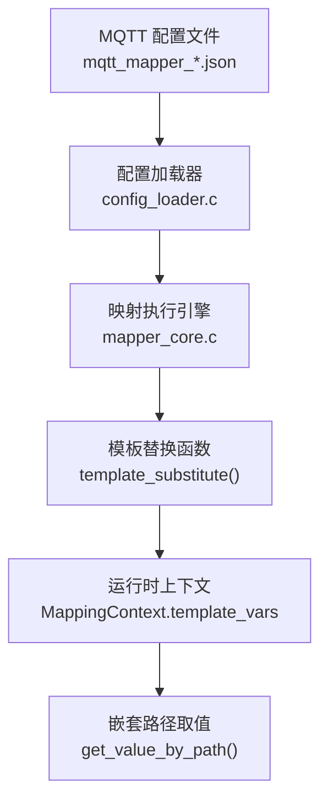
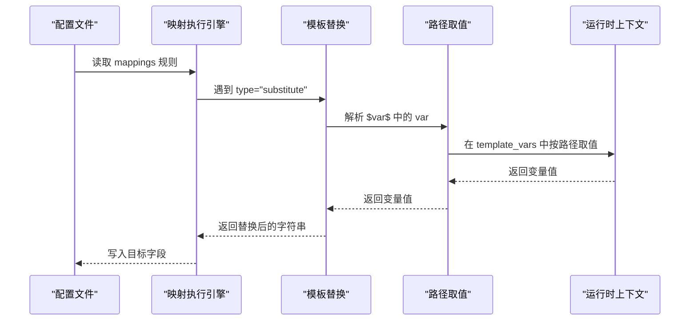
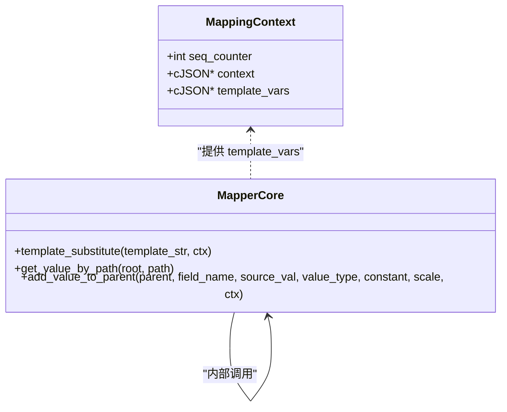

# 模板变量替换

<cite>
**本文引用的文件**
- [mapper_core.c](file://.trae/skills/protocol-conversion/scripts/mapper_core.c)
- [mapper_core.h](file://.trae/skills/protocol-conversion/scripts/mapper_core.h)
- [protocol_converter.py](file://.trae/skills/protocol-conversion/scripts/protocol_converter.py)
- [test_protocol_converter.py](file://.trae/skills/protocol-conversion/scripts/test_protocol_converter.py)
- [mqtt_mapper_202608261100.json](file://.trae/skills/mqtt-conversion/scripts/mqtt_mapper_202608261100.json)
- [SKILL.md（MQTT）](file://.trae/skills/mqtt-conversion/SKILL.md)
- [SKILL.md（HTTP）](file://.trae/skills/http-conversion/SKILL.md)
</cite>

## 目录
1. [简介](#简介)
2. [项目结构](#项目结构)
3. [核心组件](#核心组件)
4. [架构总览](#架构总览)
5. [详细组件分析](#详细组件分析)
6. [依赖关系分析](#依赖关系分析)
7. [性能考量](#性能考量)
8. [故障排查指南](#故障排查指南)
9. [结论](#结论)
10. [附录：配置示例与最佳实践](#附录配置示例与最佳实践)

## 简介
本技术文档聚焦于“模板变量替换”机制，围绕 substitute 类型的工作方式、模板字符串格式、运行时上下文值的解析与替换过程展开。重点说明：
- 在 constant 字段中使用 $变量名$ 的模板语法；
- 通过 MappingContext.template_vars 提供的嵌套路径变量进行解析（如 ssl_mqtt_server.gatewayID）；
- 已注册变量的含义与用途（以 ssl_mqtt_server.gatewayID 为代表）；
- 完整的配置示例与使用方式；
- 自定义变量扩展与作用域管理的最佳实践。

## 项目结构
该仓库中模板变量替换能力由 C 引擎与 Python 参考实现共同提供，并通过 MQTT 转换 SKILL 中的 JSON 配置进行使用。关键位置如下：
- 统一映射核心引擎（C）：mapper_core.c、mapper_core.h
- Python 参考实现（测试与演示）：protocol_converter.py、test_protocol_converter.py
- MQTT 转换配置示例：mqtt_mapper_202608261100.json
- 使用说明与约束：SKILL.md（MQTT）、SKILL.md（HTTP）

图表来源
- [mapper_core.c:282-317](file://.trae/skills/protocol-conversion/scripts/mapper_core.c#L282-L317)
- [mapper_core.c:41-88](file://.trae/skills/protocol-conversion/scripts/mapper_core.c#L41-L88)
- [mqtt_mapper_202608261100.json:23-28](file://.trae/skills/mqtt-conversion/scripts/mqtt_mapper_202608261100.json#L23-L28)

章节来源
- [mapper_core.c:282-317](file://.trae/skills/protocol-conversion/scripts/mapper_core.c#L282-L317)
- [mqtt_mapper_202608261100.json:23-28](file://.trae/skills/mqtt-conversion/scripts/mqtt_mapper_202608261100.json#L23-L28)

## 核心组件
- 模板替换函数 template_substitute：负责扫描 constant 中的 $var$ 片段，从 MappingContext.template_vars 按点号分隔的嵌套路径取值并替换。
- 路径取值工具 get_value_by_path：支持 a.b.c、a[0]、a[*]、"." 等路径语法，用于在 template_vars 中定位变量值。
- 类型转换入口 add_value_to_parent：当 value_type 为 "substitute" 时，调用 template_substitute 完成替换后再写入目标对象。
- 映射上下文 MappingContext：包含 seq_counter、context（HTTP 链式调用用）和 template_vars（MQTT 模板变量表）。

章节来源
- [mapper_core.c:282-317](file://.trae/skills/protocol-conversion/scripts/mapper_core.c#L282-L317)
- [mapper_core.c:41-88](file://.trae/skills/protocol-conversion/scripts/mapper_core.c#L41-L88)
- [mapper_core.c:332-437](file://.trae/skills/protocol-conversion/scripts/mapper_core.c#L332-L437)
- [mapper_core.h:60-64](file://.trae/skills/protocol-conversion/scripts/mapper_core.h#L60-L64)

## 架构总览
模板变量替换在映射执行阶段被触发，流程如下：
- 规则解析：读取 mappings 中的每条规则，若 source_type="constant" 且 type="substitute"，则进入模板替换分支。
- 模板扫描：template_substitute 扫描 constant 中的 $...$ 片段，提取变量名。
- 路径解析：使用 get_value_by_path 在 ctx->template_vars 中按点号路径查找对应值。
- 结果替换：将匹配到的值替换回模板字符串，最终作为目标字段的值输出。

图表来源
- [mapper_core.c:282-317](file://.trae/skills/protocol-conversion/scripts/mapper_core.c#L282-L317)
- [mapper_core.c:41-88](file://.trae/skills/protocol-conversion/scripts/mapper_core.c#L41-L88)
- [mapper_core.c:332-437](file://.trae/skills/protocol-conversion/scripts/mapper_core.c#L332-L437)

## 详细组件分析

### 模板替换函数 template_substitute
- 输入：模板字符串 constant、运行时上下文 ctx（含 template_vars）。
- 行为：
  - 扫描常量字符串，寻找形如 $var$ 的片段；
  - 将 var 按 "." 分割为多级路径，逐级在 template_vars 中取值；
  - 若找到对应字符串值，则替换原片段；否则保留原片段不变；
  - 支持多个变量在同一模板中出现。
- 复杂度：时间复杂度 O(N+M)，N 为模板长度，M 为变量数量；空间复杂度取决于结果字符串大小。
- 边界情况：
  - 未闭合的 $ 或找不到变量时，跳过并继续扫描；
  - 路径中间节点不存在时，视为未命中，不替换。

章节来源
- [mapper_core.c:282-317](file://.trae/skills/protocol-conversion/scripts/mapper_core.c#L282-L317)

### 路径取值工具 get_value_by_path
- 支持语法：
  - 对象属性访问：a.b.c
  - 数组索引：a[0]、a[1]
  - 整数组返回：a[*]
  - 根对象引用："."
- 在模板替换中，主要用于在 template_vars 中按点号路径定位变量值。
- 注意：模板变量名本身不含数组索引，但可通过 template_vars 的结构设计间接支持。

章节来源
- [mapper_core.c:41-88](file://.trae/skills/protocol-conversion/scripts/mapper_core.c#L41-L88)

### 类型转换入口 add_value_to_parent
- 当 value_type="substitute" 时：
  - 检查 constant 非空且存在 ctx；
  - 调用 template_substitute 完成替换；
  - 将替换后的字符串写入目标对象字段。
- 其他类型（int/double/long/bool/object/string）在此函数内统一处理。

章节来源
- [mapper_core.c:332-437](file://.trae/skills/protocol-conversion/scripts/mapper_core.c#L332-L437)

### 映射上下文 MappingContext
- 字段：
  - seq_counter：序列生成器计数器；
  - context：HTTP 链式调用上下文（MQTT 通常为 NULL）；
  - template_vars：MQTT 模板变量表，供 substitute 使用。
- 作用：承载运行时变量，使模板替换具备动态性。

章节来源
- [mapper_core.h:60-64](file://.trae/skills/protocol-conversion/scripts/mapper_core.h#L60-L64)

### Python 参考实现与测试
- protocol_converter.py 提供了 Python 版本的 template_substitute，逻辑与 C 版本一致，便于测试与验证。
- test_protocol_converter.py 包含单元测试，覆盖简单替换、嵌套路径替换、以及完整 MQTT 转换场景。

章节来源
- [protocol_converter.py:240-265](file://.trae/skills/protocol-conversion/scripts/protocol_converter.py#L240-L265)
- [test_protocol_converter.py:354-366](file://.trae/skills/protocol-conversion/scripts/test_protocol_converter.py#L354-L366)
- [test_protocol_converter.py:567-601](file://.trae/skills/protocol-conversion/scripts/test_protocol_converter.py#L567-L601)

## 依赖关系分析
- 模块耦合：
  - template_substitute 依赖 get_value_by_path 进行路径解析；
  - add_value_to_parent 在 value_type="substitute" 时调用 template_substitute；
  - MappingContext 提供 template_vars，贯穿整个替换过程。
- 外部依赖：
  - cJSON 库用于 JSON 操作；
  - 标准库 string/time 用于字符串与时间处理。
- 潜在循环依赖：无直接循环依赖，职责清晰分层。

图表来源
- [mapper_core.h:60-64](file://.trae/skills/protocol-conversion/scripts/mapper_core.h#L60-L64)
- [mapper_core.c:282-317](file://.trae/skills/protocol-conversion/scripts/mapper_core.c#L282-L317)
- [mapper_core.c:41-88](file://.trae/skills/protocol-conversion/scripts/mapper_core.c#L41-L88)
- [mapper_core.c:332-437](file://.trae/skills/protocol-conversion/scripts/mapper_core.c#L332-L437)

章节来源
- [mapper_core.c:282-317](file://.trae/skills/protocol-conversion/scripts/mapper_core.c#L282-L317)
- [mapper_core.c:41-88](file://.trae/skills/protocol-conversion/scripts/mapper_core.c#L41-L88)
- [mapper_core.c:332-437](file://.trae/skills/protocol-conversion/scripts/mapper_core.c#L332-L437)
- [mapper_core.h:60-64](file://.trae/skills/protocol-conversion/scripts/mapper_core.h#L60-L64)

## 性能考量
- 模板替换为线性扫描，适合短模板与少量变量；
- 若模板较长或变量较多，建议：
  - 减少重复变量引用；
  - 将复杂拼接逻辑前置到运行时上下文构造阶段；
  - 避免在高频路径上频繁创建/销毁临时字符串。
- 路径取值基于 cJSON，注意 JSON 层级过深可能带来额外开销。

## 故障排查指南
- 症状：模板未替换，输出仍为 $var$
  - 检查 MappingContext.template_vars 是否传入且非空；
  - 确认变量名拼写与路径正确（区分大小写）；
  - 确认 constant 中 $ 成对出现，且变量名不包含非法字符。
- 症状：嵌套路径无法解析
  - 使用 get_value_by_path 支持的语法，确保 template_vars 结构与路径一致；
  - 若路径中间节点缺失，将视为未命中，不会替换。
- 症状：类型错误
  - 确认 value_type="substitute" 时，constant 为字符串模板；
  - 替换后写入目标字段为字符串类型。

章节来源
- [mapper_core.c:282-317](file://.trae/skills/protocol-conversion/scripts/mapper_core.c#L282-L317)
- [mapper_core.c:41-88](file://.trae/skills/protocol-conversion/scripts/mapper_core.c#L41-L88)
- [mapper_core.c:332-437](file://.trae/skills/protocol-conversion/scripts/mapper_core.c#L332-L437)

## 结论
模板变量替换通过 $变量名$ 语法与 MappingContext.template_vars 的嵌套路径解析，实现了在 MQTT 协议转换中对运行时上下文的灵活引用。其核心在于：
- 统一的模板扫描与替换逻辑；
- 强大的路径取值能力；
- 清晰的类型转换入口；
- 可测试的 Python 参考实现与用例。
在生产环境中，应合理组织 template_vars 的结构，遵循命名规范与作用域管理，确保替换稳定可靠。

## 附录：配置示例与最佳实践

### 已注册变量清单与用途
- 依据 MQTT 转换配置与测试用例，常见变量包括：
  - ssl_mqtt_server.gatewayID：网关标识，常用于设备上报的目标消息中作为 devId 或相关标识；
  - 其他变量可按相同模式扩展（如 clientID、serverAddr 等），需在 template_vars 中定义并在映射规则中引用。
- 这些变量来源于运行时上下文，通常由平台或连接层注入。

章节来源
- [mqtt_mapper_202608261100.json:23-28](file://.trae/skills/mqtt-conversion/scripts/mqtt_mapper_202608261100.json#L23-L28)
- [test_protocol_converter.py:567-601](file://.trae/skills/protocol-conversion/scripts/test_protocol_converter.py#L567-L601)

### 嵌套路径变量解析逻辑
- 模板变量名支持点号分隔的多级路径，例如 ssl_mqtt_server.gatewayID；
- 解析过程：
  - 将变量名按 "." 拆分为多级键；
  - 在 template_vars 中逐级查找，直到获得叶子值；
  - 若任意一级不存在，则视为未命中，保留原模板片段。

章节来源
- [mapper_core.c:282-317](file://.trae/skills/protocol-conversion/scripts/mapper_core.c#L282-L317)
- [mapper_core.c:41-88](file://.trae/skills/protocol-conversion/scripts/mapper_core.c#L41-L88)

### 完整配置示例（MQTT）
- 在 mappings 中，使用 source_type="constant" 与 type="substitute" 组合，并在 constant 中引用模板变量：
  - 示例：devId 字段使用 "$ssl_mqtt_server.gatewayID$" 作为模板；
  - 运行时会从 template_vars 中解析并替换为实际网关 ID。
- 该示例可在 mqtt_mapper_202608261100.json 中找到。

章节来源
- [mqtt_mapper_202608261100.json:23-28](file://.trae/skills/mqtt-conversion/scripts/mqtt_mapper_202608261100.json#L23-L28)

### 自定义变量扩展与作用域管理最佳实践
- 变量命名规范：
  - 使用前缀分组，如 ssl_mqtt_server.*、device_info.*；
  - 避免使用特殊字符与空格，保持路径简洁可读。
- 作用域管理：
  - 将全局变量放入顶层（如 ssl_mqtt_server）；
  - 将设备/会话相关变量放入子对象（如 device_info）；
  - 在运行时构造 template_vars 时，按需合并不同作用域的变量。
- 扩展建议：
  - 新增变量时，先在 template_vars 中定义并验证路径可达；
  - 在映射规则中引用新变量，并通过单元测试覆盖；
  - 对于敏感信息（如密钥），建议使用环境变量注入到 template_vars，而非硬编码。

章节来源
- [mapper_core.h:60-64](file://.trae/skills/protocol-conversion/scripts/mapper_core.h#L60-L64)
- [test_protocol_converter.py:354-366](file://.trae/skills/protocol-conversion/scripts/test_protocol_converter.py#L354-L366)

### HTTP 与 MQTT 的差异说明
- HTTP 转换不使用 substitute 模板替换，而是通过 source_type="context" 引用运行时上下文；
- MQTT 转换使用 substitute 模板替换，结合 constant 与 type="substitute" 组合；
- 两者共享 mapper_core.c 的路径取值与类型转换能力。

章节来源
- [SKILL.md（HTTP）:81-88](file://.trae/skills/http-conversion/SKILL.md#L81-L88)
- [SKILL.md（MQTT）:48-54](file://.trae/skills/mqtt-conversion/SKILL.md#L48-L54)