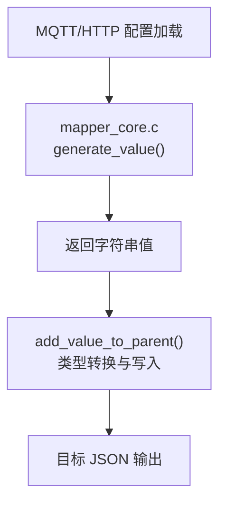
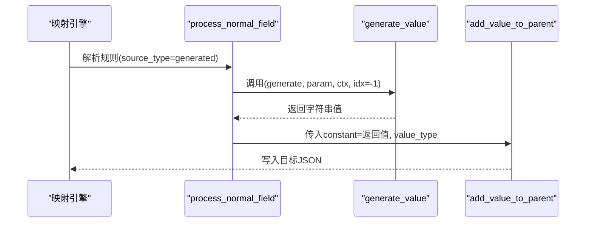
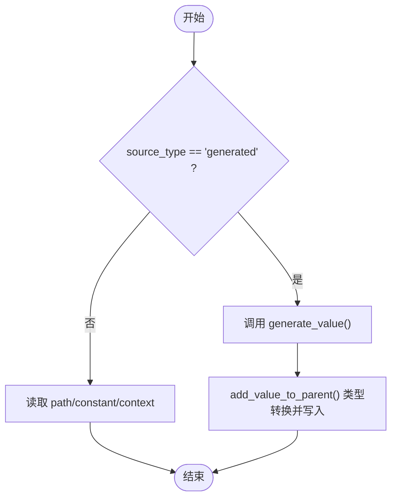
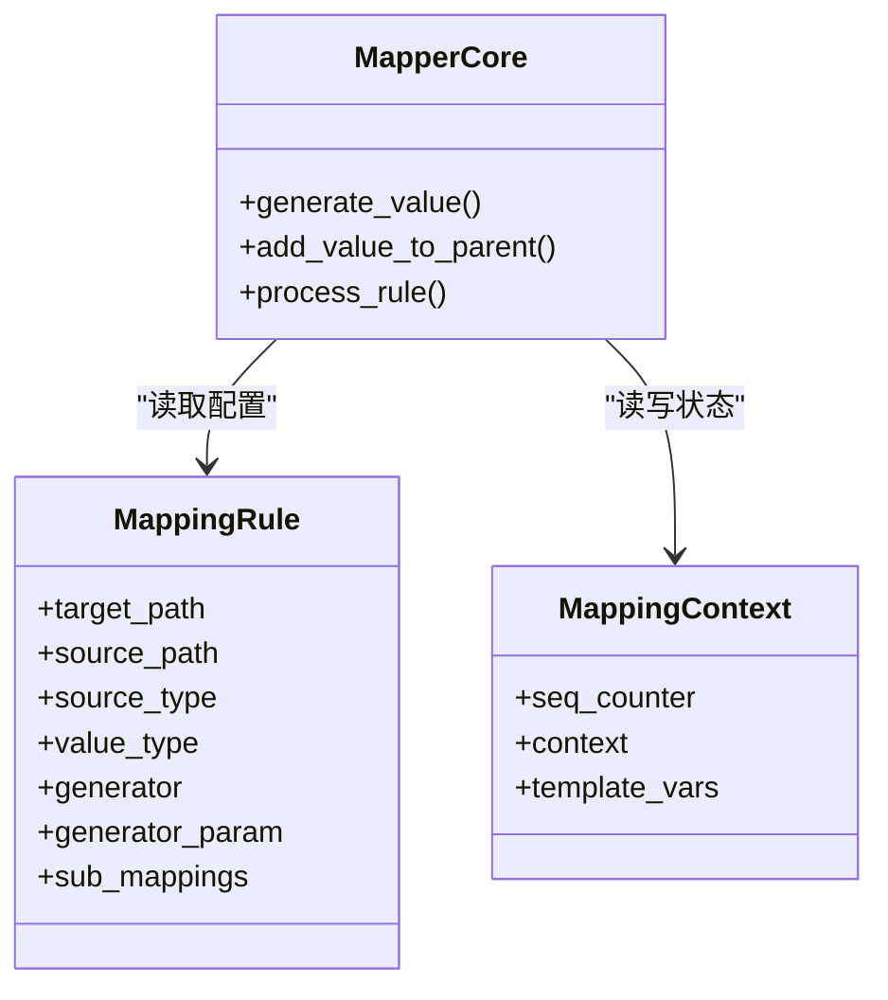

# 生成器清单

<cite>
**本文引用的文件**
- [mapper_core.c](file://.trae/skills/protocol-conversion/scripts/mapper_core.c)
- [mapper_core.h](file://.trae/skills/protocol-conversion/scripts/mapper_core.h)
- [protocol_converter.py](file://.trae/skills/protocol-conversion/scripts/protocol_converter.py)
- [test_protocol_converter.py](file://.trae/skills/protocol-conversion/scripts/test_protocol_converter.py)
- [mqtt_mapper_202608261100.json](file://.trae/skills/mqtt-conversion/scripts/mqtt_mapper_202608261100.json)
</cite>

## 目录
1. [简介](#简介)
2. [项目结构](#项目结构)
3. [核心组件](#核心组件)
4. [架构总览](#架构总览)
5. [详细组件分析](#详细组件分析)
6. [依赖关系分析](#依赖关系分析)
7. [性能考虑](#性能考虑)
8. [故障排查指南](#故障排查指南)
9. [结论](#结论)
10. [附录：配置示例与使用指南](#附录：配置示例与使用指南)

## 简介
本文件面向协议映射引擎中的“生成器”能力，系统性梳理 mapper_core.c 统一识别的所有生成器类型及其在映射规则中的作用、执行时机、返回值格式、适用场景与配置参数。覆盖的生成器包括：uuid、current_timestamp、timestamp_sec、current_timestamp_ms、timestamp_ms、datetime_compact、datetime_str、random_string、md5_sign、batch_id、sequence。文档同时提供选择指南与性能注意事项，帮助读者在实际项目中正确选用并高效使用。

## 项目结构
- 统一映射核心位于 .trae/skills/protocol-conversion/scripts/mapper_core.c/.h，负责路径取值、数组遍历、类型转换以及生成器调用。
- Python 参考实现位于 protocol_converter.py，用于测试与行为对齐；单元测试位于 test_protocol_converter.py。
- MQTT 侧配置示例位于 mqtt_mapper_202608261100.json，展示了生成的字段如何写入目标 JSON。

图表来源
- [mapper_core.c:210-271](file://.trae/skills/protocol-conversion/scripts/mapper_core.c#L210-L271)
- [mapper_core.c:332-437](file://.trae/skills/protocol-conversion/scripts/mapper_core.c#L332-L437)

章节来源
- [mapper_core.c:1-22](file://.trae/skills/protocol-conversion/scripts/mapper_core.c#L1-L22)
- [mapper_core.h:1-19](file://.trae/skills/protocol-conversion/scripts/mapper_core.h#L1-L19)

## 核心组件
- 生成器入口：generate_value(generator, param, ctx, idx)
  - 根据 generator 名称分支处理，内部获取系统时间（秒与毫秒），并按不同生成器填充静态缓冲区后返回。
- 上下文：MappingContext
  - seq_counter：供 sequence 生成器维护递增计数。
  - context/template_vars：HTTP/MQTT 链式上下文与模板变量表（与生成器无直接耦合）。
- 类型写入：add_value_to_parent(...)
  - 将 generate_value 返回的字符串按 value_type 转换为 int/double/long/bool/object/substitute/string 等写入目标对象。

章节来源
- [mapper_core.h:36-64](file://.trae/skills/protocol-conversion/scripts/mapper_core.h#L36-L64)
- [mapper_core.c:210-271](file://.trae/skills/protocol-conversion/scripts/mapper_core.c#L210-L271)
- [mapper_core.c:332-437](file://.trae/skills/protocol-conversion/scripts/mapper_core.c#L332-L437)

## 架构总览
生成器在映射流程中的位置如下：
- 当 source_type=generated 时，process_normal_field 会调用 generate_value，并将结果作为 constant_val 传入 add_value_to_parent 进行类型转换与落盘。
- 对于数组遍历（array_foreach），若子规则使用 generated，则同样通过 generate_value 生成值，并在循环中可结合 idx 或 ctx 控制序列号。

图表来源
- [mapper_core.c:617-715](file://.trae/skills/protocol-conversion/scripts/mapper_core.c#L617-L715)
- [mapper_core.c:210-271](file://.trae/skills/protocol-conversion/scripts/mapper_core.c#L210-L271)
- [mapper_core.c:332-437](file://.trae/skills/protocol-conversion/scripts/mapper_core.c#L332-L437)

## 详细组件分析

### 生成器总览与执行时机
- 执行时机：
  - 普通字段：当 source_type="generated" 时，在 process_normal_field 中调用 generate_value。
  - 数组遍历：子规则若为 generated，则在遍历过程中调用 generate_value；idx 由外层循环索引决定，ctx.seq_counter 用于跨项自增。
- 返回值：所有生成器均返回字符串，后续由 add_value_to_parent 按 value_type 转换。

章节来源
- [mapper_core.c:617-715](file://.trae/skills/protocol-conversion/scripts/mapper_core.c#L617-L715)
- [mapper_core.c:210-271](file://.trae/skills/protocol-conversion/scripts/mapper_core.c#L210-L271)

### 各生成器详解

#### uuid
- 功能与用途：生成全局唯一标识符，常用于消息 ID、请求 ID、会话 ID 等。
- 返回值格式：字符串（占位实现，Python 参考实现返回 UUID v4 标准格式）。
- 适用场景：需要唯一性且无需业务含义的标识。
- 配置参数：无。
- 执行时机：每次映射规则触发时生成新值。
- 性能：轻量级字符串生成，开销极低。

章节来源
- [mapper_core.c:233-235](file://.trae/skills/protocol-conversion/scripts/mapper_core.c#L233-L235)
- [protocol_converter.py:214-215](file://.trae/skills/protocol-conversion/scripts/protocol_converter.py#L214-L215)
- [test_protocol_converter.py:291-294](file://.trae/skills/protocol-conversion/scripts/test_protocol_converter.py#L291-L294)

#### current_timestamp / timestamp_sec
- 功能与用途：当前时间的秒级时间戳，适用于日志时间、事件时间等。
- 返回值格式：十进制秒数字符串（如 "171xxxxxxx"）。
- 适用场景：需要 Unix 秒级时间戳的场景。
- 配置参数：无。
- 执行时机：每次调用时取系统时间。
- 性能：一次 gettimeofday + 格式化，开销极低。

章节来源
- [mapper_core.c:236-239](file://.trae/skills/protocol-conversion/scripts/mapper_core.c#L236-L239)
- [protocol_converter.py:216-217](file://.trae/skills/protocol-conversion/scripts/protocol_converter.py#L216-L217)
- [test_protocol_converter.py:296-310](file://.trae/skills/protocol-conversion/scripts/test_protocol_converter.py#L296-L310)

#### current_timestamp_ms / timestamp_ms
- 功能与用途：当前时间的毫秒级时间戳，适用于高精度时序数据。
- 返回值格式：十进制毫秒数字符串（如 "171xxxxxxxxx"）。
- 适用场景：需要毫秒精度的时间戳。
- 配置参数：无。
- 执行时机：每次调用时取系统时间。
- 性能：一次 gettimeofday + 计算，开销极低。

章节来源
- [mapper_core.c:240-243](file://.trae/skills/protocol-conversion/scripts/mapper_core.c#L240-L243)
- [protocol_converter.py:218-219](file://.trae/skills/protocol-conversion/scripts/protocol_converter.py#L218-L219)
- [test_protocol_converter.py:301-316](file://.trae/skills/protocol-conversion/scripts/test_protocol_converter.py#L301-L316)

#### datetime_compact
- 功能与用途：紧凑格式日期时间字符串，便于排序与存储。
- 返回值格式：YYYYMMDDHHMMSS（14 位数字字符串）。
- 适用场景：需要人类可读但紧凑的时间表示。
- 配置参数：无。
- 执行时机：每次调用时取系统时间并格式化。
- 性能：一次 localtime + strftime，开销低。

章节来源
- [mapper_core.c:244-247](file://.trae/skills/protocol-conversion/scripts/mapper_core.c#L244-L247)
- [protocol_converter.py:220-221](file://.trae/skills/protocol-conversion/scripts/protocol_converter.py#L220-L221)
- [test_protocol_converter.py:318-322](file://.trae/skills/protocol-conversion/scripts/test_protocol_converter.py#L318-L322)

#### datetime_str
- 功能与用途：标准可读日期时间字符串。
- 返回值格式：YYYY-MM-DD HH:MM:SS（19 字符字符串）。
- 适用场景：展示型时间字段。
- 配置参数：无。
- 执行时机：每次调用时取系统时间并格式化。
- 性能：一次 localtime + strftime，开销低。

章节来源
- [mapper_core.c:248-251](file://.trae/skills/protocol-conversion/scripts/mapper_core.c#L248-L251)
- [protocol_converter.py:222-223](file://.trae/skills/protocol-conversion/scripts/protocol_converter.py#L222-L223)
- [test_protocol_converter.py:323-327](file://.trae/skills/protocol-conversion/scripts/test_protocol_converter.py#L323-L327)

#### random_string
- 功能与用途：随机字符串，可用于临时令牌、一次性码等。
- 返回值格式：字符串（C 实现为占位，Python 参考实现返回固定长度十六进制串）。
- 适用场景：不需要强唯一性的随机标识。
- 配置参数：无。
- 执行时机：每次调用生成新的随机串。
- 性能：内存分配与随机数生成，开销较低。

章节来源
- [mapper_core.c:252-254](file://.trae/skills/protocol-conversion/scripts/mapper_core.c#L252-L254)
- [protocol_converter.py:224-225](file://.trae/skills/protocol-conversion/scripts/protocol_converter.py#L224-L225)
- [test_protocol_converter.py:349-351](file://.trae/skills/protocol-conversion/scripts/test_protocol_converter.py#L349-L351)

#### md5_sign
- 功能与用途：基于时间戳的 MD5 签名，用于防重放或简单校验。
- 返回值格式：32 位小写十六进制字符串（C 实现为占位，Python 参考实现返回 MD5 hex）。
- 适用场景：轻量级签名或去重键。
- 配置参数：无。
- 执行时机：每次调用生成新签名。
- 性能：哈希计算，开销较低。

章节来源
- [mapper_core.c:255-257](file://.trae/skills/protocol-conversion/scripts/mapper_core.c#L255-L257)
- [protocol_converter.py:226-227](file://.trae/skills/protocol-conversion/scripts/protocol_converter.py#L226-L227)
- [test_protocol_converter.py:340-343](file://.trae/skills/protocol-conversion/scripts/test_protocol_converter.py#L340-L343)

#### batch_id
- 功能与用途：批次标识，用于批量数据处理分组。
- 返回值格式：字符串（C 实现为占位，Python 参考实现返回短 UUID）。
- 适用场景：同一批次的消息关联。
- 配置参数：无。
- 执行时机：每次调用生成新批次 ID。
- 性能：轻量级字符串生成，开销极低。

章节来源
- [mapper_core.c:258-260](file://.trae/skills/protocol-conversion/scripts/mapper_core.c#L258-L260)
- [protocol_converter.py:228-229](file://.trae/skills/protocol-conversion/scripts/protocol_converter.py#L228-L229)
- [test_protocol_converter.py:345-347](file://.trae/skills/protocol-conversion/scripts/test_protocol_converter.py#L345-L347)

#### sequence
- 功能与用途：顺序编号，支持两种模式：
  - 基于 idx：在数组遍历中，返回 idx+1，适合“第 N 项”的序号。
  - 基于 ctx：跨项自增，使用 MappingContext.seq_counter，适合全局递增序列。
- 返回值格式：十进制字符串（如 "1"、"2"）。
- 适用场景：流水号、订单号片段、分片序号等。
- 配置参数：无（行为由调用上下文决定）。
- 执行时机：
  - 数组遍历：idx 由外层循环提供。
  - 非数组：使用 ctx.seq_counter 自增。
- 性能：整数自增与格式化，开销极低。

章节来源
- [mapper_core.c:261-268](file://.trae/skills/protocol-conversion/scripts/mapper_core.c#L261-L268)
- [mapper_core.h:60-64](file://.trae/skills/protocol-conversion/scripts/mapper_core.h#L60-L64)
- [protocol_converter.py:230-235](file://.trae/skills/protocol-conversion/scripts/protocol_converter.py#L230-L235)
- [test_protocol_converter.py:329-338](file://.trae/skills/protocol-conversion/scripts/test_protocol_converter.py#L329-L338)

### 生成器在映射规则中的作用与执行流程图

图表来源
- [mapper_core.c:617-715](file://.trae/skills/protocol-conversion/scripts/mapper_core.c#L617-L715)
- [mapper_core.c:210-271](file://.trae/skills/protocol-conversion/scripts/mapper_core.c#L210-L271)
- [mapper_core.c:332-437](file://.trae/skills/protocol-conversion/scripts/mapper_core.c#L332-L437)

## 依赖关系分析
- generate_value 依赖系统时间与本地化函数（gettimeofday/localtime/strftime）。
- add_value_to_parent 依赖 cJSON 库进行数值与对象构建。
- MappingContext 提供 sequence 的跨项状态；template_vars/context 用于 substitute 与 HTTP 链式上下文（与生成器解耦）。

图表来源
- [mapper_core.h:36-64](file://.trae/skills/protocol-conversion/scripts/mapper_core.h#L36-L64)
- [mapper_core.c:210-271](file://.trae/skills/protocol-conversion/scripts/mapper_core.c#L210-L271)
- [mapper_core.c:332-437](file://.trae/skills/protocol-conversion/scripts/mapper_core.c#L332-L437)

章节来源
- [mapper_core.h:36-64](file://.trae/skills/protocol-conversion/scripts/mapper_core.h#L36-L64)
- [mapper_core.c:210-271](file://.trae/skills/protocol-conversion/scripts/mapper_core.c#L210-L271)
- [mapper_core.c:332-437](file://.trae/skills/protocol-conversion/scripts/mapper_core.c#L332-L437)

## 性能考虑
- 时间类生成器（current_timestamp、timestamp_sec、current_timestamp_ms、timestamp_ms、datetime_compact、datetime_str）：
  - 每次调用都会获取系统时间并进行格式化，建议在高频路径中避免不必要的重复调用。
  - 若需在同一批数据中使用相同时间，可在上层缓存后再复用。
- 唯一性与随机性（uuid、random_string、batch_id、md5_sign）：
  - 均为轻量级操作，但在极高吞吐下仍建议评估 CPU 与内存分配成本。
- 序列（sequence）：
  - 基于整数的自增，开销极低；注意在多并发环境下如需严格单调递增，应确保单线程或加锁策略。
- 类型转换（add_value_to_parent）：
  - 频繁的类型转换会带来额外开销，尽量保持 value_type 稳定并减少不必要的转换。

[本节为通用性能指导，不直接分析具体代码行]

## 故障排查指南
- 生成器未生效：
  - 检查 source_type 是否为 "generated"，否则不会调用 generate_value。
  - 确认 target_path 与 value_type 设置正确，确保 add_value_to_parent 能写入目标。
- 序列号异常：
  - 若期望跨项递增，请确保 MappingContext.seq_counter 存在且未被重置。
  - 在数组遍历中，优先使用 idx 模式以获得稳定的序号。
- 时间相关字段不符合预期：
  - 确认时区与本地化设置；datetime_compact/datetime_str 依赖 localtime。
- 占位实现差异：
  - C 实现中 uuid/random_string/md5_sign/batch_id 当前为占位，Python 参考实现有完整逻辑；请以 Python 行为为准进行验证与测试。

章节来源
- [mapper_core.c:210-271](file://.trae/skills/protocol-conversion/scripts/mapper_core.c#L210-L271)
- [protocol_converter.py:212-236](file://.trae/skills/protocol-conversion/scripts/protocol_converter.py#L212-L236)
- [test_protocol_converter.py:288-366](file://.trae/skills/protocol-conversion/scripts/test_protocol_converter.py#L288-L366)

## 结论
mapper_core.c 提供了统一的生成器接口，涵盖唯一标识、时间戳、日期时间、随机串、签名、批次号与序列号等常见需求。生成器在映射规则中以 source_type="generated" 的方式被调用，并通过 add_value_to_parent 完成类型转换与落盘。实际使用中应根据场景选择合适的生成器，并注意在高吞吐路径下的性能影响与并发一致性要求。

[本节为总结性内容，不直接分析具体代码行]

## 附录：配置示例与使用指南

### 配置字段说明
- target：目标 JSON 路径（支持嵌套路径与数组锚点 @）。
- source_type：数据来源类型，使用生成器时为 "generated"。
- generator：生成器名称（见上文列表）。
- type：目标值的类型（string/int/double/long/bool/object/substitute）。
- sub_mappings：数组遍历时的子规则集合。

章节来源
- [mapper_core.h:36-51](file://.trae/skills/protocol-conversion/scripts/mapper_core.h#L36-L51)

### 典型配置示例（来自仓库）
- MQTT 示例中使用了 uuid 与 datetime_compact：
  - msgId 使用 uuid 生成消息 ID。
  - msgTime 使用 datetime_compact 生成紧凑时间字符串。

章节来源
- [mqtt_mapper_202608261100.json:11-22](file://.trae/skills/mqtt-conversion/scripts/mqtt_mapper_202608261100.json#L11-L22)

### 生成器选择指南
- 需要唯一标识：优先 uuid；若仅需短标识可用 batch_id。
- 需要时间戳：
  - 秒级：current_timestamp 或 timestamp_sec。
  - 毫秒级：current_timestamp_ms 或 timestamp_ms。
- 需要可读时间：
  - 紧凑：datetime_compact。
  - 标准：datetime_str。
- 需要随机串：random_string。
- 需要轻量签名：md5_sign。
- 需要顺序号：
  - 数组内序号：sequence（基于 idx）。
  - 全局递增：sequence（基于 ctx.seq_counter）。

[本节为概念性指导，不直接分析具体代码行]

### 执行时机与集成要点
- 在普通字段中，当 source_type="generated" 时，会在 process_normal_field 中调用 generate_value，随后通过 add_value_to_parent 写入目标。
- 在数组遍历中，子规则若为 generated，将在遍历过程中调用 generate_value；可使用 idx 或 ctx 控制序列号。
- 若需要在同一批数据中共享时间或批次信息，可在上层缓存后复用，以减少重复生成带来的开销。

章节来源
- [mapper_core.c:617-715](file://.trae/skills/protocol-conversion/scripts/mapper_core.c#L617-L715)
- [mapper_core.c:210-271](file://.trae/skills/protocol-conversion/scripts/mapper_core.c#L210-L271)
- [mapper_core.c:332-437](file://.trae/skills/protocol-conversion/scripts/mapper_core.c#L332-L437)