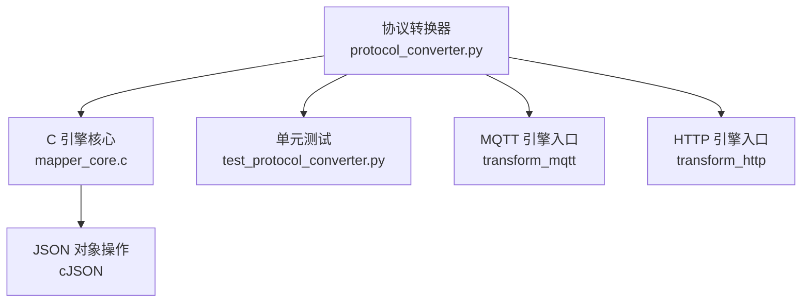
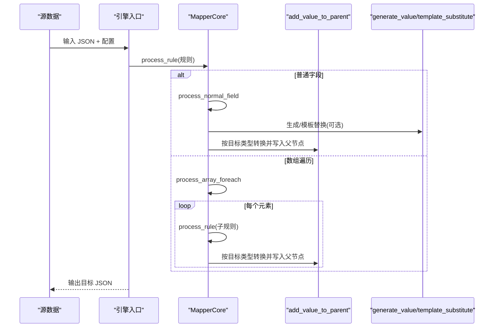
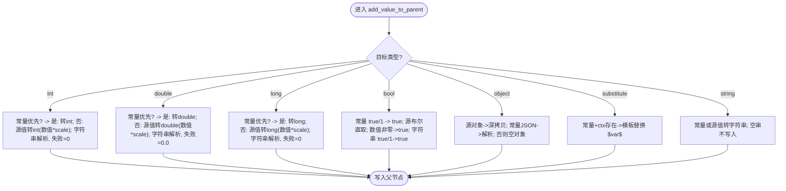
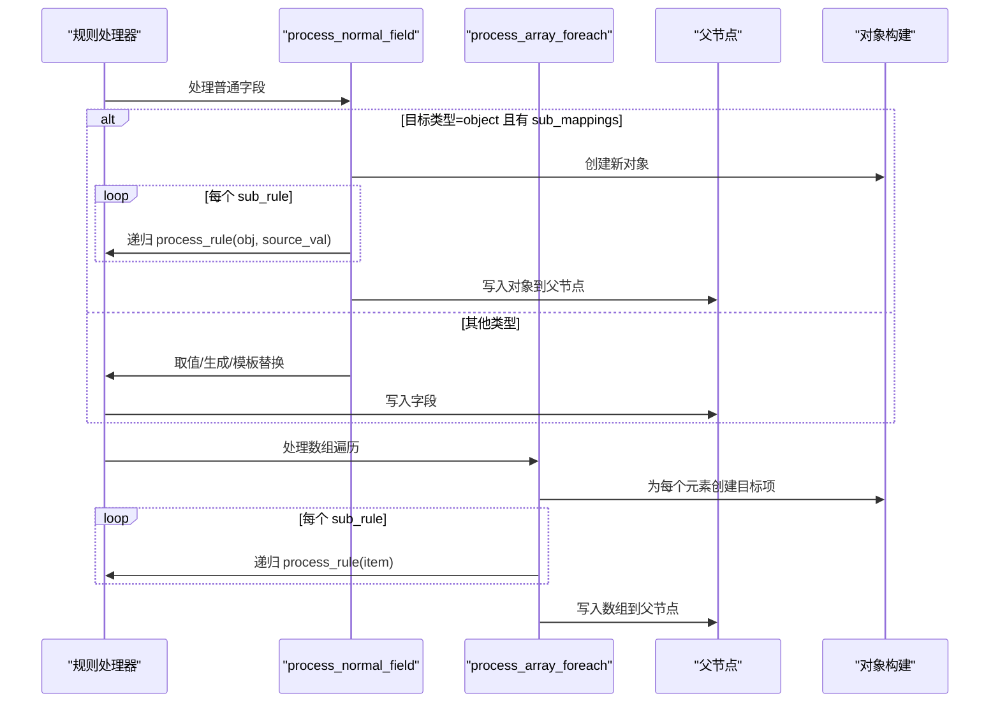
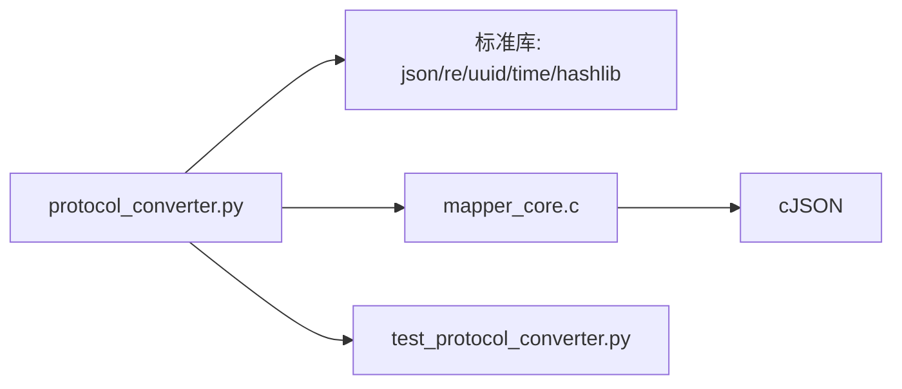

# 类型系统

<cite>
**本文引用的文件**
- [protocol_converter.py](file://.trae/skills/protocol-conversion/scripts/protocol_converter.py)
- [test_protocol_converter.py](file://.trae/skills/protocol-conversion/scripts/test_protocol_converter.py)
- [mapper_core.c](file://.trae/skills/protocol-conversion/scripts/mapper_core.c)
</cite>

## 目录
1. [简介](#简介)
2. [项目结构](#项目结构)
3. [核心组件](#核心组件)
4. [架构总览](#架构总览)
5. [详细组件分析](#详细组件分析)
6. [依赖关系分析](#依赖关系分析)
7. [性能考虑](#性能考虑)
8. [故障排查指南](#故障排查指南)
9. [结论](#结论)
10. [附录：配置示例与结果对照](#附录配置示例与结果对照)

## 简介
本技术文档聚焦于映射引擎支持的7种目标类型：string、double、int、long、bool、object、substitute。文档深入解释每种类型的源值处理方式、非数字值的默认行为、缩放因子 scale 的应用时机，并重点说明 object + sub_mappings 的递归构建机制（上下文切换、递归处理、父节点添加）。同时提供实际配置示例与转换结果对照，以及错误处理与性能优化建议。

## 项目结构
- 统一映射核心以 Python 实现（protocol_converter.py），镜像 C 引擎 mapper_core.c 的逻辑，供 MQTT 与 HTTP 两种引擎复用。
- 测试用例覆盖路径解析、类型转换、生成器、模板替换、数组遍历、MQTT/HTTP 完整转换等场景。
- C 引擎提供底层 JSON 操作与类型转换实现，Python 版本与之保持一致语义。

图表来源
- [protocol_converter.py:28-45](file://.trae/skills/protocol-conversion/scripts/protocol_converter.py#L28-L45)
- [mapper_core.c:320-437](file://.trae/skills/protocol-conversion/scripts/mapper_core.c#L320-L437)

章节来源
- [protocol_converter.py:1-16](file://.trae/skills/protocol-conversion/scripts/protocol_converter.py#L1-L16)
- [mapper_core.c:320-437](file://.trae/skills/protocol-conversion/scripts/mapper_core.c#L320-L437)

## 核心组件
- MapperCore（Python）：统一映射核心，提供路径取值、路径创建、类型转换、生成器、模板替换、规则处理、数组遍历、MQTT/HTTP 入口等方法。
- add_value_to_parent：核心类型转换函数，支持 string/double/int/long/bool/object/substitute 七种目标类型。
- process_rule/process_normal_field/process_array_foreach：规则处理与数组遍历逻辑，支撑复杂嵌套与多维数据映射。
- generate_value/template_substitute：值生成与模板变量替换能力。

章节来源
- [protocol_converter.py:269-376](file://.trae/skills/protocol-conversion/scripts/protocol_converter.py#L269-L376)
- [protocol_converter.py:379-566](file://.trae/skills/protocol-conversion/scripts/protocol_converter.py#L379-L566)
- [mapper_core.c:320-437](file://.trae/skills/protocol-conversion/scripts/mapper_core.c#L320-L437)

## 架构总览
映射引擎采用“统一核心 + 双引擎入口”的架构：
- MQTT 引擎通过 transform_mqtt 加载 mappings 并执行映射。
- HTTP 引擎通过 transform_http 加载 apis[].data_mappings 并执行映射。
- 两者共用 MapperCore 的类型转换、路径解析、数组遍历等能力。

图表来源
- [protocol_converter.py:569-601](file://.trae/skills/protocol-conversion/scripts/protocol_converter.py#L569-L601)
- [protocol_converter.py:379-566](file://.trae/skills/protocol-conversion/scripts/protocol_converter.py#L379-L566)
- [protocol_converter.py:269-376](file://.trae/skills/protocol-conversion/scripts/protocol_converter.py#L269-L376)

## 详细组件分析

### 类型转换核心：add_value_to_parent
该函数负责将源值按目标类型转换后写入父对象，支持以下行为：
- int：优先使用 constant；否则从 source_val 转换；数值型先乘以 scale 再取整；字符串尝试解析，失败为 0。
- double：优先 constant；否则 source_val；数值型乘以 scale；字符串尝试解析，失败为 0.0。
- long：同 int，但类型为长整型。
- bool：constant 为 "true"/"1" 时为真；source_val 布尔直接赋值；数值非零为真；字符串 "true"/"1" 为真。
- object：source_val 为对象则深拷贝；constant 为 JSON 字符串则解析；否则为空对象。
- substitute：仅当 constant 存在且 ctx 存在时进行模板替换 $var$。
- string（默认）：constant 或 source_val 转为字符串；空串不写入。

图表来源
- [protocol_converter.py:269-376](file://.trae/skills/protocol-conversion/scripts/protocol_converter.py#L269-L376)
- [mapper_core.c:320-437](file://.trae/skills/protocol-conversion/scripts/mapper_core.c#L320-L437)

章节来源
- [protocol_converter.py:269-376](file://.trae/skills/protocol-conversion/scripts/protocol_converter.py#L269-L376)
- [mapper_core.c:320-437](file://.trae/skills/protocol-conversion/scripts/mapper_core.c#L320-L437)

### 规则处理与 object + sub_mappings 递归构建
- process_normal_field：解析目标路径，确定父对象与字段名；若目标类型为 object 且存在 sub_mappings，则先获取 source_val（支持 $item 替换），然后对每个 sub_rule 递归调用 process_rule，最终将构建好的对象写入父节点。
- process_array_foreach：解析源数组（支持 "." 作为当前根对象、[*] 展平、嵌套 [*]），根据 item_type（object/key_value）构建目标项，并在每个子规则中递归处理，最后将数组写入父节点。

图表来源
- [protocol_converter.py:480-566](file://.trae/skills/protocol-conversion/scripts/protocol_converter.py#L480-L566)
- [protocol_converter.py:395-479](file://.trae/skills/protocol-conversion/scripts/protocol_converter.py#L395-L479)
- [mapper_core.c:606-695](file://.trae/skills/protocol-conversion/scripts/mapper_core.c#L606-L695)

章节来源
- [protocol_converter.py:480-566](file://.trae/skills/protocol-conversion/scripts/protocol_converter.py#L480-L566)
- [protocol_converter.py:395-479](file://.trae/skills/protocol-conversion/scripts/protocol_converter.py#L395-L479)
- [mapper_core.c:606-695](file://.trae/skills/protocol-conversion/scripts/mapper_core.c#L606-L695)

### 生成器与模板替换
- generate_value：支持 uuid、current_timestamp、timestamp_sec/ms、datetime_compact/str、random_string、md5_sign、batch_id、sequence（基于 idx 或上下文计数器）。
- template_substitute：支持 $var$ 语法，可嵌套路径如 ssl_mqtt_server.gatewayID，在 ctx 中查找并替换。

章节来源
- [protocol_converter.py:206-236](file://.trae/skills/protocol-conversion/scripts/protocol_converter.py#L206-L236)
- [protocol_converter.py:240-265](file://.trae/skills/protocol-conversion/scripts/protocol_converter.py#L240-L265)
- [mapper_core.c:295-317](file://.trae/skills/protocol-conversion/scripts/mapper_core.c#L295-L317)

### 引擎差异与边界条件
- MQTT 不支持 context source_type；HTTP 不支持 substitute source_type（但在特定模拟场景中可能走 substitute 分支）。
- HTTP 特有：字符串→数字转换（int/double/long）；"." 源路径表示当前根对象；key_value 模式用于键值对展开。
- 缺失路径返回 None；越界索引返回 None；空字符串不写入。

章节来源
- [test_protocol_converter.py:770-806](file://.trae/skills/protocol-conversion/scripts/test_protocol_converter.py#L770-L806)
- [protocol_converter.py:50-118](file://.trae/skills/protocol-conversion/scripts/protocol_converter.py#L50-L118)

## 依赖关系分析
- protocol_converter.py 依赖 JSON 库、re、uuid、time、hashlib。
- 与 C 引擎 mapper_core.c 保持语义一致，确保跨语言一致性。
- 测试用例验证各模块行为，保障类型转换与规则处理的正确性。

图表来源
- [protocol_converter.py:18-25](file://.trae/skills/protocol-conversion/scripts/protocol_converter.py#L18-L25)
- [mapper_core.c:320-437](file://.trae/skills/protocol-conversion/scripts/mapper_core.c#L320-L437)

章节来源
- [protocol_converter.py:18-25](file://.trae/skills/protocol-conversion/scripts/protocol_converter.py#L18-L25)
- [mapper_core.c:320-437](file://.trae/skills/protocol-conversion/scripts/mapper_core.c#L320-L437)

## 性能考虑
- 类型转换中的数值计算与字符串解析开销较小，但大量规则时应避免不必要的重复解析。
- object 类型深拷贝与 JSON 解析可能带来额外开销，建议在配置中尽量复用对象结构。
- 数组遍历与嵌套 [*] 展平会增加内存与 CPU 消耗，应合理设计源数据结构与路径表达式。
- 模板替换使用正则匹配，频繁调用时可考虑缓存或减少模板复杂度。

[本节为通用性能指导，不直接分析具体文件]

## 故障排查指南
- 类型转换失败：检查 source_val 是否为有效数字或可解析字符串；确认 constant 是否提供且格式正确。
- 路径解析失败：确认路径是否存在、索引是否越界、通配符 [*] 是否正确。
- 模板替换无效：确认 ctx 是否传入且包含所需变量；检查模板语法 $var$ 是否正确。
- 数组遍历无输出：确认 source 是否为数组、target 是否包含 @ 锚点、sub_mappings 是否非空。

章节来源
- [test_protocol_converter.py:161-286](file://.trae/skills/protocol-conversion/scripts/test_protocol_converter.py#L161-L286)
- [protocol_converter.py:50-118](file://.trae/skills/protocol-conversion/scripts/protocol_converter.py#L50-L118)
- [protocol_converter.py:240-265](file://.trae/skills/protocol-conversion/scripts/protocol_converter.py#L240-L265)

## 结论
映射引擎通过统一的类型转换与规则处理机制，支持 string、double、int、long、bool、object、substitute 七种目标类型，具备灵活的源值处理、默认行为与缩放因子应用策略。object + sub_mappings 的递归构建机制确保了复杂嵌套结构的灵活映射。结合生成器与模板替换能力，引擎能够适应多种协议转换场景。测试覆盖全面，保障了功能的稳定性与一致性。

[本节为总结性内容，不直接分析具体文件]

## 附录：配置示例与结果对照
以下为典型配置示例及对应转换结果的要点说明（基于测试用例与核心逻辑）：

- string 类型
  - 配置要点：type="string"，source_type 可为 path/constant/generated/context。
  - 结果：源值或常量转为字符串；空串不写入。
  - 参考：测试用例中对 string 的多种来源与空串跳过行为进行了验证。

- int/double/long 类型
  - 配置要点：type="int"/"double"/"long"，可设置 scale 进行缩放。
  - 结果：数值型先乘以 scale 再转换；字符串尝试解析，失败为默认值（0/0.0/0）。
  - 参考：测试用例覆盖了数值、字符串、常量与缩放因子的组合。

- bool 类型
  - 配置要点：type="bool"，constant 可为 "true"/"1"。
  - 结果：布尔直取；数值非零为真；字符串 "true"/"1" 为真。
  - 参考：测试用例验证了多种来源到布尔的转换。

- object 类型
  - 配置要点：type="object"，可配合 sub_mappings 进行递归构建。
  - 结果：源对象深拷贝；常量 JSON 解析；否则为空对象。
  - 参考：测试用例展示了对象深拷贝与 JSON 解析行为。

- substitute 类型
  - 配置要点：type="substitute"，constant 为模板字符串，ctx 提供变量。
  - 结果：模板变量被替换为 ctx 中的值；支持嵌套路径。
  - 参考：测试用例验证了简单与嵌套变量的替换。

- array_foreach 与 key_value
  - 配置要点：source_type="array_foreach"，item_type="object"/"key_value"，sub_mappings 定义子规则。
  - 结果：根据源数组长度生成目标数组；key_value 模式下每个子规则生成独立对象。
  - 参考：测试用例覆盖了 object/key_value、嵌套遍历与 "." 源路径。

章节来源
- [test_protocol_converter.py:161-286](file://.trae/skills/protocol-conversion/scripts/test_protocol_converter.py#L161-L286)
- [test_protocol_converter.py:384-500](file://.trae/skills/protocol-conversion/scripts/test_protocol_converter.py#L384-L500)
- [test_protocol_converter.py:501-619](file://.trae/skills/protocol-conversion/scripts/test_protocol_converter.py#L501-L619)
- [test_protocol_converter.py:621-765](file://.trae/skills/protocol-conversion/scripts/test_protocol_converter.py#L621-L765)