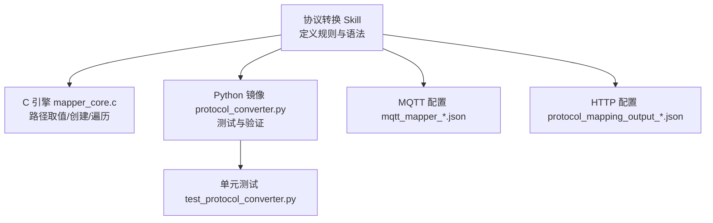
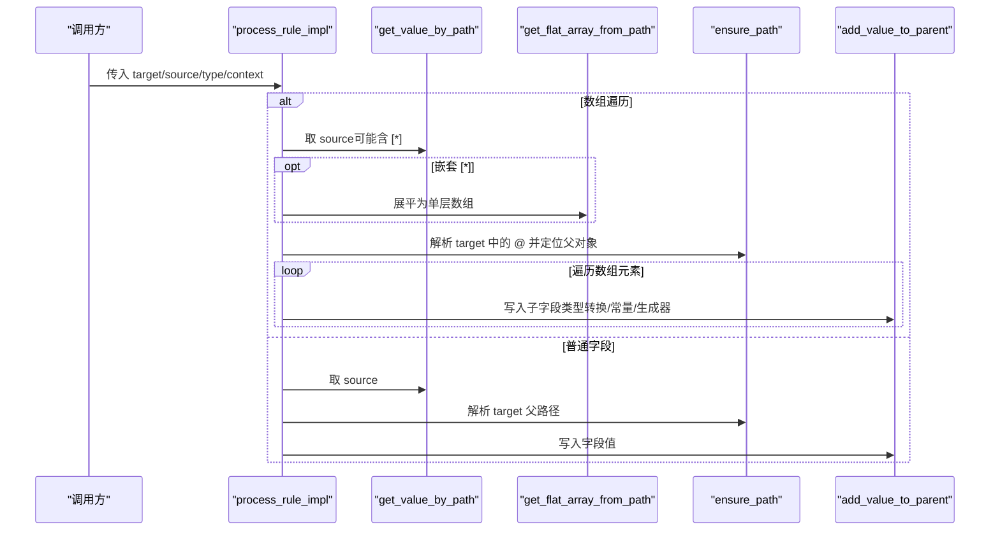
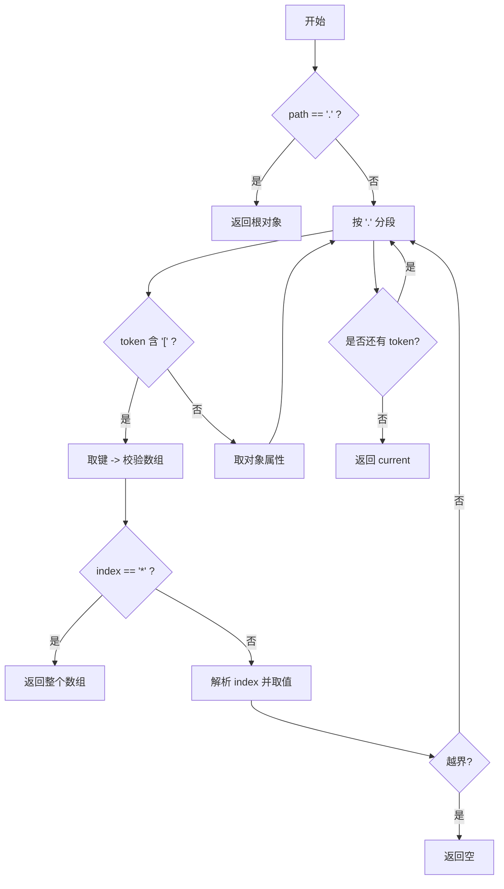
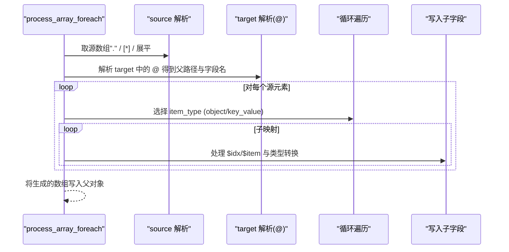
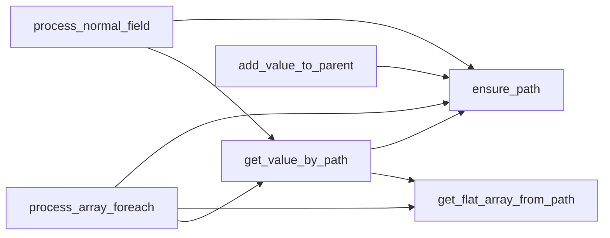

# 路径语法规范

<cite>
**本文引用的文件**
- [mapper_core.c](file://.trae/skills/protocol-conversion/scripts/mapper_core.c)
- [protocol_converter.py](file://.trae/skills/protocol-conversion/scripts/protocol_converter.py)
- [test_protocol_converter.py](file://.trae/skills/protocol-conversion/scripts/test_protocol_converter.py)
- [SKILL.md](file://.trae/skills/protocol-conversion/SKILL.md)
- [mqtt_mapper_202608261100.json](file://.trae/skills/mqtt-conversion/scripts/mqtt_mapper_202608261100.json)
- [protocol_mapping_output_20260826_110500.json](file://.trae/skills/http-conversion/scripts/protocol_mapping_output_20260826_110500.json)
</cite>

## 目录
1. [简介](#简介)
2. [项目结构](#项目结构)
3. [核心组件](#核心组件)
4. [架构总览](#架构总览)
5. [详细组件分析](#详细组件分析)
6. [依赖关系分析](#依赖关系分析)
7. [性能与复杂度](#性能与复杂度)
8. [故障排查与调试](#故障排查与调试)
9. [结论](#结论)
10. [附录：配置示例与最佳实践](#附录配置示例与最佳实践)

## 简介
本规范聚焦于统一协议映射引擎中的 JSON 路径访问语法，覆盖点号访问、数组索引、通配符遍历、锚点使用、变量引用以及根对象访问等。文档基于 C 实现与 Python 镜像实现的一致性设计，结合测试用例与真实配置文件，给出执行顺序、优先级、边界情况与排错方法，帮助读者编写正确且可维护的路径表达式。

## 项目结构
路径解析能力由共享核心提供，C 与 Python 两套实现保持一致；测试与示例配置用于验证行为与用法。

图表来源
- [SKILL.md:19-35](file://.trae/skills/protocol-conversion/SKILL.md#L19-L35)
- [mapper_core.c:1-13](file://.trae/skills/protocol-conversion/scripts/mapper_core.c#L1-L13)
- [protocol_converter.py:1-16](file://.trae/skills/protocol-conversion/scripts/protocol_converter.py#L1-L16)

章节来源
- [SKILL.md:19-35](file://.trae/skills/protocol-conversion/SKILL.md#L19-L35)

## 核心组件
- 路径取值：get_value_by_path（C）/ get_value_by_path（Python）
- 路径创建：ensure_path（C）/ ensure_path（Python）
- 扁平化数组：get_flat_array_from_path（C）/ get_flat_array_from_path（Python）
- 模板替换：template_substitute（C）/ template_substitute（Python）
- 类型转换：add_value_to_parent（C）/ add_value_to_parent（Python）
- 数组遍历：process_array_foreach（C）/ process_array_foreach（Python）
- 普通字段处理：process_normal_field（C）/ process_normal_field（Python）
- 生成器：generate_value（C）/ generate_value（Python）

章节来源
- [mapper_core.c:41-88](file://.trae/skills/protocol-conversion/scripts/mapper_core.c#L41-L88)
- [mapper_core.c:116-153](file://.trae/skills/protocol-conversion/scripts/mapper_core.c#L116-L153)
- [mapper_core.c:161-208](file://.trae/skills/protocol-conversion/scripts/mapper_core.c#L161-L208)
- [mapper_core.c:282-317](file://.trae/skills/protocol-conversion/scripts/mapper_core.c#L282-L317)
- [mapper_core.c:332-437](file://.trae/skills/protocol-conversion/scripts/mapper_core.c#L332-L437)
- [mapper_core.c:458-604](file://.trae/skills/protocol-conversion/scripts/mapper_core.c#L458-L604)
- [mapper_core.c:617-715](file://.trae/skills/protocol-conversion/scripts/mapper_core.c#L617-L715)
- [protocol_converter.py:49-104](file://.trae/skills/protocol-conversion/scripts/protocol_converter.py#L49-L104)
- [protocol_converter.py:120-159](file://.trae/skills/protocol-conversion/scripts/protocol_converter.py#L120-L159)
- [protocol_converter.py:161-202](file://.trae/skills/protocol-conversion/scripts/protocol_converter.py#L161-L202)
- [protocol_converter.py:240-265](file://.trae/skills/protocol-conversion/scripts/protocol_converter.py#L240-L265)
- [protocol_converter.py:269-376](file://.trae/skills/protocol-conversion/scripts/protocol_converter.py#L269-L376)
- [protocol_converter.py:395-479](file://.trae/skills/protocol-conversion/scripts/protocol_converter.py#L395-L479)
- [protocol_converter.py:480-565](file://.trae/skills/protocol-conversion/scripts/protocol_converter.py#L480-L565)

## 架构总览
路径解析贯穿“取值—创建—遍历—写入”的完整流程。数组遍历在目标侧通过 @ 锚点驱动，源侧支持 .、[index]、[*] 与 $item/$idx 变量。

图表来源
- [mapper_core.c:458-604](file://.trae/skills/protocol-conversion/scripts/mapper_core.c#L458-L604)
- [mapper_core.c:617-715](file://.trae/skills/protocol-conversion/scripts/mapper_core.c#L617-L715)
- [protocol_converter.py:395-479](file://.trae/skills/protocol-conversion/scripts/protocol_converter.py#L395-L479)
- [protocol_converter.py:480-565](file://.trae/skills/protocol-conversion/scripts/protocol_converter.py#L480-L565)

## 详细组件分析

### 路径取值 get_value_by_path
- 支持语法
  - 点号访问：a.b.c
  - 数组索引：a[0]、a[1]
  - 通配符：a[*] 返回整个数组
  - 根对象：单独 "." 返回当前根对象（HTTP 场景常用）
- 执行顺序与优先级
  - 先判断是否为 "." 直接返回根
  - 按 "." 分词逐段解析
  - 遇到 "[...]" 时，先取键再处理索引或通配符
  - 越界或缺失返回空
- 边界情况
  - 非数组上使用索引或通配符返回空
  - 缺失中间节点返回空
  - 字符串/数字/布尔到字符串的便捷读取（get_string_by_path）

图表来源
- [mapper_core.c:41-88](file://.trae/skills/protocol-conversion/scripts/mapper_core.c#L41-L88)
- [protocol_converter.py:49-104](file://.trae/skills/protocol-conversion/scripts/protocol_converter.py#L49-L104)

章节来源
- [mapper_core.c:41-88](file://.trae/skills/protocol-conversion/scripts/mapper_core.c#L41-L88)
- [protocol_converter.py:49-104](file://.trae/skills/protocol-conversion/scripts/protocol_converter.py#L49-L104)
- [test_protocol_converter.py:46-86](file://.trae/skills/protocol-conversion/scripts/test_protocol_converter.py#L46-L86)

### 路径创建 ensure_path
- 作用：确保目标路径存在，不存在则逐级创建对象或数组
- 数组填充：遇到 [n] 时自动扩展数组至长度 n+1，并填充空对象
- 适用场景：将多个扁平规则写入同一目标结构，无需显式初始化

章节来源
- [mapper_core.c:116-153](file://.trae/skills/protocol-conversion/scripts/mapper_core.c#L116-L153)
- [protocol_converter.py:120-159](file://.trae/skills/protocol-conversion/scripts/protocol_converter.py#L120-L159)
- [test_protocol_converter.py:120-159](file://.trae/skills/protocol-conversion/scripts/test_protocol_converter.py#L120-L159)

### 通配符与扁平化 get_flat_array_from_path
- 单层 [*]：等价于 get_value_by_path 返回数组
- 多层嵌套 a[*].b[*]：递归展平为单层数组
- 用途：在 array_foreach 中作为源数组，便于后续逐项映射

章节来源
- [mapper_core.c:161-208](file://.trae/skills/protocol-conversion/scripts/mapper_core.c#L161-L208)
- [protocol_converter.py:161-202](file://.trae/skills/protocol-conversion/scripts/protocol_converter.py#L161-L202)
- [test_protocol_converter.py:93-118](file://.trae/skills/protocol-conversion/scripts/test_protocol_converter.py#L93-L118)

### 数组遍历与锚点 @
- 触发条件：source_type = "array_foreach"
- 源数组获取优先级
  - 若 source 为 "."：将当前 source 视为单元素数组（HTTP）
  - 若包含多个 [*]：走嵌套展平逻辑（MQTT）
  - 否则：直接取值，允许单个 [*] 返回数组
- 目标锚点 @：target 中的 @ 表示在此处创建数组，@ 前为父路径
- item_type
  - object：每个源元素生成一个对象
  - key_value：每个 sub_mapping 生成一个独立对象（常用于键值对展开）
- 变量
  - $idx：在 array_foreach 子映射中替换为当前索引（从 0 开始）
  - $item：在普通字段中指向当前遍历项（可省略）

图表来源
- [mapper_core.c:458-604](file://.trae/skills/protocol-conversion/scripts/mapper_core.c#L458-L604)
- [protocol_converter.py:395-479](file://.trae/skills/protocol-conversion/scripts/protocol_converter.py#L395-L479)

章节来源
- [mapper_core.c:458-604](file://.trae/skills/protocol-conversion/scripts/mapper_core.c#L458-L604)
- [protocol_converter.py:395-479](file://.trae/skills/protocol-conversion/scripts/protocol_converter.py#L395-L479)
- [test_protocol_converter.py:384-499](file://.trae/skills/protocol-conversion/scripts/test_protocol_converter.py#L384-L499)

### 变量引用 $item 与 $idx
- $item：在普通字段处理中，当处于数组遍历上下文时，$item 指向当前遍历项；可省略写法直接使用字段名
- $idx：在 array_foreach 子映射中，将 "$idx" 替换为当前索引字符串
- 注意：$item 仅在数组遍历上下文中有效；$idx 仅用于 array_foreach 的子映射

章节来源
- [mapper_core.c:553-571](file://.trae/skills/protocol-conversion/scripts/mapper_core.c#L553-L571)
- [protocol_converter.py:460-469](file://.trae/skills/protocol-conversion/scripts/protocol_converter.py#L460-L469)
- [protocol_converter.py:545-552](file://.trae/skills/protocol-conversion/scripts/protocol_converter.py#L545-L552)

### 根对象访问 "."
- 在 get_value_by_path 中，单独 "." 返回根对象（HTTP 常用）
- 在 array_foreach 中，source="." 表示将当前 source 作为单元素数组进行遍历（HTTP）

章节来源
- [mapper_core.c:44-47](file://.trae/skills/protocol-conversion/scripts/mapper_core.c#L44-L47)
- [mapper_core.c:464-468](file://.trae/skills/protocol-conversion/scripts/mapper_core.c#L464-L468)
- [protocol_converter.py:59-61](file://.trae/skills/protocol-conversion/scripts/protocol_converter.py#L59-L61)
- [protocol_converter.py:413-416](file://.trae/skills/protocol-conversion/scripts/protocol_converter.py#L413-L416)
- [test_protocol_converter.py:73-76](file://.trae/skills/protocol-conversion/scripts/test_protocol_converter.py#L73-L76)

### 类型系统与模板替换
- 类型系统：string/double/int/long/bool/object/substitute，支持 scale 缩放与常量注入
- 模板替换：$var$ 形式，支持嵌套路径如 ssl_mqtt_server.gatewayID

章节来源
- [mapper_core.c:332-437](file://.trae/skills/protocol-conversion/scripts/mapper_core.c#L332-L437)
- [mapper_core.c:282-317](file://.trae/skills/protocol-conversion/scripts/mapper_core.c#L282-L317)
- [protocol_converter.py:269-376](file://.trae/skills/protocol-conversion/scripts/protocol_converter.py#L269-L376)
- [protocol_converter.py:240-265](file://.trae/skills/protocol-conversion/scripts/protocol_converter.py#L240-L265)
- [test_protocol_converter.py:161-285](file://.trae/skills/protocol-conversion/scripts/test_protocol_converter.py#L161-L285)

## 依赖关系分析
- 模块内聚：路径取值、创建、遍历、类型转换各自职责清晰，组合形成完整映射管线
- 外部依赖：cJSON（C 端）、Python dict/list（Python 端）
- 耦合点：process_array_foreach 同时依赖取值、展平、创建与写入；process_normal_field 依赖取值与创建

图表来源
- [mapper_core.c:41-88](file://.trae/skills/protocol-conversion/scripts/mapper_core.c#L41-L88)
- [mapper_core.c:116-153](file://.trae/skills/protocol-conversion/scripts/mapper_core.c#L116-L153)
- [mapper_core.c:161-208](file://.trae/skills/protocol-conversion/scripts/mapper_core.c#L161-L208)
- [mapper_core.c:458-604](file://.trae/skills/protocol-conversion/scripts/mapper_core.c#L458-L604)
- [mapper_core.c:617-715](file://.trae/skills/protocol-conversion/scripts/mapper_core.c#L617-L715)

章节来源
- [mapper_core.c:41-88](file://.trae/skills/protocol-conversion/scripts/mapper_core.c#L41-L88)
- [mapper_core.c:458-604](file://.trae/skills/protocol-conversion/scripts/mapper_core.c#L458-L604)

## 性能与复杂度
- 路径取值：O(n)，n 为路径段数；每次遇到数组索引或通配符需额外检查类型与大小
- 扁平化：最坏 O(N×M)，N 为外层数组大小，M 为内层平均长度；递归深度受嵌套层级限制
- 数组遍历：O(S×K)，S 为源数组大小，K 为子映射数量
- 内存：C 端涉及 cJSON 对象的创建与复制，需注意释放；Python 端为原生对象复制

优化建议
- 优先使用精确索引减少通配符开销
- 避免过深嵌套的 [*] 链
- 合理使用 ensure_path 批量构建目标结构，减少重复创建

## 故障排查与调试
常见问题与定位要点
- 路径为空或缺失：get_value_by_path 返回空，检查路径拼写与层级
- 索引越界：确保 [n] 不超过数组长度，或使用 [*] 配合遍历
- 非数组使用索引/通配符：会返回空，确认该段是否为数组
- 锚点位置错误：@ 必须出现在 array_foreach 的 target 中，且位于期望的数组字段末尾
- $item/$idx 未生效：确认是否在对应上下文（数组遍历 vs 普通字段）中使用
- 根对象访问误用：单独 "." 仅在 HTTP 场景下作为特殊语义使用

调试技巧
- 使用 Python 镜像快速验证路径表达式与映射规则
- 借助单元测试断言关键路径结果，逐步缩小问题范围
- 对复杂嵌套路径，先拆分验证各段取值是否正确

章节来源
- [test_protocol_converter.py:46-118](file://.trae/skills/protocol-conversion/scripts/test_protocol_converter.py#L46-L118)
- [test_protocol_converter.py:384-499](file://.trae/skills/protocol-conversion/scripts/test_protocol_converter.py#L384-L499)

## 结论
本规范明确了路径语法的完整规则与执行顺序，覆盖了点号、索引、通配符、锚点、变量与根对象访问等关键特性。通过 C 与 Python 双实现一致性、完备测试与真实配置样例，确保路径表达式可预测、可维护。建议在工程中优先采用声明式字段（scale、constant、substitute、generated），减少后处理函数依赖，提升可读性与稳定性。

## 附录：配置示例与最佳实践

- MQTT 示例：展示嵌套数组遍历与子映射
  - 参考路径：[mqtt_mapper_202608261100.json:29-95](file://.trae/skills/mqtt-conversion/scripts/mqtt_mapper_202608261100.json#L29-L95)

- HTTP 示例：展示 context、key_value 模式与嵌套遍历
  - 参考路径：[protocol_mapping_output_20260826_110500.json:57-85](file://.trae/skills/http-conversion/scripts/protocol_mapping_output_20260826_110500.json#L57-L85)

- 路径语法速查
  - 点号访问、数组索引、通配符、锚点、变量、根对象访问
  - 参考：[SKILL.md:58-69](file://.trae/skills/protocol-conversion/SKILL.md#L58-L69)

- 数组遍历准则与 item_type
  - 参考：[SKILL.md:126-168](file://.trae/skills/protocol-conversion/SKILL.md#L126-L168)

- 模板变量与生成器
  - 参考：[SKILL.md:170-212](file://.trae/skills/protocol-conversion/SKILL.md#L170-L212)

- 类型系统与缩放
  - 参考：[SKILL.md:81-91](file://.trae/skills/protocol-conversion/SKILL.md#L81-L91)
  - 参考：[SKILL.md:214-224](file://.trae/skills/protocol-conversion/SKILL.md#L214-L224)

- 常见错误与修正
  - 参考：[SKILL.md:408-452](file://.trae/skills/protocol-conversion/SKILL.md#L408-L452)