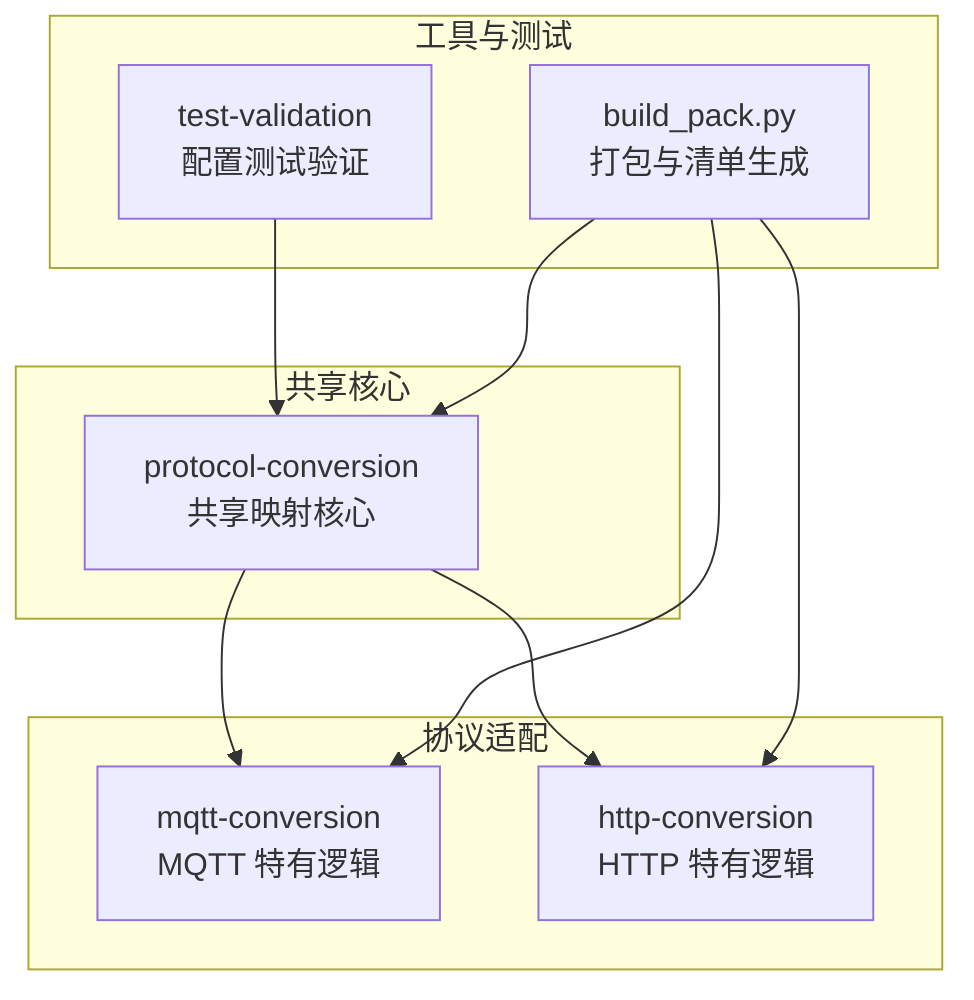
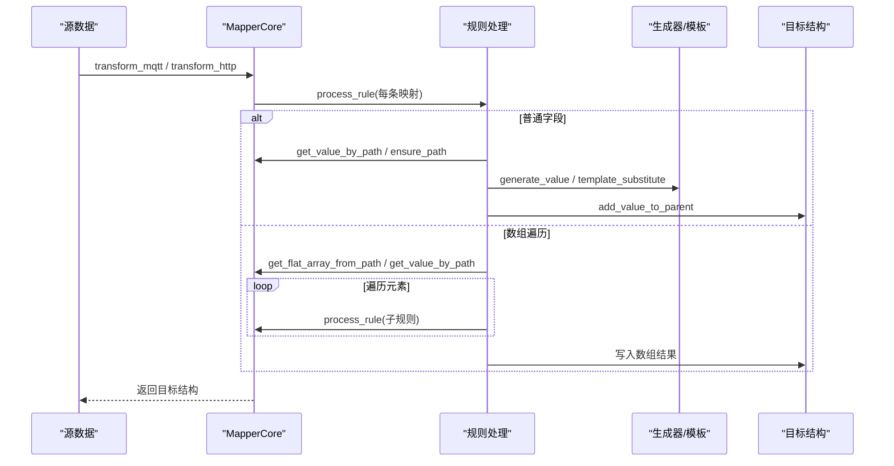
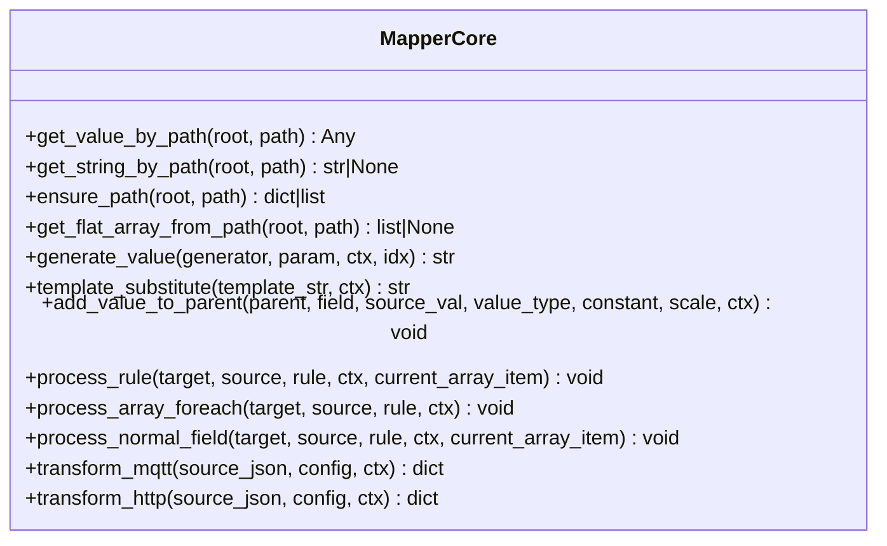
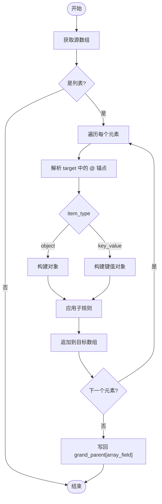
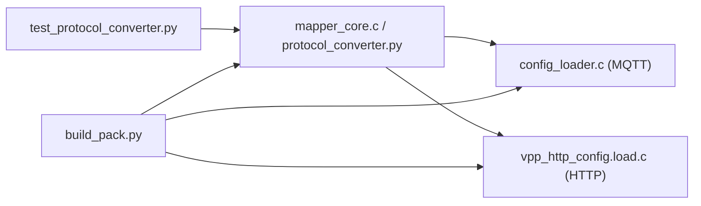

# 协议转换引擎

<cite>
**本文引用的文件**
- [protocol_converter.py](file://.trae/skills/protocol-conversion/scripts/protocol_converter.py)
- [test_protocol_converter.py](file://.trae/skills/protocol-conversion/scripts/test_protocol_converter.py)
- [mqtt_mapper_202608261100.json](file://.trae/skills/mqtt-conversion/scripts/mqtt_mapper_202608261100.json)
- [protocol_mapping_output_20260827_113000.json](file://.trae/skills/http-conversion/scripts/protocol_mapping_output_20260827_113000.json)
- [build_pack.py](file://.trae/skills/protocol-conversion/scripts/build_pack.py)
- [openai.yaml（protocol-conversion）](file://.trae/skills/protocol-conversion/agents/openai.yaml)
- [SKILL.md（http-conversion）](file://.trae/skills/http-conversion/SKILL.md)
- [SKILL.md（test-validation）](file://.trae/skills/test-validation/SKILL.md)
</cite>

## 目录
1. [简介](#简介)
2. [项目结构](#项目结构)
3. [核心组件](#核心组件)
4. [架构总览](#架构总览)
5. [详细组件分析](#详细组件分析)
6. [依赖关系分析](#依赖关系分析)
7. [性能与优化建议](#性能与优化建议)
8. [故障排查指南](#故障排查指南)
9. [结论](#结论)
10. [附录：配置格式与示例](#附录：配置格式与示例)

## 简介
本技术文档围绕“统一协议映射引擎”展开，聚焦共享映射核心的工作原理、路径语法、类型系统、数组遍历准则、模板变量替换机制，以及 MQTT 与 HTTP 两种协议的配置格式与转换流程。同时提供生成器清单、性能优化建议、调试技巧与常见问题解决方案，帮助读者快速掌握并正确使用该引擎。

## 项目结构
仓库中与协议转换相关的核心位于 .trae/skills 下，采用“共享核心 + 协议特化”的分层组织方式：
- protocol-conversion：共享映射核心（Python 镜像实现与测试），包含统一的规则处理、路径解析、类型转换、生成器、模板替换等能力。
- mqtt-conversion：MQTT 特有逻辑（如 substitute 模板变量、$item/$idx 变量、嵌套 [*] 展平）。
- http-conversion：HTTP 特有逻辑（如 context source_type、key_value item_type、“.”源路径、preprocess 等）。
- test-validation：对生成的转换配置进行冒烟测试与验证策略说明。
- build_pack.py：打包脚本，生成 manifest.json、README.md、mapping_report.md 及 ZIP 包。

**图表来源**
- [protocol_converter.py:1-16](file://.trae/skills/protocol-conversion/scripts/protocol_converter.py#L1-L16)
- [build_pack.py:27-54](file://.trae/skills/protocol-conversion/scripts/build_pack.py#L27-L54)

**章节来源**
- [protocol_converter.py:1-16](file://.trae/skills/protocol-conversion/scripts/protocol_converter.py#L1-L16)
- [build_pack.py:27-54](file://.trae/skills/protocol-conversion/scripts/build_pack.py#L27-L54)

## 核心组件
- MapperCore：统一映射核心类，封装所有共享能力（路径取值、路径创建、类型转换、生成器、模板替换、规则处理、数组遍历、MQTT/HTTP 入口）。
- MQTT 转换器：transform_mqtt，读取 platform_name + mappings[] 配置，执行映射。
- HTTP 转换器：transform_http，读取 base_url + token + apis[] 配置，仅执行 data_mappings。
- 测试套件：覆盖路径解析、类型转换、生成器、模板替换、数组遍历、引擎差异、边界条件等。

关键职责划分：
- 共享核心负责“如何映射”，不关心“从哪里加载配置”。
- 协议层负责“如何加载配置”和“协议特有字段”。

**章节来源**
- [protocol_converter.py:32-602](file://.trae/skills/protocol-conversion/scripts/protocol_converter.py#L32-L602)
- [test_protocol_converter.py:1-16](file://.trae/skills/protocol-conversion/scripts/test_protocol_converter.py#L1-L16)

## 架构总览
共享映射核心通过统一的规则处理函数，将不同协议的数据转换为目标结构。MQTT 与 HTTP 的差异主要体现在配置结构与少量特性上。

**图表来源**
- [protocol_converter.py:379-602](file://.trae/skills/protocol-conversion/scripts/protocol_converter.py#L379-L602)

## 详细组件分析

### 共享映射核心（MapperCore）
- 路径取值：支持 a.b.c、a[0]、a[*]、"."（HTTP 根对象）。
- 路径创建：ensure_path 自动创建缺失的字典/数组节点。
- 类型转换：支持 string/int/double/long/bool/object/substitute，含 scale 缩放。
- 生成器：uuid、current_timestamp/timestamp_sec、current_timestamp_ms/timestamp_ms、datetime_compact、datetime_str、random_string、md5_sign、batch_id、sequence。
- 模板替换：$var$ 语法，支持嵌套路径（如 ssl_mqtt_server.gatewayID）。
- 规则处理：统一入口 process_rule，区分 array_foreach 与普通字段。
- 数组遍历：支持 object/key_value 模式、"."源路径、嵌套 [*] 展平、$idx 变量。
- 引擎入口：transform_mqtt（mappings[]）、transform_http（apis[].data_mappings[]）。

**图表来源**
- [protocol_converter.py:49-602](file://.trae/skills/protocol-conversion/scripts/protocol_converter.py#L49-L602)

**章节来源**
- [protocol_converter.py:49-602](file://.trae/skills/protocol-conversion/scripts/protocol_converter.py#L49-L602)

### 路径语法规范
- 基本路径：a.b.c 表示逐层访问字典键。
- 数组索引：a[0]、a[1] 访问指定索引；越界返回 None。
- 通配符：a[*] 返回整个数组；用于后续遍历或展平。
- 根对象："." 在 HTTP 中返回当前 source 作为单元素数组使用。
- 嵌套路径：可组合使用，如 businessObjList[0].dataObj.dataItemList[0].itemBody[*]。

**章节来源**
- [protocol_converter.py:49-104](file://.trae/skills/protocol-conversion/scripts/protocol_converter.py#L49-L104)
- [test_protocol_converter.py:46-91](file://.trae/skills/protocol-conversion/scripts/test_protocol_converter.py#L46-L91)

### 类型系统与转换
- 支持的类型：string、int、double、long、bool、object、substitute。
- 常量优先：当 constant 存在且非空时，优先使用常量值。
- 缩放因子：scale 应用于数值类型（int/double/long）。
- 布尔转换：字符串 "true"/"1" 为真，其他为假。
- 对象类型：深拷贝避免引用共享；支持 JSON 字符串解析。
- 模板替换：substitute 类型结合 $var$ 语法从上下文 ctx 取值。

**章节来源**
- [protocol_converter.py:269-376](file://.trae/skills/protocol-conversion/scripts/protocol_converter.py#L269-L376)
- [test_protocol_converter.py:161-286](file://.trae/skills/protocol-conversion/scripts/test_protocol_converter.py#L161-L286)

### 数组遍历准则
- 触发条件：source_type 为 array_foreach 或 is_array_foreach 为真。
- 源数组获取：
  - "."：HTTP 特有，将当前 source 视为单元素数组。
  - 嵌套 [*]：MQTT 特有，先展平再遍历。
  - 常规路径：按路径取值后判断是否为列表。
- 目标锚点：target 中的 "@" 表示数组写入位置，解析父路径与字段名。
- 遍历模式：
  - object：每个源元素生成一个对象。
  - key_value：每个子规则生成一个键值对象（HTTP 常用）。
- 变量替换：
  - $idx：MQTT 特有，在子规则中替换为当前索引。
  - $item：MQTT 特有，在普通字段中替换为当前数组元素的路径片段。

**图表来源**
- [protocol_converter.py:395-479](file://.trae/skills/protocol-conversion/scripts/protocol_converter.py#L395-L479)

**章节来源**
- [protocol_converter.py:395-479](file://.trae/skills/protocol-conversion/scripts/protocol_converter.py#L395-L479)
- [test_protocol_converter.py:384-499](file://.trae/skills/protocol-conversion/scripts/test_protocol_converter.py#L384-L499)

### 模板变量替换机制
- 语法：$var$，支持嵌套路径（如 $ssl_mqtt_server.gatewayID$）。
- 上下文：ctx 为字典，按路径逐级查找；找不到则保留原占位符。
- 用途：MQTT 特有，常用于设备标识、网关信息等动态注入。

**章节来源**
- [protocol_converter.py:240-265](file://.trae/skills/protocol-conversion/scripts/protocol_converter.py#L240-L265)
- [test_protocol_converter.py:354-381](file://.trae/skills/protocol-conversion/scripts/test_protocol_converter.py#L354-L381)

### MQTT 协议转换
- 配置结构：platform_name + mappings[]。
- 特性：
  - substitute 类型与 $var$ 模板替换。
  - $item/$idx 变量在数组遍历中使用。
  - 嵌套 [*] 展平支持。
  - post_process 钩子（由上层处理）。
- 转换流程：
  - 遍历 mappings，调用 process_rule。
  - 普通字段：path/constant/generated/substitute。
  - 数组字段：array_foreach，支持嵌套。

**章节来源**
- [protocol_converter.py:569-583](file://.trae/skills/protocol-conversion/scripts/protocol_converter.py#L569-L583)
- [mqtt_mapper_202608261100.json:1-98](file://.trae/skills/mqtt-conversion/scripts/mqtt_mapper_202608261100.json#L1-L98)
- [test_protocol_converter.py:501-619](file://.trae/skills/protocol-conversion/scripts/test_protocol_converter.py#L501-L619)

### HTTP 协议转换
- 配置结构：base_url + timeout + domain + token{} + apis[]。
- 特性：
  - context source_type：从 ctx 取值（如 startTime/endTime）。
  - key_value item_type：将每个子规则映射为键值对象。
  - "." 源路径：将当前 source 作为单元素数组遍历。
  - preprocess/post_process：由业务层处理（核心只关注数据映射）。
- 转换流程：
  - 遍历 apis[].data_mappings，调用 process_rule。
  - 支持常量、路径、context、generated、array_foreach。

**章节来源**
- [protocol_converter.py:585-602](file://.trae/skills/protocol-conversion/scripts/protocol_converter.py#L585-L602)
- [protocol_mapping_output_20260827_113000.json:1-118](file://.trae/skills/http-conversion/scripts/protocol_mapping_output_20260827_113000.json#L1-L118)
- [test_protocol_converter.py:621-765](file://.trae/skills/protocol-conversion/scripts/test_protocol_converter.py#L621-L765)

### 生成器清单
- uuid：生成唯一标识。
- current_timestamp/timestamp_sec：秒级时间戳。
- current_timestamp_ms/timestamp_ms：毫秒级时间戳。
- datetime_compact：yyyyMMddHHmmss。
- datetime_str：yyyy-MM-dd HH:mm:ss。
- random_string：随机字符串。
- md5_sign：基于时间的 MD5 签名。
- batch_id：批次 ID（UUID 前缀）。
- sequence：序列号（支持 idx 或 ctx 计数器）。

**章节来源**
- [protocol_converter.py:206-236](file://.trae/skills/protocol-conversion/scripts/protocol_converter.py#L206-L236)
- [test_protocol_converter.py:288-352](file://.trae/skills/protocol-conversion/scripts/test_protocol_converter.py#L288-L352)

## 依赖关系分析
- 共享核心被 MQTT 与 HTTP 两个协议层复用，降低重复代码与维护成本。
- 测试套件覆盖核心功能与协议差异，确保一致性。
- 打包脚本生成 manifest.json，记录文件清单、校验和、依赖与变更日志。

**图表来源**
- [build_pack.py:27-54](file://.trae/skills/protocol-conversion/scripts/build_pack.py#L27-L54)
- [protocol_converter.py:1-16](file://.trae/skills/protocol-conversion/scripts/protocol_converter.py#L1-L16)

**章节来源**
- [build_pack.py:27-54](file://.trae/skills/protocol-conversion/scripts/build_pack.py#L27-L54)
- [protocol_converter.py:1-16](file://.trae/skills/protocol-conversion/scripts/protocol_converter.py#L1-L16)

## 性能与优化建议
- 路径解析优化：
  - 避免深层嵌套路径频繁计算，可在外层缓存中间结果。
  - 合理使用 [*] 展平，减少递归深度。
- 类型转换优化：
  - 批量处理时复用类型转换逻辑，减少重复解析。
  - 对高频字段使用常量或生成器，减少路径查找。
- 数组遍历优化：
  - 预检查源数组是否为空，避免无意义遍历。
  - 对于 key_value 模式，注意子规则数量与输出项数量的关系。
- 模板替换优化：
  - 合并多个 $var$ 替换，减少正则匹配次数。
  - 对复杂嵌套路径，提前构建 ctx 索引。
- 内存管理：
  - 对象类型使用深拷贝，避免引用污染。
  - 大数组遍历时考虑分块处理。

[本节为通用指导，不直接分析具体文件]

## 故障排查指南
- 路径为空或缺失：
  - 检查 source 路径是否正确，确认层级与索引。
  - 使用 get_value_by_path 调试，逐步定位失败点。
- 类型转换失败：
  - 确认 type 与 source 值兼容，必要时添加 scale。
  - 检查 constant 是否有效，避免空字符串导致默认值。
- 数组遍历异常：
  - 确认 source 为列表，否则不会触发遍历。
  - 检查 target 中的 "@" 锚点解析是否正确。
- 模板替换无效：
  - 确认 ctx 中存在对应路径，嵌套路径需逐级存在。
  - 检查 $var$ 语法是否完整，避免多余字符。
- 引擎差异问题：
  - MQTT 不支持 context source_type。
  - HTTP 不使用 substitute 模板替换（除非显式传入 ctx）。

**章节来源**
- [test_protocol_converter.py:767-800](file://.trae/skills/protocol-conversion/scripts/test_protocol_converter.py#L767-L800)
- [SKILL.md（test-validation）:77-178](file://.trae/skills/test-validation/SKILL.md#L77-L178)

## 结论
统一协议映射引擎通过共享核心实现了 MQTT 与 HTTP 协议配置的标准化映射，显著降低了维护成本并提升了扩展性。路径语法、类型系统、数组遍历与模板替换机制覆盖了常见场景，配合完善的测试套件与打包工具，确保了质量与可交付性。建议在实际使用中遵循最佳实践，合理设计映射规则，充分利用生成器与上下文，以获得稳定高效的转换效果。

[本节为总结，不直接分析具体文件]

## 附录：配置格式与示例

### MQTT 配置格式
- 顶层字段：platform_name、topic_pattern、mappings[]。
- 映射规则字段：
  - target：目标路径，支持数组锚点 "@"。
  - source_type：path/constant/generated/array_foreach/substitute。
  - source：路径或占位符。
  - type：string/int/double/long/bool/object/substitute。
  - constant：常量值。
  - generator：生成器名称。
  - scale：缩放因子。
  - sub_mappings：子规则数组。
  - item_type：object/key_value（array_foreach 时使用）。

示例参考：
- [mqtt_mapper_202608261100.json:1-98](file://.trae/skills/mqtt-conversion/scripts/mqtt_mapper_202608261100.json#L1-L98)

**章节来源**
- [mqtt_mapper_202608261100.json:1-98](file://.trae/skills/mqtt-conversion/scripts/mqtt_mapper_202608261100.json#L1-L98)

### HTTP 配置格式
- 顶层字段：base_url、timeout、domain、token{}、apis[]。
- API 字段：name、method、path、use_token、content_type、interval、interval_type、next_api、body_params[]、data_mappings[]。
- 数据映射规则：同共享核心规则定义，支持 context source_type 与 key_value item_type。

示例参考：
- [protocol_mapping_output_20260827_113000.json:1-118](file://.trae/skills/http-conversion/scripts/protocol_mapping_output_20260827_113000.json#L1-L118)

**章节来源**
- [protocol_mapping_output_20260827_113000.json:1-118](file://.trae/skills/http-conversion/scripts/protocol_mapping_output_20260827_113000.json#L1-L118)

### 转换流程详解
- MQTT：
  - 加载 platform_name + mappings[]。
  - 遍历规则，处理普通字段与数组遍历。
  - 使用 substitute 与 $item/$idx 完成动态注入。
- HTTP：
  - 加载 base_url + token + apis[]。
  - 遍历 apis[].data_mappings，处理 context 与 key_value。
  - 使用 "." 源路径简化单对象遍历。

**章节来源**
- [protocol_converter.py:569-602](file://.trae/skills/protocol-conversion/scripts/protocol_converter.py#L569-L602)
- [SKILL.md（http-conversion）:1-27](file://.trae/skills/http-conversion/SKILL.md#L1-L27)

### 生成器清单使用方法
- 在规则中设置 source_type 为 generated，并指定 generator 名称。
- 可选参数：generator_param（部分生成器需要）。
- 上下文：sequence 可使用 ctx 计数器。

**章节来源**
- [protocol_converter.py:206-236](file://.trae/skills/protocol-conversion/scripts/protocol_converter.py#L206-L236)
- [test_protocol_converter.py:288-352](file://.trae/skills/protocol-conversion/scripts/test_protocol_converter.py#L288-L352)

### 生成器清单与打包
- build_pack.py 生成 manifest.json，包含 packId、version、files（含 SHA256）、dependencies、testStatus 等。
- 同时生成 mapping_report.md 与 README.md，便于发布与回溯。

**章节来源**
- [build_pack.py:187-236](file://.trae/skills/protocol-conversion/scripts/build_pack.py#L187-L236)
- [build_pack.py:243-345](file://.trae/skills/protocol-conversion/scripts/build_pack.py#L243-L345)