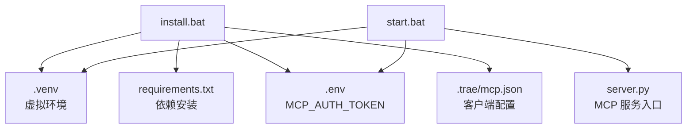
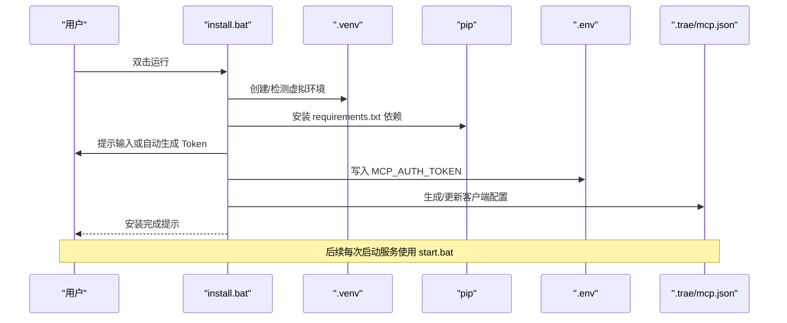
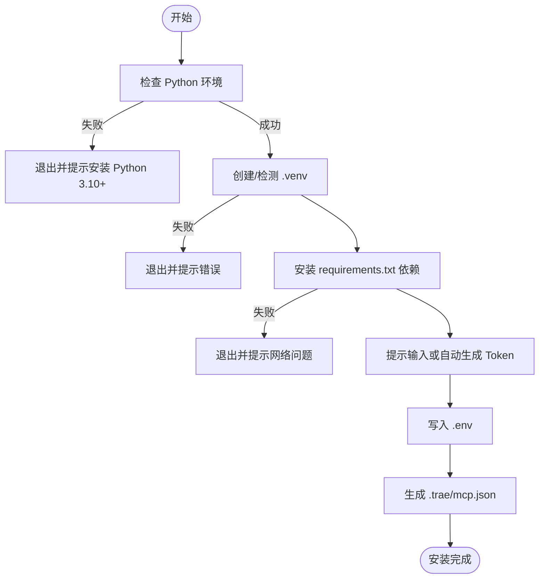
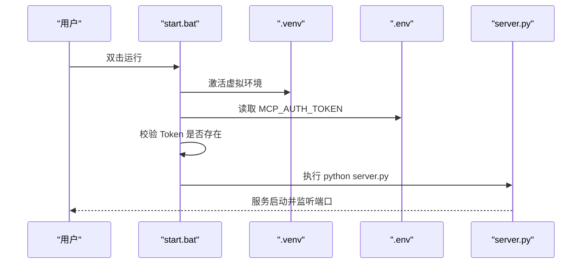
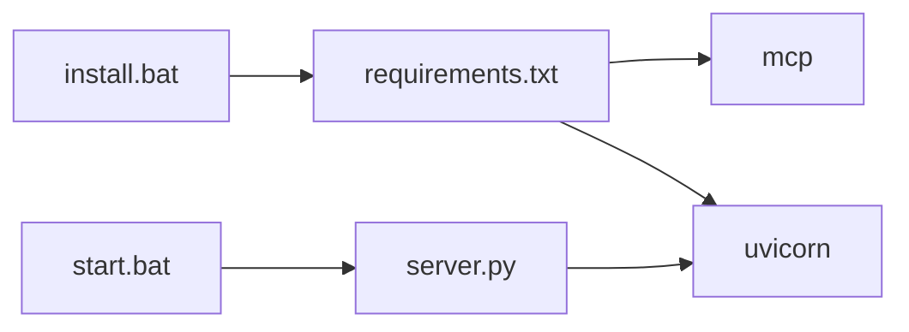

# Windows 环境部署

<cite>
**本文引用的文件**
- [mcp_server/install.bat](file://mcp_server/install.bat)
- [mcp_server/start.bat](file://mcp_server/start.bat)
- [mcp_server/requirements.txt](file://mcp_server/requirements.txt)
- [.trae/mcp.json](file://.trae/mcp.json)
- [mcp server部署.md](file://mcp server部署.md)
</cite>

## 目录
1. [简介](#简介)
2. [项目结构](#项目结构)
3. [核心组件](#核心组件)
4. [架构总览](#架构总览)
5. [详细组件分析](#详细组件分析)
6. [依赖关系分析](#依赖关系分析)
7. [性能与启动参数](#性能与启动参数)
8. [故障排查指南](#故障排查指南)
9. [结论](#结论)
10. [附录：环境变量与客户端配置](#附录：环境变量与客户端配置)

## 简介
本文档面向在 Windows 环境下部署 PCA MCP Server，重点说明安装脚本 install.bat、启动脚本 start.bat、环境变量 .env 的配置方法，以及 .trae/mcp.json 客户端配置文件的生成与修改。同时提供常见 Windows 环境问题（权限、路径、防火墙）的解决方案与排错步骤。

## 项目结构
- mcp_server/install.bat：一键初始化环境、创建虚拟环境、安装依赖、生成并写入 Token 到 .env，并自动生成 .trae/mcp.json 客户端配置。
- mcp_server/start.bat：激活虚拟环境、读取 .env 中的认证 Token、打印启动信息并启动服务。
- mcp_server/requirements.txt：声明 Python 依赖（MCP SDK、Uvicorn）。
- .trae/mcp.json：IDE 或 MCP 客户端连接配置，包含服务端 URL 与 Bearer Token。
- mcp server部署.md：项目文档，包含工作原理、脚本调用关系、常见问题等。

图表来源
- [mcp_server/install.bat:27-72](file://mcp_server/install.bat#L27-L72)
- [mcp_server/start.bat:7-41](file://mcp_server/start.bat#L7-L41)

章节来源
- [mcp_server/install.bat:1-85](file://mcp_server/install.bat#L1-L85)
- [mcp_server/start.bat:1-41](file://mcp_server/start.bat#L1-L41)
- [mcp_server/requirements.txt:1-3](file://mcp_server/requirements.txt#L1-L3)
- [.trae/mcp.json:1-1](file://.trae/mcp.json#L1-L1)
- [mcp server部署.md:285-305](file://mcp server部署.md#L285-L305)

## 核心组件
- 安装脚本 install.bat
  - 检查 Python 版本与环境可用性
  - 创建并复用 .venv 虚拟环境
  - 通过 pip 安装 requirements.txt 依赖
  - 交互式输入或自动生成 MCP_AUTH_TOKEN，写入 .env
  - 生成 .trae/mcp.json，配置客户端访问地址与认证头
- 启动脚本 start.bat
  - 激活虚拟环境
  - 从 .env 读取 MCP_AUTH_TOKEN
  - 校验 Token 是否存在
  - 打印启动信息并执行 server.py 启动服务
- 依赖 requirements.txt
  - 锁定 MCP SDK 与 Uvicorn 的版本范围，确保兼容性与稳定性
- 客户端配置 .trae/mcp.json
  - 指定 MCP 服务端 URL 与 Authorization 头部（Bearer Token）

章节来源
- [mcp_server/install.bat:12-72](file://mcp_server/install.bat#L12-L72)
- [mcp_server/start.bat:7-41](file://mcp_server/start.bat#L7-L41)
- [mcp_server/requirements.txt:1-3](file://mcp_server/requirements.txt#L1-L3)
- [.trae/mcp.json:1-1](file://.trae/mcp.json#L1-L1)

## 架构总览
Windows 部署流程由两个脚本协作完成：首次运行 install.bat 完成环境与配置；日常使用 start.bat 启动服务。服务基于 MCP 协议并通过 Uvicorn 提供 HTTP/SSE 能力。

图表来源
- [mcp_server/install.bat:27-72](file://mcp_server/install.bat#L27-L72)
- [mcp_server/start.bat:7-41](file://mcp_server/start.bat#L7-L41)

章节来源
- [mcp server部署.md:463-501](file://mcp server部署.md#L463-L501)

## 详细组件分析

### install.bat 功能与使用方法
- 功能要点
  - 设置 UTF-8 编码，避免中文乱码
  - 计算脚本所在目录与项目根目录，便于跨路径引用
  - 检查 Python 是否可用并输出版本
  - 若不存在则创建 .venv 虚拟环境
  - 激活虚拟环境并安静模式安装依赖
  - 交互获取或自动生成 MCP_AUTH_TOKEN，写入 .env
  - 生成 .trae/mcp.json，包含服务端 URL 与 Bearer Token
- 使用方法
  - 在项目根目录打开命令行，执行 mcp_server\install.bat
  - 按提示输入自定义 Token 或直接回车自动生成
  - 完成后根据提示运行 start.bat 启动服务

图表来源
- [mcp_server/install.bat:12-72](file://mcp_server/install.bat#L12-L72)

章节来源
- [mcp_server/install.bat:12-72](file://mcp_server/install.bat#L12-L72)

### start.bat 作用与启动参数
- 作用
  - 激活虚拟环境
  - 从 .env 读取 MCP_AUTH_TOKEN
  - 校验 Token 存在性
  - 打印启动信息（Token、URL、工具数量）
  - 执行 server.py 启动 MCP 服务
- 启动参数
  - 当前脚本直接调用 python server.py，未暴露额外参数
  - 如需调整端口或绑定地址，可在 server.py 中配置或通过环境变量控制（具体以 server.py 实现为准）

图表来源
- [mcp_server/start.bat:7-41](file://mcp_server/start.bat#L7-L41)

章节来源
- [mcp_server/start.bat:7-41](file://mcp_server/start.bat#L7-L41)

### .env 环境变量配置方法
- 字段说明
  - MCP_AUTH_TOKEN：用于 MCP 服务的认证令牌，由 install.bat 自动生成或手动填写
- 配置方式
  - 自动：运行 install.bat 后，会在 mcp_server/.env 中写入 MCP_AUTH_TOKEN
  - 手动：在 mcp_server/.env 文件中添加一行键值对，格式为 MCP_AUTH_TOKEN=your_token
- 注意事项
  - 不要将 .env 提交到版本库
  - 生产环境建议使用更安全的密钥管理方案

章节来源
- [mcp_server/install.bat:52-67](file://mcp_server/install.bat#L52-L67)
- [mcp_server/start.bat:15-27](file://mcp_server/start.bat#L15-L27)

### .trae/mcp.json 客户端配置文件
- 作用
  - 配置 MCP 客户端（如 Trae IDE）如何连接服务端
  - 包含服务端 URL 与 Authorization 头部（Bearer Token）
- 生成与修改
  - 自动生成：install.bat 会写入默认 URL 与 Token
  - 手动修改：编辑 .trae/mcp.json，保持 JSON 结构正确，确保 URL 与 Token 与实际一致
- 示例结构
  - mcpServers.xl-protocol-agent.url：服务端 MCP 端点
  - mcpServers.xl-protocol-agent.headers.Authorization：Bearer Token

章节来源
- [mcp_server/install.bat:69-72](file://mcp_server/install.bat#L69-L72)
- [.trae/mcp.json:1-1](file://.trae/mcp.json#L1-L1)

## 依赖关系分析
- 外部依赖
  - mcp：MCP 协议的 Python SDK，用于构建服务端与处理消息路由
  - uvicorn：ASGI 服务器，负责网络层与高性能并发
- 版本约束
  - mcp>=1.0.0,<2.0.0：限制主版本以避免不兼容升级
  - uvicorn>=0.30.0：保证 ASGI 服务器能力与性能

图表来源
- [mcp_server/requirements.txt:1-3](file://mcp_server/requirements.txt#L1-L3)
- [mcp_server/install.bat:40-49](file://mcp_server/install.bat#L40-L49)
- [mcp_server/start.bat:7-41](file://mcp_server/start.bat#L7-L41)

章节来源
- [mcp_server/requirements.txt:1-3](file://mcp_server/requirements.txt#L1-L3)
- [mcp server部署.md:38-107](file://mcp server部署.md#L38-L107)

## 性能与启动参数
- 启动性能
  - Uvicorn 基于异步事件循环，启动快、内存占用低，适合高并发场景
- 启动参数
  - 当前 start.bat 直接执行 server.py，未暴露端口与主机参数
  - 如需自定义端口或绑定地址，请在 server.py 中配置或通过环境变量控制
- 并发模型
  - Uvicorn 支持 HTTP、WebSocket、SSE，适合长连接与实时通信

章节来源
- [mcp server部署.md:82-107](file://mcp server部署.md#L82-L107)
- [mcp_server/start.bat:7-41](file://mcp_server/start.bat#L7-L41)

## 故障排查指南
- 权限问题
  - 现象：无法创建 .venv 或写入 .env/.trae/mcp.json
  - 解决：以管理员身份运行命令行；确保项目目录可写
- 路径问题
  - 现象：移动项目后虚拟环境失效
  - 解决：删除旧 .venv 并重新运行 install.bat
- 端口占用
  - 现象：启动时报端口被占用
  - 解决：查找占用进程并结束；或修改 server.py 中的端口
- 网络问题
  - 现象：依赖安装失败
  - 解决：检查网络；使用国内镜像源；升级 pip
- Token 未配置
  - 现象：启动时报 MCP_AUTH_TOKEN 未设置
  - 解决：运行 install.bat 或手动在 .env 中设置 MCP_AUTH_TOKEN

章节来源
- [mcp server部署.md:505-643](file://mcp server部署.md#L505-L643)
- [mcp_server/install.bat:27-49](file://mcp_server/install.bat#L27-L49)
- [mcp_server/start.bat:15-27](file://mcp_server/start.bat#L15-L27)

## 结论
通过 install.bat 与 start.bat 的配合，Windows 用户可以快速完成 PCA MCP Server 的环境初始化与服务启动。建议首次部署时完整运行 install.bat，并在需要时手动调整 .env 与 .trae/mcp.json。如遇权限、路径或端口问题，参考故障排查指南进行处理。

## 附录：环境变量与客户端配置
- 环境变量
  - MCP_AUTH_TOKEN：认证令牌，必须存在于 mcp_server/.env 中
- 客户端配置
  - .trae/mcp.json：包含服务端 URL 与 Authorization 头部
  - 若需切换客户端或修改 URL，请保持 JSON 结构正确并同步更新 Token

章节来源
- [mcp_server/install.bat:52-72](file://mcp_server/install.bat#L52-L72)
- [.trae/mcp.json:1-1](file://.trae/mcp.json#L1-L1)