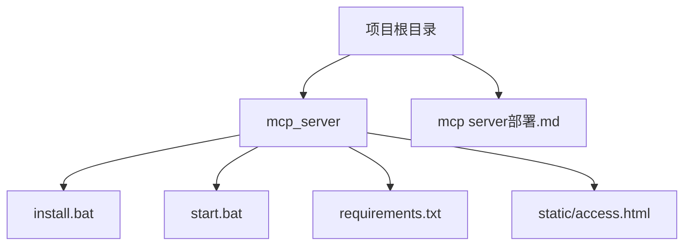
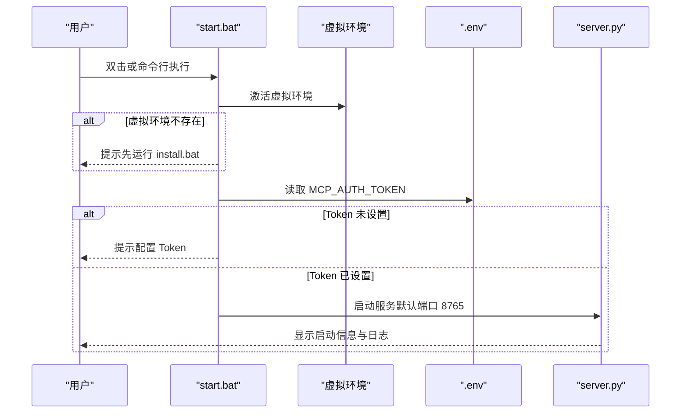

# 安装与部署

<cite>
**本文引用的文件**
- [mcp_server/install.bat](file://mcp_server/install.bat)
- [mcp_server/start.bat](file://mcp_server/start.bat)
- [mcp_server/requirements.txt](file://mcp_server/requirements.txt)
- [mcp server部署.md](file://mcp server部署.md)
- [mcp_server/static/access.html](file://mcp_server/static/access.html)
</cite>

## 目录
1. [简介](#简介)
2. [项目结构](#项目结构)
3. [环境要求](#环境要求)
4. [依赖安装步骤](#依赖安装步骤)
5. [Windows 安装脚本使用指南](#windows-安装脚本使用指南)
6. [环境变量配置说明](#环境变量配置说明)
7. [生产环境部署指南](#生产环境部署指南)
8. [容器化部署方案](#容器化部署方案)
9. [故障排除指南](#故障排除指南)
10. [结论](#结论)

## 简介
本文件面向首次部署与运维人员，提供 PCA MCP Server 的安装、配置、启动与生产部署的完整指南。内容涵盖：
- 环境要求（Python 3.10+）
- 依赖安装步骤
- Windows 环境下 install.bat 与 start.bat 的使用方法与场景
- 环境变量 MCP_HOST、MCP_PORT、MCP_AUTH_TOKEN 的作用与设置方法
- 生产环境服务器配置、安全加固、负载均衡最佳实践
- Docker 与 Kubernetes 容器化部署与环境变量配置
- 常见问题排查与解决方案

## 项目结构
当前仓库包含服务端脚本、依赖声明、静态页面与部署文档等关键文件。核心目录与职责如下：
- mcp_server：服务端脚本与依赖清单
  - install.bat：一键安装脚本（创建虚拟环境、安装依赖、生成 Token、写入 .env 与 IDE 配置）
  - start.bat：服务启动脚本（激活虚拟环境、读取 Token、启动服务）
  - requirements.txt：Python 依赖声明（mcp、uvicorn）
  - static/access.html：接入配置页面（用于获取访问地址与 Token 配置）
- mcp server部署.md：详细的技术原理、脚本流程、问题排查与安全建议

图表来源
- [mcp_server/install.bat:1-85](file://mcp_server/install.bat#L1-L85)
- [mcp_server/start.bat:1-41](file://mcp_server/start.bat#L1-L41)
- [mcp_server/requirements.txt:1-3](file://mcp_server/requirements.txt#L1-L3)
- [mcp_server/static/access.html:433-456](file://mcp_server/static/access.html#L433-L456)
- [mcp server部署.md:283-501](file://mcp server部署.md#L283-L501)

章节来源
- [mcp_server/install.bat:1-85](file://mcp_server/install.bat#L1-L85)
- [mcp_server/start.bat:1-41](file://mcp_server/start.bat#L1-L41)
- [mcp_server/requirements.txt:1-3](file://mcp_server/requirements.txt#L1-L3)
- [mcp server部署.md:283-501](file://mcp server部署.md#L283-L501)

## 环境要求
- Python 版本：3.10 或更高（Windows 安装脚本会检查并提示）
- 操作系统：Windows（install.bat/start.bat 为 Windows 批处理脚本）
- 网络：可访问 PyPI 以安装依赖；如受限可使用国内镜像源
- 端口：默认监听 8765（可通过后续配置调整）

章节来源
- [mcp_server/install.bat:12-24](file://mcp_server/install.bat#L12-L24)
- [mcp server部署.md:507-520](file://mcp server部署.md#L507-L520)

## 依赖安装步骤
- 使用虚拟环境隔离依赖，避免污染系统 Python
- 通过 requirements.txt 安装 mcp 与 uvicorn
- 推荐使用 pip 安装，若网络受限可切换镜像源

推荐步骤（在 Windows 命令行中执行）：
1. 进入项目根目录
2. 运行 mcp_server\install.bat 完成初始化（自动创建 .venv、安装依赖、生成 Token 与配置文件）
3. 如需手动安装依赖：
   - 激活虚拟环境：.venv\Scripts\activate.bat
   - 安装依赖：pip install -r mcp_server\requirements.txt

章节来源
- [mcp_server/install.bat:26-50](file://mcp_server/install.bat#L26-L50)
- [mcp_server/requirements.txt:1-3](file://mcp_server/requirements.txt#L1-L3)
- [mcp server部署.md:545-570](file://mcp server部署.md#L545-L570)

## Windows 安装脚本使用指南
### install.bat（安装脚本）
功能与使用场景：
- 首次部署时运行一次，完成环境初始化
- 检查 Python 是否安装且版本满足要求
- 创建并激活虚拟环境（.venv），安装依赖
- 生成或输入 MCP_AUTH_TOKEN，写入 mcp_server\.env
- 自动生成 .trae\mcp.json，便于 IDE 自动连接 MCP 服务
- 完成后提示运行 start.bat 启动服务

执行流程概览：

```mermaid
flowchart TD
Start(["开始"]) --> CheckPython["检查 Python 版本"]
CheckPython --> |不满足| ExitErr["退出并提示安装 Python 3.10+"]
CheckPython --> |满足| CreateVenv["创建虚拟环境 .venv"]
CreateVenv --> InstallDeps["安装依赖requirements.txt"]
InstallDeps --> SetToken["生成或输入 MCP_AUTH_TOKEN"]
SetToken --> WriteEnv["写入 mcp_server\\.env"]
WriteEnv --> WriteIDE["写入 .trae\\mcp.json"]
WriteIDE --> Done(["安装完成，提示运行 start.bat"])
```

图表来源
- [mcp_server/install.bat:12-85](file://mcp_server/install.bat#L12-L85)

章节来源
- [mcp_server/install.bat:12-85](file://mcp_server/install.bat#L12-L85)

### start.bat（启动脚本）
功能与使用场景：
- 每次启动服务时使用
- 激活虚拟环境（若不存在则提示先运行 install.bat）
- 从 mcp_server\.env 读取 MCP_AUTH_TOKEN（未设置则提示配置）
- 打印启动信息（Token、URL、工具数量）
- 执行 server.py 启动 MCP 服务（默认端口 8765）

启动流程概览：

图表来源
- [mcp_server/start.bat:7-41](file://mcp_server/start.bat#L7-L41)

章节来源
- [mcp_server/start.bat:7-41](file://mcp_server/start.bat#L7-L41)

## 环境变量配置说明
- MCP_AUTH_TOKEN：认证令牌，用于 MCP 服务的鉴权。install.bat 会自动生成并写入 mcp_server\.env；start.bat 启动时会读取该值。
- MCP_HOST：服务绑定的主机地址（例如 0.0.0.0 表示对外暴露）。当前脚本默认绑定到本地回环或 0.0.0.0，具体由 server.py 决定。
- MCP_PORT：服务监听的端口号（默认 8765）。如需变更，可在 server.py 中修改或通过环境变量注入（取决于实现）。

设置方法：
- 开发环境：直接运行 install.bat，按提示输入或自动生成 Token，写入 .env
- 生产环境：建议在进程管理器或容器编排中注入环境变量，避免明文存储在 .env
- 验证方式：启动后查看控制台输出中的 URL 与 Token 信息；通过浏览器访问 /sse 或 /mcp 端点测试连通性

章节来源
- [mcp_server/install.bat:52-72](file://mcp_server/install.bat#L52-L72)
- [mcp_server/start.bat:15-27](file://mcp_server/start.bat#L15-L27)
- [mcp server部署.md:441-459](file://mcp server部署.md#L441-L459)

## 生产环境部署指南
### 服务器配置
- 使用进程管理器（如 systemd、supervisor）管理服务生命周期，确保崩溃自启
- 绑定地址与端口：建议将 MCP_HOST 设置为 0.0.0.0，并通过反向代理限制访问来源
- 资源限制：根据并发量配置 CPU/内存上限，避免资源耗尽
- 日志与监控：启用结构化日志，集中收集至日志平台；配置健康检查端点

### 安全加固
- 认证与授权：
  - 使用强随机 Token（install.bat 已使用密码学安全的随机生成）
  - 生产环境建议使用更严格的认证机制（如 OAuth2、JWT），并结合 IP 白名单
- 传输加密：
  - 通过 Nginx/Traefik 等反向代理启用 HTTPS，终止 TLS
- 访问控制：
  - 仅允许受信任网段访问敏感端点（/sse、/mcp）
  - 对静态页面（access.html）进行访问控制或内网发布
- 最小权限原则：
  - 运行账户仅具备必要权限，避免使用 root/administrator

### 负载均衡与高可用
- 多实例部署：在同一主机或集群中运行多个服务实例，通过负载均衡器分发请求
- 会话无状态：MCP 服务基于 ASGI 异步模型，适合水平扩展
- 健康检查：配置负载均衡器的健康检查，剔除异常实例
- 灰度发布：支持滚动更新，降低发布风险

章节来源
- [mcp server部署.md:645-674](file://mcp server部署.md#L645-L674)

## 容器化部署方案
### Docker 部署
- 基础镜像：选择官方 Python 3.10+ 镜像
- 构建步骤：
  - 复制 requirements.txt 并安装依赖
  - 复制应用代码与脚本
  - 设置环境变量（MCP_HOST、MCP_PORT、MCP_AUTH_TOKEN）
  - 启动命令：python mcp_server/server.py（或通过 start.bat 调用）
- 示例 docker run：
  - 映射端口：-p 8765:8765
  - 注入环境变量：-e MCP_HOST=0.0.0.0 -e MCP_PORT=8765 -e MCP_AUTH_TOKEN=<token>
  - 挂载卷：用于持久化日志或静态资源

### Kubernetes 部署
- Deployment：定义副本数、资源限制、探针（liveness/readiness）
- Service：暴露服务端口，供内部或外部访问
- ConfigMap/Secret：管理环境变量与敏感信息（如 MCP_AUTH_TOKEN）
- Ingress：配置 HTTPS 与域名访问
- HPA：根据 CPU/内存或自定义指标自动扩缩容

章节来源
- [mcp server部署.md:82-107](file://mcp server部署.md#L82-L107)
- [mcp_server/start.bat:29-41](file://mcp_server/start.bat#L29-L41)

## 故障排除指南
常见问题与解决方案：
- Python 未安装或版本过低：
  - 错误提示：请安装 Python 3.10+
  - 解决：安装 Python 并确保加入 PATH，重新运行 install.bat
- 虚拟环境创建失败：
  - 可能原因：权限不足、磁盘空间不足
  - 解决：以管理员身份运行，清理磁盘空间后重试
- 依赖安装失败：
  - 可能原因：网络问题、pip 版本过低
  - 解决：检查网络，使用国内镜像源，升级 pip
- 启动时找不到虚拟环境：
  - 解决：确保先运行 install.bat，或检查 .venv 是否存在
- Token 未配置：
  - 解决：运行 install.bat 生成 Token，或手动创建 mcp_server\.env 并设置 MCP_AUTH_TOKEN
- 端口被占用：
  - 解决：查找占用 8765 端口的进程并结束，或修改 server.py 中的端口

章节来源
- [mcp server部署.md:507-643](file://mcp server部署.md#L507-L643)

## 结论
本指南提供了 PCA MCP Server 从环境准备、依赖安装、Windows 脚本使用、环境变量配置到生产部署与容器化的完整流程。遵循本文档的步骤与最佳实践，可快速搭建稳定、安全、可扩展的 MCP 服务。如遇问题，请参考故障排除部分定位并解决。