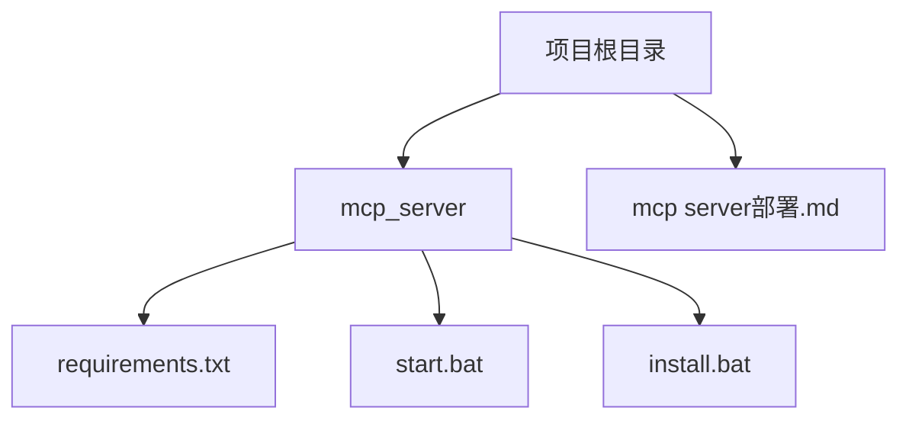
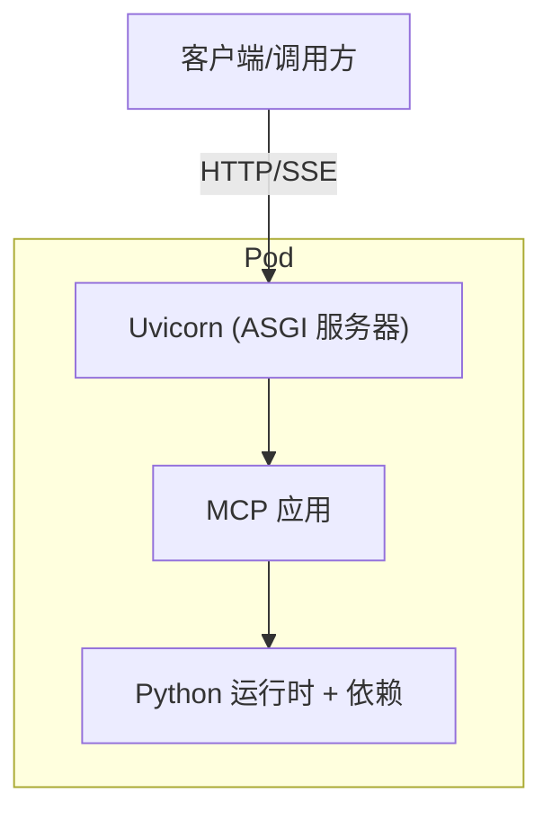
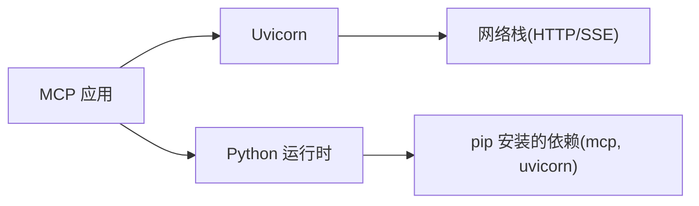
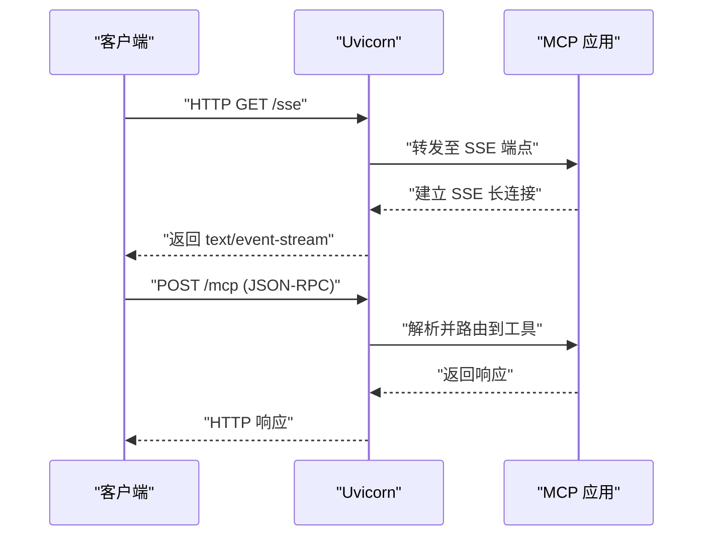

# 容器化部署

<cite>
**本文引用的文件**
- [mcp_server/requirements.txt](file://mcp_server/requirements.txt)
- [mcp_server/start.bat](file://mcp_server/start.bat)
- [mcp_server/install.bat](file://mcp_server/install.bat)
- [mcp server部署.md](file://mcp server部署.md)
</cite>

## 目录
1. [简介](#简介)
2. [项目结构](#项目结构)
3. [核心组件](#核心组件)
4. [架构总览](#架构总览)
5. [详细组件分析](#详细组件分析)
6. [依赖分析](#依赖分析)
7. [性能考虑](#性能考虑)
8. [故障排除指南](#故障排除指南)
9. [结论](#结论)
10. [附录](#附录)

## 简介
本文件面向将 PCA MCP Server 容器化的工程实践，覆盖 Docker 镜像构建（含多阶段构建与体积优化）、Docker Compose 编排、Kubernetes 部署清单、环境变量注入与配置管理最佳实践、健康检查与监控、以及容器环境下的故障排除方法。内容基于仓库中的依赖声明、启动脚本与服务文档进行推导与落地。

## 项目结构
当前仓库中与容器化直接相关的要素包括：
- Python 应用依赖：mcp、uvicorn
- Windows 本地启动脚本：install.bat、start.bat（用于本地开发）
- 服务说明文档：mcp server部署.md（包含端口、端点、ASGI 工作流等）

图表来源
- [mcp_server/requirements.txt:1-3](file://mcp_server/requirements.txt#L1-L3)
- [mcp_server/start.bat:1-41](file://mcp_server/start.bat#L1-L41)
- [mcp_server/install.bat:1-85](file://mcp_server/install.bat#L1-L85)
- [mcp server部署.md:64-108](file://mcp server部署.md#L64-L108)

章节来源
- [mcp_server/requirements.txt:1-3](file://mcp_server/requirements.txt#L1-L3)
- [mcp_server/start.bat:1-41](file://mcp_server/start.bat#L1-L41)
- [mcp_server/install.bat:1-85](file://mcp_server/install.bat#L1-L85)
- [mcp server部署.md:64-108](file://mcp server部署.md#L64-L108)

## 核心组件
- ASGI 服务器：Uvicorn，负责网络 I/O、HTTP/SSE 协议处理与高并发事件循环。
- MCP 框架：提供工具注册、JSON-RPC 路由与 SSE 长连接能力。
- 启动方式：通过 Uvicorn 运行 MCP 应用，默认监听 0.0.0.0:8765，对外暴露 /sse 与 /mcp 端点。

章节来源
- [mcp server部署.md:64-108](file://mcp server部署.md#L64-L108)
- [mcp server部署.md:163-181](file://mcp server部署.md#L163-L181)

## 架构总览
下图展示容器内进程关系与外部访问路径：客户端经反向代理或 Kubernetes Ingress 进入 Pod，访问 Uvicorn 提供的 /sse 与 /mcp 端点，MCP 在应用层处理 JSON-RPC 并返回结果。

图表来源
- [mcp server部署.md:163-181](file://mcp server部署.md#L163-L181)
- [mcp server部署.md:215-261](file://mcp server部署.md#L215-L261)

## 详细组件分析

### Docker 镜像构建指南
- 基础镜像选择
  - 使用官方 Python 镜像作为基础镜像，推荐 slim 变体以减小体积。
  - 确保系统时区与语言环境满足 UTF-8 输出需求。
- 依赖安装
  - 将 mcp_server/requirements.txt 复制到镜像中，使用 pip 安装依赖。
  - 建议启用 pip 缓存层以提升重复构建速度。
- 应用代码复制
  - 仅复制必要的业务文件与静态资源，避免引入无关目录。
- 启动命令
  - 使用 Uvicorn 启动 MCP 应用，绑定 0.0.0.0:8765。
  - 可通过环境变量控制主机与端口，便于在不同环境复用。
- 多阶段构建优化
  - 构建阶段：安装依赖并生成编译产物（如有）。
  - 运行阶段：仅拷贝最终产物与最小运行时，显著降低镜像体积。
- 镜像大小优化要点
  - 使用 .dockerignore 排除 .venv、日志、临时文件等。
  - 合并 RUN 指令减少镜像层数。
  - 使用非 root 用户运行容器提升安全性。
  - 清理 pip 缓存与不必要的系统包。

章节来源
- [mcp_server/requirements.txt:1-3](file://mcp_server/requirements.txt#L1-L3)
- [mcp server部署.md:82-108](file://mcp server部署.md#L82-L108)

### Docker Compose 编排配置
- 服务定义
  - 定义一个服务运行 MCP Server，暴露 8765 端口。
  - 通过环境变量注入认证 Token 与可选的监听参数。
- 网络配置
  - 使用默认桥接网络；如需与其他服务通信，可自定义网络并命名。
- 数据卷挂载
  - 可将静态页面或日志目录挂载为卷，便于开发与调试。
- 健康检查
  - 对 /mcp 或 /sse 端点进行 HTTP 探测，确保服务就绪。
- 示例要点（概念性）
  - 服务名：mcp-server
  - 镜像：自构建镜像
  - 端口映射：宿主机:容器 = 8765:8765
  - 环境变量：MCP_AUTH_TOKEN、UVICORN_HOST、UVICORN_PORT
  - 健康检查：GET http://localhost:8765/mcp

章节来源
- [mcp_server/start.bat:15-35](file://mcp_server/start.bat#L15-L35)
- [mcp server部署.md:163-181](file://mcp server部署.md#L163-L181)

### Kubernetes 部署清单
- Deployment
  - 副本数按负载设定；设置资源请求与限制。
  - 通过环境变量注入 MCP_AUTH_TOKEN 等配置。
  - 配置 livenessProbe 与 readinessProbe 指向 /mcp 或 /sse。
- Service
  - ClusterIP 类型暴露内部服务；Ingress 或 LoadBalancer 暴露外部访问。
- ConfigMap
  - 存放非敏感配置（如日志级别、超时时间等）。
- Secret
  - 存放敏感信息（如 MCP_AUTH_TOKEN），通过环境变量或挂载方式注入。
- 健康检查
  - 探针路径：/mcp 或 /sse；失败阈值与重试策略按需配置。
- 滚动更新与回滚
  - 使用 RollingUpdate 策略；保留历史版本以便快速回滚。

章节来源
- [mcp server部署.md:163-181](file://mcp server部署.md#L163-L181)

### 环境变量注入与配置管理最佳实践
- 环境变量
  - MCP_AUTH_TOKEN：鉴权令牌，必须通过 Secret 注入，禁止硬编码。
  - UVICORN_HOST/UVICORN_PORT：控制监听地址与端口，便于不同环境复用。
- 配置分层
  - 基础配置放入 ConfigMap；敏感配置放入 Secret。
  - 启动脚本或入口命令从环境变量读取配置，保持镜像无状态。
- 安全建议
  - 使用只读文件系统；最小权限原则运行容器。
  - 定期轮换 Token，避免长期有效凭证泄露风险。

章节来源
- [mcp_server/start.bat:15-35](file://mcp_server/start.bat#L15-L35)
- [mcp_server/install.bat:52-72](file://mcp_server/install.bat#L52-L72)

### 容器监控与健康检查
- 健康检查
  - Liveness：周期性探测 /mcp，失败则重启容器。
  - Readiness：启动完成后开放流量，避免冷启动期间误判。
- 指标采集
  - 若 MCP/Uvicorn 暴露 Prometheus 指标端点，可在 K8s 中通过 ServiceMonitor 抓取。
- 日志收集
  - 标准输出日志由容器运行时收集；必要时挂载日志目录到持久卷。

章节来源
- [mcp server部署.md:163-181](file://mcp server部署.md#L163-L181)

## 依赖分析
- 运行时依赖
  - mcp：实现 MCP 协议的工具注册与 JSON-RPC 路由。
  - uvicorn：ASGI 服务器，提供高性能网络 I/O 与 SSE 支持。
- 依赖关系图

图表来源
- [mcp_server/requirements.txt:1-3](file://mcp_server/requirements.txt#L1-L3)
- [mcp server部署.md:82-108](file://mcp server部署.md#L82-L108)

章节来源
- [mcp_server/requirements.txt:1-3](file://mcp_server/requirements.txt#L1-L3)
- [mcp server部署.md:82-108](file://mcp server部署.md#L82-L108)

## 性能考虑
- 并发模型
  - Uvicorn 基于异步事件循环，适合高并发 I/O 场景。
- 资源限制
  - 合理设置 CPU/内存请求与限制，避免资源争用。
- 连接管理
  - 合理配置 SSE 连接超时与心跳，防止僵尸连接占用资源。
- 镜像与启动
  - 使用多阶段构建与精简镜像，缩短冷启动时间。
  - 预热依赖与连接池，减少首次请求延迟。

章节来源
- [mcp server部署.md:265-279](file://mcp server部署.md#L265-L279)

## 故障排除指南
- 常见启动问题
  - 虚拟环境未创建或未激活：参考本地脚本流程定位。
  - 依赖安装失败：检查网络与镜像源。
  - 端口被占用：更换端口或释放占用进程。
- 认证相关
  - MCP_AUTH_TOKEN 未设置：通过环境变量或 Secret 注入。
  - Token 无效：检查 Secret 内容与注入位置。
- 网络与端点
  - /sse 与 /mcp 不可达：检查健康检查与探针配置。
  - 跨域或代理问题：确认 Ingress/Service 转发规则。
- 日志与诊断
  - 查看容器标准输出与错误日志。
  - 增加日志级别，定位具体异常堆栈。

章节来源
- [mcp_server/start.bat:15-35](file://mcp_server/start.bat#L15-L35)
- [mcp_server/install.bat:12-48](file://mcp_server/install.bat#L12-L48)
- [mcp server部署.md:505-632](file://mcp server部署.md#L505-L632)

## 结论
通过将 MCP 应用容器化，可实现一致的运行环境、简化的部署流程与更强的可观测性。结合多阶段构建、合理的资源与探针配置、以及安全的配置管理，能够在本地、集群与生产环境中稳定交付服务。建议在上线前完成容量评估、压测与安全加固，并建立完善的监控与告警体系。

## 附录

### 关键流程时序（容器内启动与请求处理）

图表来源
- [mcp server部署.md:163-181](file://mcp server部署.md#L163-L181)
- [mcp server部署.md:215-261](file://mcp server部署.md#L215-L261)