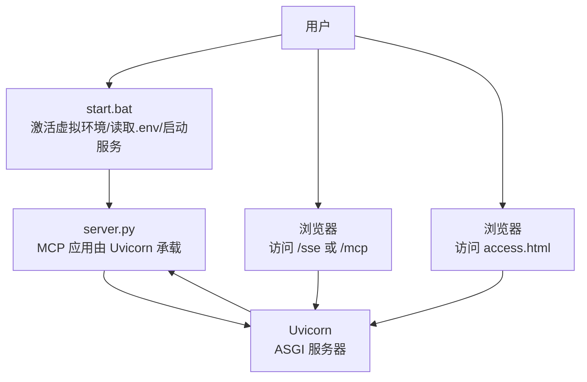
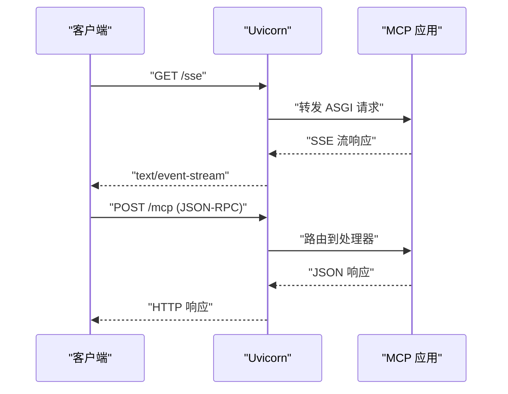
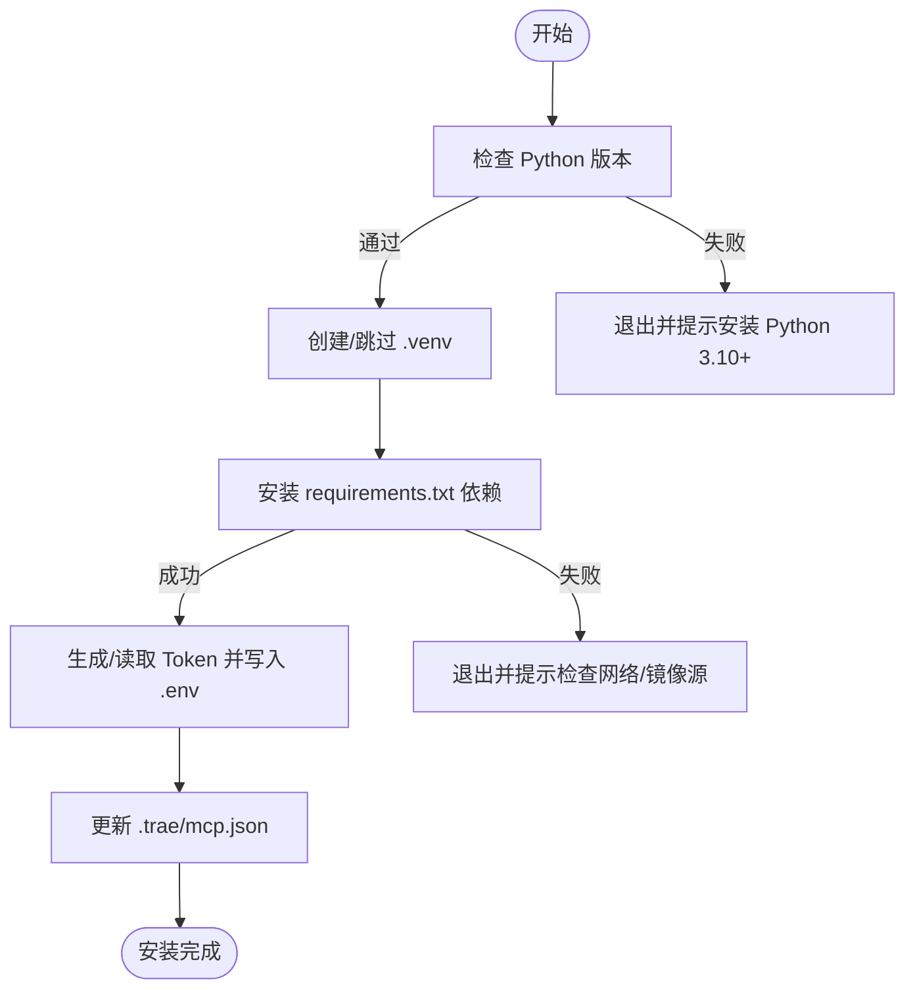
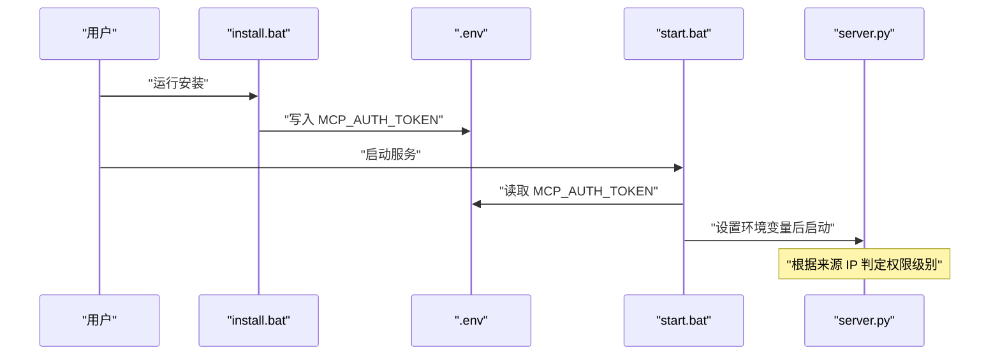
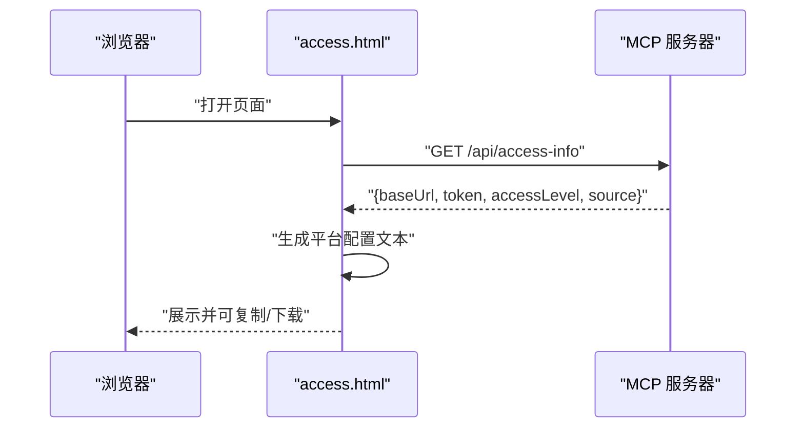
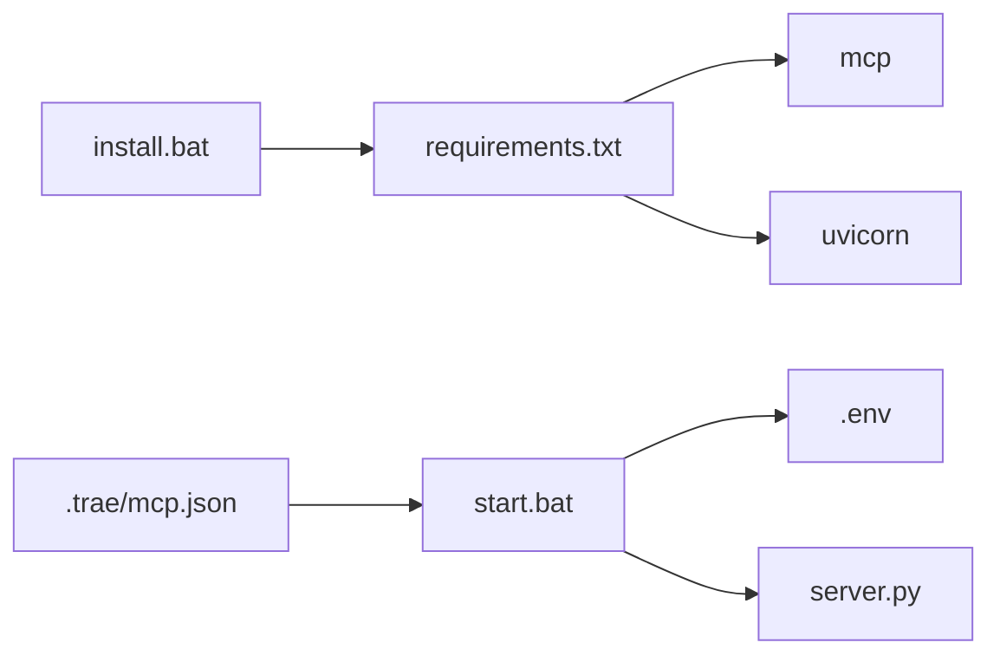

# 故障排除与常见问题

<cite>
**本文引用的文件**
- [mcp_server\install.bat](file://mcp_server/install.bat)
- [mcp_server\start.bat](file://mcp_server/start.bat)
- [mcp_server\requirements.txt](file://mcp_server/requirements.txt)
- [.trae\mcp.json](file://.trae/mcp.json)
- [mcp server部署.md](file://mcp server部署.md)
- [mcp_server\static\access.html](file://mcp_server/static/access.html)
</cite>

## 目录
1. [简介](#简介)
2. [项目结构](#项目结构)
3. [核心组件](#核心组件)
4. [架构总览](#架构总览)
5. [详细组件分析](#详细组件分析)
6. [依赖关系分析](#依赖关系分析)
7. [性能注意事项](#性能注意事项)
8. [故障排除指南](#故障排除指南)
9. [结论](#结论)
10. [附录](#附录)

## 简介
本指南面向安装、启动与运行阶段的常见问题，提供系统化的排查步骤与解决方案。覆盖 Python 版本不兼容、依赖安装失败、权限问题；启动失败的端口冲突、Token 验证错误、网络连接问题；调试技巧（Python 调试器、日志级别调整、性能分析）；常见运行时错误的诊断与修复；性能问题的识别与优化建议；以及社区支持与问题反馈渠道。

## 项目结构
本项目为基于 MCP 协议的 Python 服务端，使用 Uvicorn 作为 ASGI 服务器。Windows 环境通过 install.bat 完成环境初始化与 Token 配置，start.bat 负责激活虚拟环境、读取 .env 中的 Token 并启动服务。客户端可通过浏览器访问静态页面获取接入信息与生成配置。

图表来源
- [mcp_server\start.bat:1-41](file://mcp_server/start.bat#L1-L41)
- [mcp server部署.md:163-260](file://mcp server部署.md#L163-L260)
- [mcp_server\static\access.html:401-417](file://mcp_server/static/access.html#L401-L417)

章节来源
- [mcp_server\install.bat:1-85](file://mcp_server/install.bat#L1-L85)
- [mcp_server\start.bat:1-41](file://mcp_server/start.bat#L1-L41)
- [mcp server部署.md:283-501](file://mcp server部署.md#L283-L501)

## 核心组件
- 依赖声明：仅包含 mcp 与 uvicorn 两个核心包，版本约束明确，便于稳定运行。
- 安装脚本：检查 Python 版本、创建虚拟环境、安装依赖、生成并写入 Token、更新 IDE 配置。
- 启动脚本：激活虚拟环境、校验 .env 中 Token、打印启动信息、执行 server.py。
- 客户端配置：.trae/mcp.json 指定 MCP 服务端点与认证头。
- 访问页面：access.html 用于自动检测服务器地址、分配 Token、生成多平台接入文本。

章节来源
- [mcp_server\requirements.txt:1-3](file://mcp_server/requirements.txt#L1-L3)
- [mcp_server\install.bat:12-73](file://mcp_server/install.bat#L12-L73)
- [mcp_server\start.bat:7-27](file://mcp_server/start.bat#L7-L27)
- [.trae\mcp.json:1-1](file://.trae/mcp.json#L1-L1)
- [mcp_server\static\access.html:241-291](file://mcp_server/static/access.html#L241-L291)

## 架构总览
MCP 与 Uvicorn 的协作遵循 ASGI 协议：Uvicorn 负责网络层（监听端口、解析 HTTP/SSE、管理连接），MCP 负责应用层（路由、工具调用、JSON-RPC 消息处理）。典型流程包括：
- 启动阶段：Uvicorn 加载 MCP 应用并监听端口。
- SSE 连接：客户端请求 /sse 建立长连接。
- 请求-响应循环：客户端通过 /mcp 发送 JSON-RPC 请求，MCP 处理后返回结果。

图表来源
- [mcp server部署.md:163-260](file://mcp server部署.md#L163-L260)

章节来源
- [mcp server部署.md:110-181](file://mcp server部署.md#L110-L181)

## 详细组件分析

### 安装与启动流程
- install.bat：检查 Python、创建 .venv、安装依赖、生成 Token、写入 .env 与 .trae/mcp.json。
- start.bat：激活 .venv、读取 .env 中的 MCP_AUTH_TOKEN、打印启动信息、执行 server.py。

图表来源
- [mcp_server\install.bat:12-73](file://mcp_server/install.bat#L12-L73)

章节来源
- [mcp_server\install.bat:12-73](file://mcp_server/install.bat#L12-L73)
- [mcp_server\start.bat:7-27](file://mcp_server/start.bat#L7-L27)

### 认证与权限模型
- Token 来源：install.bat 自动生成或手动输入，写入 .env；start.bat 读取并注入环境变量。
- 权限模型：localhost 访问获得系统级（读写），其他 IP 访问为用户级（只读）；其他用户通过访问页面自动分配 Token。
- 客户端配置：.trae/mcp.json 中携带 Authorization: Bearer <token>。

图表来源
- [mcp_server\install.bat:52-73](file://mcp_server/install.bat#L52-L73)
- [mcp_server\start.bat:15-27](file://mcp_server/start.bat#L15-L27)
- [mcp server部署.md:655-663](file://mcp server部署.md#L655-L663)

章节来源
- [mcp_server\install.bat:52-73](file://mcp_server/install.bat#L52-L73)
- [mcp_server\start.bat:15-27](file://mcp_server/start.bat#L15-L27)
- [mcp server部署.md:655-663](file://mcp server部署.md#L655-L663)

### 访问页面与多平台接入
- access.html 通过 /api/access-info 获取服务器地址、Token、权限级别与来源 IP。
- 支持多平台（Trae、Cursor、VS Code Copilot、Claude Desktop、Windsurf、Cline、Kimi Code）一键生成配置文本。
- 提供 Skills 包下载与 Markdown 导出链接。

图表来源
- [mcp_server\static\access.html:401-417](file://mcp_server/static/access.html#L401-L417)
- [mcp_server\static\access.html:445-503](file://mcp_server/static/access.html#L445-L503)

章节来源
- [mcp_server\static\access.html:241-291](file://mcp_server/static/access.html#L241-L291)
- [mcp_server\static\access.html:401-417](file://mcp_server/static/access.html#L401-L417)
- [mcp_server\static\access.html:445-503](file://mcp_server/static/access.html#L445-L503)

## 依赖关系分析
- 外部依赖：mcp（>=1.0.0,<2.0.0）、uvicorn（>=0.30.0）。
- 脚本依赖：install.bat 依赖 Python 3.10+ 与 pip；start.bat 依赖 .venv 与 .env。
- 配置文件：.trae/mcp.json 指向 http://localhost:8765/mcp，并携带 Authorization 头。

图表来源
- [mcp_server\requirements.txt:1-3](file://mcp_server/requirements.txt#L1-L3)
- [mcp_server\install.bat:40-48](file://mcp_server/install.bat#L40-L48)
- [mcp_server\start.bat:7-27](file://mcp_server/start.bat#L7-L27)
- [.trae\mcp.json:1-1](file://.trae/mcp.json#L1-L1)

章节来源
- [mcp_server\requirements.txt:1-3](file://mcp_server/requirements.txt#L1-L3)
- [mcp_server\install.bat:40-48](file://mcp_server/install.bat#L40-L48)
- [mcp_server\start.bat:7-27](file://mcp_server/start.bat#L7-L27)
- [.trae\mcp.json:1-1](file://.trae/mcp.json#L1-L1)

## 性能注意事项
- Uvicorn 基于异步事件循环，适合高并发 I/O 场景；确保业务逻辑避免阻塞。
- 生产环境建议使用 Gunicorn + Uvicorn 多进程模式提升吞吐。
- 启用 HTTPS 与反向代理可改善安全与性能。
- 监控端口占用与连接数，避免资源竞争。

[本节为通用指导，不直接分析具体文件]

## 故障排除指南

### 安装阶段常见问题
- Python 版本不兼容
  - 现象：install.bat 提示未找到 Python 或版本过低。
  - 原因：未安装 Python 或未加入 PATH；版本低于 3.10。
  - 解决：安装 Python 3.10+，勾选“添加到 PATH”，重新打开命令行验证。
  - 参考路径：[mcp_server\install.bat:12-24](file://mcp_server/install.bat#L12-L24)

- 依赖安装失败
  - 现象：pip 安装报错或超时。
  - 原因：网络不可达、镜像源慢、pip 版本过低。
  - 解决：检查网络；使用国内镜像源；升级 pip；重试安装。
  - 参考路径：[mcp_server\install.bat:40-48](file://mcp_server/install.bat#L40-L48)

- 权限问题
  - 现象：无法创建 .venv 或写入 .env/.trae/mcp.json。
  - 原因：当前用户无写权限；磁盘空间不足。
  - 解决：以管理员身份运行；清理磁盘空间；确认路径可写。
  - 参考路径：[mcp_server\install.bat:26-37](file://mcp_server/install.bat#L26-L37)

- 移动项目后虚拟环境失效
  - 现象：activate.bat 路径错误。
  - 原因：绝对路径硬编码。
  - 解决：删除旧 .venv，重新运行 install.bat。
  - 参考路径：[mcp server部署.md:634-642](file://mcp server部署.md#L634-L642)

### 启动阶段常见问题
- 找不到虚拟环境
  - 现象：start.bat 提示未找到 .venv。
  - 原因：未运行 install.bat 或 .venv 被删除。
  - 解决：先运行 install.bat；确认 .venv 存在。
  - 参考路径：[mcp_server\start.bat:7-13](file://mcp_server/start.bat#L7-L13)

- Token 未配置
  - 现象：start.bat 提示 MCP_AUTH_TOKEN 未设置。
  - 原因：未运行 install.bat 或 .env 缺失。
  - 解决：运行 install.bat 生成 Token；或手动创建 .env 并写入 MCP_AUTH_TOKEN。
  - 参考路径：[mcp_server\start.bat:15-27](file://mcp_server/start.bat#L15-L27)

- 端口冲突
  - 现象：绑定 8765 端口失败。
  - 原因：其他进程占用端口。
  - 解决：查找占用进程并结束；或修改 server.py 端口。
  - 参考路径：[mcp server部署.md:610-631](file://mcp server部署.md#L610-L631)

- 网络连接问题
  - 现象：客户端无法连接 /sse 或 /mcp。
  - 原因：防火墙拦截、反向代理未配置、跨域限制。
  - 解决：开放端口；配置反向代理；检查 CORS；确认 URL 正确。
  - 参考路径：[mcp server部署.md:163-260](file://mcp server部署.md#L163-L260)

### 认证与权限问题
- Token 验证错误
  - 现象：客户端报鉴权失败。
  - 原因：.trae/mcp.json 中 Authorization 头不正确；Token 过期或被撤销。
  - 解决：核对 Token；重新生成；确认 headers 格式。
  - 参考路径：[.trae\mcp.json:1-1](file://.trae/mcp.json#L1-L1)

- 权限级别不符预期
  - 现象：非 localhost 访问仍尝试写操作。
  - 原因：权限模型限制为非 localhost 只读。
  - 解决：在本地执行写操作；或通过访问页面获取用户级 Token 并仅进行只读操作。
  - 参考路径：[mcp server部署.md:655-663](file://mcp server部署.md#L655-L663)

### 调试技巧与日志分析
- Python 调试器
  - 使用 pdb 或 IDE 断点定位异常；在关键函数入口设置断点，逐步执行。
  - 结合 print/logging 输出上下文变量，缩小问题范围。

- 日志级别调整
  - 提高 Uvicorn 日志级别以捕获更多细节；在生产环境降低日志量。
  - 关注启动日志与请求日志，定位错误堆栈。

- 性能分析工具
  - 使用 cProfile 或 line_profiler 分析热点函数。
  - 监控内存与 CPU 使用，识别阻塞点与泄漏。

[本节为通用指导，不直接分析具体文件]

### 常见运行时错误诊断与修复
- 模块导入失败
  - 现象：ImportError 或 ModuleNotFoundError。
  - 原因：依赖未安装或版本不匹配。
  - 解决：重新安装 requirements.txt；锁定版本；检查虚拟环境是否激活。
  - 参考路径：[mcp_server\requirements.txt:1-3](file://mcp_server/requirements.txt#L1-L3)

- 端点不可用
  - 现象：/sse 或 /mcp 返回 404。
  - 原因：路由未注册或应用未正确加载。
  - 解决：检查 server.py 路由；确认 Uvicorn 启动参数；查看启动日志。
  - 参考路径：[mcp server部署.md:163-260](file://mcp server部署.md#L163-L260)

- 页面访问失败
  - 现象：access.html 无法获取接入信息。
  - 原因：后端接口 /api/access-info 未就绪或跨域限制。
  - 解决：确认服务已启动；检查 CORS；通过服务器地址访问而非本地文件。
  - 参考路径：[mcp_server\static\access.html:401-417](file://mcp_server/static/access.html#L401-L417)

### 性能问题识别与优化建议
- 识别方法
  - 观察响应延迟与吞吐；使用性能分析工具定位瓶颈。
  - 检查数据库/外部 API 调用耗时；避免同步阻塞。

- 优化建议
  - 使用异步 I/O；减少锁竞争；缓存热点数据。
  - 生产环境采用多进程模式；合理配置 worker 数量。
  - 启用压缩与连接复用；使用 CDN 加速静态资源。

[本节为通用指导，不直接分析具体文件]

### 社区支持与问题反馈
- 提交 Issue：描述环境信息、复现步骤、期望与实际行为。
- 查阅文档：参考部署文档与脚本说明，确认配置正确。
- 社区渠道：参与讨论区、贡献代码、分享经验。

[本节为通用指导，不直接分析具体文件]

## 结论
通过本指南，您可以快速定位并解决安装、启动与运行阶段的常见问题。建议优先检查 Python 版本、依赖安装、虚拟环境与 Token 配置；其次排查端口冲突与网络连接；最后使用调试工具与日志分析深入定位。生产环境应强化安全与性能配置，确保稳定运行。

## 附录
- 快速命令参考
  - 首次安装：mcp_server\install.bat
  - 启动服务：mcp_server\start.bat
  - 停止服务：Ctrl+C
  - 手动激活虚拟环境：.venv\Scripts\activate.bat
  - 退出虚拟环境：deactivate
  - 手动启动服务：python mcp_server\server.py

章节来源
- [mcp server部署.md:677-686](file://mcp server部署.md#L677-L686)