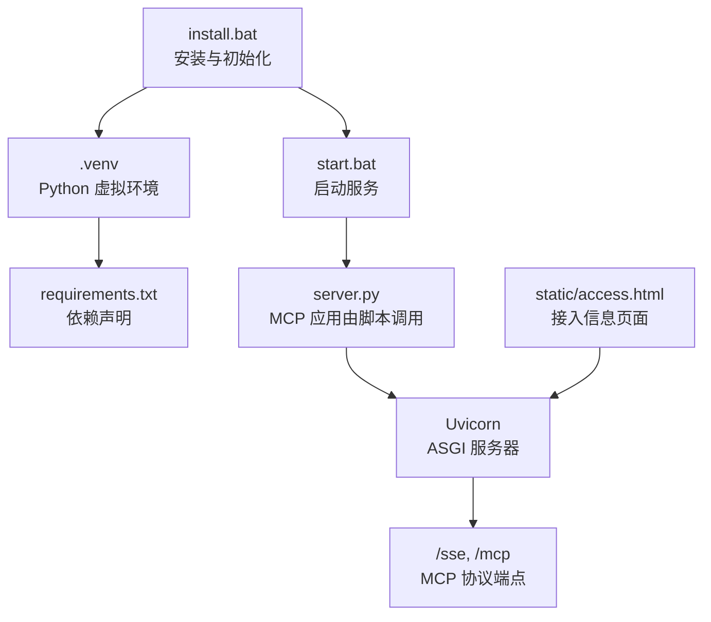
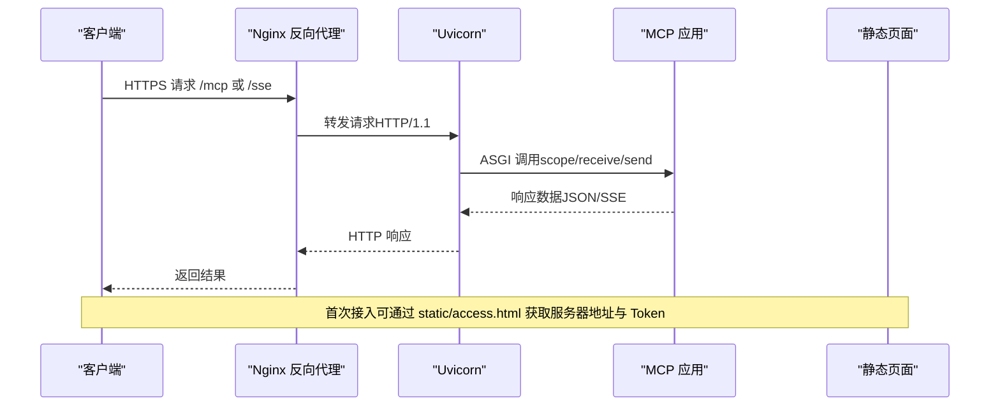
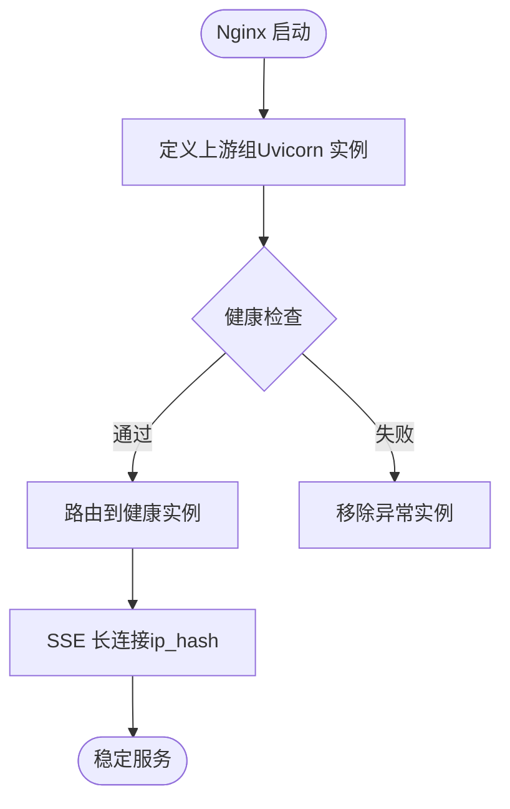
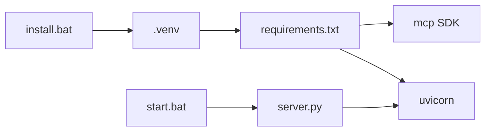

# 生产环境部署

<cite>
**本文引用的文件**
- [mcp server部署.md](file://mcp server部署.md)
- [requirements.txt](file://mcp_server/requirements.txt)
- [start.bat](file://mcp_server/start.bat)
- [install.bat](file://mcp_server/install.bat)
- [access.html](file://mcp_server/static/access.html)
</cite>

## 目录
1. [简介](#简介)
2. [项目结构](#项目结构)
3. [核心组件](#核心组件)
4. [架构总览](#架构总览)
5. [详细组件分析](#详细组件分析)
6. [依赖关系分析](#依赖关系分析)
7. [性能考虑](#性能考虑)
8. [故障排查指南](#故障排查指南)
9. [结论](#结论)
10. [附录](#附录)

## 简介
本指南面向将本项目（PCA MCP Server）部署到生产环境的运维与研发人员，覆盖服务器配置优化、安全加固、负载均衡、监控日志、备份与灾难恢复、以及性能基准测试与优化建议。内容基于仓库中的部署说明、启动脚本与静态接入页面进行系统化整理，确保在生产环境中稳定、安全、可观测地运行。

## 项目结构
- 服务入口与启动流程由 Windows 批处理脚本驱动：安装脚本负责创建虚拟环境与依赖安装；启动脚本负责加载环境变量并执行 Python 应用。
- 依赖声明位于 requirements.txt，包含 MCP SDK 与 Uvicorn。
- 静态接入页面 access.html 提供访问信息展示与一键生成配置的能力，便于客户端快速接入。

图表来源
- [install.bat:1-85](file://mcp_server/install.bat#L1-L85)
- [start.bat:1-41](file://mcp_server/start.bat#L1-L41)
- [requirements.txt:1-3](file://mcp_server/requirements.txt#L1-L3)
- [mcp server部署.md:110-181](file://mcp server部署.md#L110-L181)

章节来源
- [mcp server部署.md:285-305](file://mcp server部署.md#L285-L305)
- [mcp server部署.md:463-501](file://mcp server部署.md#L463-L501)

## 核心组件
- MCP SDK：实现 MCP 协议的 JSON-RPC 消息处理与工具路由，暴露标准端点 /sse 与 /mcp。
- Uvicorn：高性能 ASGI 服务器，承载 HTTP/SSE 请求，支持异步并发。
- 启动脚本：install.bat 完成环境准备与 Token 配置；start.bat 读取 .env 并启动服务。
- 接入页面：access.html 自动检测服务器地址与分配 Token，帮助客户端生成接入配置。

章节来源
- [mcp server部署.md:64-107](file://mcp server部署.md#L64-L107)
- [mcp server部署.md:165-181](file://mcp server部署.md#L165-L181)
- [install.bat:52-73](file://mcp_server/install.bat#L52-L73)
- [start.bat:15-41](file://mcp_server/start.bat#L15-L41)
- [access.html:321-443](file://mcp_server/static/access.html#L321-L443)

## 架构总览
下图展示了从客户端到后端服务的完整链路，包括反向代理、认证中间件、MCP 应用与 SSE 长连接。

图表来源
- [mcp server部署.md:110-181](file://mcp server部署.md#L110-L181)
- [mcp server部署.md:215-282](file://mcp server部署.md#L215-L282)
- [access.html:401-443](file://mcp_server/static/access.html#L401-L443)

## 详细组件分析

### Uvicorn 服务器参数调优与工作进程数
- 单进程 vs 多进程：默认单进程适合开发；生产建议使用多工作进程以提升吞吐与容错能力。
- 关键参数建议：
  - workers：根据 CPU 核数设置（常见为 2×CPU+1），避免过多导致上下文切换开销。
  - loop：使用 uvloop 提升事件循环性能。
  - limit-concurrency：限制并发连接数，防止内存暴涨。
  - timeout-graceful-shutdown：优雅关闭时间，保证请求完成。
  - forwarded-allow-ips：若通过反向代理，需正确设置以获取真实 IP。
- 结合项目：当前 start.bat 直接调用 Python 应用，未显式传入 Uvicorn 参数；生产应通过进程管理器（如 systemd/supervisor）或容器编排注入参数。

章节来源
- [mcp server部署.md:82-107](file://mcp server部署.md#L82-L107)
- [mcp server部署.md:165-181](file://mcp server部署.md#L165-L181)
- [start.bat:41-41](file://mcp_server/start.bat#L41-L41)

### 内存限制配置
- 操作系统级限制：Linux 可使用 cgroups/systemd MemoryMax；Windows 使用资源监视器或容器限制。
- 应用级限制：通过 Uvicorn 的 limit-concurrency 控制并发；在业务层对大对象进行流式处理与及时释放。
- 监控告警：结合系统与应用指标，设置内存使用阈值告警。

[本节为通用指导，不直接分析具体文件]

### 安全加固措施
- HTTPS 配置：
  - 在 Nginx 终止 TLS，配置证书与强加密套件，启用 HSTS。
  - 仅允许 HTTPS 访问，HTTP 强制跳转。
- 防火墙规则：
  - 仅开放必要端口（如 443），限制源 IP 范围。
  - 对内网管理接口实施白名单。
- 访问控制列表：
  - 基于 Nginx 的 allow/deny 或 WAF 规则限制恶意 IP。
  - 结合 MCP 鉴权中间件与 Token 机制，最小权限原则。
- 敏感信息管理：
  - 生产环境避免明文 Token 存储于 .env；建议使用密钥管理服务或环境变量注入。
  - 确保 .env 不被提交至版本库。

章节来源
- [mcp server部署.md:645-674](file://mcp server部署.md#L645-L674)
- [install.bat:52-73](file://mcp_server/install.bat#L52-L73)
- [start.bat:15-27](file://mcp_server/start.bat#L15-L27)

### 负载均衡配置方案
- Nginx 反向代理：
  - 上游组：定义多个 Uvicorn 实例作为 upstream，按策略轮询或加权。
  - 健康检查：配置主动健康检查或被动失败重试，确保流量只转发到健康节点。
  - 会话保持：SSE 长连接需启用 ip_hash 或 sticky session，避免连接中断。
  - 超时与缓冲：合理设置 proxy_read_timeout、proxy_send_timeout，适配 SSE 长连接。
- 健康检查端点：
  - 暴露 /health 或 /mcp 探测接口，返回 200 表示服务正常。
  - Nginx 使用 health_check 模块或外部探针定期检测。

图表来源
- [mcp server部署.md:165-181](file://mcp server部署.md#L165-L181)
- [mcp server部署.md:215-282](file://mcp server部署.md#L215-L282)

### 监控与日志配置
- 应用日志：
  - 启用结构化日志（JSON），记录请求 ID、方法、路径、状态码、耗时。
  - 分级输出（INFO/WARN/ERROR），错误日志单独文件。
- 访问日志：
  - Nginx 访问日志格式包含客户端 IP、UA、URL、状态码、耗时。
  - 集中收集到日志平台（ELK/Loki）。
- 性能指标：
  - 暴露 /metrics 或使用 Prometheus 客户端采集 QPS、延迟、错误率、内存/CPU。
  - 设置 SLO 与告警规则（如 P99 延迟、错误率阈值）。

[本节为通用指导，不直接分析具体文件]

### 备份策略与灾难恢复
- 配置备份：
  - 定期备份 Nginx 配置、证书、应用配置与环境变量。
  - 使用版本化存储（Git 或对象存储）。
- 数据备份：
  - 若涉及数据库或文件存储，制定全量与增量备份策略。
  - 验证备份可恢复性。
- 灾难恢复：
  - 制定 RTO/RPO 目标，演练恢复流程。
  - 多可用区部署，自动故障转移。

[本节为通用指导，不直接分析具体文件]

### 性能基准测试与优化建议
- 基准测试：
  - 使用 wrk/k6 模拟高并发 SSE 连接与 JSON-RPC 请求。
  - 关注 QPS、P95/P99 延迟、错误率、资源使用。
- 优化建议：
  - 调整 Uvicorn workers 与并发限制。
  - 启用 gzip/brotli 压缩静态资源。
  - 缓存热点数据，减少后端压力。
  - 优化网络栈（内核参数、TCP 队列）。

[本节为通用指导，不直接分析具体文件]

## 依赖关系分析
项目依赖集中在 requirements.txt，包含 MCP SDK 与 Uvicorn。启动流程通过 install.bat 创建虚拟环境并安装依赖，start.bat 加载环境变量后执行应用。

图表来源
- [requirements.txt:1-3](file://mcp_server/requirements.txt#L1-L3)
- [install.bat:26-49](file://mcp_server/install.bat#L26-L49)
- [start.bat:7-41](file://mcp_server/start.bat#L7-L41)

章节来源
- [requirements.txt:1-3](file://mcp_server/requirements.txt#L1-L3)
- [install.bat:26-49](file://mcp_server/install.bat#L26-L49)
- [start.bat:7-41](file://mcp_server/start.bat#L7-L41)

## 性能考虑
- 并发模型：Uvicorn 基于异步事件循环，适合 I/O 密集型任务；合理设置 workers 与并发限制。
- 连接管理：SSE 长连接占用资源，需限制最大连接数与空闲超时。
- 资源隔离：容器化部署，限制 CPU/内存，避免相互影响。
- 监控与告警：实时观察关键指标，及时扩容或降级。

[本节为通用指导，不直接分析具体文件]

## 故障排查指南
- 常见问题：
  - Python 未安装或版本过低：检查 Python 版本并安装 3.10+。
  - 虚拟环境创建失败：确认权限与磁盘空间。
  - 依赖安装失败：检查网络与镜像源。
  - 端口被占用：查找并结束占用进程或修改端口。
  - Token 未配置：运行安装脚本或手动设置环境变量。
- 定位方法：
  - 查看启动日志与错误堆栈。
  - 检查 Nginx 访问与错误日志。
  - 使用网络工具（curl/wget）验证端点可达性。

章节来源
- [mcp server部署.md:505-642](file://mcp server部署.md#L505-L642)

## 结论
通过将 Uvicorn 置于 Nginx 之后，结合多进程、健康检查与安全加固，可实现高可用、高性能的生产部署。完善的监控、日志、备份与灾备策略保障服务稳定性。持续的性能基准测试与优化确保资源利用率与服务质量。

[本节为总结，不直接分析具体文件]

## 附录
- 快速命令参考：
  - 首次安装：运行 mcp_server\install.bat
  - 启动服务：运行 mcp_server\start.bat
  - 停止服务：Ctrl+C 或进程管理器停止
  - 手动激活虚拟环境：.venv\Scripts\activate.bat
  - 退出虚拟环境：deactivate
  - 手动启动服务：python mcp_server\server.py

章节来源
- [mcp server部署.md:677-687](file://mcp server部署.md#L677-L687)