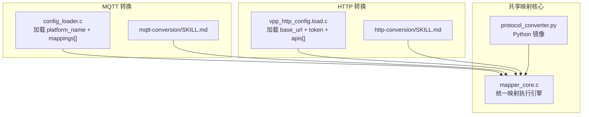
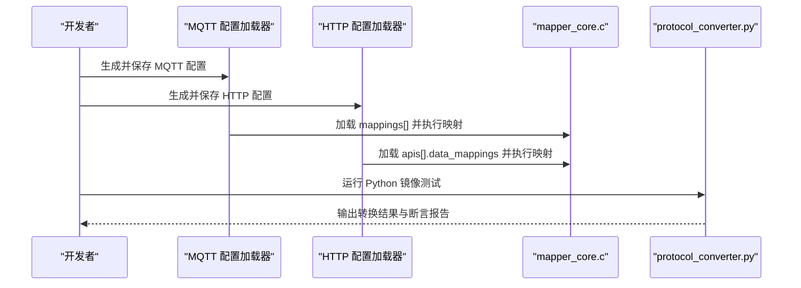
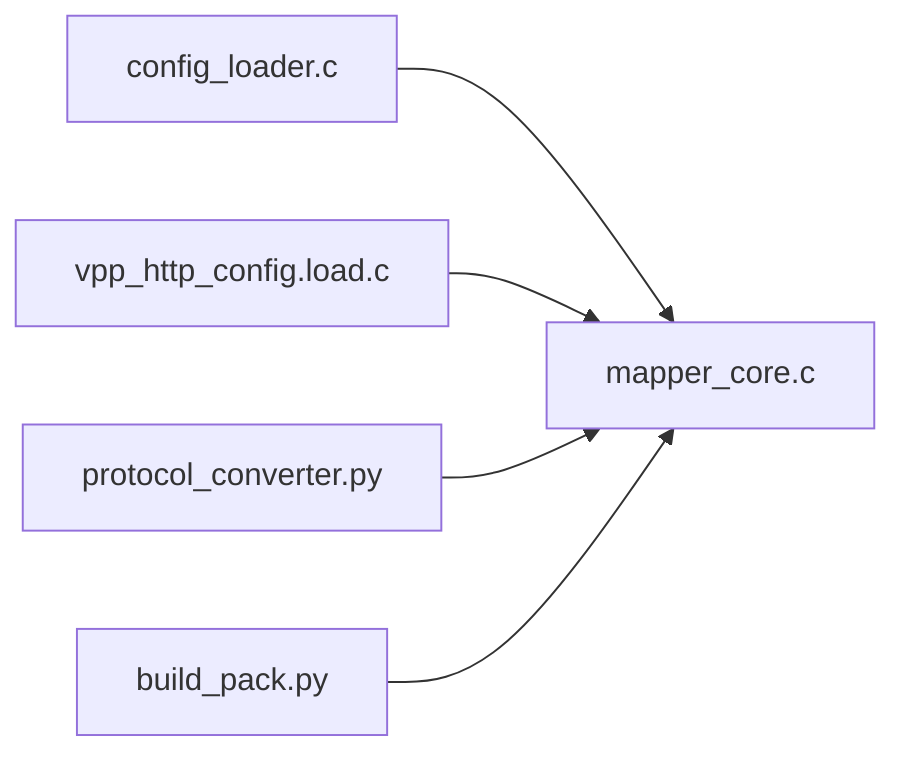

# 协议转换开发

<cite>
**本文引用的文件**
- [protocol-conversion/SKILL.md](file://.trae/skills/protocol-conversion/SKILL.md)
- [mqtt-conversion/SKILL.md](file://.trae/skills/mqtt-conversion/SKILL.md)
- [http-conversion/SKILL.md](file://.trae/skills/http-conversion/SKILL.md)
- [protocol_converter.py](file://.trae/skills/protocol-conversion/scripts/protocol_converter.py)
- [test_protocol_converter.py](file://.trae/skills/protocol-conversion/scripts/test_protocol_converter.py)
- [mapper_core.c](file://.trae/skills/protocol-conversion/scripts/mapper_core.c)
- [build_pack.py](file://.trae/skills/protocol-conversion/scripts/build_pack.py)
</cite>

## 目录
1. [简介](#简介)
2. [项目结构](#项目结构)
3. [核心组件](#核心组件)
4. [架构总览](#架构总览)
5. [详细组件分析](#详细组件分析)
6. [依赖关系分析](#依赖关系分析)
7. [性能优化指南](#性能优化指南)
8. [调试与排障](#调试与排障)
9. [测试用例设计指南](#测试用例设计指南)
10. [结论](#结论)

## 简介
本指南面向需要编写“协议转换映射规则”的开发者，覆盖字段映射语法、数据类型转换、数组遍历规则、模板变量替换机制、完整示例（从简单映射到复杂业务）、性能优化技巧（缓存、批量、内存管理）、调试方法与常见问题、以及测试用例设计方法。内容基于统一映射核心引擎与 MQTT/HTTP 两套配置加载器的实现规范，确保生成的 JSON 映射脚本可在 C 引擎中稳定执行。

## 项目结构
- 共享映射核心：定义统一的映射规则字段、路径语法、类型系统、数组遍历准则、生成器清单、模板替换机制等。
- MQTT 转换：使用 config_loader.c 加载 platform_name + mappings[] 的配置，交由 mapper_core.c 执行映射。
- HTTP 转换：使用 vpp_http_config.load.c 加载 base_url + token + apis[] 的配置，交由 mapper_core.c 执行映射。
- Python 镜像与测试：提供 protocol_converter.py 作为本地测试镜像，配合 test_protocol_converter.py 进行验证。

图表来源
- [protocol-conversion/SKILL.md:23-35](file://.trae/skills/protocol-conversion/SKILL.md#L23-L35)
- [mqtt-conversion/SKILL.md:23-31](file://.trae/skills/mqtt-conversion/SKILL.md#L23-L31)
- [http-conversion/SKILL.md:23-31](file://.trae/skills/http-conversion/SKILL.md#L23-L31)

章节来源
- [protocol-conversion/SKILL.md:23-35](file://.trae/skills/protocol-conversion/SKILL.md#L23-L35)
- [mqtt-conversion/SKILL.md:23-31](file://.trae/skills/mqtt-conversion/SKILL.md#L23-L31)
- [http-conversion/SKILL.md:23-31](file://.trae/skills/http-conversion/SKILL.md#L23-L31)

## 核心组件
- 映射规则字段：target、source_type、source、type、constant、generator、generator_param、scale、post_process、preprocess、item_type、sub_mappings。
- 路径语法：点号访问、索引访问、通配符遍历、锚点、$item/$idx、根对象引用。
- 类型系统：string/double/int/long/bool/object/substitute，含缩放因子 scale。
- 数组遍历：array_foreach + @ 锚点；object/key_value 两种 item_type；ensure_path 自动建路径。
- 模板变量替换：通过 source_type="constant" + type="substitute" 触发 $var$ 替换。
- 生成器：uuid、时间戳、日期时间、随机串、签名、批次ID、序列号等。
- 预处理/后处理：preprocess/post_process（C 引擎部分待实现），优先使用声明式字段减少硬编码。

章节来源
- [protocol-conversion/SKILL.md:37-57](file://.trae/skills/protocol-conversion/SKILL.md#L37-L57)
- [protocol-conversion/SKILL.md:58-69](file://.trae/skills/protocol-conversion/SKILL.md#L58-L69)
- [protocol-conversion/SKILL.md:81-91](file://.trae/skills/protocol-conversion/SKILL.md#L81-L91)
- [protocol-conversion/SKILL.md:112-125](file://.trae/skills/protocol-conversion/SKILL.md#L112-L125)
- [protocol-conversion/SKILL.md:126-169](file://.trae/skills/protocol-conversion/SKILL.md#L126-L169)
- [protocol-conversion/SKILL.md:170-195](file://.trae/skills/protocol-conversion/SKILL.md#L170-L195)
- [protocol-conversion/SKILL.md:196-213](file://.trae/skills/protocol-conversion/SKILL.md#L196-L213)
- [protocol-conversion/SKILL.md:214-225](file://.trae/skills/protocol-conversion/SKILL.md#L214-L225)
- [protocol-conversion/SKILL.md:226-265](file://.trae/skills/protocol-conversion/SKILL.md#L226-L265)

## 架构总览
- 配置加载层：MQTT 使用 config_loader.c，HTTP 使用 vpp_http_config.load.c。
- 映射执行层：统一由 mapper_core.c 执行字段取值、类型转换、数组遍历、生成器调用、模板替换。
- 工具链：Python 镜像用于本地测试与验证，测试套件覆盖路径解析、类型转换、生成器、模板替换、数组遍历、边界场景等。

图表来源
- [protocol-conversion/SKILL.md:23-35](file://.trae/skills/protocol-conversion/SKILL.md#L23-L35)
- [mqtt-conversion/SKILL.md:23-31](file://.trae/skills/mqtt-conversion/SKILL.md#L23-L31)
- [http-conversion/SKILL.md:23-31](file://.trae/skills/http-conversion/SKILL.md#L23-L31)

章节来源
- [protocol-conversion/SKILL.md:23-35](file://.trae/skills/protocol-conversion/SKILL.md#L23-L35)

## 详细组件分析

### 映射规则编写规范
- 字段映射语法
  - target：目标 JSON 路径，支持 .、[index]、@ 锚点。
  - source_type：path / constant / generated / array_foreach / context。
  - source：源路径，支持 .、[index]、[*]、$item、$idx；HTTP 支持 "." 返回根对象。
  - type：string / double / int / long / bool / object / substitute。
  - constant：常量值（source_type=constant 时必填）。
  - generator：生成器名称（source_type=generated 时必填）。
  - scale：数值缩放因子（默认 1.0）。
  - preprocess/post_process：预处理/后处理函数名（当前 C 引擎部分待实现）。
  - item_type：array_foreach 时必填，object 或 key_value。
  - sub_mappings：子规则，递归构建对象或数组元素映射。
- 路径语法要点
  - 点号访问属性、[index] 访问特定索引、[*] 遍历数组所有元素、@ 目标数组锚点、$item/$idx 在数组遍历中使用、"." 单独表示根对象（HTTP）。
- 类型转换与缩放
  - 数字类型支持 scale 单位换算；object 可通过 sub_mappings 递归构建；substitute 对 constant 中的模板变量执行替换。
- 数组遍历规则
  - 首要判断依据是目标格式要求：目标为 Array 时使用 array_foreach + @；目标为 Object 时取第一个元素或不遍历。
  - ensure_path 自动创建嵌套数组与对象，一条规则即可构建多层结构。
  - item_type 决定每个源元素生成一个对象或键值对列表。
- 模板变量替换机制
  - 通过 source_type="constant" + type="substitute" 组合触发 $var$ 替换，变量来自运行时上下文或模板变量定义。
  - 支持嵌套路径如 $ssl_mqtt_server.gatewayID$。
- 生成器清单
  - uuid、current_timestamp、timestamp_sec/ms、datetime_compact/str、random_string、md5_sign、batch_id、sequence 等。

章节来源
- [protocol-conversion/SKILL.md:37-57](file://.trae/skills/protocol-conversion/SKILL.md#L37-L57)
- [protocol-conversion/SKILL.md:58-69](file://.trae/skills/protocol-conversion/SKILL.md#L58-L69)
- [protocol-conversion/SKILL.md:81-91](file://.trae/skills/protocol-conversion/SKILL.md#L81-L91)
- [protocol-conversion/SKILL.md:112-125](file://.trae/skills/protocol-conversion/SKILL.md#L112-L125)
- [protocol-conversion/SKILL.md:126-169](file://.trae/skills/protocol-conversion/SKILL.md#L126-L169)
- [protocol-conversion/SKILL.md:170-195](file://.trae/skills/protocol-conversion/SKILL.md#L170-L195)
- [protocol-conversion/SKILL.md:196-213](file://.trae/skills/protocol-conversion/SKILL.md#L196-L213)
- [protocol-conversion/SKILL.md:214-225](file://.trae/skills/protocol-conversion/SKILL.md#L214-L225)
- [protocol-conversion/SKILL.md:226-265](file://.trae/skills/protocol-conversion/SKILL.md#L226-L265)

### 模板变量替换机制
- 触发方式：source_type="constant" + type="substitute"。
- 变量来源：运行时上下文或模板变量定义（如 ssl_mqtt_server.*）。
- 语法：$变量名$，支持嵌套路径。
- 行为：若上下文缺失则保留原模板字符串。

章节来源
- [protocol-conversion/SKILL.md:170-195](file://.trae/skills/protocol-conversion/SKILL.md#L170-L195)

### 数组遍历与嵌套结构
- 遍历策略：根据目标字段类型决定遍历或固定索引。
- 锚点与层级：外层 array_foreach 的 target 可含 @，其 sub_mappings 中又可再次使用 @ 创建更深层级数组。
- 自动建路径：ensure_path 遇到 [index] 自动创建数组与对象，不足长度时补齐空对象。

章节来源
- [protocol-conversion/SKILL.md:126-169](file://.trae/skills/protocol-conversion/SKILL.md#L126-L169)

### 完整开发示例（从简单到复杂）
- 简单数据映射：将源字段直接映射到目标字段，必要时进行类型转换与缩放。
- 复杂业务逻辑：
  - 多层数组遍历：设备层与测点层分别使用 @ 遍历。
  - 常量与生成器：action 固定值、msgId 使用 uuid、devId 使用模板变量替换。
  - 预处理/后处理：时间格式转换、字符串清理（C 引擎部分待实现）。
- 参考示例：
  - MQTT 真实协议示例与生成的 JSON 配置。
  - HTTP 真实协议示例与生成的 JSON 配置。

章节来源
- [mqtt-conversion/SKILL.md:365-440](file://.trae/skills/mqtt-conversion/SKILL.md#L365-L440)
- [http-conversion/SKILL.md:432-522](file://.trae/skills/http-conversion/SKILL.md#L432-L522)

### 性能优化技巧
- 缓存策略
  - 复用 httpx.AsyncClient（HTTP 引擎）避免频繁创建连接。
  - 对热点配置或字典数据进行本地缓存，减少重复解析与网络请求。
- 批量处理
  - 对大量数据项采用分批处理，控制单次处理规模，降低内存峰值。
  - 利用数组遍历与 ensure_path 一次性构建目标结构，减少多次写入。
- 内存管理
  - 及时释放不再使用的临时对象，避免大对象长期驻留。
  - 对超大响应流式处理，避免一次性加载全部数据到内存。
- 声明式优先
  - 尽量使用 scale、constant、substitute、generated 等声明式字段，减少 post_process 硬编码带来的开销与维护成本。

章节来源
- [protocol-conversion/SKILL.md:214-225](file://.trae/skills/protocol-conversion/SKILL.md#L214-L225)
- [protocol-conversion/SKILL.md:226-265](file://.trae/skills/protocol-conversion/SKILL.md#L226-L265)

### 调试方法与常见问题
- 调试方法
  - 使用 Python 镜像进行本地测试：protocol_converter.py + test_protocol_converter.py。
  - 逐步验证：路径解析 → 类型转换 → 生成器 → 模板替换 → 数组遍历 → 边界场景。
- 常见问题
  - 引擎引用错误：MQTT 应使用 config_loader.c + mapper_core.c；HTTP 应使用 vpp_http_config.load.c + mapper_core.c。
  - 看到数组就遍历：需根据目标字段类型判断是否遍历。
  - 常量字段键名错误：JSON 键名为 constant，不是 constant_value。
  - substitute 配置错误：应为 source_type="constant" + type="substitute"。
  - 过度依赖 post_process：优先使用 scale/constant/substitute/generated。

章节来源
- [protocol-conversion/SKILL.md:408-452](file://.trae/skills/protocol-conversion/SKILL.md#L408-L452)
- [test_protocol_converter.py:782-806](file://.trae/skills/protocol-conversion/scripts/test_protocol_converter.py#L782-L806)

## 依赖关系分析
- 配置加载器与执行引擎解耦：MQTT/HTTP 各自负责加载配置，统一交由 mapper_core.c 执行映射。
- Python 镜像与 C 引擎一致性：protocol_converter.py 镜像 mapper_core.c 的核心函数，便于本地测试。
- 构建与打包：build_pack.py 汇总文件信息、依赖、测试状态，生成 manifest。

图表来源
- [protocol-conversion/SKILL.md:23-35](file://.trae/skills/protocol-conversion/SKILL.md#L23-L35)
- [build_pack.py:101-134](file://.trae/skills/protocol-conversion/scripts/build_pack.py#L101-L134)

章节来源
- [protocol-conversion/SKILL.md:23-35](file://.trae/skills/protocol-conversion/SKILL.md#L23-L35)
- [build_pack.py:101-134](file://.trae/skills/protocol-conversion/scripts/build_pack.py#L101-L134)

## 性能优化指南
- 连接与超时
  - HTTP 引擎使用异步客户端并设置合理超时，避免阻塞事件循环。
- 并发与批处理
  - 高并发场景下，利用事件循环特性并行处理多个 I/O 等待任务。
  - 对大数据集采用分页与分批处理，控制内存占用。
- 资源复用
  - 复用客户端实例与解析器，减少对象创建与销毁开销。
- 日志与监控
  - 记录关键步骤耗时与错误，定位瓶颈与异常。

章节来源
- [mcp server部署.md:265-279](file://mcp server部署.md#L265-L279)

## 调试与排障
- 使用 Python 镜像快速验证映射规则
  - 运行单元测试，检查路径解析、类型转换、生成器、模板替换、数组遍历等。
- 常见错误定位
  - 检查 source_type 与 type 的组合是否正确。
  - 确认 target 路径与 @ 锚点的使用是否符合目标结构。
  - 校验常量键名与生成器名称是否在清单内。
- 回退与降级
  - 当 C 引擎功能未完全实现时，优先使用声明式字段替代 post_process。
  - 使用 Python 镜像先行验证，再部署到 C 引擎。

章节来源
- [protocol-conversion/SKILL.md:408-452](file://.trae/skills/protocol-conversion/SKILL.md#L408-L452)
- [test_protocol_converter.py:782-806](file://.trae/skills/protocol-conversion/scripts/test_protocol_converter.py#L782-L806)

## 测试用例设计指南
- 测试维度
  - 路径解析：基本路径、嵌套、数组索引、通配符、"."路径、缺失路径。
  - 类型转换：7 种类型 × 各种源值组合。
  - 生成器：所有生成器类型。
  - 模板替换：简单/嵌套/多变量/无匹配。
  - 数组遍历：object/key_value/嵌套/dot路径/展平。
  - 边界场景：空数组、缺失字段、缩放、深层嵌套。
  - 真实配置集成：MQTT/HTTP 真实配置的端到端测试。
- 执行方式
  - 使用 Python 镜像运行单元测试，捕获输出与断言结果。
  - 构造期望目标 JSON，逐项比对字段完整性、类型正确性、值正确性、数组遍历数量与映射正确性。
- 持续验证
  - 每次修改映射规则后，重新运行测试套件，确保回归通过。

章节来源
- [protocol-conversion/SKILL.md:301-338](file://.trae/skills/protocol-conversion/SKILL.md#L301-L338)
- [test_protocol_converter.py:782-806](file://.trae/skills/protocol-conversion/scripts/test_protocol_converter.py#L782-L806)

## 结论
本指南提供了协议转换开发的完整方法论与实践要点：从映射规则字段、路径语法、类型系统、数组遍历、模板替换到生成器与预处理/后处理的规范；结合 MQTT/HTTP 两套配置加载器与统一映射核心，确保配置的可移植性与执行的一致性；通过 Python 镜像与测试套件进行高效验证；并提供性能优化、调试排障与测试设计建议，帮助开发者高质量完成协议转换任务。