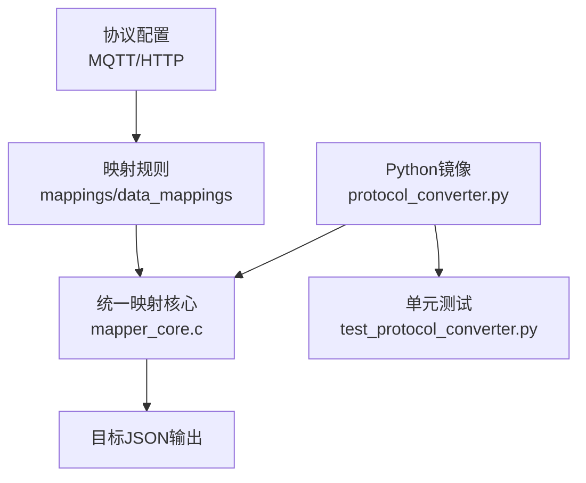
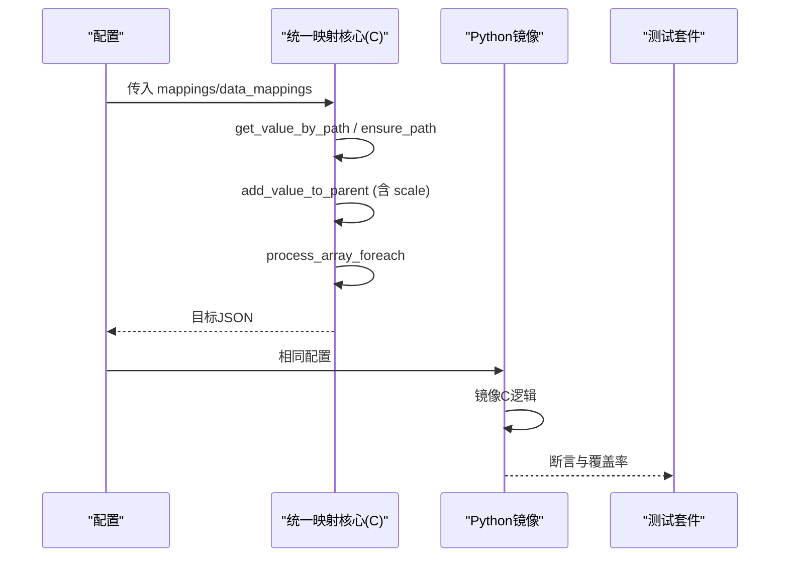
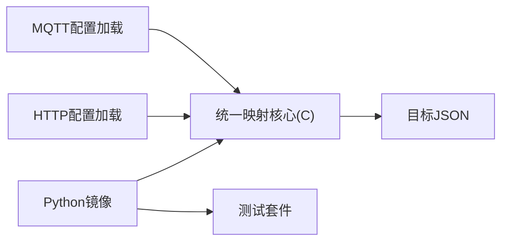
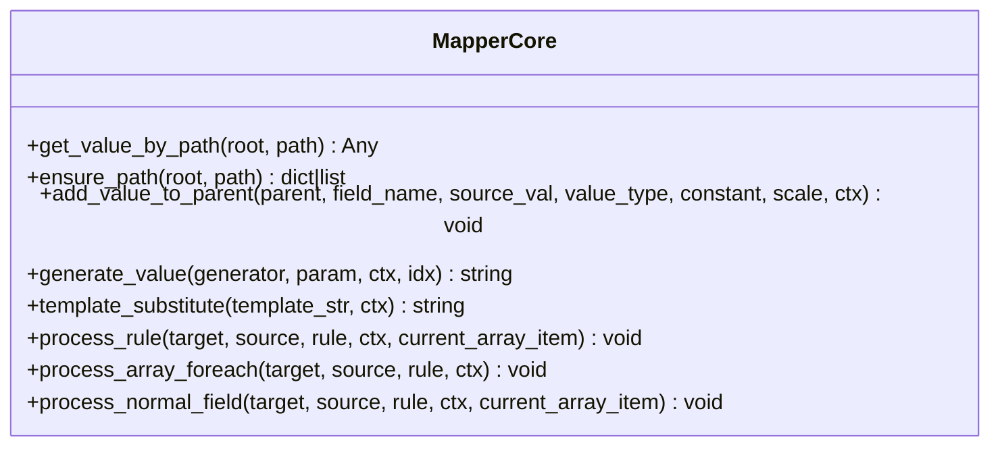

# 性能优化

<cite>
**本文引用的文件**
- [mapper_core.c](file://.trae/skills/protocol-conversion/scripts/mapper_core.c)
- [protocol_converter.py](file://.trae/skills/protocol-conversion/scripts/protocol_converter.py)
- [test_protocol_converter.py](file://.trae/skills/protocol-conversion/scripts/test_protocol_converter.py)
- [SKILL.md](file://.trae/skills/protocol-conversion/SKILL.md)
- [mcp server部署.md](file://mcp server部署.md)
</cite>

## 目录
1. [简介](#简介)
2. [项目结构](#项目结构)
3. [核心组件](#核心组件)
4. [架构总览](#架构总览)
5. [详细组件分析](#详细组件分析)
6. [依赖关系分析](#依赖关系分析)
7. [性能考量与调优](#性能考量与调优)
8. [故障排查指南](#故障排查指南)
9. [结论](#结论)
10. [附录](#附录)

## 简介
本指南聚焦协议转换的性能优化，围绕以下关键点展开：scale字段的单位换算优势、相比post_process的性能提升；批量处理与缓存策略的实现方法；内存管理最佳实践（cJSON对象的创建与释放）；性能监控与调优方法；ensure_path自动建路径的性能影响与优化建议；数组遍历的性能考虑与最佳实践；测试镜像使用方法（通过Python镜像进行性能测试）；常见性能问题的诊断与解决方案。

## 项目结构
本项目包含统一的协议映射核心（C实现）与Python镜像实现，用于本地测试与验证。核心能力包括路径取值、路径创建、类型转换、生成器、模板替换、数组遍历等。



图表来源
- [mapper_core.c:1-15](file://.trae/skills/protocol-conversion/scripts/mapper_core.c#L1-L15)
- [protocol_converter.py:1-16](file://.trae/skills/protocol-conversion/scripts/protocol_converter.py#L1-L16)

章节来源
- [SKILL.md:23-35](file://.trae/skills/protocol-conversion/SKILL.md#L23-L35)
- [mapper_core.c:1-15](file://.trae/skills/protocol-conversion/scripts/mapper_core.c#L1-L15)
- [protocol_converter.py:1-16](file://.trae/skills/protocol-conversion/scripts/protocol_converter.py#L1-L16)

## 核心组件
- 统一映射核心（C）：提供路径解析、路径创建、类型转换、生成器、模板替换、数组遍历等高性能实现。
- Python镜像：完全镜像C引擎逻辑，便于本地测试、验证与性能基准对比。
- 测试套件：覆盖路径、类型、生成器、模板替换、数组遍历、完整转换等场景，确保行为一致性与正确性。

章节来源
- [SKILL.md:266-279](file://.trae/skills/protocol-conversion/SKILL.md#L266-L279)
- [protocol_converter.py:28-45](file://.trae/skills/protocol-conversion/scripts/protocol_converter.py#L28-L45)
- [test_protocol_converter.py:1-16](file://.trae/skills/protocol-conversion/scripts/test_protocol_converter.py#L1-L16)

## 架构总览
协议转换流程由“配置加载 → 规则执行 → 结果输出”构成。C引擎负责高性能执行，Python镜像用于测试与验证。



图表来源
- [mapper_core.c:41-88](file://.trae/skills/protocol-conversion/scripts/mapper_core.c#L41-L88)
- [mapper_core.c:116-153](file://.trae/skills/protocol-conversion/scripts/mapper_core.c#L116-L153)
- [mapper_core.c:332-437](file://.trae/skills/protocol-conversion/scripts/mapper_core.c#L332-L437)
- [mapper_core.c:458-604](file://.trae/skills/protocol-conversion/scripts/mapper_core.c#L458-L604)
- [protocol_converter.py:49-104](file://.trae/skills/protocol-conversion/scripts/protocol_converter.py#L49-L104)
- [protocol_converter.py:120-159](file://.trae/skills/protocol-conversion/scripts/protocol_converter.py#L120-L159)
- [protocol_converter.py:269-376](file://.trae/skills/protocol-conversion/scripts/protocol_converter.py#L269-L376)
- [protocol_converter.py:395-479](file://.trae/skills/protocol-conversion/scripts/protocol_converter.py#L395-L479)

## 详细组件分析

### 路径取值与路径创建
- get_value_by_path：支持“.”、“[index]”、“[*]”语法，返回根对象或指定元素/数组。
- ensure_path：按路径逐级创建对象或数组，遇到[index]时自动补齐到所需索引。

性能要点
- 字符串分割与查找在热路径中频繁调用，应尽量减少拷贝与重复计算。
- 对缺失路径的短路返回可降低无效分支开销。

章节来源
- [mapper_core.c:41-88](file://.trae/skills/protocol-conversion/scripts/mapper_core.c#L41-L88)
- [mapper_core.c:116-153](file://.trae/skills/protocol-conversion/scripts/mapper_core.c#L116-L153)
- [protocol_converter.py:49-104](file://.trae/skills/protocol-conversion/scripts/protocol_converter.py#L49-L104)
- [protocol_converter.py:120-159](file://.trae/skills/protocol-conversion/scripts/protocol_converter.py#L120-L159)

### 类型转换与scale字段
- add_value_to_parent：统一处理string/double/int/long/bool/object/substitute类型。
- scale字段：数值类型支持乘以scale因子进行单位换算，避免后处理函数调用。

性能优势
- 使用scale直接在类型转换阶段完成单位换算，减少额外函数调用与分支判断。
- 相比post_process，scale是声明式且内联于转换路径，具备更低的运行时开销。

章节来源
- [mapper_core.c:332-437](file://.trae/skills/protocol-conversion/scripts/mapper_core.c#L332-L437)
- [protocol_converter.py:269-376](file://.trae/skills/protocol-conversion/scripts/protocol_converter.py#L269-L376)
- [SKILL.md:214-224](file://.trae/skills/protocol-conversion/SKILL.md#L214-L224)

### 数组遍历与嵌套展平
- process_array_foreach：支持object/key_value两种item_type，支持$idx变量替换、"."源路径、嵌套[*]展平。
- get_flat_array_from_path：递归展平多层[*]路径，将深层数组扁平化为一维数组。

性能要点
- 遍历前尽量获取源数组并做空检查，避免无意义循环。
- 嵌套展平时注意复制与追加操作的次数，控制中间对象数量。

章节来源
- [mapper_core.c:458-604](file://.trae/skills/protocol-conversion/scripts/mapper_core.c#L458-L604)
- [mapper_core.c:161-208](file://.trae/skills/protocol-conversion/scripts/mapper_core.c#L161-L208)
- [protocol_converter.py:395-479](file://.trae/skills/protocol-conversion/scripts/protocol_converter.py#L395-L479)
- [protocol_converter.py:161-202](file://.trae/skills/protocol-conversion/scripts/protocol_converter.py#L161-L202)

### 生成器与模板替换
- generate_value：支持uuid、时间戳、随机串、序列号等生成器。
- template_substitute：基于$var$语法的模板变量替换，支持嵌套路径。

性能要点
- 生成器应避免重复系统调用（如时间），可在上下文或批处理中复用。
- 模板替换采用正则匹配与字符串拼接，需控制模板复杂度与变量深度。

章节来源
- [mapper_core.c:223-271](file://.trae/skills/protocol-conversion/scripts/mapper_core.c#L223-L271)
- [mapper_core.c:282-317](file://.trae/skills/protocol-conversion/scripts/mapper_core.c#L282-L317)
- [protocol_converter.py:206-236](file://.trae/skills/protocol-conversion/scripts/protocol_converter.py#L206-L236)
- [protocol_converter.py:240-265](file://.trae/skills/protocol-conversion/scripts/protocol_converter.py#L240-L265)

### 规则分发与入口
- process_rule_impl/process_rule：根据source_type或标志位分发到数组遍历或普通字段处理。
- transform_mqtt/transform_http：分别作为MQTT与HTTP的转换入口，遍历规则并执行。

章节来源
- [mapper_core.c:723-739](file://.trae/skills/protocol-conversion/scripts/mapper_core.c#L723-L739)
- [protocol_converter.py:379-393](file://.trae/skills/protocol-conversion/scripts/protocol_converter.py#L379-L393)
- [protocol_converter.py:569-601](file://.trae/skills/protocol-conversion/scripts/protocol_converter.py#L569-L601)

## 依赖关系分析
- 统一映射核心（C）被MQTT与HTTP外层配置加载模块引用，二者共享同一映射执行引擎。
- Python镜像与C引擎保持一一对应，便于测试与回归验证。



图表来源
- [SKILL.md:23-35](file://.trae/skills/protocol-conversion/SKILL.md#L23-L35)
- [protocol_converter.py:1-16](file://.trae/skills/protocol-conversion/scripts/protocol_converter.py#L1-L16)

章节来源
- [SKILL.md:23-35](file://.trae/skills/protocol-conversion/SKILL.md#L23-L35)

## 性能考量与调优

### scale字段单位换算的优势
- 在add_value_to_parent中直接乘以scale，避免额外的post_process调用与分支判断。
- 对于高频数值转换（如电压、功率），scale能显著降低CPU开销与内存分配。

建议
- 优先使用scale进行单位换算，仅在复杂逻辑时使用post_process。
- 对批量数据，确保scale为常量或预计算值，避免在循环中重复计算。

章节来源
- [mapper_core.c:332-437](file://.trae/skills/protocol-conversion/scripts/mapper_core.c#L332-L437)
- [protocol_converter.py:269-376](file://.trae/skills/protocol-conversion/scripts/protocol_converter.py#L269-L376)
- [SKILL.md:214-224](file://.trae/skills/protocol-conversion/SKILL.md#L214-L224)

### 批量处理与缓存策略
- 批量处理：在process_array_foreach中，先获取源数组并做空检查，减少无效遍历。
- 缓存策略：对频繁访问的路径结果可考虑缓存（如get_value_by_path的结果），但需注意数据变更时的失效策略。

建议
- 对固定路径（如配置项）进行一次性解析与缓存。
- 对动态路径（如请求参数）谨慎缓存，避免脏读。

章节来源
- [mapper_core.c:458-604](file://.trae/skills/protocol-conversion/scripts/mapper_core.c#L458-L604)
- [protocol_converter.py:395-479](file://.trae/skills/protocol-conversion/scripts/protocol_converter.py#L395-L479)

### 内存管理最佳实践（cJSON）
- 创建与释放：ensure_path中创建对象/数组，process_array_foreach中创建目标数组并在必要时释放临时数组。
- 深拷贝：object类型使用cJSON_Duplicate进行深拷贝，避免共享引用导致的数据污染。
- 资源泄漏防护：对需要释放的临时数组设置need_free标志，确保在异常路径也能释放。

建议
- 严格配对cJSON_Create*/cJSON_Delete*调用。
- 对大对象使用引用计数与延迟释放，减少频繁分配/释放。

章节来源
- [mapper_core.c:116-153](file://.trae/skills/protocol-conversion/scripts/mapper_core.c#L116-L153)
- [mapper_core.c:458-604](file://.trae/skills/protocol-conversion/scripts/mapper_core.c#L458-L604)
- [mapper_core.c:392-405](file://.trae/skills/protocol-conversion/scripts/mapper_core.c#L392-L405)

### ensure_path自动建路径的性能影响与优化
- 影响：每次写入路径都会进行字符串分割与查找，可能产生多次内存分配。
- 优化：合并连续写入操作，减少ensure_path调用次数；对固定路径进行预构建。

建议
- 批量写入时，先规划目标结构，再一次性填充。
- 对高频路径（如设备ID、时间戳）进行局部缓存。

章节来源
- [mapper_core.c:116-153](file://.trae/skills/protocol-conversion/scripts/mapper_core.c#L116-L153)
- [protocol_converter.py:120-159](file://.trae/skills/protocol-conversion/scripts/protocol_converter.py#L120-L159)

### 数组遍历的性能考虑与最佳实践
- 首要原则：遍历依据目标格式要求，而非源数据是否有数组。
- 最佳实践：使用[*]与@锚点明确遍历范围；避免不必要的嵌套遍历；对key_value模式控制子映射数量。

建议
- 对大型数组，考虑分块处理与并行化（在应用层）。
- 避免在遍历中进行昂贵操作（如网络请求、复杂计算）。

章节来源
- [SKILL.md:126-168](file://.trae/skills/protocol-conversion/SKILL.md#L126-L168)
- [mapper_core.c:458-604](file://.trae/skills/protocol-conversion/scripts/mapper_core.c#L458-L604)
- [protocol_converter.py:395-479](file://.trae/skills/protocol-conversion/scripts/protocol_converter.py#L395-L479)

### 性能监控与调优方法
- 监控指标：转换耗时、内存峰值、cJSON对象数量、数组遍历次数。
- 调优手段：启用scale替代post_process；减少ensure_path调用；优化数组遍历策略；引入缓存。

建议
- 在测试套件中加入性能基准用例，定期回归。
- 使用profiler定位热点函数（如get_value_by_path、add_value_to_parent）。

章节来源
- [test_protocol_converter.py:1-16](file://.trae/skills/protocol-conversion/scripts/test_protocol_converter.py#L1-L16)
- [SKILL.md:301-338](file://.trae/skills/protocol-conversion/SKILL.md#L301-L338)

### 测试镜像的使用方法（Python镜像）
- 运行测试：进入scripts目录，执行unittest命令。
- 用途：验证C引擎逻辑的正确性与一致性，支持性能基准对比。

步骤
- 切换到脚本目录。
- 运行测试套件。
- 查看覆盖率与失败用例。

章节来源
- [SKILL.md:301-338](file://.trae/skills/protocol-conversion/SKILL.md#L301-L338)
- [test_protocol_converter.py:1-16](file://.trae/skills/protocol-conversion/scripts/test_protocol_converter.py#L1-L16)

### 常见性能问题的诊断与解决方案
- 问题：过度依赖post_process导致CPU占用高。
  - 解决：改用scale或constant进行声明式处理。
- 问题：ensure_path频繁调用导致内存分配过多。
  - 解决：合并写入路径，预构建目标结构。
- 问题：数组遍历层级过深导致性能下降。
  - 解决：简化遍历策略，使用[*]与@明确范围。

章节来源
- [SKILL.md:408-452](file://.trae/skills/protocol-conversion/SKILL.md#L408-L452)
- [mapper_core.c:458-604](file://.trae/skills/protocol-conversion/scripts/mapper_core.c#L458-L604)

## 结论
通过scale字段的单位换算、合理的批量处理与缓存策略、严格的内存管理、以及优化的数组遍历策略，可以显著提升协议转换的性能。Python镜像与测试套件为性能调优提供了可靠的验证基础。建议在工程实践中优先采用声明式配置（scale、constant、generated），减少后处理函数的使用，从而获得更高的吞吐与更低的延迟。

## 附录

### 架构图（代码级）


图表来源
- [protocol_converter.py:28-45](file://.trae/skills/protocol-conversion/scripts/protocol_converter.py#L28-L45)
- [protocol_converter.py:49-104](file://.trae/skills/protocol-conversion/scripts/protocol_converter.py#L49-L104)
- [protocol_converter.py:120-159](file://.trae/skills/protocol-conversion/scripts/protocol_converter.py#L120-L159)
- [protocol_converter.py:206-236](file://.trae/skills/protocol-conversion/scripts/protocol_converter.py#L206-L236)
- [protocol_converter.py:240-265](file://.trae/skills/protocol-conversion/scripts/protocol_converter.py#L240-L265)
- [protocol_converter.py:269-376](file://.trae/skills/protocol-conversion/scripts/protocol_converter.py#L269-L376)
- [protocol_converter.py:379-479](file://.trae/skills/protocol-conversion/scripts/protocol_converter.py#L379-L479)

### 流程图（ensure_path）
```mermaid
flowchart TD
Start(["函数入口"]) --> CheckPath["检查路径是否为空"]
CheckPath --> |为空| ReturnRoot["返回根对象"]
CheckPath --> |非空| SplitPath["分割路径为部分"]
SplitPath --> Loop{"遍历每个部分"}
Loop --> |存在[index]| CreateArray["创建或获取数组"]
CreateArray --> FillArray["补齐数组元素至索引"]
FillArray --> NextPart["移动到下一部分"]
Loop --> |不存在[index]| CreateObject["创建或获取对象"]
CreateObject --> NextPart
NextPart --> |还有部分| Loop
NextPart --> |无部分| End(["函数退出"])
```

图表来源
- [mapper_core.c:116-153](file://.trae/skills/protocol-conversion/scripts/mapper_core.c#L116-L153)
- [protocol_converter.py:120-159](file://.trae/skills/protocol-conversion/scripts/protocol_converter.py#L120-L159)