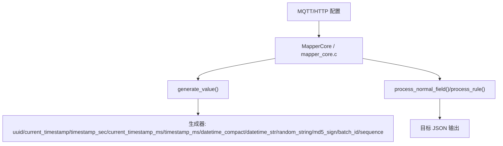
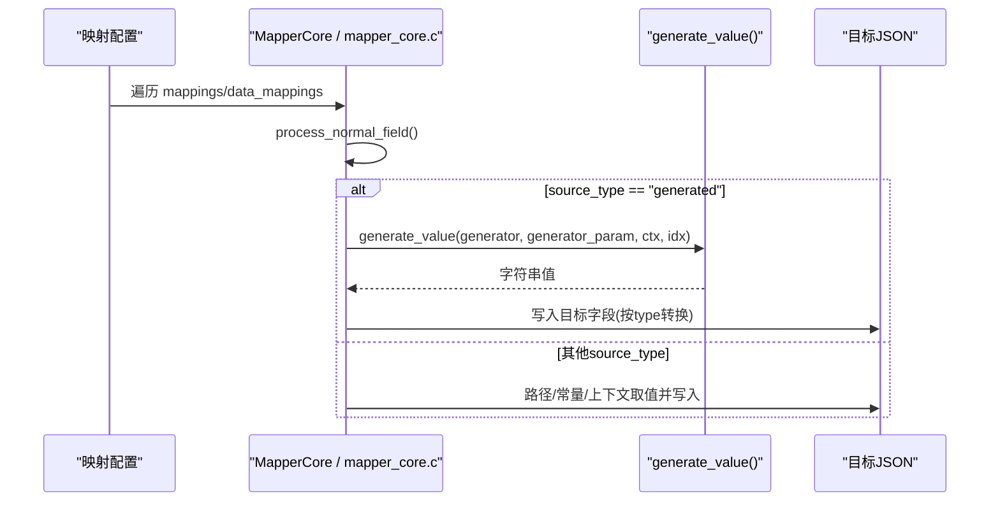
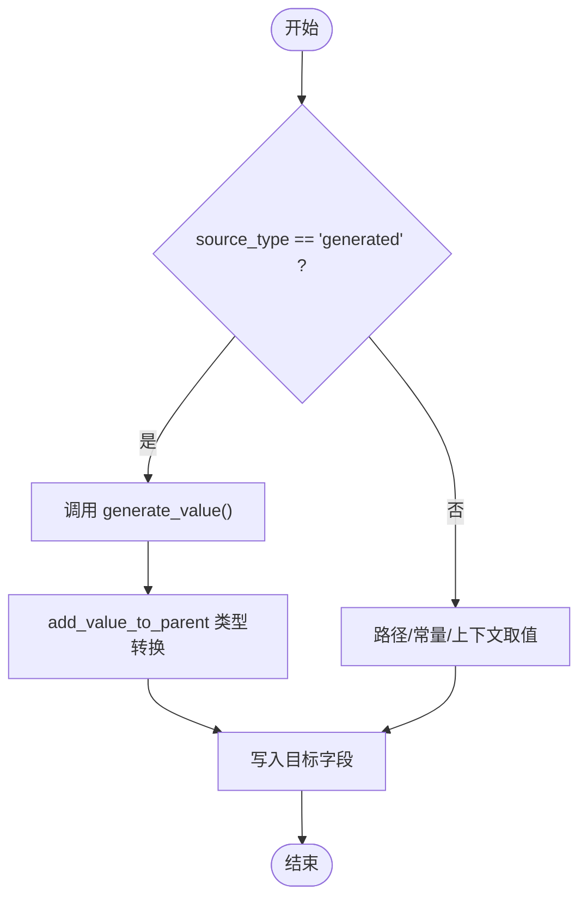
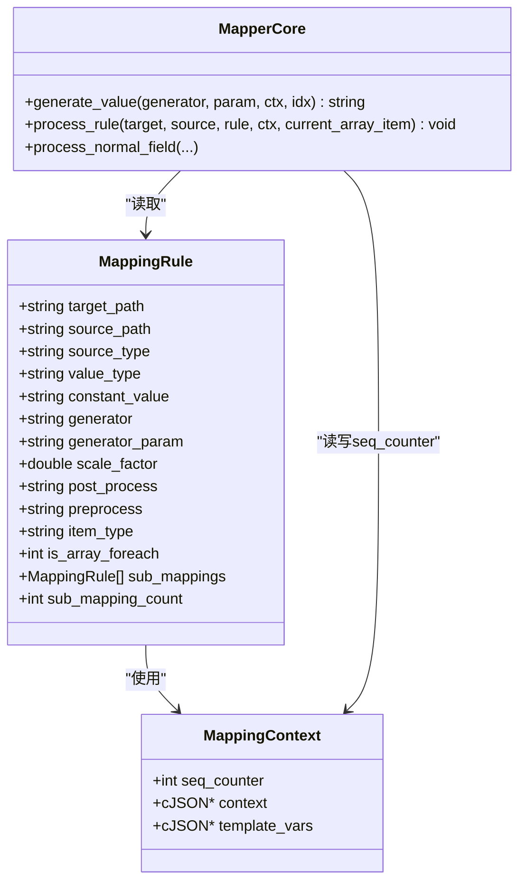
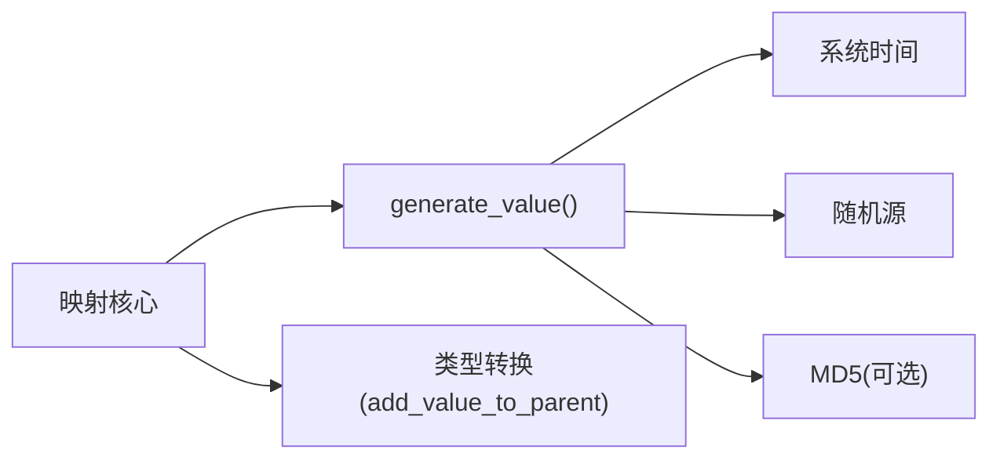

# 数据生成器

<cite>
**本文引用的文件**
- [mapper_core.c](file://.trae/skills/protocol-conversion/scripts/mapper_core.c)
- [mapper_core.h](file://.trae/skills/protocol-conversion/scripts/mapper_core.h)
- [protocol_converter.py](file://.trae/skills/protocol-conversion/scripts/protocol_converter.py)
- [test_protocol_converter.py](file://.trae/skills/protocol-conversion/scripts/test_protocol_converter.py)
- [mqtt_mapper_202608261100.json](file://.trae/skills/mqtt-conversion/scripts/mqtt_mapper_202608261100.json)
</cite>

## 目录
1. [简介](#简介)
2. [项目结构](#项目结构)
3. [核心组件](#核心组件)
4. [架构总览](#架构总览)
5. [详细组件分析](#详细组件分析)
6. [依赖关系分析](#依赖关系分析)
7. [性能考量](#性能考量)
8. [故障排查指南](#故障排查指南)
9. [结论](#结论)
10. [附录](#附录)

## 简介
本参考文档面向协议映射引擎中的数据生成器，覆盖全部可用类型：uuid、current_timestamp、timestamp_sec、current_timestamp_ms、timestamp_ms、datetime_compact、datetime_str、random_string、md5_sign、batch_id、sequence。文档说明每种生成器的用途、参数配置（generator_param）、返回值格式、在映射规则中的调用方式与执行时机，并结合 C 引擎与 Python 镜像实现，给出集成机制、性能特点与适用场景，以及实际业务使用案例。

## 项目结构
数据生成器位于统一映射核心中，C 与 Python 双实现保持一致行为：
- C 实现：mapper_core.c 提供 generate_value 及规则处理流程；mapper_core.h 定义 MappingRule、MappingContext 等结构。
- Python 实现：protocol_converter.py 的 MapperCore.generate_value 与 process_normal_field/process_rule 对应 C 逻辑。
- 测试用例：test_protocol_converter.py 验证各生成器输出格式与长度。
- 示例配置：mqtt_mapper_202608261100.json 展示在 MQTT 映射中使用 generated 源类型与具体生成器。

图表来源
- [mapper_core.c:210-271](file://.trae/skills/protocol-conversion/scripts/mapper_core.c#L210-L271)
- [protocol_converter.py:204-236](file://.trae/skills/protocol-conversion/scripts/protocol_converter.py#L204-L236)
- [mapper_core.h:36-64](file://.trae/skills/protocol-conversion/scripts/mapper_core.h#L36-L64)

章节来源
- [mapper_core.c:210-271](file://.trae/skills/protocol-conversion/scripts/mapper_core.c#L210-L271)
- [protocol_converter.py:204-236](file://.trae/skills/protocol-conversion/scripts/protocol_converter.py#L204-L236)
- [mapper_core.h:36-64](file://.trae/skills/protocol-conversion/scripts/mapper_core.h#L36-L64)

## 核心组件
- 生成器入口
  - C: generate_value(generator, param, ctx, idx)
  - Python: MapperCore.generate_value(generator, param=None, ctx=None, idx=-1)
- 规则处理与调用时机
  - C: process_normal_field 中当 source_type="generated" 时调用 generate_value
  - Python: process_normal_field 中当 source_type="generated" 时调用 generate_value
- 上下文与状态
  - C: MappingContext.seq_counter 用于 sequence 生成器跨条记录递增
  - Python: ctx["_seq_counter"] 用于 sequence 生成器跨条记录递增

章节来源
- [mapper_core.c:667-678](file://.trae/skills/protocol-conversion/scripts/mapper_core.c#L667-L678)
- [protocol_converter.py:532-542](file://.trae/skills/protocol-conversion/scripts/protocol_converter.py#L532-L542)
- [mapper_core.h:53-64](file://.trae/skills/protocol-conversion/scripts/mapper_core.h#L53-L64)

## 架构总览
生成器在映射规则中的执行时序如下：

图表来源
- [mapper_core.c:667-678](file://.trae/skills/protocol-conversion/scripts/mapper_core.c#L667-L678)
- [protocol_converter.py:532-542](file://.trae/skills/protocol-conversion/scripts/protocol_converter.py#L532-L542)

## 详细组件分析

### 生成器清单与行为
以下生成器均返回字符串，由上层 add_value_to_parent 根据 type 进行类型转换（如 int/double/long/bool/object/substitute）。

- uuid
  - 用途：生成全局唯一标识
  - 参数：无
  - 返回值：UUID v4 字符串（36字符）
  - 适用场景：消息ID、会话ID、请求ID
  - 性能：O(1)，系统随机源，开销极低
  - 参考实现
    - C: [mapper_core.c:233-235](file://.trae/skills/protocol-conversion/scripts/mapper_core.c#L233-L235)
    - Python: [protocol_converter.py:214-215](file://.trae/skills/protocol-conversion/scripts/protocol_converter.py#L214-L215)
    - 测试断言: [test_protocol_converter.py:291-294](file://.trae/skills/protocol-conversion/scripts/test_protocol_converter.py#L291-L294)

- current_timestamp / timestamp_sec
  - 用途：当前秒级时间戳
  - 参数：无
  - 返回值：秒级时间戳字符串（十进制数字串）
  - 适用场景：服务端时间标记、排序键
  - 性能：O(1)，系统时间获取
  - 参考实现
    - C: [mapper_core.c:236-239](file://.trae/skills/protocol-conversion/scripts/mapper_core.c#L236-L239)
    - Python: [protocol_converter.py:216-217](file://.trae/skills/protocol-conversion/scripts/protocol_converter.py#L216-L217)
    - 测试断言: [test_protocol_converter.py:296-310](file://.trae/skills/protocol-conversion/scripts/test_protocol_converter.py#L296-L310)

- current_timestamp_ms / timestamp_ms
  - 用途：当前毫秒级时间戳
  - 参数：无
  - 返回值：毫秒级时间戳字符串（十进制数字串）
  - 适用场景：高精度时间戳、去重键
  - 性能：O(1)，系统时间获取
  - 参考实现
    - C: [mapper_core.c:240-243](file://.trae/skills/protocol-conversion/scripts/mapper_core.c#L240-L243)
    - Python: [protocol_converter.py:218-219](file://.trae/skills/protocol-conversion/scripts/protocol_converter.py#L218-L219)
    - 测试断言: [test_protocol_converter.py:301-316](file://.trae/skills/protocol-conversion/scripts/test_protocol_converter.py#L301-L316)

- datetime_compact
  - 用途：紧凑日期时间字符串
  - 参数：无
  - 返回值：YYYYMMDDHHMMSS（14位）
  - 适用场景：文件名、短标识、日志分片
  - 性能：O(1)，本地时间格式化
  - 参考实现
    - C: [mapper_core.c:244-247](file://.trae/skills/protocol-conversion/scripts/mapper_core.c#L244-L247)
    - Python: [protocol_converter.py:220-221](file://.trae/skills/protocol-conversion/scripts/protocol_converter.py#L220-L221)
    - 测试断言: [test_protocol_converter.py:318-321](file://.trae/skills/protocol-conversion/scripts/test_protocol_converter.py#L318-L321)

- datetime_str
  - 用途：可读日期时间字符串
  - 参数：无
  - 返回值：YYYY-MM-DD HH:MM:SS（19位）
  - 适用场景：人类可读时间、报表
  - 性能：O(1)，本地时间格式化
  - 参考实现
    - C: [mapper_core.c:248-251](file://.trae/skills/protocol-conversion/scripts/mapper_core.c#L248-L251)
    - Python: [protocol_converter.py:222-223](file://.trae/skills/protocol_converter.py#L222-L223)
    - 测试断言: [test_protocol_converter.py:323-327](file://.trae/skills/protocol-conversion/scripts/test_protocol_converter.py#L323-L327)

- random_string
  - 用途：随机字符串
  - 参数：无
  - 返回值：随机十六进制片段（16位）
  - 适用场景：临时令牌、验证码前缀
  - 性能：O(1)，随机数+拼接
  - 参考实现
    - C: [mapper_core.c:252-254](file://.trae/skills/protocol-conversion/scripts/mapper_core.c#L252-L254)
    - Python: [protocol_converter.py:224-225](file://.trae/skills/protocol-conversion/scripts/protocol_converter.py#L224-L225)

- md5_sign
  - 用途：基于时间的MD5签名
  - 参数：无
  - 返回值：MD5小写十六进制字符串（32位）
  - 适用场景：简单防重放、校验签名
  - 性能：O(1)+哈希计算，轻量
  - 参考实现
    - C: [mapper_core.c:255-257](file://.trae/skills/protocol-conversion/scripts/mapper_core.c#L255-L257)
    - Python: [protocol_converter.py:226-227](file://.trae/skills/protocol-conversion/scripts/protocol_converter.py#L226-L227)

- batch_id
  - 用途：批次ID（UUID前缀）
  - 参数：无
  - 返回值：UUID前8位字符串
  - 适用场景：批量任务分组、追踪
  - 性能：O(1)
  - 参考实现
    - C: [mapper_core.c:258-260](file://.trae/skills/protocol-conversion/scripts/mapper_core.c#L258-L260)
    - Python: [protocol_converter.py:228-229](file://.trae/skills/protocol-conversion/scripts/protocol_converter.py#L228-L229)

- sequence
  - 用途：单调递增序列号
  - 参数：无
  - 返回值：自增序号字符串
  - 行为：若传入 idx>=0，则返回 idx+1；否则从上下文计数器递增
  - 适用场景：流水号、订单号、事件序号
  - 性能：O(1)，仅计数
  - 参考实现
    - C: [mapper_core.c:261-268](file://.trae/skills/protocol-conversion/scripts/mapper_core.c#L261-L268)
    - Python: [protocol_converter.py:230-235](file://.trae/skills/protocol-conversion/scripts/protocol_converter.py#L230-L235)

章节来源
- [mapper_core.c:233-268](file://.trae/skills/protocol-conversion/scripts/mapper_core.c#L233-L268)
- [protocol_converter.py:214-235](file://.trae/skills/protocol-conversion/scripts/protocol_converter.py#L214-L235)
- [test_protocol_converter.py:291-327](file://.trae/skills/protocol-conversion/scripts/test_protocol_converter.py#L291-L327)

### generator_param 参数说明
- 结构体定义
  - C: MappingRule.generator_param[128]
  - Python: generate_value 接收 param 参数（当前未使用）
- 现状
  - 所有生成器均未读取或使用 generator_param
  - 因此当前无需配置该字段即可工作
- 建议
  - 保留字段以支持未来扩展（如 random_string 长度、md5 盐值等）
  - 保持向后兼容：忽略未知参数

章节来源
- [mapper_core.h:36-51](file://.trae/skills/protocol-conversion/scripts/mapper_core.h#L36-L51)
- [protocol_converter.py:207-208](file://.trae/skills/protocol-conversion/scripts/protocol_converter.py#L207-L208)

### 在映射规则中的调用方式与执行时机
- 调用位置
  - C: process_normal_field 中 source_type="generated" 分支调用 generate_value
  - Python: process_normal_field 中 source_type="generated" 分支调用 generate_value
- 执行时机
  - 每条映射规则处理时即时执行，结果立即写入目标字段
  - 数组遍历中，每个子项都会触发相应规则的生成器执行
- 类型转换
  - 生成器返回字符串，最终通过 add_value_to_parent 按 type 转换为 int/double/long/bool/object/substitute/string

图表来源
- [mapper_core.c:667-678](file://.trae/skills/protocol-conversion/scripts/mapper_core.c#L667-L678)
- [protocol_converter.py:532-542](file://.trae/skills/protocol-conversion/scripts/protocol_converter.py#L532-L542)

章节来源
- [mapper_core.c:667-678](file://.trae/skills/protocol-conversion/scripts/mapper_core.c#L667-L678)
- [protocol_converter.py:532-542](file://.trae/skills/protocol-conversion/scripts/protocol_converter.py#L532-L542)

### 生成器与 C 引擎的集成机制
- 统一入口
  - C 头文件声明 generate_value 接口，供映射核心调用
  - Python 镜像类 MapperCore 提供等价方法，便于测试与验证
- 上下文传递
  - C: MappingContext.seq_counter 用于 sequence 跨条递增
  - Python: ctx["_seq_counter"] 等效实现
- 规则结构
  - MappingRule 包含 generator、generator_param、source_type 等字段，驱动生成器选择与参数传递

图表来源
- [mapper_core.h:36-64](file://.trae/skills/protocol-conversion/scripts/mapper_core.h#L36-L64)
- [protocol_converter.py:32-45](file://.trae/skills/protocol-conversion/scripts/protocol_converter.py#L32-L45)

章节来源
- [mapper_core.h:36-64](file://.trae/skills/protocol-conversion/scripts/mapper_core.h#L36-L64)
- [protocol_converter.py:32-45](file://.trae/skills/protocol-conversion/scripts/protocol_converter.py#L32-L45)

### 实际业务使用案例
- MQTT 消息生成
  - 使用 uuid 作为消息ID，datetime_compact 作为消息时间
  - 参考配置片段：
    - [mqtt_mapper_202608261100.json:11-22](file://.trae/skills/mqtt-conversion/scripts/mqtt_mapper_202608261100.json#L11-L22)
- HTTP 查询构造
  - 使用 current_timestamp_ms 作为请求时间戳，batch_id 作为批次标识
  - 可在 data_mappings 中以 source_type="generated" 配置
- 通用流水号
  - 使用 sequence 生成单调递增序号，适用于订单、事件流水

章节来源
- [mqtt_mapper_202608261100.json:11-22](file://.trae/skills/mqtt-conversion/scripts/mqtt_mapper_202608261100.json#L11-L22)

## 依赖关系分析
- 模块耦合
  - 生成器与映射核心强耦合：通过 source_type="generated" 触发
  - 生成器与上下文弱耦合：仅 sequence 依赖上下文计数器
- 外部依赖
  - C: 系统时间与随机源
  - Python: time、uuid、hashlib
- 一致性
  - C 与 Python 实现一一对应，保证行为一致

图表来源
- [mapper_core.c:228-268](file://.trae/skills/protocol-conversion/scripts/mapper_core.c#L228-L268)
- [protocol_converter.py:214-235](file://.trae/skills/protocol-conversion/scripts/protocol_converter.py#L214-L235)

章节来源
- [mapper_core.c:228-268](file://.trae/skills/protocol-conversion/scripts/mapper_core.c#L228-L268)
- [protocol_converter.py:214-235](file://.trae/skills/protocol-conversion/scripts/protocol_converter.py#L214-L235)

## 性能考量
- 时间复杂度
  - 所有生成器均为 O(1)，适合高频调用
- 内存占用
  - 固定缓冲区或局部变量，无动态分配热点
- I/O 与系统调用
  - 时间戳与随机数来自系统调用，开销极低
- 并发安全
  - C 使用静态缓冲返回字符串，注意调用方需及时复制结果
  - sequence 依赖上下文计数器，多线程需外部同步
- 优化建议
  - 避免在极热路径重复调用高成本生成器（当前已为轻量）
  - 对 sequence 的使用，确保上下文生命周期正确

[本节为通用指导，不直接分析具体文件]

## 故障排查指南
- 生成器未生效
  - 检查 source_type 是否为 "generated"
  - 确认 generator 名称拼写正确
  - 参考调用点：
    - C: [mapper_core.c:675-677](file://.trae/skills/protocol-conversion/scripts/mapper_core.c#L675-L677)
    - Python: [protocol_converter.py:538-541](file://.trae/skills/protocol-conversion/scripts/protocol_converter.py#L538-L541)
- 类型不匹配
  - 生成器返回字符串，需在映射规则中设置正确的 type（如 int/double）
  - 参考类型转换：
    - C: [mapper_core.c:332-437](file://.trae/skills/protocol-conversion/scripts/mapper_core.c#L332-L437)
    - Python: [protocol_converter.py:269-376](file://.trae/skills/protocol-conversion/scripts/protocol_converter.py#L269-L376)
- sequence 不递增
  - 检查上下文是否传递且未被重置
  - C: [mapper_core.c:261-268](file://.trae/skills/protocol-conversion/scripts/mapper_core.c#L261-L268)
  - Python: [protocol_converter.py:230-235](file://.trae/skills/protocol-conversion/scripts/protocol_converter.py#L230-L235)
- 单元测试失败
  - 对照测试用例验证输出格式与长度
  - 参考：
    - [test_protocol_converter.py:291-327](file://.trae/skills/protocol-conversion/scripts/test_protocol_converter.py#L291-L327)

章节来源
- [mapper_core.c:675-677](file://.trae/skills/protocol-conversion/scripts/mapper_core.c#L675-L677)
- [protocol_converter.py:538-541](file://.trae/skills/protocol-conversion/scripts/protocol_converter.py#L538-L541)
- [mapper_core.c:332-437](file://.trae/skills/protocol-conversion/scripts/mapper_core.c#L332-L437)
- [protocol_converter.py:269-376](file://.trae/skills/protocol-conversion/scripts/protocol_converter.py#L269-L376)
- [test_protocol_converter.py:291-327](file://.trae/skills/protocol-conversion/scripts/test_protocol_converter.py#L291-L327)

## 结论
数据生成器为协议映射提供了统一的动态值生成能力，涵盖标识、时间、随机、签名、批次与序列等常见需求。C 与 Python 双实现保持一致行为，易于测试与验证。当前 generator_param 预留但未使用，便于未来扩展。建议在业务中优先选用轻量生成器（时间戳、UUID），并在需要单调性时使用 sequence，结合上下文管理其生命周期。

[本节为总结，不直接分析具体文件]

## 附录
- 配置示例（MQTT）
  - 使用 uuid 与 datetime_compact 生成消息ID与时间
  - 参考：[mqtt_mapper_202608261100.json:11-22](file://.trae/skills/mqtt-conversion/scripts/mqtt_mapper_202608261100.json#L11-L22)
- 测试用例（Python）
  - 验证各生成器输出格式与长度
  - 参考：[test_protocol_converter.py:291-327](file://.trae/skills/protocol-conversion/scripts/test_protocol_converter.py#L291-L327)

章节来源
- [mqtt_mapper_202608261100.json:11-22](file://.trae/skills/mqtt-conversion/scripts/mqtt_mapper_202608261100.json#L11-L22)
- [test_protocol_converter.py:291-327](file://.trae/skills/protocol-conversion/scripts/test_protocol_converter.py#L291-L327)