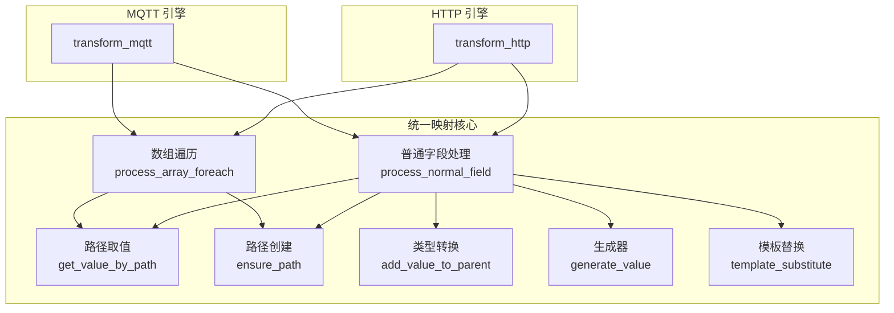
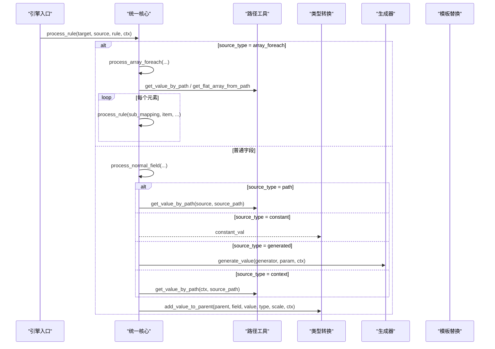
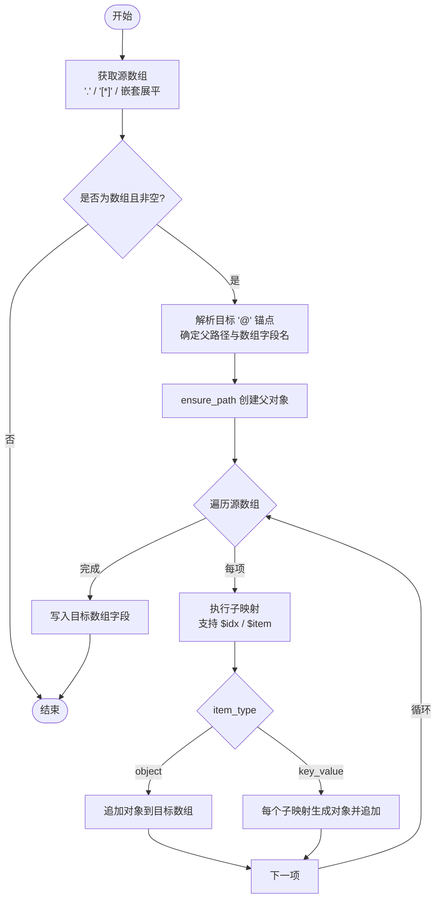
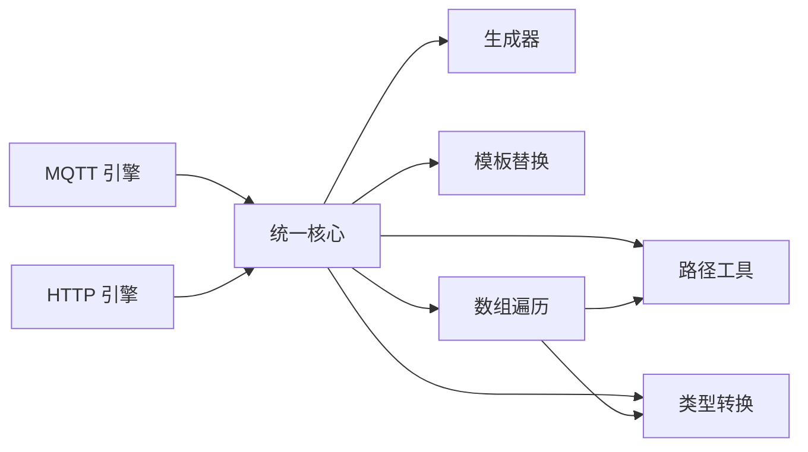

# 映射规则编写

<cite>
**本文引用的文件**
- [mapper_core.c](file://.trae/skills/protocol-conversion/scripts/mapper_core.c)
- [protocol_converter.py](file://.trae/skills/protocol-conversion/scripts/protocol_converter.py)
- [test_protocol_converter.py](file://.trae/skills/protocol-conversion/scripts/test_protocol_converter.py)
- [mqtt_mapper_202608261100.json](file://.trae/skills/mqtt-conversion/scripts/mqtt_mapper_202608261100.json)
- [protocol_mapping_output_20260826_110500.json](file://.trae/skills/http-conversion/scripts/protocol_mapping_output_20260826_110500.json)
</cite>

## 目录
1. [简介](#简介)
2. [项目结构](#项目结构)
3. [核心组件](#核心组件)
4. [架构总览](#架构总览)
5. [详细组件分析](#详细组件分析)
6. [依赖关系分析](#依赖关系分析)
7. [性能注意事项](#性能注意事项)
8. [故障排查指南](#故障排查指南)
9. [结论](#结论)
10. [附录：完整示例与最佳实践](#附录完整示例与最佳实践)

## 简介
本指南面向需要编写协议映射规则的工程师，系统化说明映射规则的字段定义、路径语法、source_type 使用方式、目标类型转换、数组遍历原则以及 ensure_path 自动建路径机制。内容基于统一映射核心引擎（C 实现与 Python 镜像）及实际配置样例，确保读者能准确编写从简单字段映射到复杂嵌套对象构建的映射规则。

## 项目结构
本项目提供统一的映射核心，同时支持 MQTT 和 HTTP 两种场景：
- 统一核心：负责路径取值、路径创建、类型转换、生成器、模板替换、数组遍历等通用逻辑。
- MQTT 场景：通过 mappings[] 描述映射规则，支持 substitute 模板替换、$item/$idx 变量、嵌套 [*] 展平。
- HTTP 场景：通过 apis[].data_mappings[] 描述映射规则，支持 context source_type、"." 源路径、key_value 模式等。

图表来源
- [mapper_core.c:41-153](file://.trae/skills/protocol-conversion/scripts/mapper_core.c#L41-L153)
- [mapper_core.c:223-271](file://.trae/skills/protocol-conversion/scripts/mapper_core.c#L223-L271)
- [mapper_core.c:332-437](file://.trae/skills/protocol-conversion/scripts/mapper_core.c#L332-L437)
- [mapper_core.c:458-604](file://.trae/skills/protocol-conversion/scripts/mapper_core.c#L458-L604)
- [mapper_core.c:617-715](file://.trae/skills/protocol-conversion/scripts/mapper_core.c#L617-L715)
- [protocol_converter.py:50-104](file://.trae/skills/protocol-conversion/scripts/protocol_converter.py#L50-L104)
- [protocol_converter.py:121-159](file://.trae/skills/protocol-conversion/scripts/protocol_converter.py#L121-L159)
- [protocol_converter.py:207-236](file://.trae/skills/protocol-conversion/scripts/protocol_converter.py#L207-L236)
- [protocol_converter.py:270-376](file://.trae/skills/protocol-conversion/scripts/protocol_converter.py#L270-L376)
- [protocol_converter.py:396-479](file://.trae/skills/protocol-conversion/scripts/protocol_converter.py#L396-L479)
- [protocol_converter.py:481-565](file://.trae/skills/protocol-conversion/scripts/protocol_converter.py#L481-L565)

章节来源
- [mapper_core.c:1-740](file://.trae/skills/protocol-conversion/scripts/mapper_core.c#L1-L740)
- [protocol_converter.py:1-602](file://.trae/skills/protocol-conversion/scripts/protocol_converter.py#L1-L602)

## 核心组件
- 路径取值 get_value_by_path：支持点号访问、数组索引、通配符 [*]、根引用 "."。
- 路径创建 ensure_path：按路径自动创建缺失的对象或数组节点，并填充至指定索引。
- 类型转换 add_value_to_parent：将源值按目标类型写入父对象，支持 string/int/double/long/bool/object/substitute。
- 生成器 generate_value：支持 uuid、时间戳、日期字符串、随机串、签名、批次号、序列号等。
- 模板替换 template_substitute：在 constant 中用 $var$ 语法从上下文替换变量。
- 数组遍历 process_array_foreach：解析 @ 锚点、展开源数组、逐项执行子映射，支持 object/key_value 模式与 $idx 变量。
- 普通字段处理 process_normal_field：根据 source_type 取值（path/constant/generated/context），并调用类型转换。

章节来源
- [mapper_core.c:41-153](file://.trae/skills/protocol-conversion/scripts/mapper_core.c#L41-L153)
- [mapper_core.c:223-271](file://.trae/skills/protocol-conversion/scripts/mapper_core.c#L223-L271)
- [mapper_core.c:332-437](file://.trae/skills/protocol-conversion/scripts/mapper_core.c#L332-L437)
- [mapper_core.c:458-604](file://.trae/skills/protocol-conversion/scripts/mapper_core.c#L458-L604)
- [mapper_core.c:617-715](file://.trae/skills/protocol-conversion/scripts/mapper_core.c#L617-L715)
- [protocol_converter.py:50-104](file://.trae/skills/protocol-conversion/scripts/protocol_converter.py#L50-L104)
- [protocol_converter.py:121-159](file://.trae/skills/protocol-conversion/scripts/protocol_converter.py#L121-L159)
- [protocol_converter.py:207-236](file://.trae/skills/protocol-conversion/scripts/protocol_converter.py#L207-L236)
- [protocol_converter.py:270-376](file://.trae/skills/protocol-conversion/scripts/protocol_converter.py#L270-L376)
- [protocol_converter.py:396-479](file://.trae/skills/protocol-conversion/scripts/protocol_converter.py#L396-L479)
- [protocol_converter.py:481-565](file://.trae/skills/protocol-conversion/scripts/protocol_converter.py#L481-L565)

## 架构总览
映射规则由上层引擎（MQTT/HTTP）加载后，交由统一核心处理。核心根据 rule.source_type 决定取值策略，再依据 rule.type 进行类型转换并写入目标路径。数组遍历通过 @ 锚点定位目标数组字段，逐项执行子映射；路径创建通过 ensure_path 自动补齐中间节点。

图表来源
- [mapper_core.c:723-739](file://.trae/skills/protocol-conversion/scripts/mapper_core.c#L723-L739)
- [mapper_core.c:458-604](file://.trae/skills/protocol-conversion/scripts/mapper_core.c#L458-L604)
- [mapper_core.c:617-715](file://.trae/skills/protocol-conversion/scripts/mapper_core.c#L617-L715)
- [protocol_converter.py:380-393](file://.trae/skills/protocol-conversion/scripts/protocol_converter.py#L380-L393)
- [protocol_converter.py:396-479](file://.trae/skills/protocol-conversion/scripts/protocol_converter.py#L396-L479)
- [protocol_converter.py:481-565](file://.trae/skills/protocol-conversion/scripts/protocol_converter.py#L481-L565)

## 详细组件分析

### 映射规则字段定义与约束
- target（必填）：目标路径，支持点号分隔与数组索引；数组遍历时使用 @ 作为占位符表示当前数组字段名。
- source_type（必填）：取值来源类型，支持 path、constant、generated、array_foreach、context。
- type（必填）：目标数据类型，支持 string、int、double、long、bool、object、substitute。
- source（条件必填）：当 source_type 为 path 或 array_foreach 时需提供；支持点号、数组索引、[*]、"."。
- constant（条件必填）：当 source_type 为 constant 时需提供；可配合 type 做类型转换。
- generator/generator_param（条件必填）：当 source_type 为 generated 时需提供 generator；可选参数用于控制行为。
- item_type（可选）：在 array_foreach 中指定每项构造方式，object 或 key_value。
- sub_mappings（条件必填）：在 array_foreach 或 object + sub_mappings 时提供，定义子项映射。
- preprocess/post_process（预留）：已定义但尚未实现具体函数调用（如 url_to_base64、datetime_to_yyyyMMddHHmmss、trim、sm4_encode）。
- scale_factor/scale（可选）：数值类型的缩放因子，应用于数值型转换。

章节来源
- [mapper_core.c:617-715](file://.trae/skills/protocol-conversion/scripts/mapper_core.c#L617-L715)
- [protocol_converter.py:481-565](file://.trae/skills/protocol-conversion/scripts/protocol_converter.py#L481-L565)
- [mqtt_mapper_202608261100.json:1-98](file://.trae/skills/mqtt-conversion/scripts/mqtt_mapper_202608261100.json#L1-L98)
- [protocol_mapping_output_20260826_110500.json:1-89](file://.trae/skills/http-conversion/scripts/protocol_mapping_output_20260826_110500.json#L1-L89)

### 路径语法规范
- 点号访问：a.b.c 逐级取对象字段。
- 数组索引：a[0]、a[1] 精确访问数组元素；越界或缺失返回空。
- 通配符遍历：a[*] 返回整个数组；可用于 array_foreach 的源路径。
- 根引用："." 表示当前 source 对象本身（HTTP 引擎常用）。
- 嵌套展平：a[*].b[*] 会递归展平为扁平数组（MQTT 特有）。
- 锚点：target 中的 @ 表示数组字段名占位，由引擎在遍历时替换为实际字段名。

章节来源
- [mapper_core.c:41-88](file://.trae/skills/protocol-conversion/scripts/mapper_core.c#L41-L88)
- [mapper_core.c:161-208](file://.trae/skills/protocol-conversion/scripts/mapper_core.c#L161-L208)
- [protocol_converter.py:50-104](file://.trae/skills/protocol-conversion/scripts/protocol_converter.py#L50-L104)
- [protocol_converter.py:162-202](file://.trae/skills/protocol-conversion/scripts/protocol_converter.py#L162-L202)
- [test_protocol_converter.py:46-117](file://.trae/skills/protocol-conversion/scripts/test_protocol_converter.py#L46-L117)

### 五种 source_type 的使用场景与配置
- path：从源 JSON 中按路径取值；支持 $item 在当前数组项上下文中取值（MQTT）。
- constant：直接写入常量值；可与 type 组合完成类型转换。
- generated：调用生成器产生值（uuid、时间戳、日期串、随机串、签名、批次号、序列号）。
- array_foreach：对源数组逐项遍历，并在目标路径 @ 处创建数组；支持 object/key_value 模式与 $idx 变量。
- context：从运行时上下文 ctx 中取值（HTTP 链式调用常用）。

章节来源
- [mapper_core.c:667-715](file://.trae/skills/protocol-conversion/scripts/mapper_core.c#L667-L715)
- [protocol_converter.py:532-565](file://.trae/skills/protocol-conversion/scripts/protocol_converter.py#L532-L565)
- [protocol_mapping_output_20260826_110500.json:32-85](file://.trae/skills/http-conversion/scripts/protocol_mapping_output_20260826_110500.json#L32-L85)

### 七种目标类型处理逻辑与转换规则
- string：默认类型；从源值或常量转换为字符串；空字符串不添加。
- int：从数字、字符串或常量转为整数；支持 scale 缩放。
- double：从数字、字符串或常量转为浮点数；支持 scale 缩放。
- long：从数字、字符串或常量转为长整型；支持 scale 缩放。
- bool：从布尔、数字、字符串或常量转为布尔；true/1 视为真。
- object：深拷贝源对象或解析常量 JSON；无源则创建空对象。
- substitute：在 constant 中使用 $var$ 模板语法，从 ctx 中替换变量（MQTT 特有）。

章节来源
- [mapper_core.c:332-437](file://.trae/skills/protocol-conversion/scripts/mapper_core.c#L332-L437)
- [protocol_converter.py:270-376](file://.trae/skills/protocol-conversion/scripts/protocol_converter.py#L270-L376)
- [test_protocol_converter.py:164-285](file://.trae/skills/protocol-conversion/scripts/test_protocol_converter.py#L164-L285)

### 数组遍历的核心原则与 ensure_path 自动建路径机制
- 数组遍历原则：
  - 解析源数组：支持 "."（单元素）、[*] 通配、嵌套 [*] 展平。
  - 解析目标 @ 锚点：确定父路径与数组字段名，自动创建父对象。
  - 逐项执行子映射：支持 $idx 变量替换；object 模式生成对象，key_value 模式每个子映射生成独立对象。
  - 写入结果：将生成的数组写入目标字段。
- ensure_path 机制：
  - 按路径逐段创建对象或数组；遇到数组索引时自动扩展至所需长度并填充空对象。
  - 支持 a.b[0].c.d[2] 这类复杂路径的自动构建。

图表来源
- [mapper_core.c:458-604](file://.trae/skills/protocol-conversion/scripts/mapper_core.c#L458-L604)
- [mapper_core.c:116-153](file://.trae/skills/protocol-conversion/scripts/mapper_core.c#L116-L153)
- [protocol_converter.py:396-479](file://.trae/skills/protocol-conversion/scripts/protocol_converter.py#L396-L479)
- [protocol_converter.py:121-159](file://.trae/skills/protocol-conversion/scripts/protocol_converter.py#L121-L159)

章节来源
- [mapper_core.c:458-604](file://.trae/skills/protocol-conversion/scripts/mapper_core.c#L458-L604)
- [mapper_core.c:116-153](file://.trae/skills/protocol-conversion/scripts/mapper_core.c#L116-L153)
- [protocol_converter.py:396-479](file://.trae/skills/protocol-conversion/scripts/protocol_converter.py#L396-L479)
- [protocol_converter.py:121-159](file://.trae/skills/protocol-conversion/scripts/protocol_converter.py#L121-L159)

### 生成器与模板替换
- 生成器：
  - uuid：生成唯一标识。
  - current_timestamp/timestamp_sec：秒级时间戳。
  - current_timestamp_ms/timestamp_ms：毫秒级时间戳。
  - datetime_compact：紧凑日期时间格式。
  - datetime_str：标准日期时间字符串。
  - random_string：随机字符串。
  - md5_sign：基于时间的 MD5 签名。
  - batch_id：批次号。
  - sequence：序列号，支持 idx 或上下文计数器。
- 模板替换：
  - 在 constant 中使用 $var$ 语法，从 ctx 中查找变量并替换；支持嵌套路径如 ssl_mqtt_server.gatewayID。

章节来源
- [mapper_core.c:223-271](file://.trae/skills/protocol-conversion/scripts/mapper_core.c#L223-L271)
- [mapper_core.c:282-317](file://.trae/skills/protocol-conversion/scripts/mapper_core.c#L282-L317)
- [protocol_converter.py:207-236](file://.trae/skills/protocol-conversion/scripts/protocol_converter.py#L207-L236)
- [protocol_converter.py:241-265](file://.trae/skills/protocol-conversion/scripts/protocol_converter.py#L241-L265)
- [test_protocol_converter.py:288-381](file://.trae/skills/protocol-conversion/scripts/test_protocol_converter.py#L288-L381)

## 依赖关系分析
- 统一核心被 MQTT 与 HTTP 引擎复用，减少重复实现。
- 路径工具与类型转换是基础依赖，被所有映射流程调用。
- 数组遍历依赖路径取值与路径创建，形成闭环。
- 生成器与模板替换为增强能力，按需启用。

图表来源
- [mapper_core.c:723-739](file://.trae/skills/protocol-conversion/scripts/mapper_core.c#L723-L739)
- [protocol_converter.py:570-602](file://.trae/skills/protocol-conversion/scripts/protocol_converter.py#L570-L602)

章节来源
- [mapper_core.c:1-740](file://.trae/skills/protocol-conversion/scripts/mapper_core.c#L1-L740)
- [protocol_converter.py:1-602](file://.trae/skills/protocol-conversion/scripts/protocol_converter.py#L1-L602)

## 性能注意事项
- 避免过度使用深层嵌套路径与多次 [*] 展平，可能带来额外开销。
- 合理使用 ensure_path 自动建路径，避免不必要的中间对象创建。
- 在高频场景中优先使用常量与生成器，减少路径解析次数。
- 注意数组大小与遍历深度，防止内存占用过高。

## 故障排查指南
- 路径为空或缺失：检查 target/source 路径是否正确，确认数组索引是否越界。
- 类型转换失败：确认 type 与源值兼容，必要时使用 string 过渡。
- 数组遍历未生效：确认 source 为数组且非空，target 包含 @ 锚点。
- 模板替换无效：确认 ctx 中存在对应变量，且 constant 使用 $var$ 语法。
- 生成器未输出：确认 generator 名称正确，必要时传入 ctx 或 idx。

章节来源
- [test_protocol_converter.py:78-117](file://.trae/skills/protocol-conversion/scripts/test_protocol_converter.py#L78-L117)
- [test_protocol_converter.py:164-285](file://.trae/skills/protocol-conversion/scripts/test_protocol_converter.py#L164-L285)
- [test_protocol_converter.py:384-499](file://.trae/skills/protocol-conversion/scripts/test_protocol_converter.py#L384-L499)

## 结论
统一映射核心提供了稳定、可扩展的协议转换能力。通过规范的字段定义、路径语法、source_type 与类型系统，能够覆盖从简单字段映射到复杂嵌套对象构建的各种场景。结合 ensure_path 与数组遍历机制，开发者可以高效地编写高质量映射规则。

## 附录：完整示例与最佳实践

### 示例一：简单字段映射（MQTT）
- 目标：将常量、生成器与模板替换组合，生成消息头与设备标识。
- 关键点：
  - action/msgId/msgTime 使用 constant/generated。
  - devId 使用 substitute 从 ctx 中替换网关 ID。
- 参考配置路径
  - [mqtt_mapper_202608261100.json:5-28](file://.trae/skills/mqtt-conversion/scripts/mqtt_mapper_202608261100.json#L5-L28)

章节来源
- [mqtt_mapper_202608261100.json:5-28](file://.trae/skills/mqtt-conversion/scripts/mqtt_mapper_202608261100.json#L5-L28)

### 示例二：数组遍历与嵌套对象（MQTT）
- 目标：将业务对象列表中的 itemBody 与 item 逐项映射为目标结构。
- 关键点：
  - 外层 array_foreach 遍历 itemBody[*]，内层遍历 item[*]。
  - 使用 @ 锚点创建目标数组字段。
  - 数值字段使用 double 类型。
- 参考配置路径
  - [mqtt_mapper_202608261100.json:29-95](file://.trae/skills/mqtt-conversion/scripts/mqtt_mapper_202608261100.json#L29-L95)

章节来源
- [mqtt_mapper_202608261100.json:29-95](file://.trae/skills/mqtt-conversion/scripts/mqtt_mapper_202608261100.json#L29-L95)

### 示例三：HTTP 场景下的 context 与 key_value 模式
- 目标：从上下文读取查询参数，并将数据列表映射为目标结构；内层使用 key_value 模式生成键值对。
- 关键点：
  - body_params 使用 context source_type 从 ctx 取值。
  - data_mappings 中 array_foreach 遍历 data.list[*]。
  - 内层 item.@" 使用 key_value 模式，每个子映射生成独立对象。
- 参考配置路径
  - [protocol_mapping_output_20260826_110500.json:32-85](file://.trae/skills/http-conversion/scripts/protocol_mapping_output_20260826_110500.json#L32-L85)

章节来源
- [protocol_mapping_output_20260826_110500.json:32-85](file://.trae/skills/http-conversion/scripts/protocol_mapping_output_20260826_110500.json#L32-L85)

### 示例四：复杂嵌套与路径创建
- 目标：构建多层嵌套对象，并确保中间路径存在。
- 关键点：
  - 使用 ensure_path 自动创建 businessObjList[0].dataObj.dataItemList[0].itemBody。
  - 通过 @ 锚点动态生成数组字段。
- 参考测试路径
  - [test_protocol_converter.py:437-463](file://.trae/skills/protocol-conversion/scripts/test_protocol_converter.py#L437-L463)

章节来源
- [test_protocol_converter.py:437-463](file://.trae/skills/protocol-conversion/scripts/test_protocol_converter.py#L437-L463)

### 最佳实践
- 明确 source_type：优先使用 path 与 constant，必要时使用 generated 与 context。
- 合理设计 target：使用 @ 锚点简化数组字段命名，避免硬编码。
- 谨慎使用 [*]：仅在确有需要时进行通配与展平，避免性能问题。
- 利用 type 与 scale：确保数值精度与单位一致。
- 善用模板替换：在 MQTT 场景下通过 substitute 注入运行时变量。