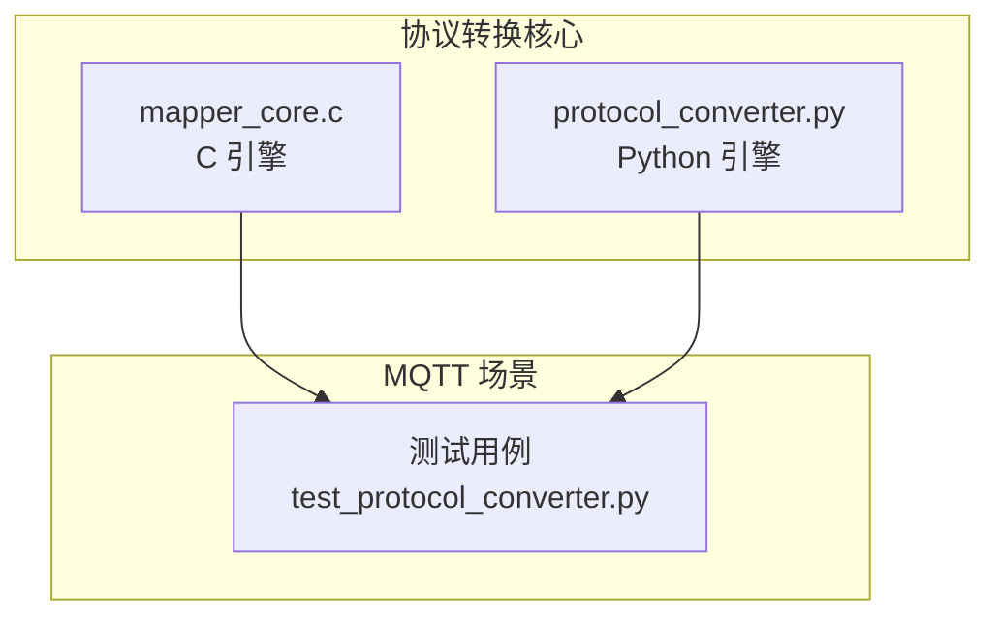
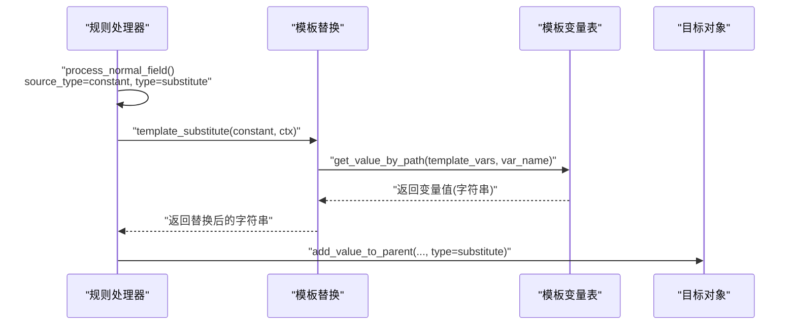
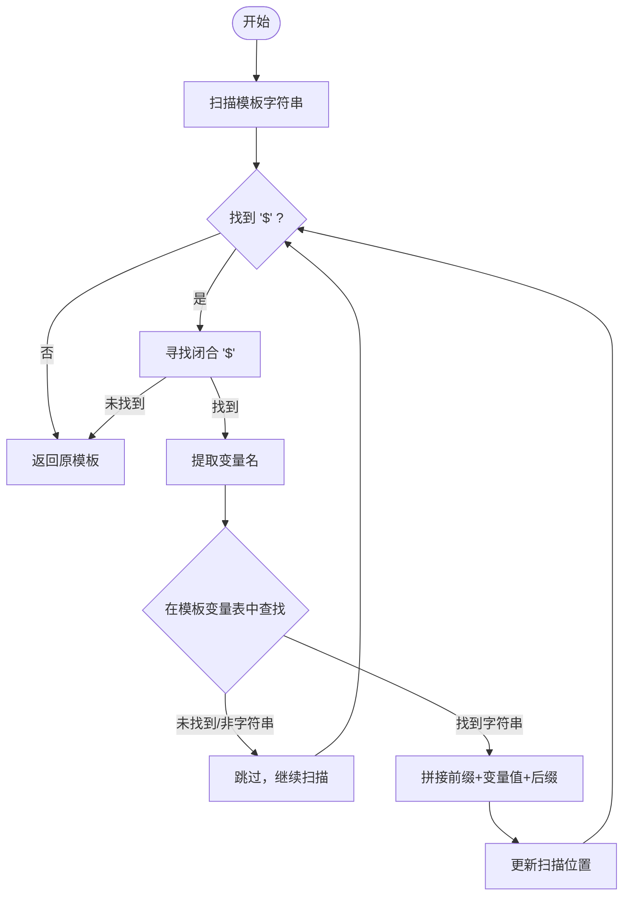
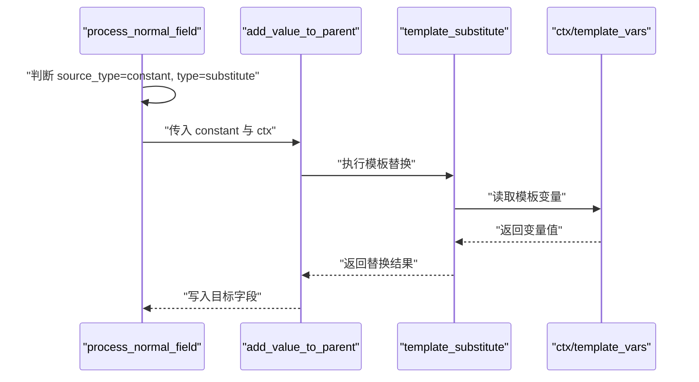
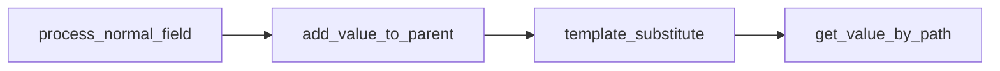

# 模板变量系统

<cite>
**本文引用的文件**
- [mapper_core.c](file://.trae/skills/protocol-conversion/scripts/mapper_core.c)
- [mapper_core.h](file://.trae/skills/protocol-conversion/scripts/mapper_core.h)
- [protocol_converter.py](file://.trae/skills/protocol-conversion/scripts/protocol_converter.py)
- [test_protocol_converter.py](file://.trae/skills/protocol-conversion/scripts/test_protocol_converter.py)
</cite>

## 目录
1. [简介](#简介)
2. [项目结构](#项目结构)
3. [核心组件](#核心组件)
4. [架构总览](#架构总览)
5. [详细组件分析](#详细组件分析)
6. [依赖关系分析](#依赖关系分析)
7. [性能考虑](#性能考虑)
8. [故障排查指南](#故障排查指南)
9. [结论](#结论)
10. [附录](#附录)

## 简介
本文件面向“模板变量替换系统”的开发与使用，聚焦于 substitute 类型的实现机制、$变量名$ 语法规范、变量引用方式（含嵌套路径）、已注册变量示例（如 ssl_mqtt_server.*）、模板变量的使用示例与最佳实践、template_vars.def 的结构约定，以及模板替换在转换流程中的执行时机。

该能力由统一映射核心提供，C 引擎与 Python 引擎保持一致行为：当 source_type 为 constant 且 type 为 substitute 时，将把 constant 字段视为模板字符串，从上下文中的模板变量表进行 $var$ 形式的替换。MQTT 引擎通过 MappingContext.template_vars 注入模板变量；HTTP 引擎通常不使用此组合。

## 项目结构
- 统一映射核心位于 protocol-conversion/scripts，包含 C 实现与 Python 镜像实现，二者逻辑对齐。
- MQTT 特有配置与测试用例展示了 substitute 的使用方式与上下文变量结构。
- HTTP 相关文档说明 HTTP 引擎不采用 substitute 组合，而是通过其他机制处理常量或环境变量。

图表来源
- [mapper_core.c:273-317](file://.trae/skills/protocol-conversion/scripts/mapper_core.c#L273-L317)
- [protocol_converter.py:238-265](file://.trae/skills/protocol-conversion/scripts/protocol_converter.py#L238-L265)
- [test_protocol_converter.py:354-381](file://.trae/skills/protocol-conversion/scripts/test_protocol_converter.py#L354-L381)

章节来源
- [mapper_core.c:273-317](file://.trae/skills/protocol-conversion/scripts/mapper_core.c#L273-L317)
- [protocol_converter.py:238-265](file://.trae/skills/protocol-conversion/scripts/protocol_converter.py#L238-L265)
- [test_protocol_converter.py:354-381](file://.trae/skills/protocol-conversion/scripts/test_protocol_converter.py#L354-L381)

## 核心组件
- 模板替换函数
  - C: template_substitute，按 $var$ 语法扫描并替换，支持嵌套路径访问 ctx->template_vars。
  - Python: MapperCore.template_substitute，正则匹配 $...$，支持点号分隔的嵌套路径。
- 类型转换与触发点
  - add_value_to_parent 在 value_type == "substitute" 时调用模板替换，并将结果写入目标对象。
  - process_normal_field 中，source_type == "constant" + type == "substitute" 会进入 substitute 分支。
- 上下文与变量表
  - C: MappingContext.template_vars 用于存放模板变量（MQTT）。
  - Python: transform_mqtt 接受 ctx，并在 substitute 时使用 ctx 作为变量源。

章节来源
- [mapper_core.c:332-416](file://.trae/skills/protocol-conversion/scripts/mapper_core.c#L332-L416)
- [mapper_core.c:617-715](file://.trae/skills/protocol-conversion/scripts/mapper_core.c#L617-L715)
- [mapper_core.h:53-64](file://.trae/skills/protocol-conversion/scripts/mapper_core.h#L53-L64)
- [protocol_converter.py:238-360](file://.trae/skills/protocol-conversion/scripts/protocol_converter.py#L238-L360)
- [protocol_converter.py:569-583](file://.trae/skills/protocol-conversion/scripts/protocol_converter.py#L569-L583)

## 架构总览
下图展示 substitute 在规则处理中的位置：普通字段处理根据 source_type/type 决定取值策略，当命中 substitute 时，调用模板替换函数，最终写入目标 JSON。

图表来源
- [mapper_core.c:617-715](file://.trae/skills/protocol-conversion/scripts/mapper_core.c#L617-L715)
- [mapper_core.c:273-317](file://.trae/skills/protocol-conversion/scripts/mapper_core.c#L273-L317)
- [protocol_converter.py:480-565](file://.trae/skills/protocol-conversion/scripts/protocol_converter.py#L480-L565)
- [protocol_converter.py:238-265](file://.trae/skills/protocol-conversion/scripts/protocol_converter.py#L238-L265)

## 详细组件分析

### 模板替换算法与语法
- 语法规范
  - 变量以 $ 开头并以 $ 结尾，例如 $var$。
  - 支持嵌套路径，使用点号分隔层级，例如 $ssl_mqtt_server.gatewayID$。
  - 多个变量可并列出现，例如 $a$_$b$。
- 查找与替换
  - C 引擎逐字符扫描模板，定位成对的 $，提取变量名后通过 get_value_by_path 在 ctx->template_vars 中取值，仅当值为字符串时替换。
  - Python 引擎使用正则匹配 $...$，对每个匹配项按点号拆分路径，逐级在 ctx 字典中取值，找不到则保留原占位符。
- 边界情况
  - 未找到变量时，保持原样输出（不报错）。
  - 非字符串变量不会参与替换（C 引擎要求 cJSON_IsString）。
  - 空模板或空上下文直接返回原模板。

图表来源
- [mapper_core.c:273-317](file://.trae/skills/protocol-conversion/scripts/mapper_core.c#L273-L317)
- [protocol_converter.py:238-265](file://.trae/skills/protocol-conversion/scripts/protocol_converter.py#L238-L265)

章节来源
- [mapper_core.c:273-317](file://.trae/skills/protocol-conversion/scripts/mapper_core.c#L273-L317)
- [protocol_converter.py:238-265](file://.trae/skills/protocol-conversion/scripts/protocol_converter.py#L238-L265)
- [test_protocol_converter.py:354-381](file://.trae/skills/protocol-conversion/scripts/test_protocol_converter.py#L354-L381)

### 触发条件与执行时机
- 触发条件
  - source_type: "constant" 且 type: "substitute"。
  - constant 字段为模板字符串，例如 "$ssl_mqtt_server.gatewayID$"。
- 执行时机
  - 在普通字段处理阶段，解析完 source_type/type 后，进入 add_value_to_parent。
  - 当 type == "substitute" 时，立即执行模板替换，并将结果写入目标对象对应字段。
- 与数组遍历的关系
  - 在 array_foreach 子映射中，同样遵循上述规则；$idx$ 等索引变量由遍历逻辑单独处理，不影响模板变量替换。

图表来源
- [mapper_core.c:617-715](file://.trae/skills/protocol-conversion/scripts/mapper_core.c#L617-L715)
- [mapper_core.c:332-416](file://.trae/skills/protocol-conversion/scripts/mapper_core.c#L332-L416)
- [protocol_converter.py:480-565](file://.trae/skills/protocol-conversion/scripts/protocol_converter.py#L480-L565)

章节来源
- [mapper_core.c:617-715](file://.trae/skills/protocol-conversion/scripts/mapper_core.c#L617-L715)
- [mapper_core.c:332-416](file://.trae/skills/protocol-conversion/scripts/mapper_core.c#L332-L416)
- [protocol_converter.py:480-565](file://.trae/skills/protocol-conversion/scripts/protocol_converter.py#L480-L565)

### 变量定义与注册
- 变量来源
  - MQTT: 通过 MappingContext.template_vars 注入，键为字符串路径，值为字符串。
  - Python: transform_mqtt 接收 ctx，substitute 直接使用 ctx 作为变量源。
- 常见变量示例（来自测试与配置）
  - ssl_mqtt_server.gatewayID：网关标识，常用于设备 ID 填充。
  - 其他 ssl_mqtt_server.* 字段（如 clientID、username、password 等）可按相同模式在上下文中注册并使用。
- 变量命名建议
  - 使用小写字母与下划线组织命名空间，避免与业务字段冲突。
  - 使用点号表示层级，便于结构化组织。

章节来源
- [mapper_core.h:53-64](file://.trae/skills/protocol-conversion/scripts/mapper_core.h#L53-L64)
- [test_protocol_converter.py:565-601](file://.trae/skills/protocol-conversion/scripts/test_protocol_converter.py#L565-L601)
- [test_protocol_converter.py:926-932](file://.trae/skills/protocol-conversion/scripts/test_protocol_converter.py#L926-L932)

### 使用示例与最佳实践
- 基本用法
  - 在 mappings 中设置 target、source_type="constant"、type="substitute"、constant="$ssl_mqtt_server.gatewayID$"。
  - 在 MQTT 转换时传入 ctx={"ssl_mqtt_server": {"gatewayID": "GW001"}}。
- 多变量组合
  - 可在同一模板中使用多个变量，如 "$a$_$b$"。
- 嵌套路径
  - 使用点号访问深层变量，如 "$ssl_mqtt_server.gatewayID$"。
- 缺失变量处理
  - 若变量不存在，模板原样保留，便于调试与回退。
- 最佳实践
  - 将环境相关的敏感信息（如用户名、密码）放入模板变量表，不在配置中硬编码。
  - 为不同环境（开发/生产）准备不同的上下文，避免修改映射配置。
  - 在测试中覆盖变量缺失、嵌套路径、多变量组合等边界情况。

章节来源
- [test_protocol_converter.py:354-381](file://.trae/skills/protocol-conversion/scripts/test_protocol_converter.py#L354-L381)
- [test_protocol_converter.py:565-601](file://.trae/skills/protocol-conversion/scripts/test_protocol_converter.py#L565-L601)
- [protocol_converter.py:238-265](file://.trae/skills/protocol-conversion/scripts/protocol_converter.py#L238-L265)

### 与数组遍历和生成器的关系
- 数组遍历
  - array_foreach 支持 $idx$ 索引变量，与模板变量替换互不干扰。
  - 子映射中的字段仍可使用 substitute 组合。
- 生成器
  - generated 类型用于生成 UUID、时间戳、随机串等，与 substitute 互补：前者动态生成值，后者基于上下文替换模板。

章节来源
- [mapper_core.c:458-604](file://.trae/skills/protocol-conversion/scripts/mapper_core.c#L458-L604)
- [protocol_converter.py:395-479](file://.trae/skills/protocol-conversion/scripts/protocol_converter.py#L395-L479)
- [protocol_converter.py:206-236](file://.trae/skills/protocol-conversion/scripts/protocol_converter.py#L206-L236)

## 依赖关系分析
- 模块耦合
  - 模板替换依赖路径取值工具 get_value_by_path，确保嵌套路径解析一致。
  - 类型转换 add_value_to_parent 与模板替换紧密耦合，仅在 type=="substitute" 时触发。
- 外部依赖
  - C 引擎依赖 cJSON 进行 JSON 操作。
  - Python 引擎使用 re、json 等标准库。

图表来源
- [mapper_core.c:273-317](file://.trae/skills/protocol-conversion/scripts/mapper_core.c#L273-L317)
- [mapper_core.c:332-416](file://.trae/skills/protocol-conversion/scripts/mapper_core.c#L332-L416)
- [protocol_converter.py:238-265](file://.trae/skills/protocol-conversion/scripts/protocol_converter.py#L238-L265)
- [protocol_converter.py:480-565](file://.trae/skills/protocol-conversion/scripts/protocol_converter.py#L480-L565)

章节来源
- [mapper_core.c:273-317](file://.trae/skills/protocol-conversion/scripts/mapper_core.c#L273-L317)
- [protocol_converter.py:238-265](file://.trae/skills/protocol-conversion/scripts/protocol_converter.py#L238-L265)

## 性能考虑
- 模板替换为线性扫描，复杂度与模板长度成正比；合理控制模板长度与变量数量。
- 嵌套路径查找为逐层字典/JSON 访问，避免过深层级以提升性能。
- 在高频转换场景中，可将常用模板变量缓存到局部变量以减少重复查找。

[本节为通用指导，无需特定文件来源]

## 故障排查指南
- 现象：变量未被替换
  - 检查 ctx 是否包含对应变量，且值为字符串。
  - 确认模板语法正确，成对 $ 包裹变量名。
- 现象：嵌套路径失败
  - 检查路径层级是否与上下文结构一致，确保每级均为字典/对象。
- 现象：HTTP 引擎未生效
  - HTTP 引擎通常不使用 substitute 组合；如需类似能力，请通过其他机制（如环境变量）处理。
- 调试建议
  - 在测试中增加断言，验证替换前后结果。
  - 打印中间上下文，确认变量存在性与类型。

章节来源
- [test_protocol_converter.py:354-381](file://.trae/skills/protocol-conversion/scripts/test_protocol_converter.py#L354-L381)
- [test_protocol_converter.py:565-601](file://.trae/skills/protocol-conversion/scripts/test_protocol_converter.py#L565-L601)

## 结论
模板变量替换系统通过统一的 substitute 类型与 $var$ 语法，实现了灵活、可配置的模板化字段填充。其核心在于模板替换函数与类型转换流程的协同工作，结合 MappingContext.template_vars 提供的变量表，能够安全地注入运行时上下文信息。建议在 MQTT 场景中使用该能力，配合良好的变量命名与上下文管理，提升配置的可维护性与安全性。

[本节为总结性内容，无需特定文件来源]

## 附录

### 模板变量定义格式（template_vars.def 约定）
- 目的：集中管理模板变量，便于在不同环境中复用与切换。
- 结构建议
  - 顶层键为命名空间（如 ssl_mqtt_server），子键为具体变量（如 gatewayID、clientID、username、password）。
  - 所有变量值应为字符串，以便模板替换直接使用。
- 加载方式
  - MQTT: 在构建 MappingContext 时将 template_vars 注入。
  - Python: 在 transform_mqtt 的 ctx 中提供相同结构的字典。

章节来源
- [mapper_core.h:53-64](file://.trae/skills/protocol-conversion/scripts/mapper_core.h#L53-L64)
- [protocol_converter.py:569-583](file://.trae/skills/protocol-conversion/scripts/protocol_converter.py#L569-L583)

### 已注册变量清单（示例）
- ssl_mqtt_server.gatewayID：网关标识
- ssl_mqtt_server.clientID：客户端标识（可按需注册）
- ssl_mqtt_server.username：用户名（可按需注册）
- ssl_mqtt_server.password：密码（可按需注册）

章节来源
- [test_protocol_converter.py:565-601](file://.trae/skills/protocol-conversion/scripts/test_protocol_converter.py#L565-L601)
- [test_protocol_converter.py:926-932](file://.trae/skills/protocol-conversion/scripts/test_protocol_converter.py#L926-L932)

### 使用示例（路径参考）
- 基本替换
  - 规则：target="devId", source_type="constant", type="substitute", constant="$ssl_mqtt_server.gatewayID$"
  - 上下文：ctx={"ssl_mqtt_server": {"gatewayID": "GW001"}}
  - 结果：devId="GW001"
- 多变量组合
  - 模板："$a$_$b$"
  - 上下文：{"a": "hello", "b": "world"}
  - 结果："hello_world"
- 嵌套路径
  - 模板："$ssl_mqtt_server.gatewayID$"
  - 上下文：{"ssl_mqtt_server": {"gatewayID": "GW_TEST"}}
  - 结果："GW_TEST"

章节来源
- [test_protocol_converter.py:354-381](file://.trae/skills/protocol-conversion/scripts/test_protocol_converter.py#L354-L381)
- [test_protocol_converter.py:565-601](file://.trae/skills/protocol-conversion/scripts/test_protocol_converter.py#L565-L601)
- [test_protocol_converter.py:926-932](file://.trae/skills/protocol-conversion/scripts/test_protocol_converter.py#L926-L932)