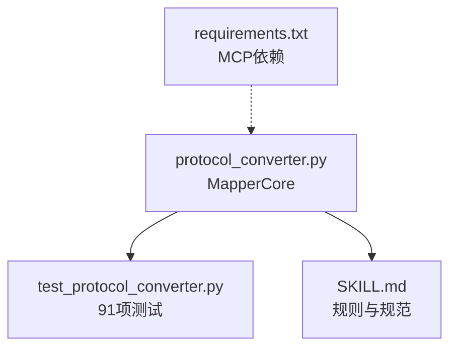
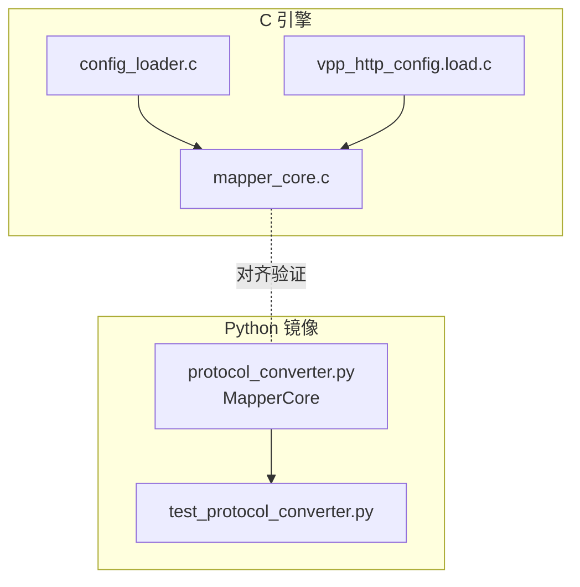
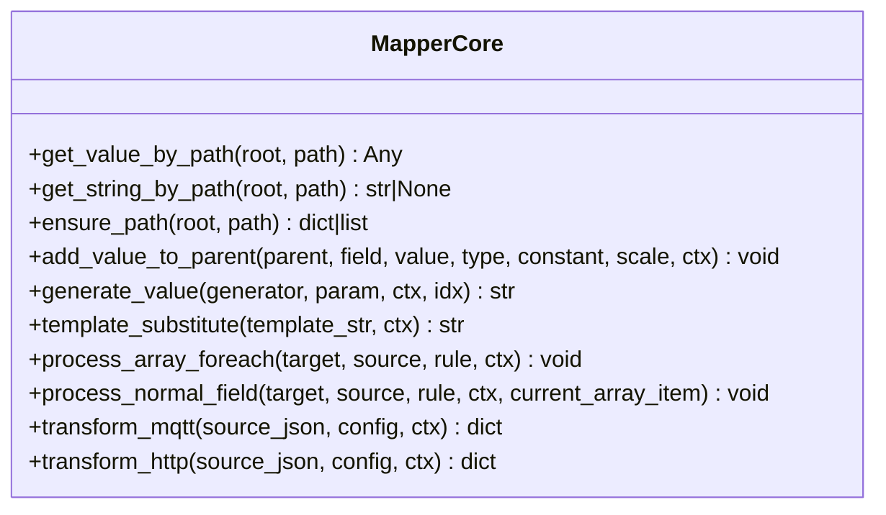
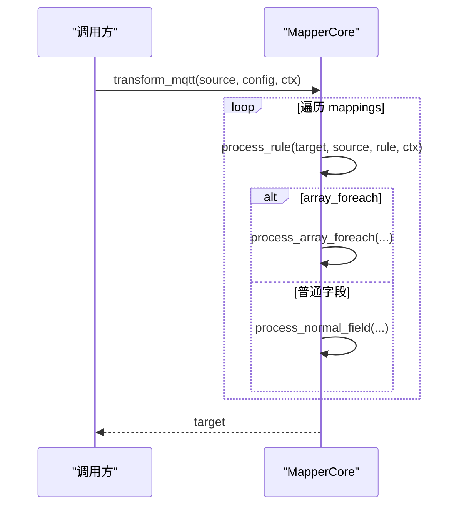
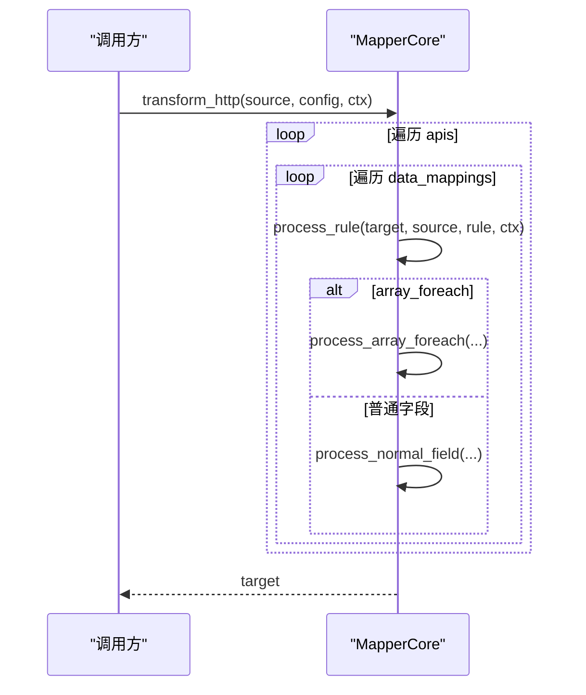
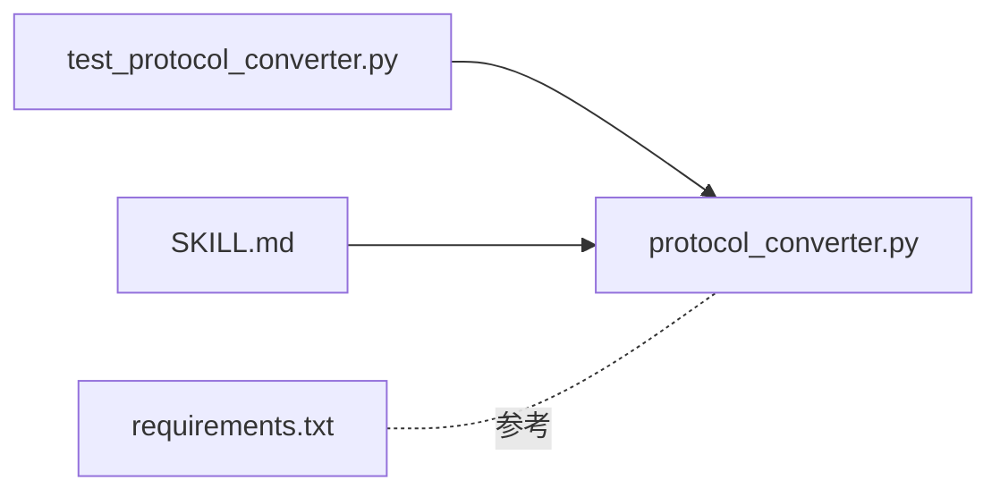

# 测试与调试

<cite>
**本文引用的文件**
- [protocol_converter.py](file://.trae/skills/protocol-conversion/scripts/protocol_converter.py)
- [test_protocol_converter.py](file://.trae/skills/protocol-conversion/scripts/test_protocol_converter.py)
- [SKILL.md](file://.trae/skills/protocol-conversion/SKILL.md)
- [requirements.txt](file://mcp_server/requirements.txt)
</cite>

## 目录
1. [简介](#简介)
2. [项目结构](#项目结构)
3. [核心组件](#核心组件)
4. [架构总览](#架构总览)
5. [详细组件分析](#详细组件分析)
6. [依赖关系分析](#依赖关系分析)
7. [性能考虑](#性能考虑)
8. [故障排查指南](#故障排查指南)
9. [结论](#结论)
10. [附录](#附录)

## 简介
本指南面向协议转换的测试与调试，聚焦 Python 镜像实现与统一测试套件。内容涵盖：
- MapperCore 类的 transform_mqtt 与 transform_http 函数使用方法
- 91 项测试用例的结构、运行方法与分类说明
- 如何编写新测试以验证自定义映射规则
- 调试技巧、常见问题定位与错误日志分析方法
- 测试环境搭建与依赖安装步骤
- 如何验证 C 引擎与 Python 镜像的一致性

## 项目结构
协议转换的核心位于 .trae/skills/protocol-conversion/scripts 目录：
- protocol_converter.py：Python 实现的统一映射核心（MapperCore），镜像 C 引擎 mapper_core.c
- test_protocol_converter.py：基于 unittest 的完整测试套件（91 项）
- SKILL.md：映射规则规范、路径语法、类型系统、生成器清单等权威文档
- mcp_server/requirements.txt：MCP 服务依赖（与测试无直接耦合，但用于整体环境参考）

图表来源
- [protocol_converter.py:1-602](file://.trae/skills/protocol-conversion/scripts/protocol_converter.py#L1-L602)
- [test_protocol_converter.py:1-1052](file://.trae/skills/protocol-conversion/scripts/test_protocol_converter.py#L1-L1052)
- [SKILL.md:1-458](file://.trae/skills/protocol-conversion/SKILL.md#L1-L458)
- [requirements.txt:1-3](file://mcp_server/requirements.txt#L1-L3)

章节来源
- [protocol_converter.py:1-602](file://.trae/skills/protocol-conversion/scripts/protocol_converter.py#L1-L602)
- [test_protocol_converter.py:1-1052](file://.trae/skills/protocol-conversion/scripts/test_protocol_converter.py#L1-L1052)
- [SKILL.md:1-458](file://.trae/skills/protocol-conversion/SKILL.md#L1-L458)
- [requirements.txt:1-3](file://mcp_server/requirements.txt#L1-L3)

## 核心组件
- MapperCore：统一映射核心类，提供路径取值、路径创建、类型转换、生成器、模板替换、数组遍历、普通字段处理以及两个引擎入口方法。
- transform_mqtt：MQTT 引擎入口，按 mappings 规则将源 JSON 转换为目标 JSON。
- transform_http：HTTP 引擎入口，按 apis[].data_mappings 规则进行转换。
- 测试套件：覆盖路径解析、路径创建、类型转换、生成器、模板替换、数组遍历、MQTT/HTTP 完整转换、引擎差异、边界条件与真实配置集成。

章节来源
- [protocol_converter.py:32-602](file://.trae/skills/protocol-conversion/scripts/protocol_converter.py#L32-L602)
- [test_protocol_converter.py:27-1052](file://.trae/skills/protocol-conversion/scripts/test_protocol_converter.py#L27-L1052)

## 架构总览
Python 镜像与 C 引擎职责划分：
- C 引擎：mapper_core.c 负责映射执行；config_loader.c 加载 MQTT 配置；vpp_http_config.load.c 加载 HTTP 配置。
- Python 镜像：protocol_converter.py 镜像 mapper_core.c 逻辑，便于本地快速测试与验证。
- 测试套件：test_protocol_converter.py 通过 unittest 驱动 MapperCore，覆盖全部能力点并验证一致性。

图表来源
- [protocol_converter.py:1-16](file://.trae/skills/protocol-conversion/scripts/protocol_converter.py#L1-L16)
- [SKILL.md:23-35](file://.trae/skills/protocol-conversion/SKILL.md#L23-L35)

章节来源
- [protocol_converter.py:1-16](file://.trae/skills/protocol-conversion/scripts/protocol_converter.py#L1-L16)
- [SKILL.md:23-35](file://.trae/skills/protocol-conversion/SKILL.md#L23-L35)

## 详细组件分析

### MapperCore 类与引擎入口
- get_value_by_path / get_string_by_path：支持 a.b.c、[index]、[*]、"."（HTTP 返回根对象）。
- ensure_path：自动创建目标路径（含 [index] 数组填充）。
- add_value_to_parent：统一类型转换（string/double/int/long/bool/object/substitute），支持 scale 缩放与常量注入。
- generate_value：支持 uuid、时间戳、日期、随机串、MD5、批次号、序列号等。
- template_substitute：$var$ 模板变量替换，支持嵌套路径。
- process_array_foreach：支持 object/key_value 模式、"." 源路径、MQTT 嵌套 [*] 展平、$idx 替换。
- process_normal_field：path/constant/generated/context/substitute 五种 source_type，支持 $item 替换与 object+sub_mappings 递归。
- transform_mqtt：遍历 mappings，调用 process_rule。
- transform_http：遍历 apis[].data_mappings，调用 process_rule。

图表来源
- [protocol_converter.py:32-602](file://.trae/skills/protocol-conversion/scripts/protocol_converter.py#L32-L602)

章节来源
- [protocol_converter.py:32-602](file://.trae/skills/protocol-conversion/scripts/protocol_converter.py#L32-L602)

### transform_mqtt 流程
- 输入：source_json、config（包含 platform_name 与 mappings[]）、ctx（可选上下文）。
- 处理：逐条处理 mappings，调用 process_rule，最终输出 target。
- 关键特性：支持 substitute（模板替换）、generated（生成器）、array_foreach（数组遍历）、scale（缩放）、object+sub_mappings（递归构建）。

图表来源
- [protocol_converter.py:569-583](file://.trae/skills/protocol-conversion/scripts/protocol_converter.py#L569-L583)
- [protocol_converter.py:379-566](file://.trae/skills/protocol-conversion/scripts/protocol_converter.py#L379-L566)

章节来源
- [protocol_converter.py:569-583](file://.trae/skills/protocol-conversion/scripts/protocol_converter.py#L569-L583)
- [protocol_converter.py:379-566](file://.trae/skills/protocol-conversion/scripts/protocol_converter.py#L379-L566)

### transform_http 流程
- 输入：source_json、config（包含 base_url、token、apis[]）、ctx（可选上下文）。
- 处理：仅执行 data_mappings，其他如 body_params/headers 由 HTTP 业务层处理。
- 关键特性：支持 context source_type、"." 源路径、key_value 模式、object+sub_mappings。

图表来源
- [protocol_converter.py:585-601](file://.trae/skills/protocol-conversion/scripts/protocol_converter.py#L585-L601)
- [protocol_converter.py:379-566](file://.trae/skills/protocol-conversion/scripts/protocol_converter.py#L379-L566)

章节来源
- [protocol_converter.py:585-601](file://.trae/skills/protocol-conversion/scripts/protocol_converter.py#L585-L601)
- [protocol_converter.py:379-566](file://.trae/skills/protocol-conversion/scripts/protocol_converter.py#L379-L566)

### 测试套件结构与运行方法
- 测试类与覆盖范围：
  - TestPathResolution：路径取值（基本、嵌套、索引、通配符、"."、缺失、越界、字符串化、扁平数组）
  - TestEnsurePath：路径创建（简单、嵌套、数组、填充、空路径）
  - TestTypeConversion：7种类型转换（string/double/int/long/bool/object/substitute）
  - TestGenerators：所有生成器（uuid、时间戳、日期、随机串、MD5、批次号、序列号）
  - TestTemplateSubstitute：模板替换（简单、嵌套、多变量、无匹配、纯文本）
  - TestArrayForeach：数组遍历（object/key_value、嵌套、"." 源路径、MQTT 嵌套 [*] 展平）
  - TestMQTTTransform：MQTT 完整转换（基本字段、嵌套数组、substitute、常量 int、生成器）
  - TestHTTPTransform：HTTP 完整转换（常量、路径、嵌套常量、object/key_value、context、"." 源路径）
  - TestEngineDifferences：引擎差异（MQTT 不支持 context、HTTP 不使用 substitute、HTTP 字符串转数字）
  - 其余边界与真实配置测试（共 91 项）
- 运行命令：
  - 进入 scripts 目录后执行：python -m unittest test_protocol_converter -v

章节来源
- [test_protocol_converter.py:27-1052](file://.trae/skills/protocol-conversion/scripts/test_protocol_converter.py#L27-L1052)
- [SKILL.md:301-338](file://.trae/skills/protocol-conversion/SKILL.md#L301-L338)

### 如何编写新的测试用例
- 新增场景建议：
  - 新增 source_type 或 type 组合时，补充对应断言（如 context、substitute、object+sub_mappings）
  - 新增路径语法（如 "."、[*]、[index]）时，补充路径解析与数组遍历用例
  - 新增生成器时，在 TestGenerators 中增加断言
  - 针对 MQTT/HTTP 差异，补充引擎差异用例
- 编写要点：
  - 使用 setUp 准备典型 source 与 config
  - 调用 MapperCore.transform_mqtt 或 transform_http，断言目标字段存在性与值正确性
  - 对边界情况（空数组、缺失字段、越界索引、缩放因子）补充用例

章节来源
- [test_protocol_converter.py:27-1052](file://.trae/skills/protocol-conversion/scripts/test_protocol_converter.py#L27-L1052)
- [protocol_converter.py:32-602](file://.trae/skills/protocol-conversion/scripts/protocol_converter.py#L32-L602)

### 调试技巧与常见问题
- 调试技巧：
  - 打印中间结果：在 process_rule 前后打印 target 与 source，确认路径取值是否正确
  - 逐步缩小范围：先验证 get_value_by_path 与 ensure_path，再验证 add_value_to_parent 与 process_array_foreach
  - 使用最小可复现配置：构造最小 source/config，逐步添加规则定位问题
- 常见问题：
  - 路径语法错误：检查是否正确使用 "."、[index]、[*]、"$item"、"$idx"
  - 类型转换异常：确认 type 与 source_type 组合，必要时使用 scale 或 constant
  - 数组遍历不生效：确认 item_type 与 @ 锚点位置，检查源是否为 list
  - 引擎差异：MQTT 不支持 context；HTTP 通常不使用 substitute

章节来源
- [protocol_converter.py:32-602](file://.trae/skills/protocol-conversion/scripts/protocol_converter.py#L32-L602)
- [test_protocol_converter.py:27-1052](file://.trae/skills/protocol-conversion/scripts/test_protocol_converter.py#L27-L1052)

### 错误日志分析与定位
- 日志关注点：
  - 路径取值失败：get_value_by_path 返回 None，检查路径是否存在或越界
  - 类型转换失败：add_value_to_parent 默认值（如 0、False、""），检查 source_val 与 scale
  - 数组遍历为空：process_array_foreach 未进入循环，检查 source 是否为 list
- 定位方法：
  - 在 process_rule 分支处插入日志，区分 array_foreach 与普通字段
  - 对每个子映射打印 target_path、source_type、type、constant、generator
  - 对比 C 引擎行为：使用相同 source/config 分别运行 Python 与 C 引擎，比对输出差异

章节来源
- [protocol_converter.py:379-566](file://.trae/skills/protocol-conversion/scripts/protocol_converter.py#L379-L566)
- [test_protocol_converter.py:27-1052](file://.trae/skills/protocol-conversion/scripts/test_protocol_converter.py#L27-L1052)

### 测试环境搭建与依赖安装
- 环境要求：
  - Python 3.x（unittest 标准库）
  - 无需额外第三方依赖（测试脚本仅依赖标准库）
- 安装与运行：
  - 进入 .trae/skills/protocol-conversion/scripts
  - 执行：python -m unittest test_protocol_converter -v
- MCP 服务依赖（参考）：
  - mcp_server/requirements.txt 定义了 MCP 服务依赖，与测试无直接耦合

章节来源
- [test_protocol_converter.py:1-25](file://.trae/skills/protocol-conversion/scripts/test_protocol_converter.py#L1-L25)
- [requirements.txt:1-3](file://mcp_server/requirements.txt#L1-L3)

### 验证 C 引擎与 Python 镜像的一致性
- 对齐依据：
  - SKILL.md 明确 Python 镜像镜像 mapper_core.c 逻辑，MQTT/HTTP 外层配置格式不同但映射核心一致
- 验证方法：
  - 使用相同 source/config 分别调用 transform_mqtt/transform_http 与 C 引擎
  - 对比输出 JSON 结构、字段值、数组长度、数值精度
  - 重点验证：路径取值、类型转换、生成器、模板替换、数组遍历、缩放因子

章节来源
- [SKILL.md:23-35](file://.trae/skills/protocol-conversion/SKILL.md#L23-L35)
- [protocol_converter.py:1-16](file://.trae/skills/protocol-conversion/scripts/protocol_converter.py#L1-L16)

## 依赖关系分析
- 模块内依赖：
  - test_protocol_converter.py 依赖 protocol_converter.py 中的 MapperCore
  - SKILL.md 作为规范文档，指导映射规则设计与测试覆盖
- 外部依赖：
  - 测试脚本仅使用 Python 标准库（json、re、uuid、time、hashlib、unittest）
  - mcp_server/requirements.txt 为 MCP 服务依赖，与测试无直接耦合

图表来源
- [test_protocol_converter.py:1-25](file://.trae/skills/protocol-conversion/scripts/test_protocol_converter.py#L1-L25)
- [protocol_converter.py:1-25](file://.trae/skills/protocol-conversion/scripts/protocol_converter.py#L1-L25)
- [SKILL.md:1-20](file://.trae/skills/protocol-conversion/SKILL.md#L1-L20)
- [requirements.txt:1-3](file://mcp_server/requirements.txt#L1-L3)

章节来源
- [test_protocol_converter.py:1-25](file://.trae/skills/protocol-conversion/scripts/test_protocol_converter.py#L1-L25)
- [protocol_converter.py:1-25](file://.trae/skills/protocol-conversion/scripts/protocol_converter.py#L1-L25)
- [SKILL.md:1-20](file://.trae/skills/protocol-conversion/SKILL.md#L1-L20)
- [requirements.txt:1-3](file://mcp_server/requirements.txt#L1-L3)

## 性能考虑
- 路径取值与数组遍历：
  - 避免过度使用深层嵌套路径，合理设计源数据结构以减少多次 get_value_by_path
  - 合理使用 [*] 展平与 array_foreach，减少重复计算
- 类型转换与缩放：
  - 优先使用 scale 进行单位换算，避免频繁 post_process
  - 对大量数值字段，注意浮点精度与舍入策略
- 生成器与模板替换：
  - 生成器调用开销较低，但应避免在高频循环中重复生成相同值
  - 模板替换仅在 substitute 类型触发，注意 ctx 传递与变量有效性

## 故障排查指南
- 路径相关问题：
  - 症状：字段值为 None 或未创建
  - 排查：检查路径语法、数组索引是否越界、ensure_path 是否正确创建路径
- 类型转换问题：
  - 症状：字段类型为 string 但期望数字，或数值为 0/False
  - 排查：确认 type 与 source_type，检查 scale 与 constant，查看 add_value_to_parent 分支
- 数组遍历问题：
  - 症状：目标数组为空或长度不符
  - 排查：确认 item_type、@ 锚点位置、源是否为 list，检查 process_array_foreach 分支
- 引擎差异问题：
  - 症状：MQTT 配置使用 context 无效，HTTP 配置使用 substitute 不符合预期
  - 排查：对照引擎差异用例，确认 source_type 与 type 的组合是否符合引擎支持

章节来源
- [protocol_converter.py:32-602](file://.trae/skills/protocol-conversion/scripts/protocol_converter.py#L32-L602)
- [test_protocol_converter.py:27-1052](file://.trae/skills/protocol-conversion/scripts/test_protocol_converter.py#L27-L1052)

## 结论
- Python 镜像提供了与 C 引擎一致的映射核心能力，便于本地快速测试与验证
- 91 项测试覆盖了路径解析、类型转换、生成器、模板替换、数组遍历、MQTT/HTTP 完整转换与引擎差异
- 通过规范化的测试结构与调试方法，可有效定位与修复映射规则问题
- 建议在新增映射规则时同步补充测试用例，确保与 C 引擎行为一致

## 附录
- 常用路径语法与类型系统参考见 SKILL.md
- 运行测试命令与依赖安装见本节与环境搭建部分
- 如需扩展生成器或类型，请在 MapperCore 中实现并在测试套件中补充断言