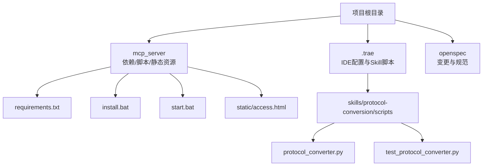
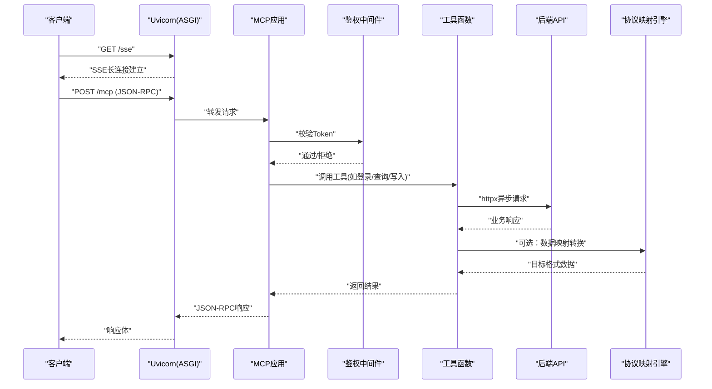
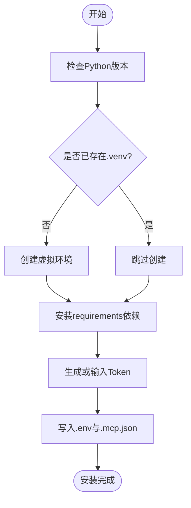
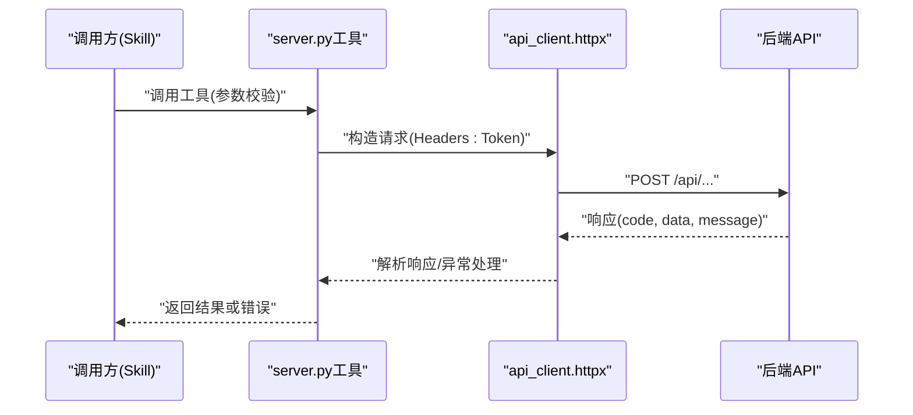
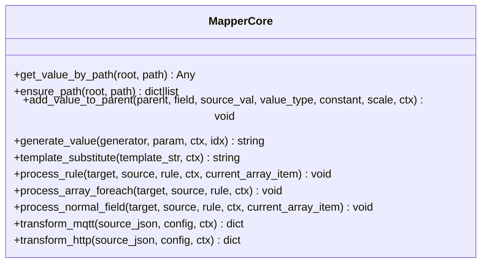
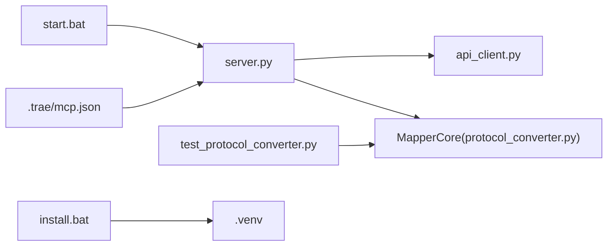
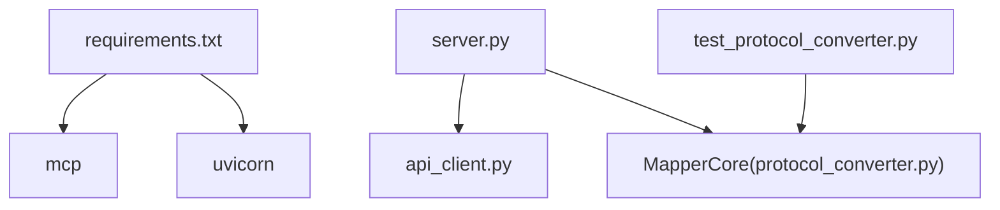

# 开发指南

<cite>
**本文引用的文件**
- [requirements.txt](file://mcp_server/requirements.txt)
- [install.bat](file://mcp_server/install.bat)
- [start.bat](file://mcp_server/start.bat)
- [mcp.json](file://.trae/mcp.json)
- [protocol_converter.py](file://.trae/skills/protocol-conversion/scripts/protocol_converter.py)
- [test_protocol_converter.py](file://.trae/skills/protocol-conversion/scripts/test_protocol_converter.py)
- [规约管理MCP服务化Spec.md](file://规约管理MCP服务化Spec.md)
- [mcp server部署.md](file://mcp server部署.md)
</cite>

## 目录
1. [简介](#简介)
2. [项目结构](#项目结构)
3. [核心组件](#核心组件)
4. [架构总览](#架构总览)
5. [详细组件分析](#详细组件分析)
6. [依赖关系分析](#依赖关系分析)
7. [性能考虑](#性能考虑)
8. [故障排查指南](#故障排查指南)
9. [结论](#结论)
10. [附录](#附录)

## 简介
本指南面向新加入的开发者，目标是帮助你在最短时间内完成本地环境搭建、理解代码结构与模块关系、掌握新增 MCP 工具与协议转换功能的完整流程，并提供调试技巧、测试方法与最佳实践建议。本项目基于 MCP（Model Context Protocol）构建，使用 Uvicorn 作为 ASGI 服务器，提供 SSE 长连接与 JSON-RPC 消息处理；同时包含一套统一的协议映射引擎，用于将不同来源的数据按规则转换为统一目标格式。

## 项目结构
- mcp_server：服务端代码与启动脚本所在目录，包含依赖声明、安装与启动批处理脚本以及静态页面。
- .trae：IDE 配置与 Skill 脚本集合，其中 protocol-conversion 提供了协议映射的核心实现与测试。
- openspec：变更管理与规范文档目录，用于记录需求与任务拆分。
- 根目录文档：部署说明与规约管理 MCP 服务化的 Spec，指导后端 API 封装为 MCP 工具的改造方案。

**图表来源**
- [requirements.txt:1-3](file://mcp_server/requirements.txt#L1-L3)
- [install.bat:1-85](file://mcp_server/install.bat#L1-L85)
- [start.bat:1-41](file://mcp_server/start.bat#L1-L41)
- [protocol_converter.py:1-602](file://.trae/skills/protocol-conversion/scripts/protocol_converter.py#L1-L602)

**章节来源**
- [mcp server部署.md:285-305](file://mcp server部署.md#L285-L305)
- [requirements.txt:1-3](file://mcp_server/requirements.txt#L1-L3)

## 核心组件
- MCP 服务器与 ASGI 路由：由 Uvicorn 承载，暴露 /sse 与 /mcp 端点，负责接收客户端请求并转发到 MCP 应用层进行工具调用与响应组装。
- 认证中间件与 Token 管理：通过环境变量或配置文件注入 Token，支持本地系统级与远程用户级权限模型。
- 协议映射引擎：统一的 MapperCore 类，提供路径取值、路径创建、类型转换、模板替换、数组遍历与生成器等功能，支撑 MQTT 与 HTTP 两种数据源到目标格式的转换。
- Skill 与测试：protocol-conversion 下的脚本实现了映射核心逻辑，配套单元测试覆盖路径解析、类型转换、数组遍历、MQTT/HTTP 完整转换等场景。

**章节来源**
- [mcp server部署.md:64-125](file://mcp server部署.md#L64-L125)
- [protocol_converter.py:32-602](file://.trae/skills/protocol-conversion/scripts/protocol_converter.py#L32-L602)
- [test_protocol_converter.py:27-800](file://.trae/skills/protocol-conversion/scripts/test_protocol_converter.py#L27-L800)

## 架构总览
下图展示了从客户端到 MCP 服务器再到后端 API 的完整调用链路，以及协议映射引擎在 Skill 侧的作用。

**图表来源**
- [mcp server部署.md:163-261](file://mcp server部署.md#L163-L261)
- [规约管理MCP服务化Spec.md:56-66](file://规约管理MCP服务化Spec.md#L56-L66)

## 详细组件分析

### 开发环境搭建
- 依赖安装
  - 使用 requirements.txt 声明依赖：mcp 与 uvicorn。
  - 通过 install.bat 一键创建虚拟环境、安装依赖、生成 Token 并写入 .env 与 .trae/mcp.json。
- 调试配置
  - start.bat 会激活虚拟环境、读取 .env 中的 MCP_AUTH_TOKEN，然后执行 server.py。
  - 若端口被占用或 Token 未配置，脚本会给出明确提示。
- 测试环境设置
  - 协议映射引擎的测试位于 .trae/skills/protocol-conversion/scripts/test_protocol_converter.py，可直接运行 unittest 验证路径解析、类型转换、数组遍历与完整转换流程。

**图表来源**
- [install.bat:12-73](file://mcp_server/install.bat#L12-L73)

**章节来源**
- [requirements.txt:1-3](file://mcp_server/requirements.txt#L1-L3)
- [install.bat:12-73](file://mcp_server/install.bat#L12-L73)
- [start.bat:7-27](file://mcp_server/start.bat#L7-L27)
- [test_protocol_converter.py:18-24](file://.trae/skills/protocol-conversion/scripts/test_protocol_converter.py#L18-L24)

### 新增 MCP 工具的开发流程
- 工具注册
  - 在 server.py 中定义 async 工具函数并使用 @mcp.tool() 装饰器注册。
  - 每个工具对应一个后端 API，参数需严格校验，错误信息统一封装。
- 参数验证
  - 对必填字段进行非空与类型校验，必要时做范围与格式校验。
  - 对于分页列表接口，确保 pageIndex 与 pageSize 为有效数值。
- 错误处理
  - 网络异常、HTTP 状态码异常、业务错误码（如 code != 20000）、Token 无效等情况统一返回结构化错误对象。
  - 参考 api_client.py 的设计思路，封装 _request 方法集中处理异常。
- 测试方法
  - 针对每个工具编写单元测试，覆盖正常路径与异常分支。
  - 使用 httpx 异步客户端模拟后端响应，断言返回结构与字段。
  - 结合 Skill 编排进行端到端测试，验证多工具串联流程。

**图表来源**
- [规约管理MCP服务化Spec.md:247-286](file://规约管理MCP服务化Spec.md#L247-L286)
- [规约管理MCP服务化Spec.md:323-336](file://规约管理MCP服务化Spec.md#L323-L336)

**章节来源**
- [规约管理MCP服务化Spec.md:247-286](file://规约管理MCP服务化Spec.md#L247-L286)
- [规约管理MCP服务化Spec.md:323-336](file://规约管理MCP服务化Spec.md#L323-L336)

### 协议转换功能的开发指南
- 映射规则编写
  - 使用 MapperCore 提供的能力：get_value_by_path、ensure_path、add_value_to_parent、generate_value、template_substitute、process_array_foreach。
  - 区分 MQTT 与 HTTP 的差异：MQTT 支持 substitute 与嵌套 [*] 展平；HTTP 支持 context source_type 与 "." 源路径。
- 测试用例设计
  - 覆盖路径取值、路径创建、类型转换、生成器、模板替换、数组遍历、MQTT/HTTP 完整转换等场景。
  - 使用 test_protocol_converter.py 中的用例作为模板，扩展新的映射规则与边界条件。
- 性能优化技巧
  - 复用 httpx.AsyncClient 实例，避免频繁创建连接。
  - 合理设置超时与重试策略，减少网络抖动影响。
  - 对大数组遍历采用懒加载与分批处理，避免一次性加载过多数据。
  - 使用 ensure_path 提前构建目标结构，减少重复判断与赋值。

**图表来源**
- [protocol_converter.py:32-602](file://.trae/skills/protocol-conversion/scripts/protocol_converter.py#L32-L602)

**章节来源**
- [protocol_converter.py:32-602](file://.trae/skills/protocol-conversion/scripts/protocol_converter.py#L32-L602)
- [test_protocol_converter.py:27-800](file://.trae/skills/protocol-conversion/scripts/test_protocol_converter.py#L27-L800)

### 代码结构与模块关系
- server.py：MCP 工具注册与 ASGI 路由入口，负责鉴权中间件与静态页面路由。
- api_client.py：后端 API 调用封装，统一请求构造、响应解析与错误处理。
- protocol_converter.py：协议映射核心，提供 MQTT 与 HTTP 的统一转换能力。
- test_protocol_converter.py：单元测试，覆盖映射引擎的关键功能。
- install.bat/start.bat：环境初始化与服务启动脚本。
- .trae/mcp.json：IDE 客户端配置，指向本地 MCP 服务地址与鉴权头。

**图表来源**
- [install.bat:12-73](file://mcp_server/install.bat#L12-L73)
- [start.bat:7-41](file://mcp_server/start.bat#L7-L41)
- [protocol_converter.py:32-602](file://.trae/skills/protocol-conversion/scripts/protocol_converter.py#L32-L602)
- [test_protocol_converter.py:18-24](file://.trae/skills/protocol-conversion/scripts/test_protocol_converter.py#L18-L24)
- [mcp.json:1-1](file://.trae/mcp.json#L1-L1)

**章节来源**
- [mcp server部署.md:285-305](file://mcp server部署.md#L285-L305)
- [mcp.json:1-1](file://.trae/mcp.json#L1-L1)

## 依赖关系分析
- 外部依赖
  - mcp：MCP 协议 SDK，定义工具、资源、提示词与 JSON-RPC 消息处理。
  - uvicorn：ASGI 服务器，提供高性能网络层与 SSE 支持。
- 内部依赖
  - server.py 依赖 api_client.py 进行后端 API 调用。
  - protocol_converter.py 被 Skill 与测试用例引用，提供映射能力。
  - install.bat/start.bat 依赖 Python 环境与虚拟环境。

**图表来源**
- [requirements.txt:1-3](file://mcp_server/requirements.txt#L1-L3)
- [protocol_converter.py:32-602](file://.trae/skills/protocol-conversion/scripts/protocol_converter.py#L32-L602)

**章节来源**
- [requirements.txt:1-3](file://mcp_server/requirements.txt#L1-L3)

## 性能考虑
- 网络层
  - 使用 httpx.AsyncClient 复用连接，设置合理的超时与重试策略。
  - 对大响应数据进行流式处理，避免内存峰值过高。
- 映射引擎
  - 优先使用 ensure_path 构建目标结构，减少重复判断。
  - 对数组遍历采用分批处理，避免一次性展开过深嵌套。
- 服务层
  - 合理配置 Uvicorn 工作进程数，根据 CPU 核数与 I/O 负载调整。
  - 启用日志审计，记录关键工具调用与异常堆栈，便于定位瓶颈。

[本节为通用性能建议，不直接分析具体文件]

## 故障排查指南
- Python 未安装或版本过低
  - 现象：install.bat 报错提示需要 Python 3.10+。
  - 解决：安装 Python 3.10+，并确保添加到 PATH。
- 虚拟环境创建失败
  - 现象：提示虚拟环境创建失败。
  - 解决：检查权限与磁盘空间，以管理员身份运行。
- 依赖安装失败
  - 现象：pip 安装依赖失败。
  - 解决：检查网络，尝试使用国内镜像源，升级 pip。
- 启动时找不到虚拟环境
  - 现象：start.bat 提示未找到虚拟环境。
  - 解决：先运行 install.bat，确保 .venv 存在。
- Token 未配置
  - 现象：提示 MCP_AUTH_TOKEN 未设置。
  - 解决：运行 install.bat 生成 Token，或手动创建 .env 文件。
- 端口被占用
  - 现象：绑定端口失败。
  - 解决：查找占用进程并结束，或修改端口号。

**章节来源**
- [mcp server部署.md:505-642](file://mcp server部署.md#L505-L642)

## 结论
本项目通过 MCP 协议与 Uvicorn 构建了高并发、可扩展的工具调用服务，配合统一的协议映射引擎，能够灵活对接多种数据源。遵循本指南的流程，开发者可以快速完成环境搭建、新增 MCP 工具与协议转换功能，并通过完善的测试与调试手段保障质量与稳定性。建议在后续迭代中持续完善错误处理、日志审计与性能监控，以提升整体可维护性与用户体验。

[本节为总结性内容，不直接分析具体文件]

## 附录
- 快速命令参考
  - 首次安装：mcp_server\install.bat
  - 启动服务：mcp_server\start.bat
  - 停止服务：Ctrl+C
  - 手动激活虚拟环境：.venv\Scripts\activate.bat
  - 退出虚拟环境：deactivate
  - 手动启动服务：python mcp_server\server.py

**章节来源**
- [mcp server部署.md:677-686](file://mcp server部署.md#L677-L686)