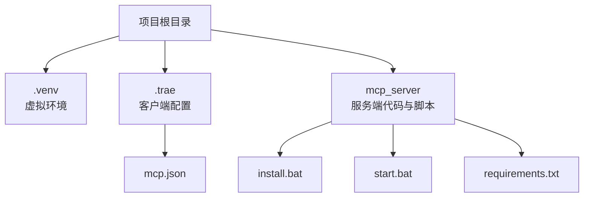
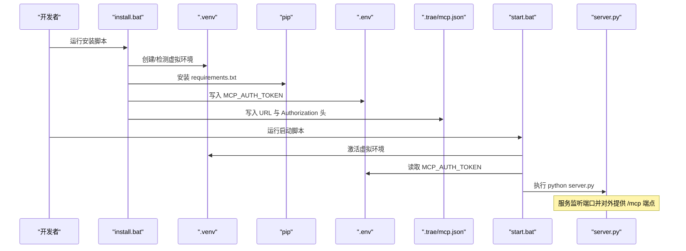
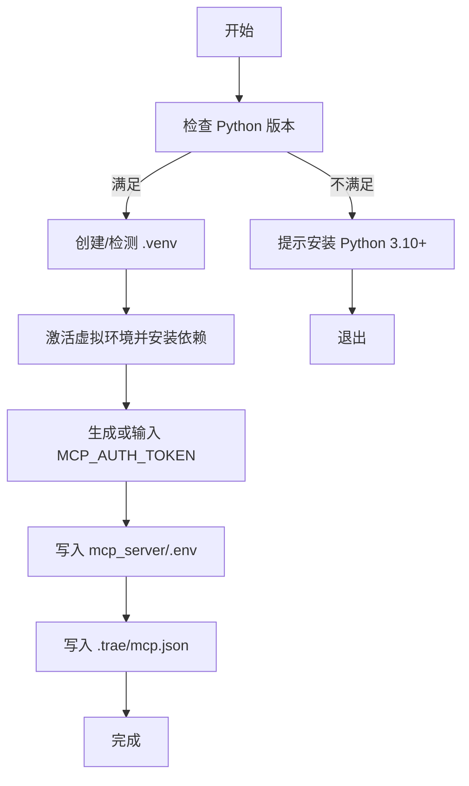
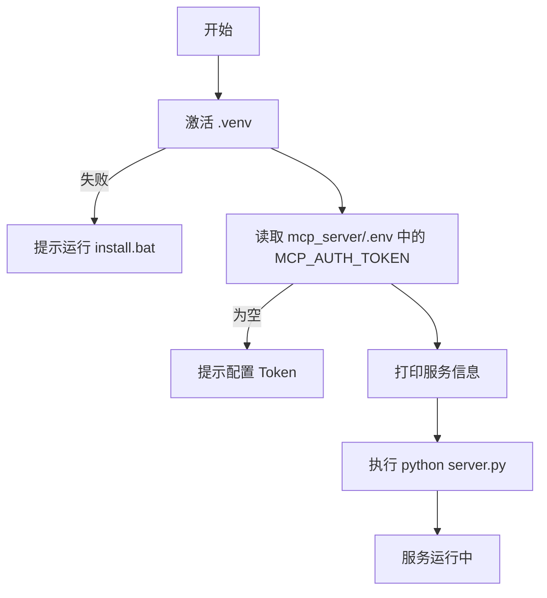
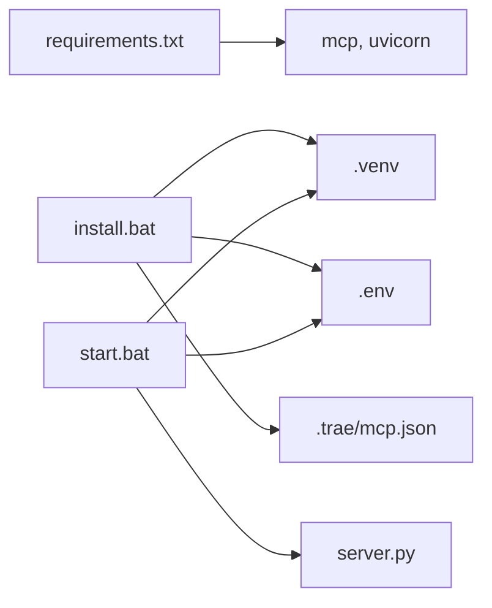

# 开发环境搭建

<cite>
**本文引用的文件**
- [mcp_server/requirements.txt](file://mcp_server/requirements.txt)
- [mcp_server/install.bat](file://mcp_server/install.bat)
- [mcp_server/start.bat](file://mcp_server/start.bat)
- [.trae/mcp.json](file://.trae/mcp.json)
- [mcp server部署.md](file://mcp server部署.md)
</cite>

## 目录
1. [简介](#简介)
2. [项目结构](#项目结构)
3. [核心组件](#核心组件)
4. [架构总览](#架构总览)
5. [详细组件分析](#详细组件分析)
6. [依赖关系分析](#依赖关系分析)
7. [性能注意事项](#性能注意事项)
8. [故障排查指南](#故障排查指南)
9. [结论](#结论)
10. [附录](#附录)

## 简介
本文件面向首次接触该项目的开发者，提供从零开始的 Windows 开发环境搭建指南。内容涵盖 Python 版本要求、虚拟环境创建与激活、依赖安装、一键脚本使用（install.bat、start.bat）、MCP 客户端配置（.trae/mcp.json）以及常见问题定位与解决建议。目标是让开发者在本地快速启动 MCP 服务并连接 IDE 客户端进行调试。

## 项目结构
本项目采用“服务端 + 客户端配置”的分离式组织：
- mcp_server：包含服务端入口、依赖声明、安装与启动脚本
- .trae：IDE 客户端配置文件存放位置（如 Trae IDE）
- .venv：Python 虚拟环境（由 install.bat 自动创建）
- 根目录文档：部署说明与规约文档

图表来源
- [mcp_server/install.bat:1-85](file://mcp_server/install.bat#L1-L85)
- [mcp_server/start.bat:1-41](file://mcp_server/start.bat#L1-L41)
- [mcp_server/requirements.txt:1-3](file://mcp_server/requirements.txt#L1-L3)
- [.trae/mcp.json:1-1](file://.trae/mcp.json#L1-L1)

章节来源
- [mcp_server/install.bat:1-85](file://mcp_server/install.bat#L1-L85)
- [mcp_server/start.bat:1-41](file://mcp_server/start.bat#L1-L41)
- [mcp_server/requirements.txt:1-3](file://mcp_server/requirements.txt#L1-L3)
- [.trae/mcp.json:1-1](file://.trae/mcp.json#L1-L1)

## 核心组件
- Python 环境与虚拟环境
  - 要求：Python 3.10+
  - 虚拟环境：.venv（由 install.bat 创建），用于隔离依赖
- 依赖包
  - mcp：MCP 协议 SDK（版本约束见 requirements.txt）
  - uvicorn：ASGI 服务器，承载 MCP 应用
- 脚本
  - install.bat：检查 Python、创建虚拟环境、安装依赖、生成 Token、写入 .env 与 .trae/mcp.json
  - start.bat：激活虚拟环境、读取 Token、启动 MCP 服务
- 客户端配置
  - .trae/mcp.json：定义 MCP 客户端如何连接本地服务（URL、鉴权头）

章节来源
- [mcp_server/install.bat:12-73](file://mcp_server/install.bat#L12-L73)
- [mcp_server/start.bat:7-41](file://mcp_server/start.bat#L7-L41)
- [mcp_server/requirements.txt:1-3](file://mcp_server/requirements.txt#L1-L3)
- [.trae/mcp.json:1-1](file://.trae/mcp.json#L1-L1)

## 架构总览
下图展示了从双击脚本到服务运行的完整调用链，包括虚拟环境、环境变量、MCP 服务与客户端配置的交互。

图表来源
- [mcp_server/install.bat:26-73](file://mcp_server/install.bat#L26-L73)
- [mcp_server/start.bat:7-41](file://mcp_server/start.bat#L7-L41)
- [mcp_server/requirements.txt:1-3](file://mcp_server/requirements.txt#L1-L3)
- [.trae/mcp.json:1-1](file://.trae/mcp.json#L1-L1)

## 详细组件分析

### 安装脚本 install.bat
- 功能要点
  - 检查 Python 是否安装且版本满足要求
  - 在项目根目录创建或复用 .venv 虚拟环境
  - 激活虚拟环境后安装 requirements.txt 中的依赖
  - 交互式输入或自动生成 MCP_AUTH_TOKEN，并写入 mcp_server/.env
  - 生成 .trae/mcp.json，配置客户端连接地址与鉴权头
- 关键路径
  - 虚拟环境路径：项目根目录下的 .venv
  - 依赖清单：mcp_server/requirements.txt
  - 环境变量：mcp_server/.env（键为 MCP_AUTH_TOKEN）
  - 客户端配置：.trae/mcp.json（包含 URL 与 Authorization 头）

图表来源
- [mcp_server/install.bat:12-73](file://mcp_server/install.bat#L12-L73)

章节来源
- [mcp_server/install.bat:12-73](file://mcp_server/install.bat#L12-L73)

### 启动脚本 start.bat
- 功能要点
  - 激活虚拟环境（若不存在则提示先运行 install.bat）
  - 从 mcp_server/.env 读取 MCP_AUTH_TOKEN（未设置则提示重新配置）
  - 打印服务信息（Token、URL、工具数量等）
  - 执行 server.py 启动 MCP 服务
- 关键路径
  - 虚拟环境激活：.venv/Scripts/activate.bat
  - 环境变量：mcp_server/.env
  - 服务入口：mcp_server/server.py

图表来源
- [mcp_server/start.bat:7-41](file://mcp_server/start.bat#L7-L41)

章节来源
- [mcp_server/start.bat:7-41](file://mcp_server/start.bat#L7-L41)

### 依赖管理 requirements.txt
- 依赖项
  - mcp：MCP 协议 SDK，版本范围受约束
  - uvicorn：ASGI 服务器，承载 MCP 应用
- 安装方式
  - 通过 install.bat 自动在虚拟环境中安装
  - 也可手动进入 .venv 后执行 pip 安装

章节来源
- [mcp_server/requirements.txt:1-3](file://mcp_server/requirements.txt#L1-L3)

### MCP 客户端配置 .trae/mcp.json
- 作用
  - 告诉 IDE 客户端如何连接到本地 MCP 服务
  - 包含服务 URL 与鉴权头（Authorization: Bearer <TOKEN>）
- 关键字段
  - url：服务主端点（例如 http://localhost:8765/mcp）
  - headers.Authorization：Bearer 令牌，需与服务端 Token 一致
- 生成方式
  - install.bat 会自动根据 MCP_AUTH_TOKEN 生成该文件
  - 如需修改，可直接编辑 .trae/mcp.json

章节来源
- [.trae/mcp.json:1-1](file://.trae/mcp.json#L1-L1)
- [mcp_server/install.bat:52-73](file://mcp_server/install.bat#L52-L73)

## 依赖关系分析
- 运行时依赖
  - mcp：提供 MCP 协议能力（工具注册、路由、SSE 等）
  - uvicorn：作为 ASGI 服务器承载 MCP 应用
- 脚本依赖
  - install.bat 依赖 Python 标准库（venv、secrets）与 pip
  - start.bat 依赖虚拟环境激活脚本与环境变量文件
- 配置依赖
  - .env：服务端鉴权 Token
  - .trae/mcp.json：客户端连接与鉴权配置

图表来源
- [mcp_server/requirements.txt:1-3](file://mcp_server/requirements.txt#L1-L3)
- [mcp_server/install.bat:26-73](file://mcp_server/install.bat#L26-L73)
- [mcp_server/start.bat:7-41](file://mcp_server/start.bat#L7-L41)

章节来源
- [mcp_server/requirements.txt:1-3](file://mcp_server/requirements.txt#L1-L3)
- [mcp_server/install.bat:26-73](file://mcp_server/install.bat#L26-L73)
- [mcp_server/start.bat:7-41](file://mcp_server/start.bat#L7-L41)

## 性能注意事项
- 事件循环与并发
  - uvicorn 基于异步事件循环，适合高并发 I/O 场景
- 资源占用
  - 虚拟环境隔离依赖，避免全局污染
- 网络层
  - 确保端口未被占用，避免重复绑定导致启动失败

[本节为通用指导，无需特定文件引用]

## 故障排查指南
- Python 未安装或版本过低
  - 现象：安装脚本提示需要 Python 3.10+
  - 处理：安装 Python 3.10+，并确保加入 PATH；重新打开命令行验证
- 虚拟环境创建失败
  - 现象：提示虚拟环境创建失败
  - 处理：检查权限、磁盘空间与 Python 版本；以管理员身份重试
- 依赖安装失败
  - 现象：提示依赖安装失败，检查网络
  - 处理：检查网络连通性；可尝试更换镜像源；升级 pip 后重试
- 启动时找不到虚拟环境
  - 现象：提示未找到虚拟环境，请先运行安装脚本
  - 处理：确认已运行 install.bat；若 .venv 被删除，重新运行安装脚本
- Token 未配置
  - 现象：提示 MCP_AUTH_TOKEN 未设置
  - 处理：运行 install.bat 生成 Token；或手动创建 mcp_server/.env 并写入 MCP_AUTH_TOKEN
- 端口被占用
  - 现象：提示无法绑定端口（例如 8765）
  - 处理：查找占用进程并结束；或修改服务端口后重启
- 移动项目后虚拟环境失效
  - 原因：激活脚本包含绝对路径
  - 处理：删除旧 .venv 并重新运行 install.bat

章节来源
- [mcp server部署.md:505-643](file://mcp server部署.md#L505-L643)

## 结论
通过 install.bat 与 start.bat，可在 Windows 环境下快速完成 Python 环境初始化、依赖安装、Token 配置与 MCP 服务启动。.trae/mcp.json 将 IDE 客户端指向本地服务并完成鉴权。遇到常见环境问题可按故障排查指南逐项定位与修复。

[本节为总结性内容，无需特定文件引用]

## 附录

### 快速命令参考
- 首次安装：运行 mcp_server\install.bat
- 启动服务：运行 mcp_server\start.bat
- 停止服务：按 Ctrl+C
- 手动激活虚拟环境：.venv\Scripts\activate.bat
- 退出虚拟环境：deactivate
- 手动启动服务：python mcp_server\server.py

章节来源
- [mcp server部署.md:677-687](file://mcp server部署.md#L677-L687)