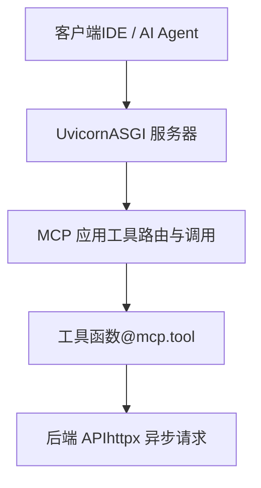
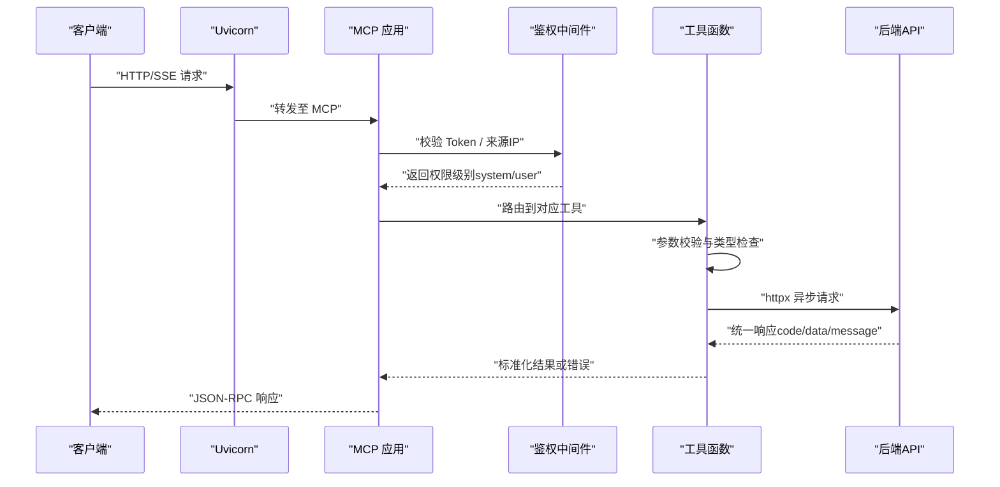
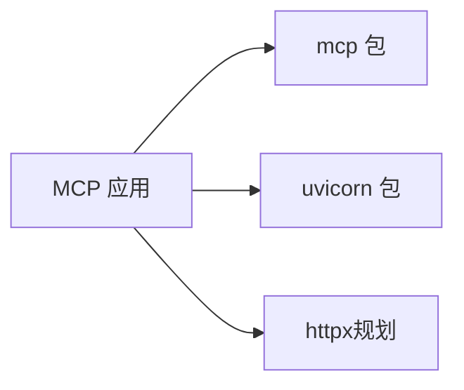

# 工具定义规范

<cite>
**本文引用的文件**
- [规约管理MCP服务化Spec.md](file://规约管理MCP服务化Spec.md)
- [mcp server部署.md](file://mcp server部署.md)
- [requirements.txt](file://mcp_server/requirements.txt)
- [access.html](file://mcp_server/static/access.html)
- [install.bat](file://mcp_server/install.bat)
- [.trae/mcp.json](file://.trae/mcp.json)
</cite>

## 目录
1. [简介](#简介)
2. [项目结构](#项目结构)
3. [核心组件](#核心组件)
4. [架构总览](#架构总览)
5. [详细组件分析](#详细组件分析)
6. [依赖关系分析](#依赖关系分析)
7. [性能考虑](#性能考虑)
8. [故障排查指南](#故障排查指南)
9. [结论](#结论)
10. [附录](#附录)

## 简介
本规范面向 MCP（Model Context Protocol）服务端，聚焦“工具定义”的完整约定与最佳实践。内容涵盖：
- @mcp.tool() 装饰器的使用方式、函数签名、参数类型注解与返回值格式要求
- TOOL_DEFINITIONS 数组的结构与各字段含义（name、type、status、description）
- 只读工具与写入工具的区分及权限级别标记方法
- 从简单查询到复杂业务逻辑的完整工具定义示例
- 参数验证的最佳实践与错误处理模式

## 项目结构
本项目采用“协议层 + 应用层”的分层组织：
- 协议层：Uvicorn 提供 ASGI 服务器能力，承载 HTTP/SSE 端点
- 应用层：MCP 框架负责路由、工具注册与调用生命周期
- 业务层：通过工具函数封装后端 API 调用，实现细粒度原子操作

图表来源
- [mcp server部署.md:110-280](file://mcp server部署.md#L110-L280)
- [规约管理MCP服务化Spec.md:44-66](file://规约管理MCP服务化Spec.md#L44-L66)

章节来源
- [mcp server部署.md:110-280](file://mcp server部署.md#L110-L280)
- [规约管理MCP服务化Spec.md:44-66](file://规约管理MCP服务化Spec.md#L44-L66)

## 核心组件
- 工具装饰器：@mcp.tool() 用于将 Python 函数注册为 MCP 工具
- 工具清单：TOOL_DEFINITIONS 数组集中声明工具元数据（名称、类型、状态、描述等）
- 鉴权中间件：基于 Token 的访问控制，区分系统级（读写）与用户级（只读）
- 接入页面：access.html 提供一键生成配置与权限提示

章节来源
- [规约管理MCP服务化Spec.md:247-286](file://规约管理MCP服务化Spec.md#L247-L286)
- [mcp server部署.md:645-674](file://mcp server部署.md#L645-L674)
- [access.html:263-290](file://mcp_server/static/access.html#L263-L290)

## 架构总览
下图展示一次工具调用的端到端流程，包括鉴权、工具路由、参数校验、后端调用与响应归一化。

图表来源
- [mcp server部署.md:163-261](file://mcp server部署.md#L163-L261)
- [规约管理MCP服务化Spec.md:123-131](file://规约管理MCP服务化Spec.md#L123-L131)

## 详细组件分析

### 工具装饰器 @mcp.tool()
- 作用：将异步函数注册为 MCP 工具，暴露给客户端调用
- 函数签名建议：
  - 使用 async def，便于在 I/O 密集场景下不阻塞事件循环
  - 参数需包含明确的类型注解（如 str、int、dict、Optional[...]），利于自动文档与校验
  - 返回值建议使用 dict，并遵循统一的 error/code/message/data 结构
- 典型模式：
  - 参数校验 → 调用 api_client → 统一错误处理 → 返回标准结构

章节来源
- [规约管理MCP服务化Spec.md:260-275](file://规约管理MCP服务化Spec.md#L260-L275)
- [规约管理MCP服务化Spec.md:123-131](file://规约管理MCP服务化Spec.md#L123-L131)

### 工具清单 TOOL_DEFINITIONS
- 目的：集中声明所有可用工具的元数据，便于工具列表展示、权限控制与审计
- 关键字段：
  - name：工具唯一标识（小写、语义清晰）
  - type：工具类型（read/write/login/probe 等）
  - status：工具状态（active/deprecated/stub 等）
  - description：人类可读的描述，说明用途、输入输出与注意事项
- 维护建议：
  - 新增工具时同步更新 TOOL_DEFINITIONS
  - 对写入类工具标注 write，并在中间件中做权限拦截
  - 对探测类工具（如 list_mcp_tools）标注 probe，用于连通性与鉴权检测

章节来源
- [规约管理MCP服务化Spec.md:247-286](file://规约管理MCP服务化Spec.md#L247-L286)
- [mcp server部署.md:645-674](file://mcp server部署.md#L645-L674)

### 只读工具与写入工具
- 只读工具：仅读取数据，不改变后端状态；适合查询、导出、列表等操作
- 写入工具：会修改后端状态；包括新增、更新、删除、上传、生成脚本等
- 权限标记：
  - 在 TOOL_DEFINITIONS 中通过 type 字段标记 read/write
  - 结合鉴权中间件，根据来源 IP 与 Token 决定允许的操作范围
  - 非 localhost 访问默认限制为只读，localhost 可授予系统级读写权限

章节来源
- [mcp server部署.md:655-674](file://mcp server部署.md#L655-L674)
- [access.html:263-290](file://mcp_server/static/access.html#L263-L290)

### 权限级别与鉴权
- 本地访问（localhost）：系统级权限，支持读写
- 远程访问（非 localhost）：用户级权限，仅支持只读
- Token 机制：
  - 安装阶段生成或手动设置 MCP_AUTH_TOKEN
  - 客户端通过 Authorization: Bearer <token> 进行鉴权
  - 登录工具返回业务 Token，后续工具调用作为参数传入后端 API

章节来源
- [mcp server部署.md:645-674](file://mcp server部署.md#L645-L674)
- [install.bat:52-72](file://mcp_server/install.bat#L52-L72)
- [.trae/mcp.json:1-1](file://.trae/mcp.json#L1-L1)

### 参数验证最佳实践
- 类型注解：为每个参数添加明确类型（str、int、float、bool、list、dict、Optional[...]）
- 必填校验：在函数入口处校验必填参数是否存在且合法
- 值域校验：对枚举、范围、格式（如邮箱、编码）进行前置校验
- 安全校验：对敏感字段（如 token、id）进行长度与格式限制
- 错误信息：返回结构化错误，包含 code、message 与可选 raw 上下文

章节来源
- [规约管理MCP服务化Spec.md:123-131](file://规约管理MCP服务化Spec.md#L123-L131)
- [规约管理MCP服务化Spec.md:260-275](file://规约管理MCP服务化Spec.md#L260-L275)

### 错误处理模式
- 网络异常：捕获超时、连接失败，返回 NETWORK_ERROR
- HTTP 异常：捕获非 2xx 状态码，返回 HTTP_ERROR
- 业务异常：后端返回非成功码（如非 20000），返回 API_ERROR，附带 message 与 raw
- 认证异常：Token 无效或过期，返回 AUTH_ERROR，提示重新登录
- 统一结构：error 布尔标志、code 错误码、message 人类可读信息、data 可选数据

章节来源
- [规约管理MCP服务化Spec.md:123-131](file://规约管理MCP服务化Spec.md#L123-L131)

### 工具定义示例（从简单到复杂）
- 简单查询工具：
  - 功能：获取大类列表
  - 参数：分页参数与可选过滤条件
  - 返回：统一数据结构，包含 rows 与 total
- 复杂业务工具：
  - 功能：新增规约信息并关联文件
  - 参数：多字段组合校验（名称、类型、分类、品牌、型号、文件列表）
  - 返回：成功返回 code 与 message，失败返回错误码与原因
- 登录工具：
  - 功能：手机号+验证码登录，返回业务 Token
  - 参数：手机号、验证码
  - 返回：token 与用户信息

章节来源
- [规约管理MCP服务化Spec.md:132-246](file://规约管理MCP服务化Spec.md#L132-L246)
- [规约管理MCP服务化Spec.md:295-319](file://规约管理MCP服务化Spec.md#L295-L319)

## 依赖关系分析
- 运行时依赖：
  - mcp：MCP 协议 SDK，提供工具注册与消息处理
  - uvicorn：ASGI 服务器，承载 HTTP/SSE 端点
- 业务依赖（规划中）：
  - httpx：异步 HTTP 客户端，用于调用后端 API

图表来源
- [requirements.txt:1-3](file://mcp_server/requirements.txt#L1-L3)
- [规约管理MCP服务化Spec.md:287-293](file://规约管理MCP服务化Spec.md#L287-L293)

章节来源
- [requirements.txt:1-3](file://mcp_server/requirements.txt#L1-L3)
- [规约管理MCP服务化Spec.md:287-293](file://规约管理MCP服务化Spec.md#L287-L293)

## 性能考虑
- 异步优先：工具函数使用 async/await，避免阻塞事件循环
- 连接复用：httpx.AsyncClient 复用连接，减少握手开销
- 超时控制：为网络请求设置合理超时，防止长尾请求拖垮服务
- 并发模型：Uvicorn 基于事件循环，天然支持高并发 I/O 密集型任务
- 资源清理：在服务关闭时释放客户端连接，避免资源泄漏

章节来源
- [mcp server部署.md:265-280](file://mcp server部署.md#L265-L280)
- [规约管理MCP服务化Spec.md:89-121](file://规约管理MCP服务化Spec.md#L89-L121)

## 故障排查指南
- 启动失败：
  - 检查 Python 版本与环境变量
  - 确认虚拟环境已创建并激活
  - 检查端口占用情况
- 鉴权失败：
  - 确认 .env 中 MCP_AUTH_TOKEN 已正确配置
  - 客户端请求头是否携带正确的 Authorization
- 工具调用失败：
  - 查看统一错误结构中的 code 与 message
  - 检查后端 API 是否可达与业务码是否为 20000
- 权限不足：
  - 非 localhost 访问仅支持只读，写入需在本地执行
  - 使用 access.html 查看当前权限级别与来源 IP

章节来源
- [mcp server部署.md:505-674](file://mcp server部署.md#L505-L674)
- [access.html:263-290](file://mcp_server/static/access.html#L263-L290)

## 结论
本规范明确了 MCP 工具的定义方式、权限模型与错误处理策略。通过 @mcp.tool() 装饰器与 TOOL_DEFINITIONS 数组，可实现工具的统一注册与治理；结合鉴权中间件与权限分级，确保只读与写入操作的边界清晰。建议在开发中坚持类型注解、参数校验与统一错误结构，以提升工具的可维护性与可观测性。

## 附录
- 快速命令参考：
  - 首次安装：运行 install.bat
  - 启动服务：运行 start.bat
  - 停止服务：按 Ctrl+C
  - 手动启动：python mcp_server/server.py
- 接入配置：
  - 通过 access.html 自动生成各平台配置
  - 配置文件位置与示例见 .trae/mcp.json

章节来源
- [mcp server部署.md:677-687](file://mcp server部署.md#L677-L687)
- [.trae/mcp.json:1-1](file://.trae/mcp.json#L1-L1)