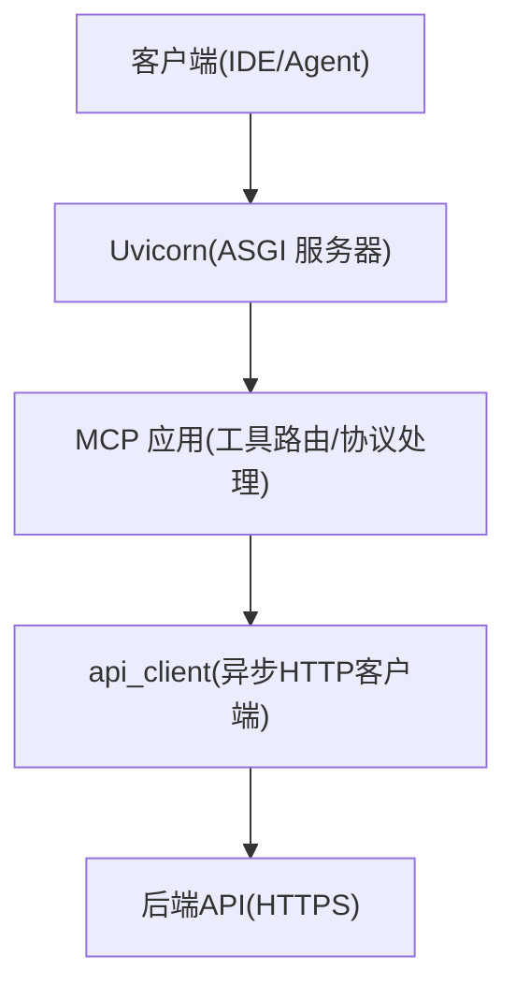
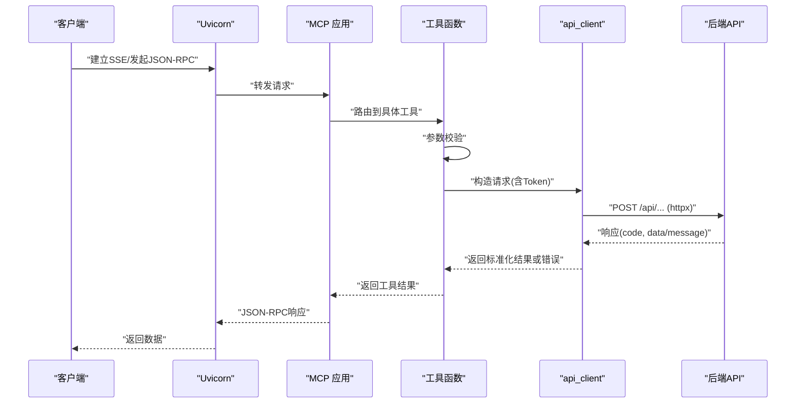
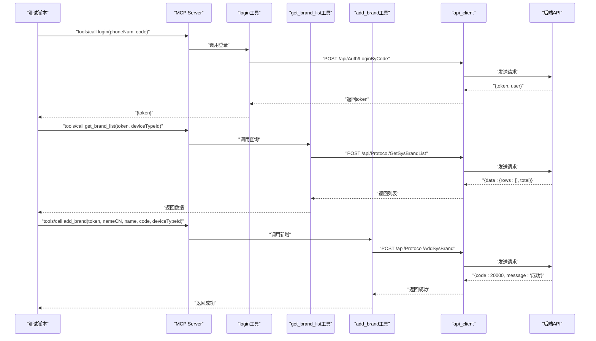
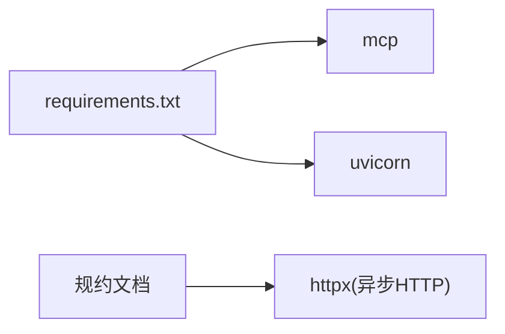

# 工具测试方法

<cite>
**本文引用的文件**
- [mcp server部署.md](file://mcp server部署.md)
- [规约管理MCP服务化Spec.md](file://规约管理MCP服务化Spec.md)
- [requirements.txt](file://mcp_server/requirements.txt)
</cite>

## 目录
1. [简介](#简介)
2. [项目结构](#项目结构)
3. [核心组件](#核心组件)
4. [架构总览](#架构总览)
5. [详细组件分析](#详细组件分析)
6. [依赖分析](#依赖分析)
7. [性能考虑](#性能考虑)
8. [故障排查指南](#故障排查指南)
9. [结论](#结论)
10. [附录](#附录)

## 简介
本指南面向为 MCP（Model Context Protocol）服务端编写“工具函数”的单元测试与集成测试。目标包括：
- 参数验证、业务逻辑与返回值断言的单元级测试方法
- 权限控制逻辑的覆盖（正常访问与拒绝场景）
- 与 FastMCP/Uvicorn 的集成测试方法（SSE/JSON-RPC 交互）
- 使用现有桩函数进行隔离测试的策略
- 测试环境搭建与执行流程
- 覆盖成功、失败与边界条件的用例设计

## 项目结构
当前仓库包含 MCP 服务器文档与规范，以及运行所需的基础依赖声明。关键要点：
- 服务由 Uvicorn 启动，暴露 /sse 与 /mcp 端点
- MCP 层负责工具注册、协议解析与调用路由
- 后端 API 通过 httpx 异步调用（按规范设计）
- 鉴权基于 Token 请求头；本地与远程访问存在权限差异

**图示来源**
- [mcp server部署.md:64-125](file://mcp server部署.md#L64-L125)
- [mcp server部署.md:215-260](file://mcp server部署.md#L215-L260)
- [规约管理MCP服务化Spec.md:79-131](file://规约管理MCP服务化Spec.md#L79-L131)

**章节来源**
- [mcp server部署.md:64-125](file://mcp server部署.md#L64-L125)
- [mcp server部署.md:215-260](file://mcp server部署.md#L215-L260)
- [规约管理MCP服务化Spec.md:79-131](file://规约管理MCP服务化Spec.md#L79-L131)

## 核心组件
- MCP 工具层：每个工具对应一个原子操作，负责参数校验与调用 api_client
- api_client：封装 httpx.AsyncClient，统一构造请求头、发送请求、解析响应与错误归一化
- 鉴权中间件：基于 Token 的访问控制，区分本地与远程权限
- 运行时：Uvicorn 提供 ASGI 能力，承载 SSE 长连接与 JSON-RPC 消息

**章节来源**
- [mcp server部署.md:64-125](file://mcp server部署.md#L64-L125)
- [mcp server部署.md:655-664](file://mcp server部署.md#L655-L664)
- [规约管理MCP服务化Spec.md:79-131](file://规约管理MCP服务化Spec.md#L79-L131)

## 架构总览
下图展示从客户端到后端 API 的完整调用链，并标注测试关注点（参数校验、权限、网络异常、业务错误码）。

**图示来源**
- [mcp server部署.md:215-260](file://mcp server部署.md#L215-L260)
- [规约管理MCP服务化Spec.md:79-131](file://规约管理MCP服务化Spec.md#L79-L131)

## 详细组件分析

### 工具函数单元测试（参数验证、业务逻辑、返回值）
- 目标：在不依赖网络的情况下，验证工具函数的输入校验、分支逻辑与输出结构
- 策略：
  - 对工具函数直接调用，传入合法/非法参数，断言抛出错误或返回预期结构
  - 将 api_client 替换为桩对象，模拟后端不同响应（成功、业务错误、网络异常、鉴权失败）
  - 针对分页、空列表、边界值等场景构造数据
- 建议用例：
  - 参数缺失/类型错误 → 应返回明确的错误信息或抛出异常
  - 合法参数 → 返回标准结构 {code, message, data}
  - 分页边界 → pageIndex/pageSize 极值、空页
  - 业务错误码 → code≠20000 时，断言 error/message/raw 字段

**章节来源**
- [规约管理MCP服务化Spec.md:123-131](file://规约管理MCP服务化Spec.md#L123-L131)

### 权限控制逻辑测试（正常访问与拒绝）
- 背景：本地 localhost 具备读写权限，其他 IP 仅只读；Token 用于鉴权
- 测试要点：
  - 携带有效 Token 且来自 localhost → 允许写操作
  - 携带无效/过期 Token → 返回 AUTH_ERROR
  - 非 localhost 发起写请求 → 拒绝（只读）
  - 无 Token → 拒绝
- 实现方式：
  - 在工具层或中间件层注入“来源IP”和“Token”，根据规则放行或拒绝
  - 通过桩模拟不同来源与 Token 状态，断言返回码与消息

**章节来源**
- [mcp server部署.md:655-664](file://mcp server部署.md#L655-L664)
- [规约管理MCP服务化Spec.md:123-131](file://规约管理MCP服务化Spec.md#L123-L131)

### 集成测试（与 FastMCP/Uvicorn 交互）
- 目标：端到端验证 MCP 工具通过 /sse 与 /mcp 端点的正确性
- 步骤：
  - 启动 Uvicorn 服务（参考启动脚本）
  - 建立 SSE 连接，发送 tools/call 请求
  - 断言响应结构与业务语义
- 注意：
  - 使用 httpx 异步客户端进行集成测试
  - 对后端 API 可配置 Mock 或代理，避免真实网络依赖
  - 覆盖成功、鉴权失败、网络超时、业务错误码等路径

**章节来源**
- [mcp server部署.md:64-125](file://mcp server部署.md#L64-L125)
- [mcp server部署.md:215-260](file://mcp server部署.md#L215-L260)

### 使用 _stub_response 进行桩测试
- 说明：若历史代码中存在 _stub_response，可用于快速生成固定响应以隔离外部依赖
- 用法建议：
  - 构造成功响应：{code:20000, data:{...}, message:"成功"}
  - 构造业务错误：{code:40000, message:"业务异常"}
  - 构造鉴权错误：{code:40100, message:"登录失效"}
  - 构造网络异常：{error:true, code:"NETWORK_ERROR", message:"..."}
- 优势：无需真实后端即可覆盖工具层的分支逻辑

**章节来源**
- [规约管理MCP服务化Spec.md:123-131](file://规约管理MCP服务化Spec.md#L123-L131)

### 典型调用流程测试序列图
以下序列图展示“登录→查询品牌→新增品牌”的端到端流程，便于组织集成测试用例。

**图示来源**
- [规约管理MCP服务化Spec.md:295-319](file://规约管理MCP服务化Spec.md#L295-L319)

## 依赖分析
- 运行时依赖：mcp、uvicorn
- 网络依赖：httpx（按规范引入，用于异步 HTTP 调用）
- 测试依赖：unittest（已有报告生成脚本）、pytest（可选）

**图示来源**
- [requirements.txt:1-3](file://mcp_server/requirements.txt#L1-L3)
- [规约管理MCP服务化Spec.md:287-293](file://规约管理MCP服务化Spec.md#L287-L293)

**章节来源**
- [requirements.txt:1-3](file://mcp_server/requirements.txt#L1-L3)
- [规约管理MCP服务化Spec.md:287-293](file://规约管理MCP服务化Spec.md#L287-L293)

## 性能考虑
- 使用 httpx.AsyncClient 避免阻塞事件循环
- 复用连接池，合理设置超时
- 批量接口分页参数优化，减少往返次数
- 集成测试中启用 Mock，降低 I/O 开销

[本节为通用指导，不直接分析具体文件]

## 故障排查指南
- 常见问题：
  - Python 版本过低或未安装
  - 虚拟环境创建失败
  - 依赖安装失败（网络问题）
  - 端口占用
  - Token 未配置
- 解决思路：
  - 检查 Python 版本与环境变量
  - 重新创建虚拟环境并安装依赖
  - 更换 pip 镜像源
  - 释放端口或修改监听端口
  - 通过 install.bat 生成 Token 或手动写入 .env

**章节来源**
- [mcp server部署.md:505-631](file://mcp server部署.md#L505-L631)

## 结论
- 单元测试聚焦工具函数的参数校验、分支逻辑与返回结构，借助桩隔离外部依赖
- 集成测试覆盖 MCP 协议交互与后端 API 行为，确保端到端正确性
- 权限控制需覆盖本地/远程与 Token 有效性等多维场景
- 使用 _stub_response 可快速构建稳定、可重复的测试数据
- 遵循规范中的错误模型与响应格式，保证测试断言的一致性与可维护性

[本节为总结，不直接分析具体文件]

## 附录

### 测试环境搭建与执行流程
- 首次安装：运行 mcp_server\install.bat，创建虚拟环境、安装依赖、生成 Token
- 启动服务：运行 mcp_server\start.bat，启动 Uvicorn 与 MCP 服务
- 执行测试：
  - 单元测试：使用 unittest 或 pytest 运行工具函数测试
  - 集成测试：启动服务后，通过 httpx 向 /sse 与 /mcp 发送请求并断言

**章节来源**
- [mcp server部署.md:309-336](file://mcp server部署.md#L309-L336)
- [mcp server部署.md:415-459](file://mcp server部署.md#L415-L459)
- [mcp server部署.md:677-686](file://mcp server部署.md#L677-L686)

### 测试用例清单（示例）
- 成功场景
  - 登录成功，获取 token
  - 查询列表成功，返回分页数据
  - 新增/更新/删除资源成功
- 失败场景
  - 参数缺失/类型错误
  - 业务错误码（code≠20000）
  - 鉴权失败（Token 无效/过期）
  - 网络异常（超时、连接失败）
- 边界条件
  - 分页 pageIndex=1, pageSize=1/极大值
  - 空列表、单条记录
  - 特殊字符与超长字符串
  - 并发请求下的幂等性与一致性

[本节为概念性内容，不直接分析具体文件]

### 权限控制测试矩阵
- 本地 localhost + 有效 Token → 读写均可
- 本地 localhost + 无效 Token → 拒绝
- 远程 IP + 有效 Token → 只读
- 远程 IP + 无效 Token → 拒绝
- 无 Token → 拒绝

**章节来源**
- [mcp server部署.md:655-664](file://mcp server部署.md#L655-L664)

### 错误模型与断言要点
- 网络异常：{error:true, code:"NETWORK_ERROR", message:"..."}
- 业务错误：{error:true, code:"API_ERROR", message:"...", raw:{...}}
- 鉴权错误：{error:true, code:"AUTH_ERROR", message:"Token无效，请重新登录"}
- HTTP 异常：{error:true, code:"HTTP_ERROR", message:"..."}

**章节来源**
- [规约管理MCP服务化Spec.md:123-131](file://规约管理MCP服务化Spec.md#L123-L131)