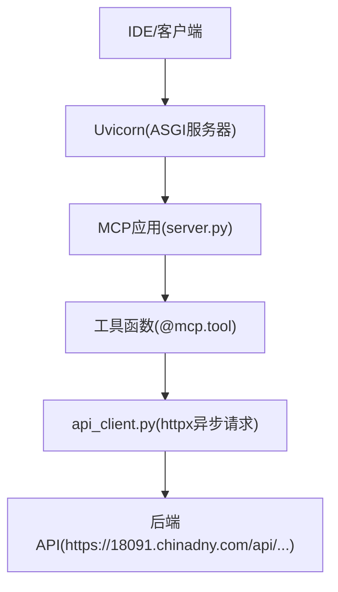
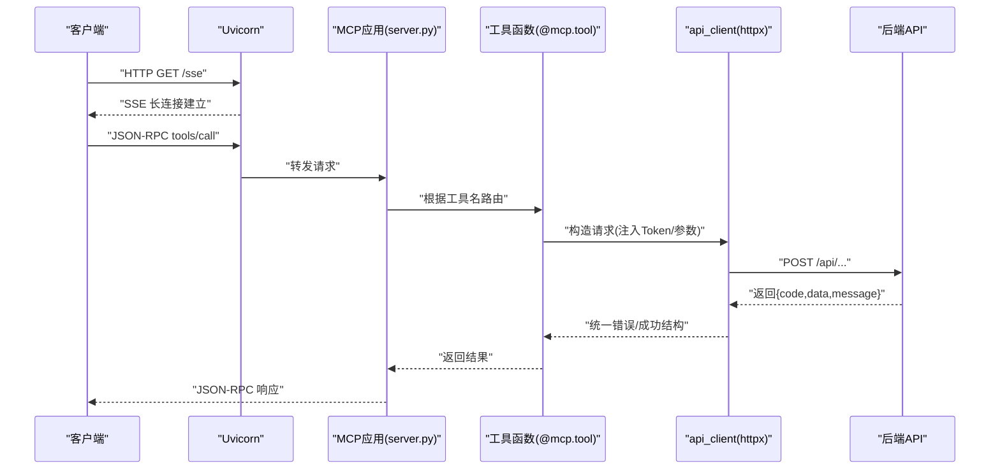
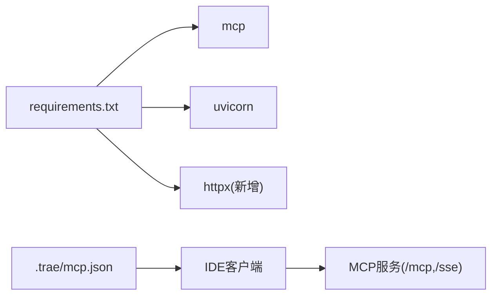

# 新增工具开发

<cite>
**本文引用的文件**
- [mcp server部署.md](file://mcp server部署.md)
- [规约管理MCP服务化Spec.md](file://规约管理MCP服务化Spec.md)
- [tasks.md](file://openspec/changes/enhance-modbus-mcp-workflow/tasks.md)
- [start.bat](file://mcp_server/start.bat)
- [.trae/mcp.json](file://.trae/mcp.json)
</cite>

## 目录
1. [简介](#简介)
2. [项目结构](#项目结构)
3. [核心组件](#核心组件)
4. [架构总览](#架构总览)
5. [详细组件分析](#详细组件分析)
6. [依赖关系分析](#依赖关系分析)
7. [性能考虑](#性能考虑)
8. [故障排查指南](#故障排查指南)
9. [结论](#结论)
10. [附录](#附录)

## 简介
本指南面向需要在 PCA MCP Server 中新增 MCP 工具的开发者，目标是提供从工具函数定义、注册到权限控制、测试与排错的完整流程说明。本项目基于 MCP 协议与 Uvicorn 运行，通过 ASGI 暴露 /sse 与 /mcp 端点，使用 Token 鉴权，并以“细粒度原子工具”的方式封装后端 API，便于 Skill 编排自动化流程。

## 项目结构
当前仓库包含服务端文档、部署脚本、MCP 客户端配置以及需求规格说明。关键路径与职责如下：
- mcp_server/start.bat：启动脚本，负责激活虚拟环境、读取 .env 中的 MCP_AUTH_TOKEN、打印启动信息并执行 server.py。
- mcp_server/requirements.txt：声明 Python 依赖（mcp、uvicorn）。
- .trae/mcp.json：IDE 的 MCP 客户端连接配置，包含 URL 与 Authorization 头。
- mcp server部署.md：描述 MCP 与 Uvicorn 的工作原理、部署脚本、常见问题与安全注意事项。
- 规约管理MCP服务化Spec.md：定义工具清单、数据流、错误处理策略、API 映射与典型调用流程。
- openspec/changes/enhance-modbus-mcp-workflow/tasks.md：任务清单，明确写入类工具标记为 write、系统级权限检查等要求。

图表来源
- [mcp server部署.md:110-263](file://mcp server部署.md#L110-L263)
- [规约管理MCP服务化Spec.md:44-66](file://规约管理MCP服务化Spec.md#L44-L66)

章节来源
- [mcp server部署.md:25-35](file://mcp server部署.md#L25-L35)
- [mcp server部署.md:110-263](file://mcp server部署.md#L110-L263)
- [规约管理MCP服务化Spec.md:44-66](file://规约管理MCP服务化Spec.md#L44-L66)

## 核心组件
- MCP 服务器与路由：由 MCP SDK 提供，暴露 /sse 与 /mcp 端点，处理 JSON-RPC 消息与工具调用路由。
- 工具函数：以 @mcp.tool() 装饰器定义的异步函数，每个工具对应一个原子操作（如查询或写入）。
- 工具注册：在 server.py 中将工具函数加入 TOOL_DEFINITIONS，使 MCP 框架发现并暴露工具元数据。
- HTTP 客户端：api_client.py 封装 httpx.AsyncClient，统一构造请求头、超时、错误归一化与响应解析。
- 鉴权中间件：基于 Bearer Token 的访问控制，区分本地与远程访问权限；写入类工具需系统级权限。
- 启动脚本：start.bat 负责加载环境变量、打印工具数量与 URL，并启动 server.py。

章节来源
- [mcp server部署.md:64-79](file://mcp server部署.md#L64-L79)
- [mcp server部署.md:110-126](file://mcp server部署.md#L110-L126)
- [规约管理MCP服务化Spec.md:44-66](file://规约管理MCP服务化Spec.md#L44-L66)
- [tasks.md:1-14](file://openspec/changes/enhance-modbus-mcp-workflow/tasks.md#L1-L14)
- [start.bat:1-41](file://mcp_server/start.bat#L1-L41)

## 架构总览
下图展示从客户端到后端 API 的完整调用链，包括 SSE 长连接、JSON-RPC 路由、工具函数与 api_client 的请求封装。

图表来源
- [mcp server部署.md:185-263](file://mcp server部署.md#L185-L263)
- [规约管理MCP服务化Spec.md:56-66](file://规约管理MCP服务化Spec.md#L56-L66)

## 详细组件分析

### 工具函数定义规范
- 使用 @mcp.tool() 装饰器将异步函数注册为 MCP 工具。
- 参数定义：
  - 所有工具参数应在函数签名中显式声明，类型标注清晰（如 str、int、dict）。
  - 敏感参数（如 token）应作为显式参数传入，避免在服务端隐式持有状态。
- 返回值格式：
  - 成功：返回字典，包含业务数据（data）、状态码（code=20000）与消息（message）。
  - 失败：返回字典，包含 error=True、错误码（如 NETWORK_ERROR、API_ERROR、AUTH_ERROR、HTTP_ERROR）与 message。
- 日志记录：
  - 在工具入口处记录入参摘要（脱敏），在异常分支记录错误堆栈与上下文。
- 最佳实践：
  - 参数校验：对必填字段进行前置校验，缺失时直接返回明确的参数错误。
  - 幂等性：写入类工具尽量设计为幂等（例如通过唯一键判断是否存在再更新）。
  - 超时与重试：httpx 设置合理超时；对网络抖动可考虑有限次重试（注意幂等）。

章节来源
- [规约管理MCP服务化Spec.md:123-131](file://规约管理MCP服务化Spec.md#L123-L131)
- [规约管理MCP服务化Spec.md:247-286](file://规约管理MCP服务化Spec.md#L247-L286)
- [tasks.md:1-14](file://openspec/changes/enhance-modbus-mcp-workflow/tasks.md#L1-L14)

### 工具注册机制（TOOL_DEFINITIONS）
- 在 server.py 中维护 TOOL_DEFINITIONS，用于向 MCP 框架声明工具名称、描述、参数与权限类别。
- 新工具需在两处登记：
  - 工具函数：使用 @mcp.tool() 装饰的 async 函数。
  - 工具清单：在 TOOL_DEFINITIONS 中添加条目，确保 list_mcp_tools 能正确列出。
- 权限类别：
  - 只读工具：查询类接口（get_*、list_*、export_*）。
  - 写入工具：增删改类接口（add_*、update_*、del_*、save_*、upload_*、gen_*），需系统级权限。

章节来源
- [规约管理MCP服务化Spec.md:247-286](file://规约管理MCP服务化Spec.md#L247-L286)
- [tasks.md:9-14](file://openspec/changes/enhance-modbus-mcp-workflow/tasks.md#L9-L14)

### 权限控制机制
- 接入鉴权：
  - 使用 Bearer Token 的中间件保护 /mcp 与 /sse 端点。
  - 本地访问（localhost）具备系统级权限；其他 IP 地址仅允许只读。
- 写入保护：
  - 所有写入类工具必须标记为 write，并在中间件中校验系统级权限。
  - 普通用户调用任一写入工具应返回 FORBIDDEN。
- 业务 Token：
  - 后端 API 的 Token 作为工具参数传递，不替代 MCP 接入 Token。

章节来源
- [mcp server部署.md:655-673](file://mcp server部署.md#L655-L673)
- [tasks.md:9-14](file://openspec/changes/enhance-modbus-mcp-workflow/tasks.md#L9-L14)
- [规约管理MCP服务化Spec.md:247-286](file://规约管理MCP服务化Spec.md#L247-L286)

### 完整的工具开发示例
以下示例覆盖从简单查询到复杂业务逻辑的常见模式（以路径引用代替代码片段）：
- 简单查询工具（只读）：
  - 参考：[规约管理MCP服务化Spec.md:490-519](file://规约管理MCP服务化Spec.md#L490-L519)
  - 要点：参数分页与模糊搜索；返回 data.rows 列表；无副作用。
- 写入类工具（新增/更新/删除）：
  - 参考：[规约管理MCP服务化Spec.md:520-567](file://规约管理MCP服务化Spec.md#L520-L567)
  - 要点：必填字段校验；返回 code=20000 与 message；写入类工具需系统级权限。
- 复杂业务逻辑（多步骤编排）：
  - 参考：[规约管理MCP服务化Spec.md:295-319](file://规约管理MCP服务化Spec.md#L295-L319)
  - 要点：先登录获取 token，再依次调用多个工具完成品牌、型号、规约、数据项与脚本生成；每步检查返回码与错误。

章节来源
- [规约管理MCP服务化Spec.md:490-567](file://规约管理MCP服务化Spec.md#L490-L567)
- [规约管理MCP服务化Spec.md:295-319](file://规约管理MCP服务化Spec.md#L295-L319)

### 参数验证、错误处理与日志记录最佳实践
- 参数验证：
  - 在工具入口对必填参数进行存在性与类型校验；对枚举值进行白名单校验。
  - 对分页参数限制范围（如 pageSize 上限），防止恶意请求。
- 错误处理：
  - 统一通过 api_client 的错误归一化返回结构，区分网络、HTTP、业务与认证错误。
  - 对 401/40000/40100 等状态码进行分支处理，给出明确的用户提示。
- 日志记录：
  - 记录工具名、入参摘要（脱敏）、耗时、上游错误码与消息。
  - 对异常捕获后记录堆栈，便于定位问题。

章节来源
- [规约管理MCP服务化Spec.md:123-131](file://规约管理MCP服务化Spec.md#L123-L131)
- [mcp server部署.md:655-673](file://mcp server部署.md#L655-L673)

### 测试方法（单元测试与集成测试）
- 单元测试：
  - 针对工具函数的参数校验与边界条件进行测试（如缺失必填参数、非法枚举值）。
  - 模拟 api_client 的返回（成功与失败），验证工具是否正确包装返回结构。
- 集成测试：
  - 启动服务后，通过 MCP 客户端（如 Trae IDE）调用 list_mcp_tools 验证工具可见性。
  - 使用真实后端环境或 Mock 后端，验证端到端的工具调用链路（登录→查询→写入）。
- 权限测试：
  - 分别以本地与远程 IP 发起请求，验证只读与写入权限控制是否符合预期。
  - 验证普通用户调用写入工具返回 FORBIDDEN。

章节来源
- [tasks.md:1-14](file://openspec/changes/enhance-modbus-mcp-workflow/tasks.md#L1-L14)
- [mcp server部署.md:655-673](file://mcp server部署.md#L655-L673)

## 依赖关系分析
- 运行时依赖：
  - mcp：提供 MCP 协议实现与工具注册能力。
  - uvicorn：ASGI 服务器，承载 MCP 应用。
- 新增依赖（按规划）：
  - httpx：异步 HTTP 客户端，用于调用后端 API。
- 配置文件：
  - .trae/mcp.json：IDE 侧 MCP 客户端连接配置，包含 URL 与 Authorization 头。

图表来源
- [mcp_server/requirements.txt:1-3](file://mcp_server/requirements.txt#L1-L3)
- [.trae/mcp.json:1-1](file://.trae/mcp.json#L1-L1)
- [mcp server部署.md:38-45](file://mcp server部署.md#L38-L45)

章节来源
- [mcp_server/requirements.txt:1-3](file://mcp_server/requirements.txt#L1-L3)
- [.trae/mcp.json:1-1](file://.trae/mcp.json#L1-L1)
- [mcp server部署.md:38-45](file://mcp server部署.md#L38-L45)

## 性能考虑
- 异步 I/O：
  - 使用 httpx.AsyncClient 避免阻塞事件循环，提升并发处理能力。
- 连接复用：
  - 复用 AsyncClient 实例以减少握手开销。
- 超时与限流：
  - 设置合理的请求超时时间，防止慢请求拖垮服务。
  - 对高频查询接口增加缓存层（如内存缓存或 Redis）以降低后端压力。
- 日志与监控：
  - 记录关键指标（QPS、延迟、错误率），便于容量规划与问题定位。

[本节为通用指导，无需具体文件引用]

## 故障排查指南
- 启动失败：
  - 检查虚拟环境是否已创建并激活；确认 .env 中存在 MCP_AUTH_TOKEN。
  - 参考启动脚本输出与错误提示。
- 端口占用：
  - 若端口被占用，结束占用进程或修改端口号。
- 鉴权失败：
  - 确认 .trae/mcp.json 中的 Authorization 头与 Token 正确。
  - 检查中间件对本地与远程访问的权限差异。
- 后端错误：
  - 查看 api_client 的统一错误结构，定位是网络、HTTP、业务还是认证错误。
  - 对 401/40000/40100 等状态码进行针对性处理。

章节来源
- [mcp server部署.md:505-632](file://mcp server部署.md#L505-L632)
- [mcp server部署.md:645-673](file://mcp server部署.md#L645-L673)
- [start.bat:1-41](file://mcp_server/start.bat#L1-L41)

## 结论
新增 MCP 工具的核心在于：以 @mcp.tool() 定义原子化工具函数，将其纳入 TOOL_DEFINITIONS 进行注册，并通过 api_client 统一封装后端 API 调用与错误处理。权限控制方面，严格区分只读与写入操作，写入类工具需系统级权限。遵循参数校验、错误归一化与日志记录的实践，可有效提升工具的可维护性与稳定性。配合单元测试与集成测试，确保工具在开发与生产环境中行为一致。

## 附录
- 快速命令参考：
  - 首次安装：运行 install.bat
  - 启动服务：运行 start.bat
  - 手动启动：python mcp_server/server.py
- 客户端配置：
  - 在 .trae/mcp.json 中配置 MCP 服务的 URL 与 Authorization 头。

章节来源
- [mcp server部署.md:677-686](file://mcp server部署.md#L677-L686)
- [.trae/mcp.json:1-1](file://.trae/mcp.json#L1-L1)