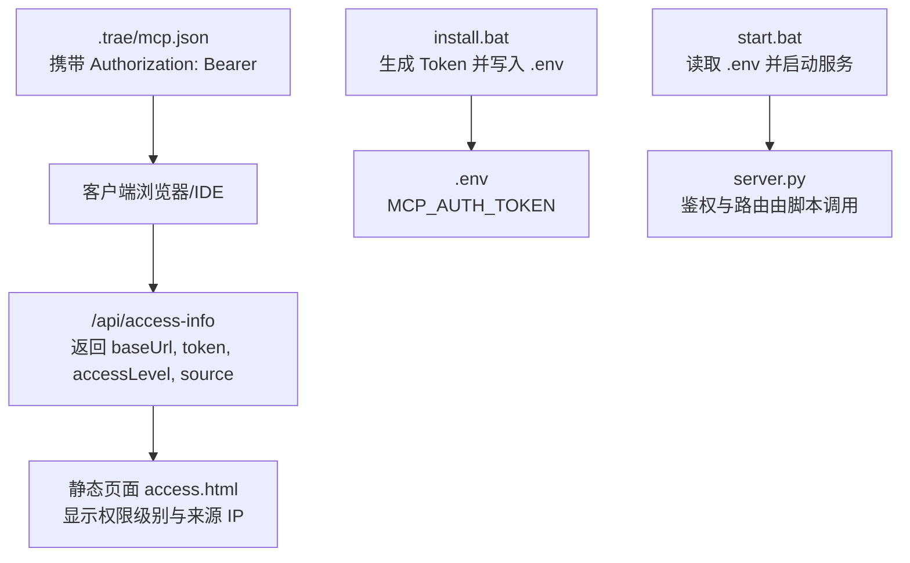
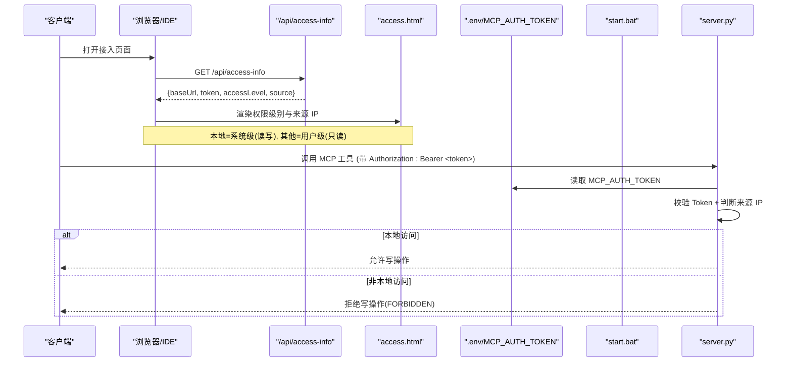
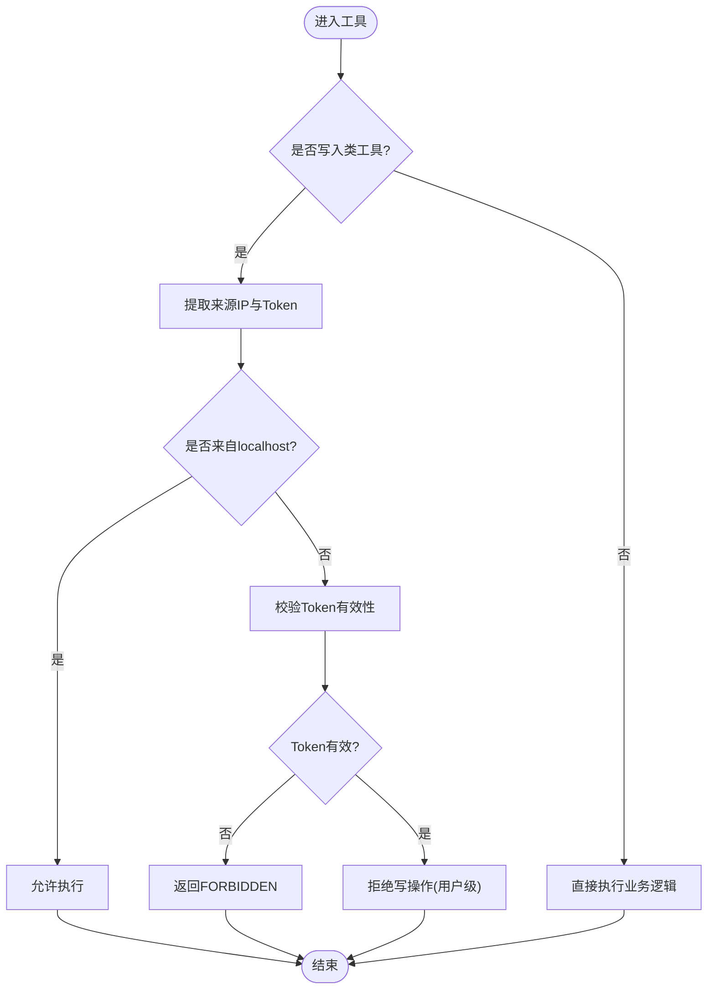
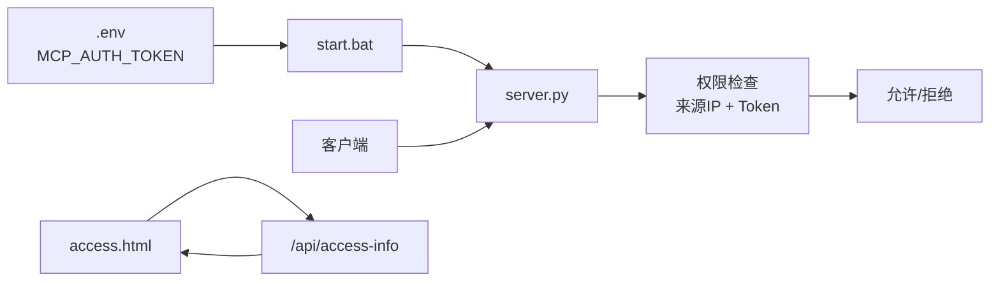

# 权限控制机制

<cite>
**本文引用的文件**
- [mcp_server\static\access.html](file://mcp_server/static/access.html)
- [mcp server部署.md](file://mcp server部署.md)
- [mcp_server\install.bat](file://mcp_server/install.bat)
- [mcp_server\start.bat](file://mcp_server/start.bat)
- [.trae\mcp.json](file://.trae/mcp.json)
- [规约管理MCP服务化Spec.md](file://规约管理MCP服务化Spec.md)
</cite>

## 目录
1. [简介](#简介)
2. [项目结构](#项目结构)
3. [核心组件](#核心组件)
4. [架构总览](#架构总览)
5. [详细组件分析](#详细组件分析)
6. [依赖关系分析](#依赖关系分析)
7. [性能考虑](#性能考虑)
8. [故障排查指南](#故障排查指南)
9. [结论](#结论)
10. [附录](#附录)

## 简介
本指南面向需要在 MCP Server 中实现或扩展权限控制的开发者，聚焦以下目标：
- 说明 Token 管理机制与访问来源（IP）如何共同决定权限级别。
- 解释 AUTH_TOKEN 环境变量的配置、校验与使用方式。
- 明确 localhost 与非 localhost 访问的权限差异，以及系统级与用户级权限的区别。
- 提供 _write_permission 检查函数的使用方法与自定义权限控制的扩展方式。
- 给出完整示例，帮助为新工具添加特定的权限检查逻辑。

## 项目结构
当前仓库中与权限控制直接相关的资源包括：
- 前端接入页面：用于展示服务器地址、Token、权限级别和来源 IP，并生成各 IDE 的接入配置。
- 启动脚本与环境变量：负责读取 .env 中的 MCP_AUTH_TOKEN，并在未设置时报错提示。
- 安装脚本：自动生成 Token、写入 .env 与 .trae/mcp.json。
- 部署文档：总结权限模型与安全注意事项。
- 规范文档：描述 Token 传递策略、写入类工具的标记与权限检查要求。

图表来源
- [mcp_server\static\access.html:401-431](file://mcp_server/static/access.html#L401-L431)
- [mcp_server\install.bat:52-71](file://mcp_server/install.bat#L52-L71)
- [mcp_server\start.bat:15-27](file://mcp_server/start.bat#L15-L27)
- [.trae\mcp.json:1-1](file://.trae/mcp.json#L1-L1)

章节来源
- [mcp_server\static\access.html:263-294](file://mcp_server/static/access.html#L263-L294)
- [mcp_server\install.bat:52-71](file://mcp_server/install.bat#L52-L71)
- [mcp_server\start.bat:15-27](file://mcp_server/start.bat#L15-L27)
- [mcp server部署.md:645-663](file://mcp server部署.md#L645-L663)

## 核心组件
- Token 管理
  - 通过 install.bat 自动生成或手动输入 MCP_AUTH_TOKEN，并写入 mcp_server/.env。
  - start.bat 在启动时从 .env 读取 MCP_AUTH_TOKEN；若未设置则中止启动并提示。
  - 客户端（如 Trae）通过 .trae/mcp.json 将 Authorization: Bearer <token> 随请求发送。
- 访问来源与权限级别
  - /api/access-info 返回 accessLevel 与 source（来源 IP）。
  - 本地访问（localhost）为系统级（读写），非本地访问为用户级（只读）。
  - 前端根据 accessLevel 动态显示“系统级（读写）”或“用户级（只读）”。
- 写入保护
  - 写入类工具需标记为 write，并在服务端进行系统级权限检查。
  - 普通用户调用写入工具应返回 FORBIDDEN；系统级用户可调用但仅返回后端实际结果。

章节来源
- [mcp_server\install.bat:52-71](file://mcp_server/install.bat#L52-L71)
- [mcp_server\start.bat:15-27](file://mcp_server/start.bat#L15-L27)
- [mcp_server\static\access.html:401-431](file://mcp_server/static/access.html#L401-L431)
- [规约管理MCP服务化Spec.md:1225-1236](file://规约管理MCP服务化Spec.md#L1225-L1236)

## 架构总览
下图展示了从客户端到服务端的关键鉴权与权限判定流程，涵盖 Token 验证、来源 IP 判断与权限级别输出。

图表来源
- [mcp_server\static\access.html:401-431](file://mcp_server/static/access.html#L401-L431)
- [mcp_server\start.bat:15-27](file://mcp_server/start.bat#L15-L27)
- [mcp server部署.md:645-663](file://mcp server部署.md#L645-L663)

## 详细组件分析

### Token 生成与存储（install.bat）
- 功能要点
  - 若用户未输入 Token，则自动生成形如 metam_pat_... 的随机令牌。
  - 将 Token 写入 mcp_server/.env 的 MCP_AUTH_TOKEN。
  - 同时更新 .trae/mcp.json，使 IDE 可直接以 Bearer Token 连接 MCP 端点。
- 安全建议
  - .env 不应提交至版本库。
  - 生产环境建议使用更安全的密钥管理方案。

章节来源
- [mcp_server\install.bat:52-71](file://mcp_server/install.bat#L52-L71)
- [mcp server部署.md:645-663](file://mcp server部署.md#L645-L663)

### Token 读取与服务启动（start.bat）
- 功能要点
  - 激活虚拟环境后，从 mcp_server/.env 解析 MCP_AUTH_TOKEN。
  - 若未设置，打印错误信息并退出，避免无鉴权的运行状态。
  - 启动 server.py 前确保已具备有效的 Token。
- 常见问题
  - 端口占用、虚拟环境失效等可参考部署文档。

章节来源
- [mcp_server\start.bat:15-27](file://mcp_server/start.bat#L15-L27)
- [mcp server部署.md:610-642](file://mcp server部署.md#L610-L642)

### 接入信息与权限展示（access.html）
- 功能要点
  - 页面加载时调用 /api/access-info，获取 baseUrl、token、accessLevel、source。
  - 根据 accessLevel 显示“系统级（读写）”或“用户级（只读）”。
  - 生成不同 IDE 的接入配置文本，便于一键复制与下载。
- 交互流程
  - 选择平台 → 生成配置 → 复制到剪贴板或下载 Markdown。

章节来源
- [mcp_server\static\access.html:401-431](file://mcp_server/static/access.html#L401-L431)
- [mcp_server\static\access.html:263-294](file://mcp_server/static/access.html#L263-L294)

### 权限模型与规则（部署文档与规范）
- 权限模型
  - localhost 访问：系统级，允许读写。
  - 其他 IP：用户级，仅允许只读。
- 写入类工具
  - 需要统一标记为 write，并在服务端执行系统级权限检查。
  - 普通用户调用写入工具应返回 FORBIDDEN。
- Token 传递
  - 登录返回 Token，后续工具调用需显式传入，保持无状态与透明性。

章节来源
- [mcp server部署.md:655-663](file://mcp server部署.md#L655-L663)
- [规约管理MCP服务化Spec.md:1225-1236](file://规约管理MCP服务化Spec.md#L1225-L1236)
- [规约管理MCP服务化Spec.md:30-42](file://规约管理MCP服务化Spec.md#L30-L42)

### 权限检查函数与自定义扩展（_write_permission）
- 设计目标
  - 对写入类工具进行统一的权限拦截，确保非系统级来源无法执行写操作。
- 推荐实现要点
  - 参数：工具名、请求上下文（包含来源 IP、Token、请求头等）。
  - 返回值：布尔或异常类型，表示是否允许继续执行。
  - 策略：
    - 若来源为 localhost，放行。
    - 否则，校验 Token 有效性；无效则拒绝。
    - 对于非 localhost，一律拒绝写操作。
- 扩展方式
  - 新增工具时，在注册阶段标注 write 属性。
  - 在工具入口调用 _write_permission 进行检查。
  - 如需更细粒度控制，可在 _write_permission 内部按工具名或资源维度做白名单/黑名单。

图表来源
- [规约管理MCP服务化Spec.md:1225-1236](file://规约管理MCP服务化Spec.md#L1225-L1236)
- [mcp server部署.md:655-663](file://mcp server部署.md#L655-L663)

### 新工具权限检查集成示例
- 步骤
  1. 在工具注册处为该工具标注 write 属性。
  2. 在工具函数入口处调用 _write_permission(request_context)。
  3. 若返回拒绝，统一返回 FORBIDDEN；否则继续执行业务逻辑。
  4. 在测试中覆盖：
     - 本地系统级用户调用写入工具成功。
     - 非本地用户调用写入工具被拒绝。
     - 查询工具在任何权限下均可调用。
- 注意事项
  - 不要在服务端自动重试失败的后端写操作，仅返回真实结果。
  - 查询失败不应伪装成“不存在”，需保留错误语义。

章节来源
- [规约管理MCP服务化Spec.md:1225-1236](file://规约管理MCP服务化Spec.md#L1225-L1236)

## 依赖关系分析
- 环境变量依赖
  - MCP_AUTH_TOKEN 必须存在且有效，否则服务无法启动。
- 前端依赖
  - access.html 依赖 /api/access-info 接口返回正确的权限信息。
- 客户端配置
  - .trae/mcp.json 中的 Authorization 头需携带正确 Token。

图表来源
- [mcp_server\start.bat:15-27](file://mcp_server/start.bat#L15-L27)
- [mcp_server\static\access.html:401-431](file://mcp_server/static/access.html#L401-L431)
- [mcp server部署.md:645-663](file://mcp server部署.md#L645-L663)

章节来源
- [mcp_server\start.bat:15-27](file://mcp_server/start.bat#L15-L27)
- [mcp_server\static\access.html:401-431](file://mcp_server/static/access.html#L401-L431)
- [mcp server部署.md:645-663](file://mcp server部署.md#L645-L663)

## 性能考虑
- 鉴权开销
  - Token 校验与来源 IP 判断应为轻量操作，避免阻塞事件循环。
- 并发与缓存
  - 若 Token 校验涉及外部服务，建议引入短期缓存以减少网络往返。
- 错误快速失败
  - 对非法 Token 或来源立即返回错误，减少后续处理成本。

[本节为通用指导，不直接分析具体文件]

## 故障排查指南
- 启动时报 MCP_AUTH_TOKEN not set
  - 确认已运行 install.bat 生成 .env，或手动设置 MCP_AUTH_TOKEN。
- 端口被占用
  - 查找并结束占用进程，或修改 server.py 中的端口号。
- 虚拟环境失效
  - 删除旧 .venv 并重新运行 install.bat。
- 权限级别不正确
  - 检查访问来源是否为 localhost；确认 /api/access-info 返回的 accessLevel 与 source。
- 写入操作被拒绝
  - 确认工具已标记为 write；检查 _write_permission 的实现是否符合预期。

章节来源
- [mcp_server\start.bat:15-27](file://mcp_server/start.bat#L15-L27)
- [mcp server部署.md:610-642](file://mcp server部署.md#L610-L642)
- [mcp_server\static\access.html:401-431](file://mcp_server/static/access.html#L401-L431)

## 结论
本权限控制机制通过 Token 与来源 IP 的组合判定，实现了本地系统级与远程用户级的差异化访问控制。配合写入类工具的统一标记与检查函数，可有效防止非授权写操作。建议在新增工具时遵循既定流程，确保权限一致性与安全性。

[本节为总结，不直接分析具体文件]

## 附录
- 关键环境变量
  - MCP_AUTH_TOKEN：MCP 服务鉴权令牌，存放于 mcp_server/.env。
- 关键接口
  - /api/access-info：返回 baseUrl、token、accessLevel、source，供前端展示与配置生成。
- 配置文件
  - .trae/mcp.json：客户端侧的 MCP 服务配置，包含 Authorization 头。

章节来源
- [mcp_server\install.bat:52-71](file://mcp_server/install.bat#L52-L71)
- [mcp_server\static\access.html:401-431](file://mcp_server/static/access.html#L401-L431)
- [.trae\mcp.json:1-1](file://.trae/mcp.json#L1-L1)