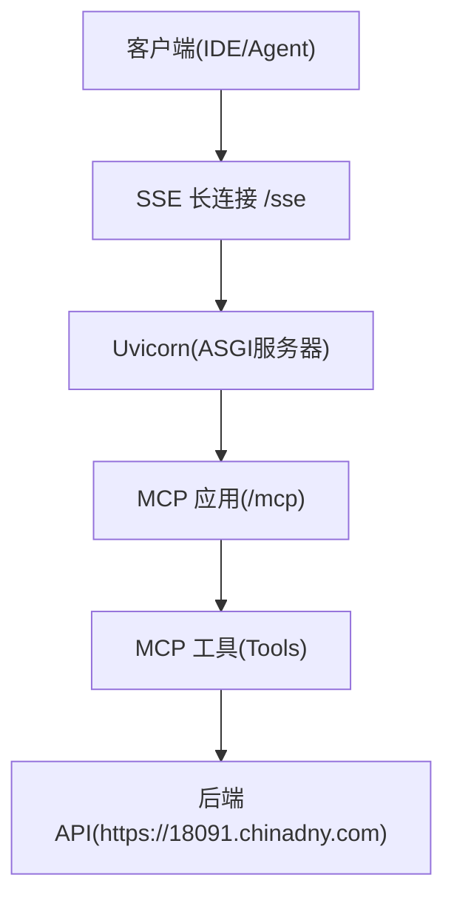
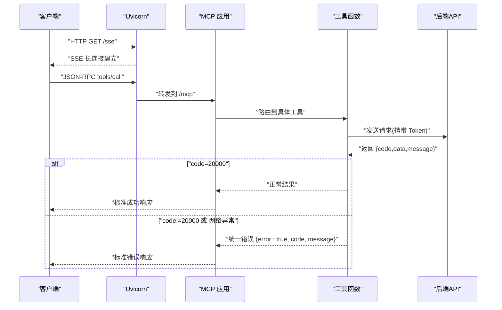
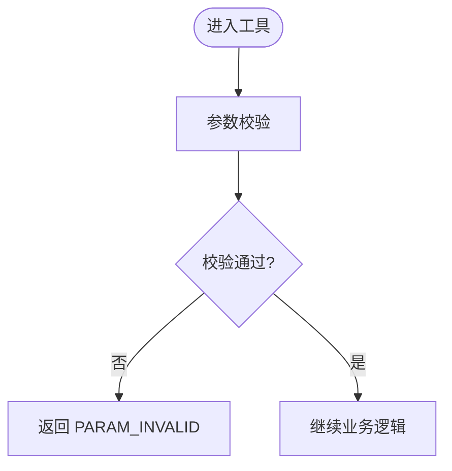
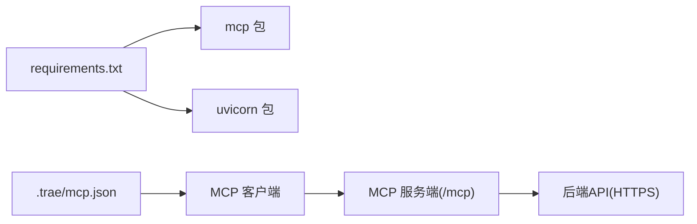

# 错误处理最佳实践

<cite>
**本文引用的文件**
- [规约管理MCP服务化Spec.md](file://规约管理MCP服务化Spec.md)
- [mcp server部署.md](file://mcp server部署.md)
- [requirements.txt](file://mcp_server/requirements.txt)
- [mcp.json](file://.trae/mcp.json)
</cite>

## 目录
1. [简介](#简介)
2. [项目结构](#项目结构)
3. [核心组件](#核心组件)
4. [架构总览](#架构总览)
5. [详细组件分析](#详细组件分析)
6. [依赖关系分析](#依赖关系分析)
7. [性能考虑](#性能考虑)
8. [故障排查指南](#故障排查指南)
9. [结论](#结论)
10. [附录](#附录)

## 简介
本指南面向 MCP 工具的错误处理，目标是统一错误响应格式、规范错误码与消息、覆盖参数校验、业务逻辑与外部服务调用三类错误，并给出异常捕获与日志记录的最佳实践。同时提供常见错误场景（权限不足、数据不存在、网络超时等）的处理示例，以及友好的错误消息设计原则与监控告警建议，帮助快速定位问题并提升用户体验。

## 项目结构
本项目为基于 MCP 协议的服务端，通过 Uvicorn 启动 ASGI 应用，暴露 /sse 与 /mcp 端点；Skill 侧通过 MCP 客户端连接后调用工具函数。当前仓库包含：
- 服务端运行说明与部署脚本文档
- MCP 客户端配置（Token 注入）
- 依赖声明
- 规约管理与 API 映射的规格文档（含错误处理策略）

图表来源
- [mcp server部署.md:185-260](file://mcp server部署.md#L185-L260)
- [mcp server部署.md:74-79](file://mcp server部署.md#L74-L79)

章节来源
- [mcp server部署.md:185-260](file://mcp server部署.md#L185-L260)
- [mcp server部署.md:74-79](file://mcp server部署.md#L74-L79)

## 核心组件
- 客户端配置：通过 .trae/mcp.json 指定 MCP 服务端地址与鉴权头（Authorization）。
- 服务端运行：Uvicorn 作为 ASGI 服务器承载 MCP 应用，提供 /sse 与 /mcp 端点。
- 工具层：MCP 工具负责参数校验、调用后端 API、统一错误封装与返回。
- 后端 API：统一响应结构 { code, data, message }，成功码为 20000，登录失效 40100，业务异常 40000。

章节来源
- [mcp.json:1-1](file://.trae/mcp.json#L1-L1)
- [mcp server部署.md:74-79](file://mcp server部署.md#L74-L79)
- [规约管理MCP服务化Spec.md:327-335](file://规约管理MCP服务化Spec.md#L327-L335)

## 架构总览
下图展示一次工具调用的端到端流程，包括错误在何处产生、如何被捕获与标准化返回。

图表来源
- [mcp server部署.md:185-260](file://mcp server部署.md#L185-L260)
- [规约管理MCP服务化Spec.md:123-130](file://规约管理MCP服务化Spec.md#L123-L130)
- [规约管理MCP服务化Spec.md:327-335](file://规约管理MCP服务化Spec.md#L327-L335)

## 详细组件分析

### 统一错误响应格式
- 字段约定
  - error: 布尔值，表示是否出错
  - code: 字符串或数字错误码，用于分类与机器判断
  - message: 面向用户的友好提示，中文为主，必要时附带关键上下文
- 推荐扩展字段
  - raw: 原始响应体（调试用，生产环境谨慎输出）
  - trace_id: 追踪ID（便于跨链路排查）
  - details: 结构化细节（如字段级校验失败列表）

章节来源
- [规约管理MCP服务化Spec.md:123-130](file://规约管理MCP服务化Spec.md#L123-L130)

### 参数验证错误
- 触发点：工具入口对必填字段、类型、取值范围进行校验
- 错误码建议：PARAM_INVALID
- 消息设计：明确指出缺失或非法字段及期望格式，避免模糊描述
- 处理流程
  - 校验失败 → 构造 {error:true, code:"PARAM_INVALID", message} → 直接返回
  - 不继续调用后端，减少无效网络开销

图表来源
- [规约管理MCP服务化Spec.md:327-335](file://规约管理MCP服务化Spec.md#L327-L335)

### 业务逻辑错误
- 触发点：后端返回非 20000（例如 40000），或工具内部业务规则校验失败
- 错误码建议：BUSINESS_ERROR
- 消息设计：结合业务语义，告知用户操作为何失败，可附带必要上下文（如资源ID）
- 处理流程
  - 收到后端非 20000 → 提取 message → 包装为 {error:true, code:"BUSINESS_ERROR", message}
  - 可选附加 raw 字段用于调试

章节来源
- [规约管理MCP服务化Spec.md:123-130](file://规约管理MCP服务化Spec.md#L123-L130)
- [规约管理MCP服务化Spec.md:327-335](file://规约管理MCP服务化Spec.md#L327-L335)

### 外部服务调用错误
- 触发点：网络异常、HTTP 状态码异常、超时、DNS 解析失败等
- 错误码建议：NETWORK_ERROR、HTTP_ERROR
- 消息设计：区分网络层与HTTP层错误，提示重试或检查网络/域名/证书
- 处理流程
  - 捕获异常 → 分类为 NETWORK_ERROR 或 HTTP_ERROR → 返回统一错误结构
  - 对超时设置合理阈值（参考 httpx 默认/自定义 timeout）

章节来源
- [规约管理MCP服务化Spec.md:123-130](file://规约管理MCP服务化Spec.md#L123-L130)

### 鉴权与权限错误
- 触发点：Token 无效/过期（后端 40100）、无访问权限
- 错误码建议：AUTH_ERROR
- 消息设计：明确提示“请重新登录”或“权限不足”，引导下一步操作
- 处理流程
  - 检测到 40100 → 返回 AUTH_ERROR 并提示刷新 Token
  - 权限不足 → 返回 AUTH_ERROR 并说明受限操作

章节来源
- [规约管理MCP服务化Spec.md:123-130](file://规约管理MCP服务化Spec.md#L123-L130)
- [规约管理MCP服务化Spec.md:327-335](file://规约管理MCP服务化Spec.md#L327-L335)

### 异常捕获与日志记录最佳实践
- 捕获范围
  - 工具入口：参数校验、业务分支、外部调用
  - 外部调用：网络层、HTTP层、序列化/反序列化
- 日志级别
  - ERROR：不可恢复错误（网络失败、认证失败、后端异常）
  - WARN：可恢复但需关注（重试、降级、限流）
  - INFO：关键路径节点（开始/结束、耗时、关键ID）
- 日志内容
  - 固定字段：trace_id、tool_name、user_id（脱敏）、request_id
  - 敏感信息：禁止记录密码、完整Token、个人身份信息
- 结构化日志
  - JSON 格式，便于采集与分析
  - 包含错误码、错误消息、堆栈摘要（仅开发/测试环境）

[本节为通用实践指导，不直接分析具体文件]

### 常见错误场景与处理示例
- 权限不足
  - 现象：后端返回 40100 或权限拒绝
  - 处理：返回 AUTH_ERROR，message 提示“权限不足，请联系管理员”
- 数据不存在
  - 现象：查询不到目标资源
  - 处理：返回 BUSINESS_ERROR，message 提示“未找到指定资源，请确认ID是否正确”
- 网络超时
  - 现象：请求超时或连接失败
  - 处理：返回 NETWORK_ERROR，message 提示“网络请求超时，请稍后重试”
- 后端业务异常
  - 现象：后端返回 40000
  - 处理：返回 BUSINESS_ERROR，message 使用后端提供的业务提示

[本节为通用实践指导，不直接分析具体文件]

### 友好的错误消息设计
- 清晰准确：指出具体问题与位置（字段名、资源ID）
- 可操作：给出下一步建议（重试、检查输入、联系支持）
- 本地化：默认中文，必要时保留英文技术术语
- 去噪：隐藏内部实现细节，仅暴露必要上下文
- 一致性：同类错误采用统一前缀与句式

[本节为通用实践指导，不直接分析具体文件]

### 错误监控与告警建议
- 指标采集
  - 错误率：按 tool_name、code 维度统计
  - 延迟分布：P50/P95/P99
  - 外部依赖健康度：后端可用性、超时率
- 告警规则
  - 错误率突增（如 >5%）
  - 超时率升高（如 >2%）
  - 认证失败集中出现（可能遭攻击或配置错误）
- 采集与可视化
  - 日志平台：ELK/Loki
  - 指标平台：Prometheus + Grafana
  - 链路追踪：OpenTelemetry（trace_id 贯穿）

[本节为通用实践指导，不直接分析具体文件]

## 依赖关系分析
- 运行时依赖
  - mcp：定义工具、资源、提示词与协议处理
  - uvicorn：ASGI 服务器，承载 MCP 应用
- 客户端配置
  - .trae/mcp.json：指定 MCP 服务端 URL 与鉴权头（Authorization）
- 后端接口
  - 统一响应结构与错误码约定（20000/40100/40000）

图表来源
- [requirements.txt:1-3](file://mcp_server/requirements.txt#L1-L3)
- [mcp.json:1-1](file://.trae/mcp.json#L1-L1)
- [mcp server部署.md:74-79](file://mcp server部署.md#L74-L79)

章节来源
- [requirements.txt:1-3](file://mcp_server/requirements.txt#L1-L3)
- [mcp.json:1-1](file://.trae/mcp.json#L1-L1)
- [mcp server部署.md:74-79](file://mcp server部署.md#L74-L79)

## 性能考虑
- 超时与重试
  - 为外部请求设置合理超时（httpx 默认或自定义）
  - 幂等操作可加有限重试与退避策略
- 连接复用
  - 使用异步客户端连接池，减少握手开销
- 错误快速失败
  - 参数校验失败立即返回，避免无效网络请求
- 日志开销
  - 生产环境降低日志级别，避免高频INFO影响吞吐

[本节为通用实践指导，不直接分析具体文件]

## 故障排查指南
- 常见问题
  - Python 版本过低或未安装
  - 虚拟环境创建失败
  - 依赖安装失败（网络问题）
  - 端口占用导致启动失败
  - Token 未配置或无效
- 排查步骤
  - 检查 Python 版本与环境变量
  - 确认 .venv 存在且已激活
  - 查看 requirements.txt 安装日志
  - 使用 netstat 查找占用端口并释放
  - 检查 .env 中的 MCP_AUTH_TOKEN 与 .trae/mcp.json 的 Authorization
- 日志定位
  - 收集 trace_id 与错误码
  - 核对工具名称与请求参数
  - 复现最小用例并抓取前后端日志

章节来源
- [mcp server部署.md:505-631](file://mcp server部署.md#L505-L631)

## 结论
通过统一的错误响应格式、清晰的错误码与消息规范、完善的异常捕获与日志记录，以及监控告警体系，可以显著提升 MCP 工具的稳定性与可维护性。建议在工具层集中处理参数校验、业务逻辑与外部调用三类错误，确保错误信息对用户友好、对系统可观测。

## 附录
- 后端 API 通用约定
  - 所有接口 POST，统一响应 { code, data, message }
  - 成功码 20000，登录失效 40100，业务异常 40000
- 客户端鉴权
  - 通过 Authorization: Bearer <token> 传递令牌

章节来源
- [规约管理MCP服务化Spec.md:327-335](file://规约管理MCP服务化Spec.md#L327-L335)
- [mcp.json:1-1](file://.trae/mcp.json#L1-L1)