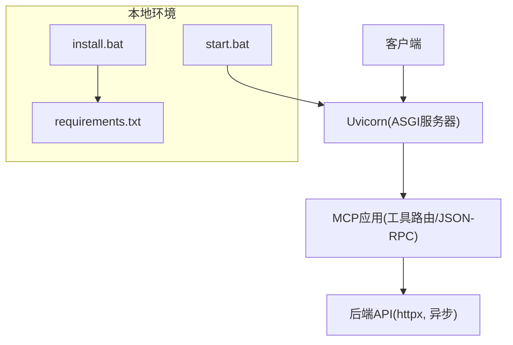
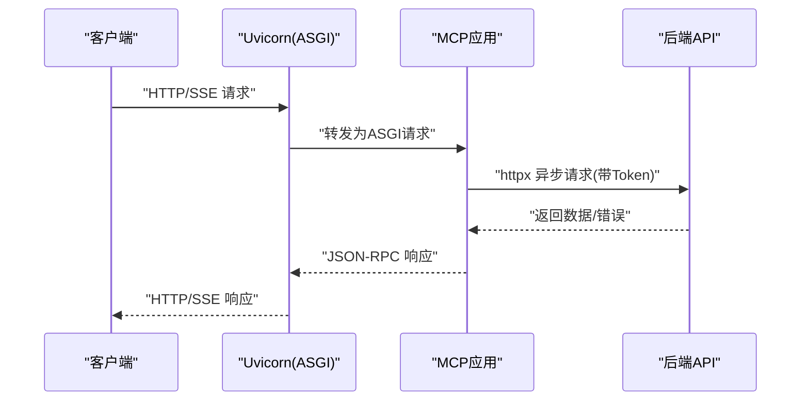
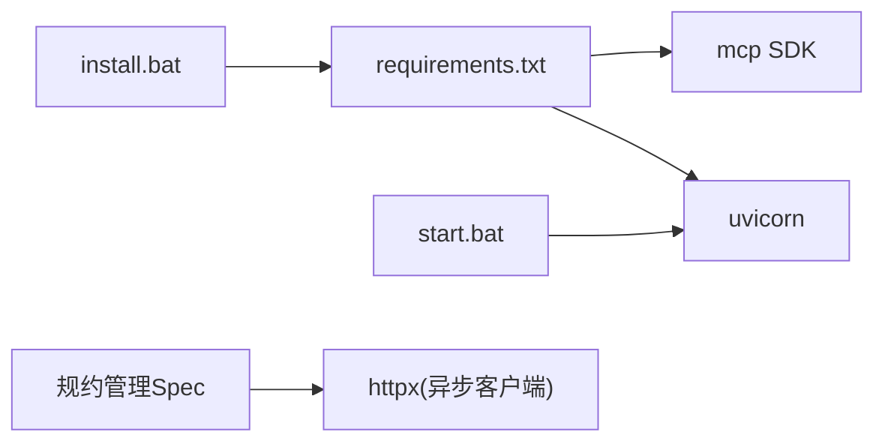

# 性能测试与优化

<cite>
**本文引用的文件**
- [requirements.txt](file://mcp_server/requirements.txt)
- [install.bat](file://mcp_server/install.bat)
- [start.bat](file://mcp_server/start.bat)
- [mcp server部署.md](file://mcp server部署.md)
- [规约管理MCP服务化Spec.md](file://规约管理MCP服务化Spec.md)
</cite>

## 目录
1. [简介](#简介)
2. [项目结构](#项目结构)
3. [核心组件](#核心组件)
4. [架构总览](#架构总览)
5. [详细组件分析](#详细组件分析)
6. [依赖关系分析](#依赖关系分析)
7. [性能考虑](#性能考虑)
8. [故障排查指南](#故障排查指南)
9. [结论](#结论)
10. [附录](#附录)

## 简介
本指南面向 PCA MCP Server 的性能测试与优化，覆盖负载测试方法（Locust、JMeter）、压力测试策略（极限负载、内存泄漏检测、CPU 监控）、性能基准测试（基线建立与配置对比）、性能分析工具（cProfile、memory_profiler）以及生产环境的性能监控与告警。文档同时结合项目现有依赖与启动方式，给出可落地的实践建议。

## 项目结构
本项目采用“脚本 + 文档”的轻量组织形式：
- mcp_server/requirements.txt：声明运行依赖（MCP SDK、Uvicorn）。
- mcp_server/install.bat、start.bat：Windows 一键安装与启动流程。
- mcp server部署.md：详细说明 MCP 与 Uvicorn 的工作原理、ASGI 协议、并发模型与常见问题。
- 规约管理MCP服务化Spec.md：规划了 MCP 工具与后端 API 的映射关系，涉及异步 HTTP 客户端等设计要点。

图表来源
- [mcp server部署.md:82-107](file://mcp server部署.md#L82-L107)
- [mcp server部署.md:163-279](file://mcp server部署.md#L163-L279)
- [规约管理MCP服务化Spec.md:79-121](file://规约管理MCP服务化Spec.md#L79-L121)

章节来源
- [requirements.txt:1-2](file://mcp_server/requirements.txt#L1-L2)
- [install.bat:1-85](file://mcp_server/install.bat#L1-L85)
- [start.bat:1-41](file://mcp_server/start.bat#L1-L41)
- [mcp server部署.md:82-107](file://mcp server部署.md#L82-L107)
- [mcp server部署.md:163-279](file://mcp server部署.md#L163-L279)
- [规约管理MCP服务化Spec.md:79-121](file://规约管理MCP服务化Spec.md#L79-L121)

## 核心组件
- 运行时依赖
  - MCP SDK：提供工具注册、JSON-RPC 处理与 SSE 支持。
  - Uvicorn：高性能 ASGI 服务器，基于 uvloop/httptools，适合高并发 I/O 场景。
- 启动与部署
  - install.bat：创建虚拟环境、安装依赖、生成 Token、写入配置文件。
  - start.bat：激活虚拟环境、读取 Token、打印启动信息并执行 server.py。
- 协议与并发
  - ASGI 协议：异步请求/响应模型，利于并发处理。
  - SSE 长连接：用于实时消息推送。
- 业务扩展点
  - 规约管理 Spec 中定义了通过 httpx 异步调用后端 API 的设计，为后续性能优化（连接池、超时、重试）提供基础。

章节来源
- [requirements.txt:1-2](file://mcp_server/requirements.txt#L1-L2)
- [mcp server部署.md:82-107](file://mcp server部署.md#L82-L107)
- [mcp server部署.md:163-279](file://mcp server部署.md#L163-L279)
- [规约管理MCP服务化Spec.md:79-121](file://规约管理MCP服务化Spec.md#L79-L121)

## 架构总览
下图展示了从客户端到 MCP 应用再到后端 API 的完整链路，以及 Uvicorn 在其中的角色。

图表来源
- [mcp server部署.md:163-279](file://mcp server部署.md#L163-L279)
- [规约管理MCP服务化Spec.md:79-121](file://规约管理MCP服务化Spec.md#L79-L121)

## 详细组件分析

### 负载测试方法（Locust/JMeter）
- 目标
  - 评估 MCP 服务器的吞吐量（TPS/QPS）与响应时间（P50/P95/P99）。
  - 验证 SSE 长连接稳定性与 JSON-RPC over HTTP 的吞吐能力。
- 推荐方案
  - Locust：适合 Python 生态，编写用户行为脚本模拟并发；便于集成 cProfile 做热点分析。
  - JMeter：图形化压测，适合多协议混合场景（HTTP+SSE），便于生成报告与阈值告警。
- 关键指标
  - 请求成功率、平均/分位响应时间、QPS/TPS、错误率、资源使用（CPU/内存/网络）。
- 执行步骤（概念性）
  - 准备：确保服务已启动，Token 可用，端口可达。
  - 构建用例：登录获取 Token → 调用工具列表 → 批量调用典型工具（读/写）。
  - 设定并发：逐步增加用户数，观察拐点（瓶颈点）。
  - 采集指标：服务端日志、系统指标、APM 指标。
  - 回归对比：不同配置下对比基线。

[本节为通用方法论，不直接分析具体代码文件]

### 压力测试策略（极限负载、内存泄漏、CPU 监控）
- 极限负载
  - 逐步加压至系统或下游 API 限制，记录最大稳定 QPS 与延迟分布。
  - 关注连接池耗尽、线程/协程阻塞、下游限流/熔断。
- 内存泄漏检测
  - 使用 memory_profiler 对关键路径进行采样，定位持续增长的对象。
  - 结合进程级内存曲线（RSS/WS）判断是否存在泄漏。
- CPU 使用率监控
  - 使用 cProfile 统计函数耗时，识别热点。
  - 配合系统监控（如 Windows 任务管理器、Prometheus Node Exporter）观察 CPU 占用。

[本节为通用方法论，不直接分析具体代码文件]

### 性能基准测试（建立基线与配置对比）
- 基线定义
  - 固定硬件、Python 版本、依赖版本、并发模型、网络条件。
  - 选择代表性用例集（登录、查询、写入、导出等）。
- 对比维度
  - Uvicorn 参数（workers、backlog、keepalive）。
  - 连接池大小、超时、重试策略。
  - 缓存命中率、I/O 并发度。
- 输出物
  - 基线报告（含 P50/P95/P99、错误率、资源使用）。
  - 变更对比（差异显著性检验）。

[本节为通用方法论，不直接分析具体代码文件]

### 性能分析工具使用（cProfile、memory_profiler）
- cProfile
  - 用法：在入口或关键函数处启用，收集调用次数与耗时。
  - 解读：定位最耗时的函数与调用链，优先优化热点。
- memory_profiler
  - 用法：对关键函数加装饰器，输出逐行内存变化。
  - 解读：发现异常增长对象、重复创建的大对象、未释放的资源。
- 结合压测
  - 在压测过程中开启分析，捕获峰值阶段的热点与内存特征。

[本节为通用方法论，不直接分析具体代码文件]

### 连接池配置、缓存策略、异步处理优化
- 连接池
  - 使用 httpx.AsyncClient 时合理设置连接池大小、超时、重试。
  - 避免过多连接导致下游拥塞或本机资源耗尽。
- 缓存
  - 对只读接口引入缓存（内存/Redis），降低重复计算与下游压力。
  - 注意缓存一致性、过期策略与失效机制。
- 异步优化
  - 保持 I/O 操作非阻塞，避免同步调用阻塞事件循环。
  - 控制并发度，防止下游被压垮。

章节来源
- [规约管理MCP服务化Spec.md:79-121](file://规约管理MCP服务化Spec.md#L79-L121)

### 生产环境的性能监控与告警
- 监控指标
  - 应用层：QPS、错误率、P95/P99 延迟、SSE 连接数。
  - 系统层：CPU、内存、磁盘 I/O、网络带宽。
  - 依赖层：下游 API 延迟、错误率、连接池状态。
- 告警规则
  - 错误率突增、延迟超过阈值、连接池耗尽、内存持续增长。
- 落地建议
  - 接入 APM/日志系统，统一采集与可视化。
  - 结合反向代理（Nginx/Ingress）与进程管理器（Gunicorn+Uvicorn）提升稳定性。

[本节为通用方法论，不直接分析具体代码文件]

## 依赖关系分析
- 外部依赖
  - mcp：提供 MCP 协议实现与工具注册。
  - uvicorn：ASGI 服务器，承载高并发请求。
- 内部脚本
  - install.bat：负责环境初始化与 Token 配置。
  - start.bat：负责加载环境变量并启动服务。
- 业务扩展
  - 规约管理 Spec 中引入 httpx 异步客户端，为后续性能优化奠定基础。

图表来源
- [requirements.txt:1-2](file://mcp_server/requirements.txt#L1-L2)
- [install.bat:1-85](file://mcp_server/install.bat#L1-L85)
- [start.bat:1-41](file://mcp_server/start.bat#L1-L41)
- [规约管理MCP服务化Spec.md:79-121](file://规约管理MCP服务化Spec.md#L79-L121)

章节来源
- [requirements.txt:1-2](file://mcp_server/requirements.txt#L1-L2)
- [install.bat:1-85](file://mcp_server/install.bat#L1-L85)
- [start.bat:1-41](file://mcp_server/start.bat#L1-L41)
- [规约管理MCP服务化Spec.md:79-121](file://规约管理MCP服务化Spec.md#L79-L121)

## 性能考虑
- 并发模型
  - Uvicorn 基于异步事件循环，适合 I/O 密集型场景；需确保业务逻辑不阻塞事件循环。
- 资源上限
  - 合理设置 workers、连接池大小、超时与重试，避免资源耗尽。
- 下游依赖
  - 对后端 API 增加超时、重试与熔断，避免雪崩。
- 观测性
  - 完善日志与指标采集，快速定位瓶颈。

[本节为通用指导，不直接分析具体代码文件]

## 故障排查指南
- 常见启动问题
  - 虚拟环境未创建或路径错误：按提示重新运行安装脚本。
  - Token 未配置：检查 .env 是否生成或手动设置。
  - 端口占用：查找并结束占用进程，或修改端口。
- 性能相关问题
  - 高延迟：检查下游 API 延迟、连接池、缓存命中率。
  - 内存增长：使用 memory_profiler 定位泄漏点。
  - CPU 飙升：使用 cProfile 定位热点函数。

章节来源
- [mcp server部署.md:505-642](file://mcp server部署.md#L505-L642)

## 结论
PCA MCP Server 基于 MCP SDK 与 Uvicorn 构建，具备高并发与异步处理能力。通过规范的负载与压力测试、完善的性能分析与监控告警，可有效保障服务的稳定性与性能。建议在后续实现中重点优化连接池、缓存与异步 I/O，并建立持续的性能基线与回归流程。

[本节为总结性内容，不直接分析具体代码文件]

## 附录
- 快速命令参考
  - 首次安装：运行安装脚本
  - 启动服务：运行启动脚本
  - 停止服务：中断进程
  - 手动激活虚拟环境：执行激活脚本
  - 手动启动服务：直接执行入口脚本

章节来源
- [mcp server部署.md:677-686](file://mcp server部署.md#L677-L686)