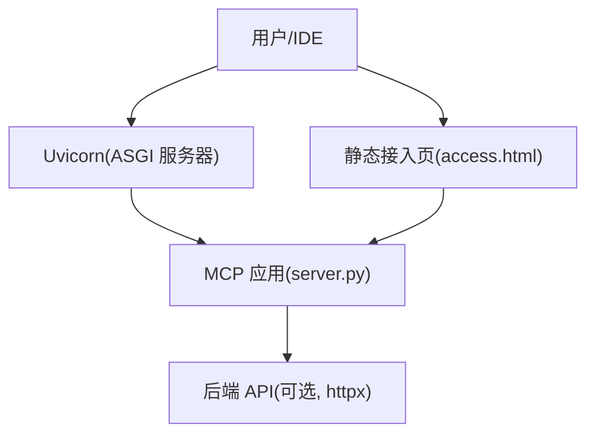
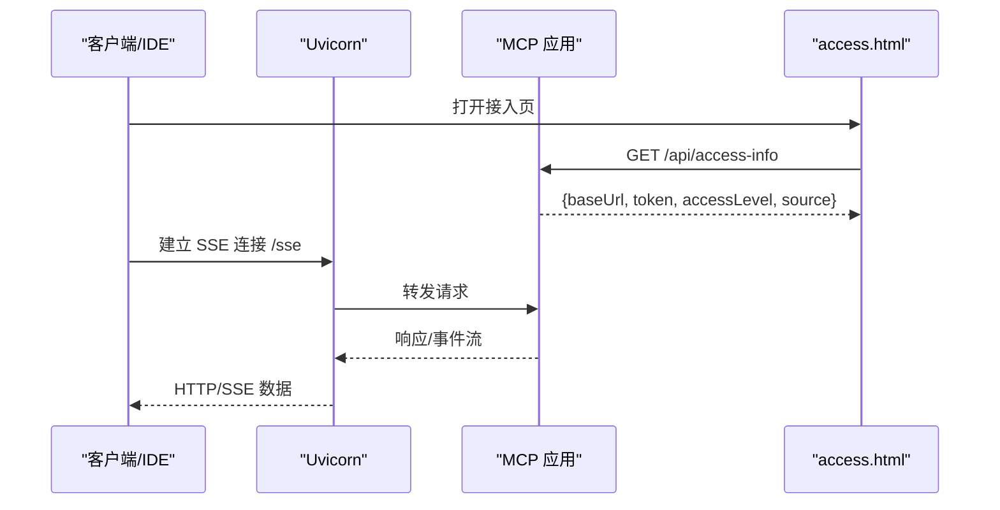
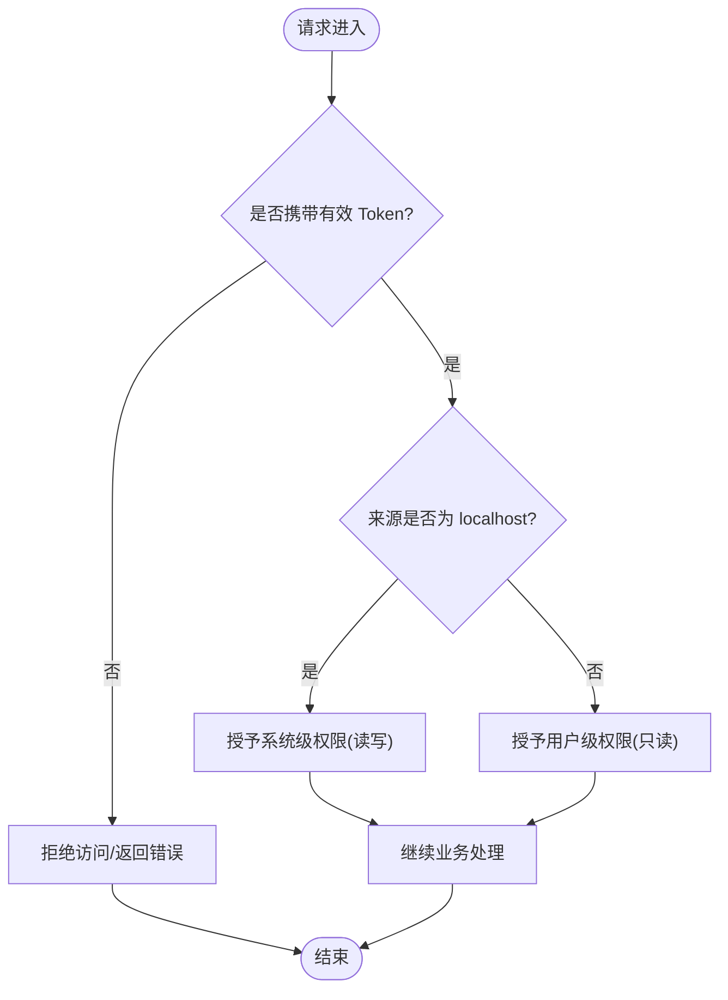
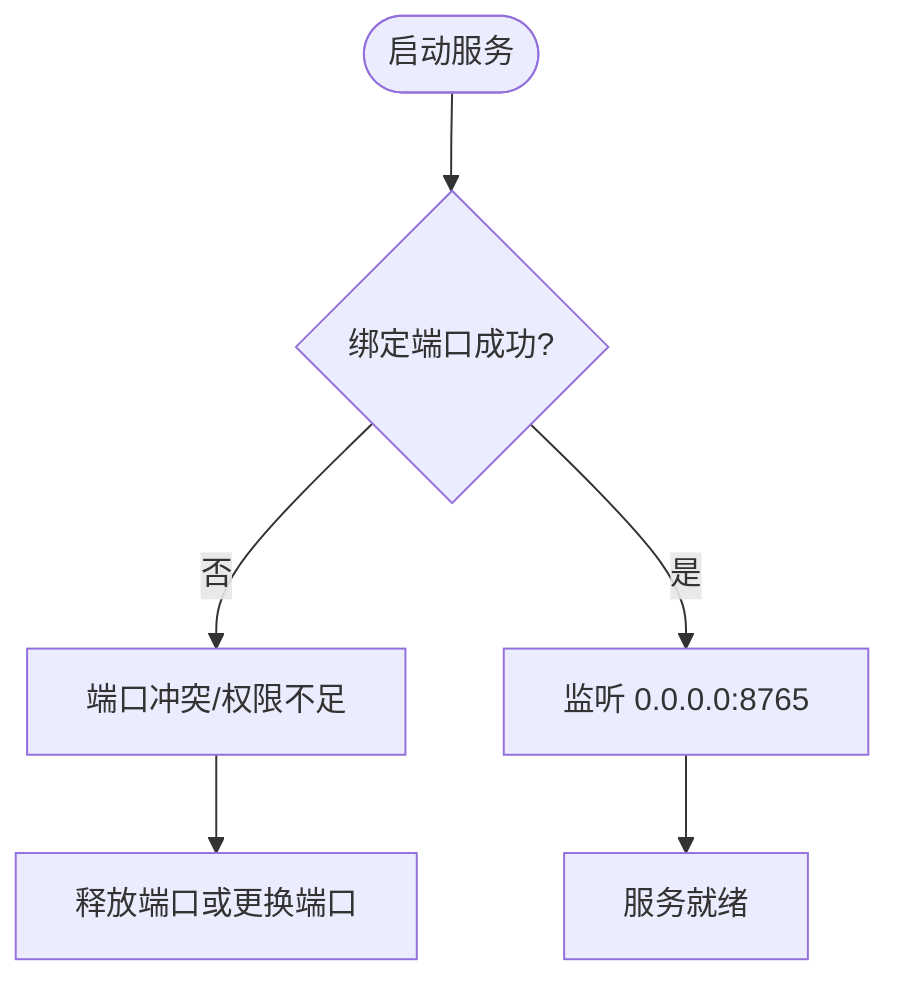
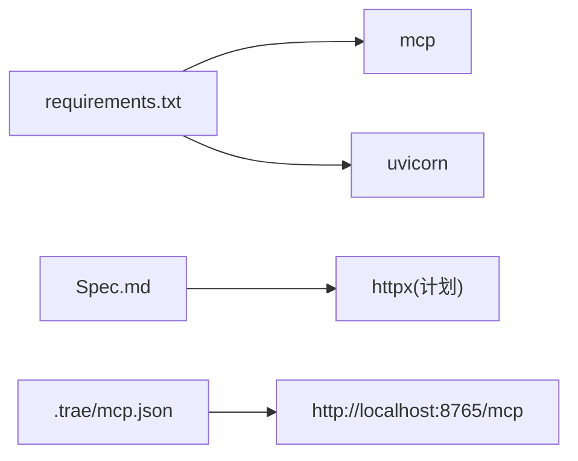

# 故障排除指南

<cite>
**本文引用的文件**
- [mcp_server/requirements.txt](file://mcp_server/requirements.txt)
- [mcp server部署.md](file://mcp server部署.md)
- [规约管理MCP服务化Spec.md](file://规约管理MCP服务化Spec.md)
- [mcp_server/install.bat](file://mcp_server/install.bat)
- [mcp_server/start.bat](file://mcp_server/start.bat)
- [.trae/mcp.json](file://.trae/mcp.json)
- [mcp_server/static/access.html](file://mcp_server/static/access.html)
</cite>

## 目录
1. [简介](#简介)
2. [项目结构](#项目结构)
3. [核心组件](#核心组件)
4. [架构总览](#架构总览)
5. [详细组件分析](#详细组件分析)
6. [依赖关系分析](#依赖关系分析)
7. [性能注意事项](#性能注意事项)
8. [故障排查指南](#故障排查指南)
9. [结论](#结论)
10. [附录](#附录)

## 简介
本指南面向 PCA MCP Server 的运维与开发团队，聚焦认证失败、网络连接异常、性能问题等常见故障的诊断与修复；提供日志分析方法、调试工具使用技巧、系统级问题（Docker、环境变量、依赖版本）排查步骤；并给出问题上报模板与恢复流程。内容基于仓库中的部署文档、脚本与前端接入页面信息整理而成。

## 项目结构
- 运行依赖：Python 包 mcp、uvicorn，由 requirements.txt 声明。
- 启动与安装：install.bat 负责创建虚拟环境、安装依赖、生成 Token 并写入 .env 与 .trae/mcp.json；start.bat 激活虚拟环境、读取 Token、启动 server.py。
- 客户端配置：.trae/mcp.json 指定 MCP 服务端点与鉴权头。
- 接入页：static/access.html 提供一键接入生成器，自动检测服务器地址、Token、权限级别与来源 IP，并输出多 IDE 的配置文本。

图表来源
- [mcp server部署.md:110-262](file://mcp server部署.md#L110-L262)
- [mcp_server/static/access.html:401-417](file://mcp_server/static/access.html#L401-L417)

章节来源
- [mcp_server/requirements.txt:1-3](file://mcp_server/requirements.txt#L1-L3)
- [mcp server部署.md:283-501](file://mcp server部署.md#L283-L501)
- [mcp_server/install.bat:1-85](file://mcp_server/install.bat#L1-L85)
- [mcp_server/start.bat:1-41](file://mcp_server/start.bat#L1-L41)
- [.trae/mcp.json:1-1](file://.trae/mcp.json#L1-L1)
- [mcp_server/static/access.html:241-318](file://mcp_server/static/access.html#L241-L318)

## 核心组件
- Uvicorn：高性能 ASGI 服务器，负责网络层、协议解析、连接管理。
- MCP 应用：实现协议路由、工具调用、资源管理与 JSON-RPC 消息处理。
- 认证中间件：基于 Token 的身份校验，区分本地系统级与远程用户级权限。
- 接入页：自动生成各 IDE 的 MCP 配置与下载 Skills 包的链接。

章节来源
- [mcp server部署.md:110-160](file://mcp server部署.md#L110-L160)
- [mcp server部署.md:163-262](file://mcp server部署.md#L163-L262)
- [mcp_server/static/access.html:263-318](file://mcp_server/static/access.html#L263-L318)

## 架构总览
请求从客户端经 Uvicorn 进入 MCP 应用，再根据路径路由到具体工具或资源；SSE 长连接用于实时通信；静态接入页通过 /api/access-info 获取服务器信息与 Token，辅助快速接入。

图表来源
- [mcp server部署.md:185-262](file://mcp server部署.md#L185-L262)
- [mcp_server/static/access.html:401-417](file://mcp_server/static/access.html#L401-L417)

## 详细组件分析

### 认证与权限
- 认证方式：Token 鉴权，支持本地系统级读写与远程用户级只读。
- 配置文件：install.bat 生成 .env 与 .trae/mcp.json，start.bat 读取 .env 中的 Token 并打印启动信息。
- 接入页：显示当前访问来源 IP、权限级别与 Token，便于验证认证状态。

图表来源
- [mcp server部署.md:645-674](file://mcp server部署.md#L645-L674)
- [mcp_server/install.bat:52-72](file://mcp_server/install.bat#L52-L72)
- [mcp_server/start.bat:15-27](file://mcp_server/start.bat#L15-L27)
- [mcp_server/static/access.html:263-318](file://mcp_server/static/access.html#L263-L318)

章节来源
- [mcp server部署.md:645-674](file://mcp server部署.md#L645-L674)
- [mcp_server/install.bat:52-72](file://mcp_server/install.bat#L52-L72)
- [mcp_server/start.bat:15-27](file://mcp_server/start.bat#L15-L27)
- [.trae/mcp.json:1-1](file://.trae/mcp.json#L1-L1)

### 网络与端口
- 默认监听端口：8765（可通过 server.py 修改）。
- 常见问题：端口被占用导致绑定失败；防火墙限制外部访问。
- 诊断要点：查看 Uvicorn 启动日志、操作系统端口占用情况、防火墙规则。

图表来源
- [mcp server部署.md:610-631](file://mcp server部署.md#L610-L631)

章节来源
- [mcp server部署.md:610-631](file://mcp server部署.md#L610-L631)

### 性能与并发
- 模型：Uvicorn 基于异步事件循环，适合高并发 I/O 场景。
- 关注点：避免阻塞调用、合理设置超时、监控内存与 CPU 使用率。
- 建议：对后端 API 调用采用异步客户端（如 httpx），避免同步阻塞事件循环。

章节来源
- [mcp server部署.md:265-280](file://mcp server部署.md#L265-L280)
- [规约管理MCP服务化Spec.md:38-41](file://规约管理MCP服务化Spec.md#L38-L41)

## 依赖关系分析
- 运行时依赖：mcp、uvicorn，版本范围在 requirements.txt 中约束。
- 扩展依赖：规划中引入 httpx 作为异步 HTTP 客户端，用于调用后端 API。
- 客户端配置：.trae/mcp.json 指向 MCP 端点与鉴权头。

图表来源
- [mcp_server/requirements.txt:1-3](file://mcp_server/requirements.txt#L1-L3)
- [规约管理MCP服务化Spec.md:287-293](file://规约管理MCP服务化Spec.md#L287-L293)
- [.trae/mcp.json:1-1](file://.trae/mcp.json#L1-L1)

章节来源
- [mcp_server/requirements.txt:1-3](file://mcp_server/requirements.txt#L1-L3)
- [规约管理MCP服务化Spec.md:287-293](file://规约管理MCP服务化Spec.md#L287-L293)
- [.trae/mcp.json:1-1](file://.trae/mcp.json#L1-L1)

## 性能注意事项
- 使用异步 I/O：确保所有网络请求为异步，避免阻塞事件循环。
- 控制超时：为外部 API 设置合理的超时时间，防止长时间挂起。
- 资源复用：复用连接池，减少握手开销。
- 监控指标：关注进程内存、CPU、线程/协程数量与请求延迟。

[本节为通用指导，不直接分析具体文件]

## 故障排查指南

### 一、认证失败问题
- 症状
  - 客户端无法连接或返回鉴权错误。
  - 接入页显示权限级别不符合预期。
- 可能原因
  - Token 未配置或无效。
  - 客户端配置的 Authorization 头不正确。
  - 来源 IP 非 localhost 导致仅只读权限。
- 诊断步骤
  - 检查 .env 是否存在且包含 MCP_AUTH_TOKEN。
  - 检查 .trae/mcp.json 中 url 与 headers 是否正确。
  - 通过接入页查看 source 与 accessLevel。
- 解决方案
  - 重新运行 install.bat 生成 Token，或手动设置 MCP_AUTH_TOKEN。
  - 修正客户端配置中的 URL 与 Authorization 头。
  - 如需写入操作，请在服务器本地访问或使用具备系统级权限的环境。

章节来源
- [mcp_server/install.bat:52-72](file://mcp_server/install.bat#L52-L72)
- [mcp_server/start.bat:15-27](file://mcp_server/start.bat#L15-L27)
- [mcp_server/static/access.html:263-318](file://mcp_server/static/access.html#L263-L318)
- [mcp server部署.md:645-674](file://mcp server部署.md#L645-L674)

### 二、网络连接问题
- 症状
  - 启动时报端口绑定失败。
  - 客户端无法访问 /sse 或 /mcp。
- 可能原因
  - 端口 8765 被其他进程占用。
  - 防火墙或安全组阻止入站流量。
  - 绑定地址配置不当。
- 诊断步骤
  - 查看 Uvicorn 启动日志中的错误信息。
  - 使用系统命令查找占用端口的进程并终止或更换端口。
  - 检查防火墙规则与容器端口映射。
- 解决方案
  - 释放占用进程或修改 server.py 中的监听端口。
  - 开放必要端口并确保反向代理/容器映射正确。

章节来源
- [mcp server部署.md:610-631](file://mcp server部署.md#L610-L631)

### 三、性能问题
- 症状
  - 响应缓慢、CPU 占用过高、内存持续增长。
- 可能原因
  - 同步阻塞调用占用了事件循环。
  - 外部 API 超时或连接泄漏。
  - 大量 SSE 连接未正确关闭。
- 诊断步骤
  - 观察 Uvicorn 日志与系统资源监控。
  - 检查是否有同步网络调用或大对象常驻内存。
  - 使用网络抓包确认请求/响应是否正常。
- 解决方案
  - 将同步调用改为异步（如使用 httpx.AsyncClient）。
  - 设置合理的超时与重试策略，及时释放连接。
  - 优化数据处理逻辑，避免不必要的复制与大对象。

章节来源
- [mcp server部署.md:265-280](file://mcp server部署.md#L265-L280)
- [规约管理MCP服务化Spec.md:38-41](file://规约管理MCP服务化Spec.md#L38-L41)

### 四、日志分析方法
- 日志级别配置
  - 调整 Uvicorn 日志级别以捕获更详细的请求与错误信息。
  - 在应用层记录关键路径与异常堆栈。
- 错误信息解读
  - 关注端口绑定错误、网络异常、业务错误码。
  - 结合接入页返回的 auth 字段定位认证与权限问题。
- 堆栈跟踪分析
  - 收集 Python 异常堆栈，定位阻塞点与资源泄漏。
  - 结合时间戳与请求 ID 关联上下游日志。

章节来源
- [mcp server部署.md:163-262](file://mcp server部署.md#L163-L262)
- [mcp_server/static/access.html:401-417](file://mcp_server/static/access.html#L401-L417)

### 五、调试工具使用技巧
- 网络抓包
  - 使用 Wireshark/tcpdump 抓取 /sse 与 /mcp 的请求与响应，验证头部与内容。
- 内存分析
  - 使用内存分析工具（如 memory_profiler）定位增长热点。
- 线程/协程状态检查
  - 使用 async 调试工具查看事件循环任务队列与阻塞点。

[本节为通用指导，不直接分析具体文件]

### 六、系统级问题排查
- Docker 容器问题
  - 检查容器端口映射、环境变量注入与卷挂载。
  - 确认容器内能访问外部 API，必要时配置代理。
- 环境变量配置
  - 确保 .env 存在且 MCP_AUTH_TOKEN 已设置。
  - 启动脚本会读取 .env 并打印 Token，便于核对。
- 依赖版本冲突
  - 使用虚拟环境隔离依赖，按 requirements.txt 安装。
  - 若升级依赖，注意兼容性与行为变更。

章节来源
- [mcp_server/install.bat:26-48](file://mcp_server/install.bat#L26-L48)
- [mcp_server/start.bat:7-13](file://mcp_server/start.bat#L7-L13)
- [mcp_server/requirements.txt:1-3](file://mcp_server/requirements.txt#L1-L3)

### 七、问题上报模板
- 基本信息
  - 服务版本、部署环境（本地/容器）、操作系统与 Python 版本。
- 问题描述
  - 现象、发生频率、影响范围。
- 复现步骤
  - 最小化复现用例与输入参数。
- 日志与证据
  - Uvicorn 日志片段、接入页截图、网络抓包文件。
- 期望结果与实际结果
  - 明确对比差异。
- 临时缓解措施
  - 已尝试的修复与效果。

[本节为通用模板，不直接分析具体文件]

### 八、故障恢复流程
- 快速止血
  - 重启服务、回滚配置或依赖版本。
- 根因定位
  - 依据日志与抓包定位问题模块。
- 修复与验证
  - 修复后在测试环境验证，逐步上线。
- 复盘与改进
  - 更新文档与告警规则，避免同类问题复发。

[本节为通用流程，不直接分析具体文件]

## 结论
本指南围绕认证、网络、性能三大类问题提供了可操作的诊断与修复步骤，并结合项目中的安装与启动脚本、接入页与部署文档，给出了系统级问题的排查方法。建议在生产环境中完善日志与监控，强化依赖与环境管理，以降低故障概率与恢复时间。

## 附录
- 快速命令参考
  - 首次安装：运行 install.bat
  - 启动服务：运行 start.bat
  - 停止服务：Ctrl+C
  - 手动激活虚拟环境：运行 .venv\Scripts\activate.bat
  - 退出虚拟环境：deactivate
  - 手动启动服务：python mcp_server\server.py

章节来源
- [mcp server部署.md:677-687](file://mcp server部署.md#L677-L687)