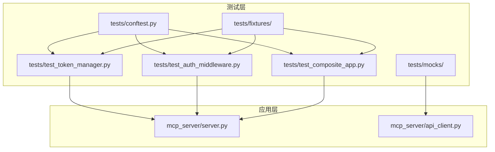
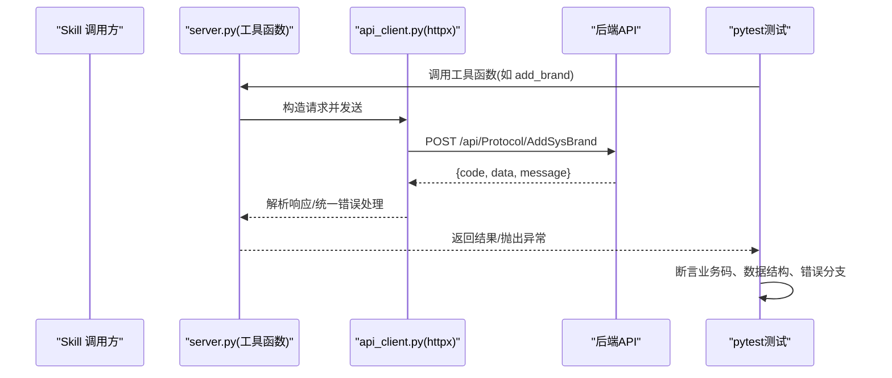
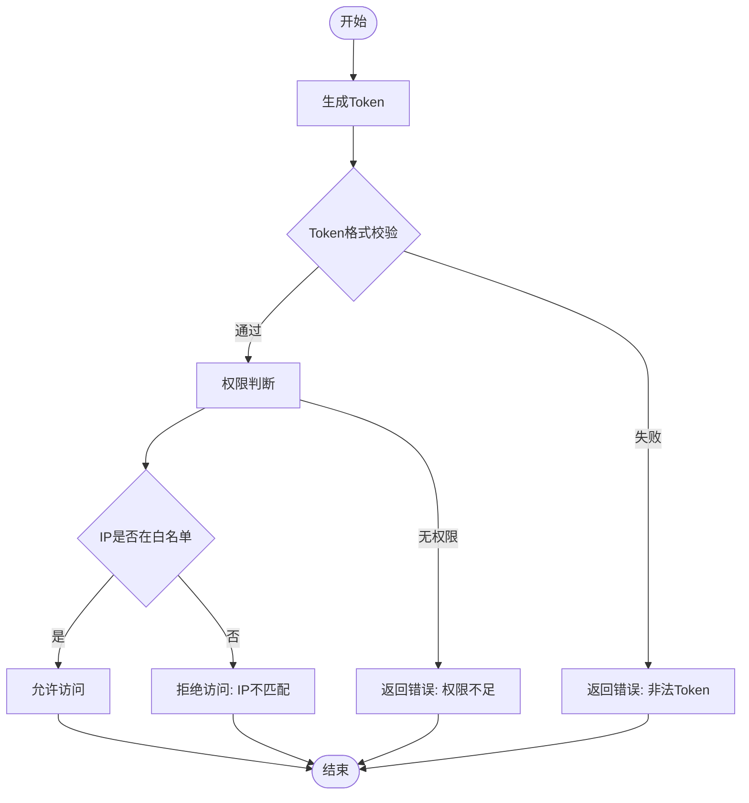
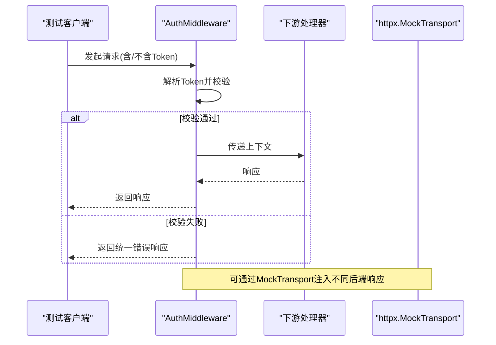
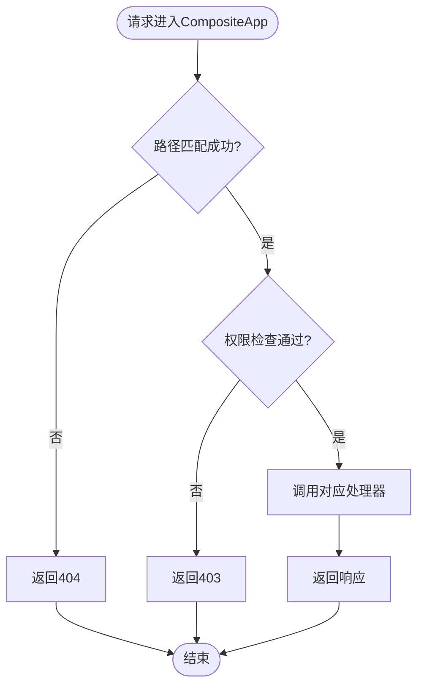
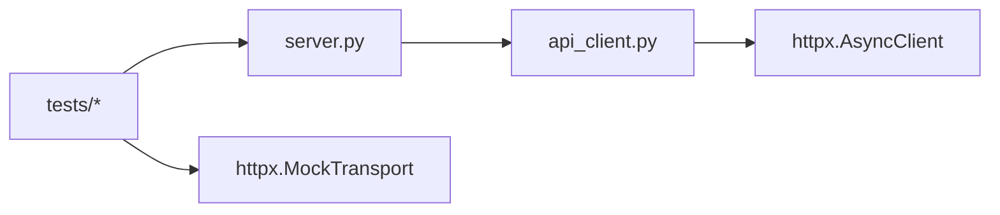

# 单元测试框架

<cite>
**本文引用的文件**
- [requirements.txt](file://mcp_server/requirements.txt)
- [规约管理MCP服务化Spec.md](file://规约管理MCP服务化Spec.md)
- [规约管理基础数据模块Spec.md](file://规约管理基础数据模块Spec.md)
- [test_protocol_converter.py](file://.trae/skills/protocol-conversion/scripts/test_protocol_converter.py)
- [gen_test_report.py](file://.trae/skills/protocol-conversion/scripts/gen_test_report.py)
</cite>

## 目录
1. [简介](#简介)
2. [项目结构](#项目结构)
3. [核心组件](#核心组件)
4. [架构总览](#架构总览)
5. [详细组件分析](#详细组件分析)
6. [依赖分析](#依赖分析)
7. [性能考虑](#性能考虑)
8. [故障排查指南](#故障排查指南)
9. [结论](#结论)
10. [附录](#附录)

## 简介
本文件为“规约管理 MCP 服务”的单元测试框架文档，目标是在当前仓库基础上，系统化地搭建 pytest 测试环境、组织测试目录与用例，并围绕以下核心组件提供可执行的单测方案：
- TokenManager：Token 生成验证、权限判断、IP 关联
- AuthMiddleware：鉴权逻辑、请求拦截、错误响应
- CompositeApp：路由路径匹配、权限控制
同时覆盖 mock 策略（外部 API、文件系统、网络请求）、测试数据准备与清理机制，以及正常流程与异常场景的用例设计。

## 项目结构
当前仓库包含服务端规范与脚本工具，尚未包含 Python 源代码与测试代码。基于 Spec 描述，后续应新增 server.py、api_client.py 等实现，并在 mcp_server 下组织测试。建议的测试目录结构如下：
- tests/
  - conftest.py：全局夹具、pytest 配置、Mock 初始化
  - test_token_manager.py：TokenManager 单测
  - test_auth_middleware.py：AuthMiddleware 单测
  - test_composite_app.py：CompositeApp 路由与权限单测
  - fixtures/：测试数据与夹具
  - mocks/：HTTP、文件系统、时间等 Mock 实现
- mcp_server/
  - requirements.txt：运行依赖（已存在）
  - server.py：待实现的 MCP 工具注册与 ASGI 路由
  - api_client.py：待实现的后端 API 封装（httpx 异步）

图表来源
- [requirements.txt:1-3](file://mcp_server/requirements.txt#L1-L3)
- [规约管理MCP服务化Spec.md:44-66](file://规约管理MCP服务化Spec.md#L44-L66)

章节来源
- [requirements.txt:1-3](file://mcp_server/requirements.txt#L1-L3)
- [规约管理MCP服务化Spec.md:44-66](file://规约管理MCP服务化Spec.md#L44-L66)

## 核心组件
本节聚焦三大被测组件的单测要点与用例设计思路，结合 Spec 中定义的鉴权方式、API 约定与错误码进行覆盖。

- TokenManager
  - 目标：验证 Token 生成规则、权限判定逻辑、IP 绑定校验
  - 关键断言点：
    - Token 格式符合 32 位大写十六进制
    - 权限判断基于角色/资源映射
    - IP 白名单或黑名单命中时拒绝访问
  - 异常场景：非法输入、过期 Token、缺失权限、IP 不匹配

- AuthMiddleware
  - 目标：在 ASGI 中间件中完成鉴权、拦截未授权请求、返回统一错误响应
  - 关键断言点：
    - 请求头 Token 注入与校验
    - 对受保护路由的拦截与放行
    - 错误响应结构与状态码符合约定
  - 异常场景：缺少 Token、Token 无效、后端返回非 20000、网络异常

- CompositeApp
  - 目标：路由路径匹配、权限控制、工具列表暴露
  - 关键断言点：
    - 路径正则/前缀匹配正确
    - 权限不足时返回 403
    - list_mcp_tools 返回完整工具清单
  - 异常场景：未知路由、权限不足、参数缺失

章节来源
- [规约管理MCP服务化Spec.md:68-131](file://规约管理MCP服务化Spec.md#L68-L131)
- [规约管理MCP服务化Spec.md:247-286](file://规约管理MCP服务化Spec.md#L247-L286)

## 架构总览
下图展示 Skill 调用 MCP 工具到后端 API 的端到端流程，以及测试如何在此流程中进行 Mock 与断言。

图表来源
- [规约管理MCP服务化Spec.md:56-66](file://规约管理MCP服务化Spec.md#L56-L66)
- [规约管理MCP服务化Spec.md:123-131](file://规约管理MCP服务化Spec.md#L123-L131)

## 详细组件分析

### TokenManager 单元测试
- 测试目标
  - Token 生成：长度、字符集、唯一性
  - 权限判断：基于角色/资源的决策
  - IP 关联：白名单/黑名单命中与拒绝
- 用例设计
  - 正常流程：生成合法 Token；具备权限的请求通过；IP 在白名单内通过
  - 异常场景：非法输入；Token 过期；无权限；IP 不在白名单
- Mock 策略
  - 使用 unittest.mock.patch 替换时间、随机数、配置读取
  - 使用 pytest-mock 简化 fixture 中的 mock 注入
- 数据准备与清理
  - 使用临时目录存放 Token 缓存（若涉及持久化）
  - 每个用例前后重置状态，避免共享状态污染

图表来源
- [规约管理MCP服务化Spec.md:68-78](file://规约管理MCP服务化Spec.md#L68-L78)

章节来源
- [规约管理MCP服务化Spec.md:68-78](file://规约管理MCP服务化Spec.md#L68-L78)

### AuthMiddleware 单元测试
- 测试目标
  - 鉴权逻辑：从请求头提取 Token 并校验
  - 请求拦截：对受保护路由进行拦截
  - 错误响应：统一错误结构与状态码
- 用例设计
  - 正常流程：携带有效 Token 的请求通过
  - 异常场景：缺少 Token；Token 无效；后端返回非 20000；网络异常
- Mock 策略
  - 使用 httpx.MockTransport 模拟后端响应
  - 使用 pytest 的 monkeypatch 替换环境变量或配置
- 数据准备与清理
  - 构造最小化的请求对象（ASGI scope + receive/send）
  - 确保每次测试后关闭 Mock 客户端连接

图表来源
- [规约管理MCP服务化Spec.md:123-131](file://规约管理MCP服务化Spec.md#L123-L131)

章节来源
- [规约管理MCP服务化Spec.md:123-131](file://规约管理MCP服务化Spec.md#L123-L131)

### CompositeApp 单元测试
- 测试目标
  - 路径匹配：路由前缀/精确匹配是否正确
  - 权限控制：无权限时返回 403
  - 工具列表：list_mcp_tools 返回完整清单
- 用例设计
  - 正常流程：匹配到的路由返回预期结果；工具列表包含所有工具
  - 异常场景：未知路由返回 404；权限不足返回 403；参数缺失返回 400
- Mock 策略
  - 使用 pytest 的 monkeypatch 替换路由表或权限表
  - 使用 httpx.MockTransport 模拟后端接口
- 数据准备与清理
  - 构造最小化的路由上下文
  - 每个用例独立注册/注销路由，避免交叉影响

图表来源
- [规约管理MCP服务化Spec.md:247-286](file://规约管理MCP服务化Spec.md#L247-L286)

章节来源
- [规约管理MCP服务化Spec.md:247-286](file://规约管理MCP服务化Spec.md#L247-L286)

## 依赖分析
- 运行依赖
  - mcp、uvicorn：服务运行所需
  - httpx：异步 HTTP 客户端（用于 api_client.py）
- 测试依赖（建议）
  - pytest、pytest-asyncio、pytest-mock、httpx[http2]（用于 Mock 传输）
  - coverage（覆盖率统计）
- 依赖关系图

图表来源
- [requirements.txt:1-3](file://mcp_server/requirements.txt#L1-L3)
- [规约管理MCP服务化Spec.md:79-121](file://规约管理MCP服务化Spec.md#L79-L121)

章节来源
- [requirements.txt:1-3](file://mcp_server/requirements.txt#L1-L3)
- [规约管理MCP服务化Spec.md:79-121](file://规约管理MCP服务化Spec.md#L79-L121)

## 性能考虑
- 使用 httpx.MockTransport 替代真实网络请求，减少 I/O 开销
- 批量构造测试数据，减少重复创建成本
- 合理拆分异步测试，避免阻塞事件循环
- 使用 pytest-xdist 并行执行测试（注意隔离状态）

## 故障排查指南
- 常见问题
  - 网络超时：检查 Mock 响应是否及时返回
  - 权限错误：确认 Token 与权限映射是否正确
  - 路由不匹配：检查路径前缀与参数命名
- 调试技巧
  - 打印请求/响应体，定位问题环节
  - 使用 pytest -v 查看详细输出
  - 针对特定用例添加断言日志

章节来源
- [规约管理MCP服务化Spec.md:123-131](file://规约管理MCP服务化Spec.md#L123-L131)

## 结论
通过系统化的 pytest 环境搭建、清晰的测试目录组织、完善的 Mock 策略与数据管理，可以为 TokenManager、AuthMiddleware、CompositeApp 提供高覆盖率的单元测试。结合 Spec 中定义的鉴权方式、API 约定与错误码，能够稳定覆盖正常流程与异常场景，保障服务质量与可维护性。

## 附录

### pytest 环境搭建与配置
- 安装依赖
  - 安装运行依赖：参考 requirements.txt
  - 安装测试依赖：pytest、pytest-asyncio、pytest-mock、httpx[http2]、coverage
- 配置文件
  - pytest.ini 或 pyproject.toml：定义测试发现规则、异步支持、插件配置
  - conftest.py：集中管理夹具、全局 Mock、数据库/文件临时目录
- 测试目录组织
  - tests/ 下按组件划分测试文件，fixtures/ 存放测试数据，mocks/ 存放通用 Mock

章节来源
- [requirements.txt:1-3](file://mcp_server/requirements.txt#L1-L3)

### 测试数据准备与清理机制
- 数据准备
  - 使用 fixtures 提供标准化测试数据（Token、用户信息、路由表）
  - 使用临时目录存储文件上传/导出结果
- 清理机制
  - 每个用例结束后清理临时文件与 Mock 状态
  - 使用 pytest 的 yield fixture 实现资源释放

章节来源
- [规约管理MCP服务化Spec.md:56-66](file://规约管理MCP服务化Spec.md#L56-L66)

### Mock 策略详解
- 外部 API 调用模拟
  - 使用 httpx.MockTransport 注入不同响应（成功、业务错误、网络异常）
- 文件系统操作模拟
  - 使用 pathlib 与 tempfile 创建虚拟文件，避免真实磁盘写入
- 网络请求模拟
  - 使用 requests_mock 或 httpx 的 Mock 能力，屏蔽真实网络

章节来源
- [规约管理MCP服务化Spec.md:79-121](file://规约管理MCP服务化Spec.md#L79-L121)

### 现有测试脚本参考
- 报告生成脚本
  - gen_test_report.py：解析 unittest 输出并生成 JSON 报告
- 测试入口
  - test_protocol_converter.py：示例测试模块，可作为 pytest 用例编写参考

章节来源
- [gen_test_report.py:1-88](file://.trae/skills/protocol-conversion/scripts/gen_test_report.py#L1-L88)
- [test_protocol_converter.py:1-200](file://.trae/skills/protocol-conversion/scripts/test_protocol_converter.py#L1-L200)