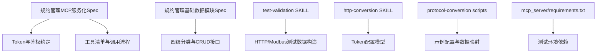
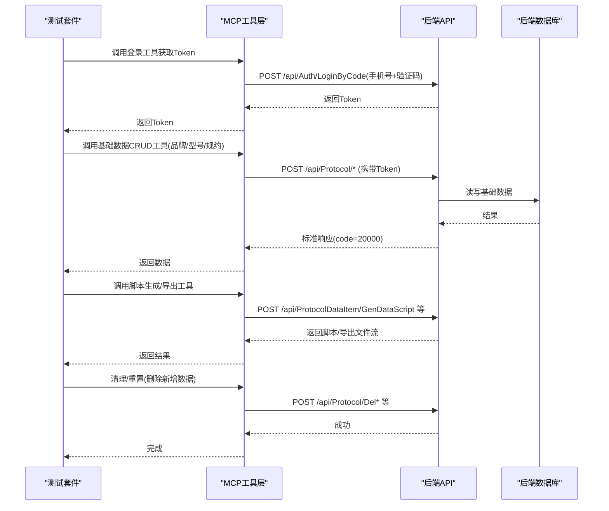
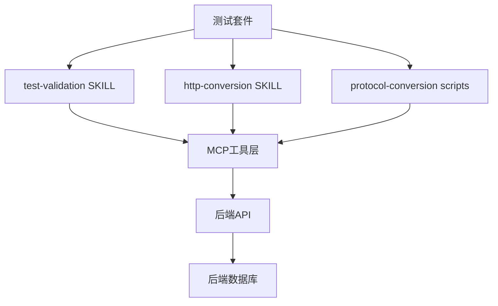

# 测试数据管理

<cite>
**本文引用的文件**
- [规约管理MCP服务化Spec.md](file://规约管理MCP服务化Spec.md)
- [规约管理基础数据模块Spec.md](file://规约管理基础数据模块Spec.md)
- [.trae/skills/test-validation/SKILL.md](file://.trae/skills/test-validation/SKILL.md)
- [.trae/skills/http-conversion/SKILL.md](file://.trae/skills/http-conversion/SKILL.md)
- [.trae/skills/protocol-conversion/scripts/test_protocol_converter.py](file://.trae/skills/protocol-conversion/scripts/test_protocol_converter.py)
- [mcp_server/requirements.txt](file://mcp_server/requirements.txt)
</cite>

## 目录
1. [简介](#简介)
2. [项目结构](#项目结构)
3. [核心组件](#核心组件)
4. [架构总览](#架构总览)
5. [详细组件分析](#详细组件分析)
6. [依赖关系分析](#依赖关系分析)
7. [性能考量](#性能考量)
8. [故障排查指南](#故障排查指南)
9. [结论](#结论)
10. [附录](#附录)

## 简介
本文件面向“规约管理 MCP 服务化”项目的测试数据管理，目标是建立一套可复用、可隔离、可版本化的测试数据体系，覆盖：
- 固定测试数据文件与动态生成策略
- 测试数据库（后端 API）的初始化与清理
- Token 测试数据管理（管理员、用户、过期场景）
- 规约管理基础数据的准备（品牌型号、协议配置、脚本模板）
- 测试数据隔离、版本管理与迁移方案
- 测试后清理与重置机制，确保环境整洁

## 项目结构
本项目当前仓库包含 MCP Server 规范文档、基础数据模块规范以及若干 Skill 能力说明。测试数据相关的关键位置如下：
- 规约管理 MCP 服务化 Spec：定义了鉴权方式、Token 传递、错误处理策略、工具清单与典型调用流程，是构建测试数据与用例的基础依据。
- 规约管理基础数据模块 Spec：定义了四级分类层级（大类→设备类型→品牌→型号→规约信息），以及各页面的 CRUD 接口，用于构造稳定的基础测试数据。
- test-validation Skill：提供 HTTP 专项测试与 Modbus 专项测试的校验项、构造模拟输入数据的方法与执行验证流程，指导如何准备正常/边界/异常测试数据。
- http-conversion Skill：定义 Token 配置字段（登录路径、Header、有效期等），为 Token 测试数据提供统一配置模型。
- protocol-conversion scripts：提供示例配置片段（含 token 配置、API 列表、body_params、data_mappings），可作为动态测试数据生成的参考模板。
- mcp_server/requirements.txt：列出运行时依赖，便于在测试环境中安装必要库以运行测试。

图表来源
- [规约管理MCP服务化Spec.md:123-148](file://规约管理MCP服务化Spec.md#L123-L148)
- [规约管理基础数据模块Spec.md:1-16](file://规约管理基础数据模块Spec.md#L1-L16)
- [.trae/skills/test-validation/SKILL.md:54-131](file://.trae/skills/test-validation/SKILL.md#L54-L131)
- [.trae/skills/http-conversion/SKILL.md:45-57](file://.trae/skills/http-conversion/SKILL.md#L45-L57)
- [.trae/skills/protocol-conversion/scripts/test_protocol_converter.py:644-671](file://.trae/skills/protocol-conversion/scripts/test_protocol_converter.py#L644-L671)
- [mcp_server/requirements.txt:1-3](file://mcp_server/requirements.txt#L1-L3)

章节来源
- [规约管理MCP服务化Spec.md:123-148](file://规约管理MCP服务化Spec.md#L123-L148)
- [规约管理基础数据模块Spec.md:1-16](file://规约管理基础数据模块Spec.md#L1-L16)
- [.trae/skills/test-validation/SKILL.md:54-131](file://.trae/skills/test-validation/SKILL.md#L54-L131)
- [.trae/skills/http-conversion/SKILL.md:45-57](file://.trae/skills/http-conversion/SKILL.md#L45-L57)
- [.trae/skills/protocol-conversion/scripts/test_protocol_converter.py:644-671](file://.trae/skills/protocol-conversion/scripts/test_protocol_converter.py#L644-L671)
- [mcp_server/requirements.txt:1-3](file://mcp_server/requirements.txt#L1-L3)

## 核心组件
围绕测试数据管理的核心组件包括：
- 鉴权与 Token 管理：基于 MCP Spec 中定义的 Token 传递方式与错误处理策略，结合 http-conversion Skill 的 Token 配置模型，形成统一的认证测试数据基线。
- 基础数据准备：依据基础数据模块 Spec 中的四级分类与 CRUD 接口，准备品牌、型号、规约信息等稳定测试数据。
- 测试数据构造与验证：使用 test-validation Skill 提供的构造方法，生成正常、边界、异常三类数据，并执行模拟转换与输出验证。
- 脚本与模板数据：通过 protocol-conversion scripts 中的示例配置，生成或校验脚本模板数据，支撑规约数据项配置与脚本生成测试。
- 环境与依赖：通过 requirements.txt 安装依赖，保证测试运行环境一致。

章节来源
- [规约管理MCP服务化Spec.md:123-148](file://规约管理MCP服务化Spec.md#L123-L148)
- [规约管理基础数据模块Spec.md:1-16](file://规约管理基础数据模块Spec.md#L1-L16)
- [.trae/skills/test-validation/SKILL.md:54-131](file://.trae/skills/test-validation/SKILL.md#L54-L131)
- [.trae/skills/http-conversion/SKILL.md:45-57](file://.trae/skills/http-conversion/SKILL.md#L45-L57)
- [.trae/skills/protocol-conversion/scripts/test_protocol_converter.py:644-671](file://.trae/skills/protocol-conversion/scripts/test_protocol_converter.py#L644-L671)
- [mcp_server/requirements.txt:1-3](file://mcp_server/requirements.txt#L1-L3)

## 架构总览
测试数据管理整体架构由“数据准备—认证—业务操作—验证—清理”构成，贯穿 MCP 工具调用与后端 API 交互。

图表来源
- [规约管理MCP服务化Spec.md:123-148](file://规约管理MCP服务化Spec.md#L123-L148)
- [规约管理基础数据模块Spec.md:304-336](file://规约管理基础数据模块Spec.md#L304-L336)

## 详细组件分析

### 固定测试数据文件
- 目标：提供稳定的基础数据（大类、设备类型、品牌、型号、规约类型、功能项），确保测试可重复执行。
- 数据来源：基础数据模块 Spec 中的页面与接口定义，涵盖 CRUD 请求参数与响应结构。
- 组织建议：
  - 按模块划分固定数据文件（如 classification.json、device_type.json、brand.json、model.json、protocol_type.json、function_item.json）。
  - 每个文件包含最小可用数据集（例如每类至少一条记录），并附带关联 ID 以便级联引用。
  - 对敏感字段（如名称编码）采用占位符或常量，便于在不同环境替换。
- 校验规则：
  - 必填字段完整性检查
  - 字段类型校验（int/string/bool/array/object）
  - 值范围校验（如设备类型编码纯数字、品牌英文名禁止中文）
- 参考实现要点：
  - 使用 test-validation Skill 的 Phase 1 配置格式校验与 Phase 2 构造测试数据方法，确保数据质量。
  - 对特殊校验（如 deviceTypeCode 纯数字、name 英文禁止中文）进行断言。

章节来源
- [规约管理基础数据模块Spec.md:21-117](file://规约管理基础数据模块Spec.md#L21-L117)
- [.trae/skills/test-validation/SKILL.md:79-103](file://.trae/skills/test-validation/SKILL.md#L79-L103)

### 动态测试数据生成
- 目标：针对边界与异常场景，自动生成测试数据，提高覆盖率。
- 生成策略：
  - 正常数据：基于文档示例构造（如品牌名称、型号名称、规约名称）。
  - 边界数据：空值、最大值、最小值、超长字符串、特殊字符。
  - 异常数据：缺少字段、类型错误、格式错误、数组超限。
- 执行流程：
  - 解析输入 JSON → 按映射配置转换 → 执行生成器 → 输出 JSON → 验证输出格式。
- 参考实现要点：
  - 使用 test-validation Skill 的 Phase 3 执行模拟转换与 Phase 4 验证输出，逐项检查字段完整性、类型正确性、值正确性、数组遍历、常量值、生成器格式、嵌套结构。
  - 对于 Modbus 场景，检查寄存器地址、功能码、数据布局、比例系数、位域提取、读块合并、轮询分组等。

章节来源
- [.trae/skills/test-validation/SKILL.md:93-131](file://.trae/skills/test-validation/SKILL.md#L93-L131)

### 测试数据库管理
- 目标：确保测试前后数据库状态可控，避免污染。
- 策略：
  - 测试前：导入固定测试数据，建立基线。
  - 测试中：仅允许写入测试产生的临时数据，所有写操作需标记来源（如测试批次ID）。
  - 测试后：回滚或删除测试数据，恢复基线。
- 实施要点：
  - 使用基础数据模块 Spec 中的 CRUD 接口进行数据准备与清理。
  - 对导出接口（Excel/Blob）进行下载与内容校验。
  - 对分页查询接口进行多页数据一致性校验。

章节来源
- [规约管理基础数据模块Spec.md:304-336](file://规约管理基础数据模块Spec.md#L304-L336)

### Token 测试数据管理方案
- 目标：覆盖管理员 Token、用户 Token、过期 Token 等关键场景。
- 方案：
  - 管理员 Token：使用管理员账号登录，获取高权限 Token，用于管理类操作（大类、设备类型、字典等）。
  - 用户 Token：使用普通用户账号登录，获取受限权限 Token，用于业务操作（品牌、型号、规约等）。
  - 过期 Token：构造已过期或无效 Token，验证鉴权失败路径。
- 配置模型：
  - 登录路径、方法、内容类型、Token 路径、Header 名称、有效期秒数。
- 错误处理：
  - Token 无效/过期时，返回 AUTH_ERROR，提示重新登录。
- 参考实现要点：
  - 使用 http-conversion Skill 的 Token 配置字段，统一注入到后续请求头。
  - 使用 MCP Spec 的错误处理策略，区分网络异常、业务错误、HTTP 异常。

章节来源
- [.trae/skills/http-conversion/SKILL.md:45-57](file://.trae/skills/http-conversion/SKILL.md#L45-L57)
- [规约管理MCP服务化Spec.md:123-148](file://规约管理MCP服务化Spec.md#L123-L148)

### 规约管理测试数据准备方法
- 品牌型号数据：
  - 准备大类、设备类型、品牌、型号的最小数据集，确保级联关系完整。
  - 校验品牌英文名禁止中文、设备类型编码纯数字等约束。
- 协议配置数据：
  - 准备规约类型（Modbus/BACnet/OPC-UA）与功能项，用于数据项配置与脚本生成。
  - 校验规约信息与四级分类的关联关系。
- 脚本模板数据：
  - 使用 protocol-conversion scripts 中的示例配置，构造 body_params 与 data_mappings，生成或校验脚本模板。
  - 对导出接口（Excel/Blob）进行下载与内容校验。

章节来源
- [规约管理基础数据模块Spec.md:85-157](file://规约管理基础数据模块Spec.md#L85-L157)
- [.trae/skills/protocol-conversion/scripts/test_protocol_converter.py:644-671](file://.trae/skills/protocol-conversion/scripts/test_protocol_converter.py#L644-L671)

### 测试数据隔离策略
- 目标：确保测试之间的独立性，避免相互影响。
- 策略：
  - 使用独立测试批次 ID 标记所有写入数据，便于批量清理。
  - 对共享基础数据只读访问，不修改；新增数据限定在测试作用域内。
  - 对并发测试使用隔离的数据集或事务回滚。
- 实施要点：
  - 在测试开始前导入固定数据，测试结束后删除测试产生的数据。
  - 对导出与文件上传接口，使用临时目录或命名空间隔离。

章节来源
- [规约管理基础数据模块Spec.md:304-336](file://规约管理基础数据模块Spec.md#L304-L336)

### 测试数据版本管理与迁移方案
- 目标：确保测试数据与代码版本同步，支持回滚与升级。
- 策略：
  - 将固定测试数据纳入版本控制，按模块分文件管理。
  - 对数据结构变更，编写迁移脚本，支持从旧版本升级到新版本。
  - 对 Token 配置与 API 路径变更，更新 http-conversion Skill 的配置模型。
- 实施要点：
  - 使用基础数据模块 Spec 中的接口定义作为迁移依据。
  - 对导出与脚本生成接口，校验输出格式与内容一致性。

章节来源
- [规约管理基础数据模块Spec.md:304-336](file://规约管理基础数据模块Spec.md#L304-L336)

### 测试数据的清理和重置机制
- 目标：确保测试环境整洁，避免残留数据影响后续测试。
- 策略：
  - 测试结束后，按测试批次 ID 删除新增数据。
  - 对文件上传与导出，清理临时文件。
  - 对 Token 会话，强制失效或刷新。
- 实施要点：
  - 使用基础数据模块 Spec 中的删除接口，批量清理测试数据。
  - 对导出接口，校验文件下载成功后再清理。

章节来源
- [规约管理基础数据模块Spec.md:304-336](file://规约管理基础数据模块Spec.md#L304-L336)

## 依赖关系分析
测试数据管理依赖以下组件：
- MCP 工具层：封装后端 API 调用，统一注入 Token。
- 后端 API：提供鉴权与业务接口，返回标准响应。
- 测试 Skill：提供数据构造、校验与执行流程。
- 环境依赖：requirements.txt 中的库用于运行测试。

图表来源
- [.trae/skills/test-validation/SKILL.md:54-131](file://.trae/skills/test-validation/SKILL.md#L54-L131)
- [.trae/skills/http-conversion/SKILL.md:45-57](file://.trae/skills/http-conversion/SKILL.md#L45-L57)
- [.trae/skills/protocol-conversion/scripts/test_protocol_converter.py:644-671](file://.trae/skills/protocol-conversion/scripts/test_protocol_converter.py#L644-L671)
- [规约管理MCP服务化Spec.md:123-148](file://规约管理MCP服务化Spec.md#L123-L148)

章节来源
- [.trae/skills/test-validation/SKILL.md:54-131](file://.trae/skills/test-validation/SKILL.md#L54-L131)
- [.trae/skills/http-conversion/SKILL.md:45-57](file://.trae/skills/http-conversion/SKILL.md#L45-L57)
- [.trae/skills/protocol-conversion/scripts/test_protocol_converter.py:644-671](file://.trae/skills/protocol-conversion/scripts/test_protocol_converter.py#L644-L671)
- [规约管理MCP服务化Spec.md:123-148](file://规约管理MCP服务化Spec.md#L123-L148)

## 性能考量
- 批量操作：对大量基础数据，优先使用批量导入与导出接口，减少网络往返。
- 分页查询：对列表接口，合理设置 pageSize，避免一次性加载过多数据。
- 缓存策略：对只读数据（如大类、设备类型）可考虑本地缓存，减少重复请求。
- 超时与重试：对网络异常与 HTTP 异常，设置合理的超时与重试策略。

[本节为通用指导，无需特定文件来源]

## 故障排查指南
- 鉴权失败：
  - 检查 Token 是否有效、是否过期、是否正确注入到请求头。
  - 参考 MCP Spec 的错误处理策略，区分 AUTH_ERROR 与其他错误。
- 数据不一致：
  - 检查固定数据是否导入成功，是否存在脏数据。
  - 对级联关系（大类→设备类型→品牌→型号）进行一致性校验。
- 导出失败：
  - 检查导出接口是否返回 Blob，前端是否正确创建下载链接。
  - 对文件内容进行校验，确保格式正确。

章节来源
- [规约管理MCP服务化Spec.md:123-148](file://规约管理MCP服务化Spec.md#L123-L148)
- [规约管理基础数据模块Spec.md:304-336](file://规约管理基础数据模块Spec.md#L304-L336)

## 结论
通过建立固定与动态结合的测试数据体系，结合 Token 管理、基础数据准备、脚本模板数据与清理重置机制，可有效保障“规约管理 MCP 服务化”项目的测试稳定性与可维护性。建议在团队内推广该方案，并结合具体业务场景持续优化。

[本节为总结，无需特定文件来源]

## 附录
- 常用接口参考：
  - 登录：POST /api/Auth/LoginByCode
  - 品牌管理：GET/POST/PUT/DELETE /api/Protocol/GetSysBrandList 等
  - 型号管理：GET/POST/PUT/DELETE /api/Protocol/GetProtocolModelList 等
  - 规约信息：GET/POST/PUT/DELETE /api/Protocol/GetProtocolInfos 等
  - 脚本生成：POST /api/ProtocolDataItem/GenDataScript
  - 导出：POST /api/Protocol/ExportData（Blob）

章节来源
- [规约管理基础数据模块Spec.md:304-336](file://规约管理基础数据模块Spec.md#L304-L336)