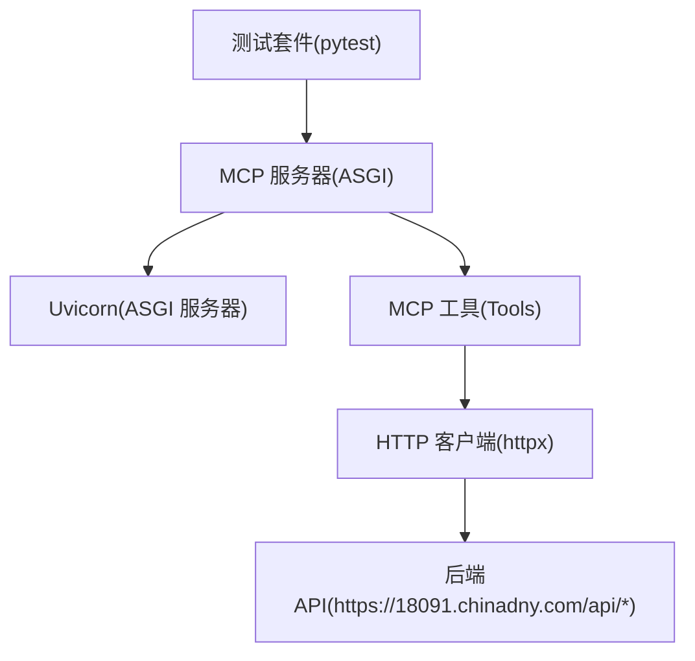
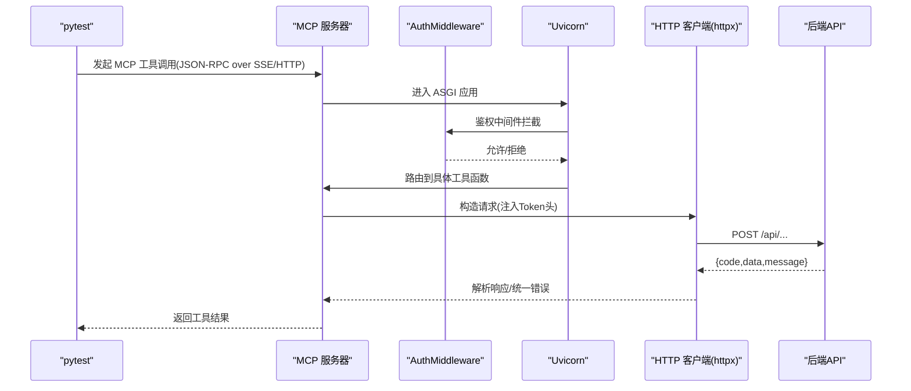
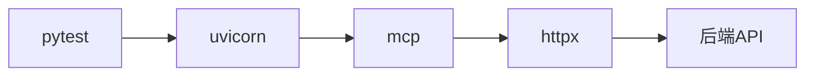

# 测试框架与用例

<cite>
**本文引用的文件**
- [requirements.txt](file://mcp_server/requirements.txt)
- [mcp server部署.md](file://mcp server部署.md)
- [规约管理MCP服务化Spec.md](file://规约管理MCP服务化Spec.md)
- [规约管理基础数据模块Spec.md](file://规约管理基础数据模块Spec.md)
</cite>

## 目录
1. [引言](#引言)
2. [项目结构](#项目结构)
3. [核心组件](#核心组件)
4. [架构总览](#架构总览)
5. [详细组件分析](#详细组件分析)
6. [依赖分析](#依赖分析)
7. [性能考虑](#性能考虑)
8. [故障排查指南](#故障排查指南)
9. [结论](#结论)
10. [附录](#附录)

## 引言
本文件面向 PCA MCP Server 项目的测试体系建设，目标是提供一套可落地的单元测试、集成测试与端到端测试方案，覆盖 Token 鉴权、MCP 工具调用、后端 API 交互、错误处理与协议兼容性等关键路径。文档基于仓库中的规范与部署说明，给出 pytest 配置建议、测试环境准备、依赖 Mock 策略、核心组件测试要点、自动化脚本示例以及测试数据与报告生成方法。

## 项目结构
当前仓库包含 MCP 服务器运行说明、依赖声明与规约接口规格文档。测试体系将围绕以下关键点展开：
- 依赖与环境：通过 requirements.txt 声明 mcp 与 uvicorn；部署文档说明了 ASGI 启动方式与端口、SSE/MCP 端点。
- 服务端职责：MCP 负责工具注册与 JSON-RPC 路由；Uvicorn 负责网络层与 SSE 长连接。
- 外部依赖：根据规约文档，MCP 工具会调用后端 HTTP API（httpx 异步客户端），需对网络请求进行隔离与 Mock。

图表来源
- [mcp server部署.md:64-100](file://mcp server部署.md#L64-L100)
- [mcp server部署.md:163-261](file://mcp server部署.md#L163-L261)
- [规约管理MCP服务化Spec.md:56-78](file://规约管理MCP服务化Spec.md#L56-L78)

章节来源
- [requirements.txt:1-3](file://mcp_server/requirements.txt#L1-L3)
- [mcp server部署.md:64-100](file://mcp server部署.md#L64-L100)
- [mcp server部署.md:163-261](file://mcp server部署.md#L163-L261)
- [规约管理MCP服务化Spec.md:56-78](file://规约管理MCP服务化Spec.md#L56-L78)

## 核心组件
- TokenManager：负责 MCP 服务侧的 Token 管理与校验（如本地鉴权 Token）。测试重点包括 Token 生成规则、有效期策略、非法 Token 拒绝访问。
- AuthMiddleware：在 ASGI 层拦截请求，校验 Token 并决定放行或拒绝。测试重点包括不同场景下的鉴权分支（本地/远程、权限级别）。
- CompositeApp：组合路由与应用入口，承载 /sse、/mcp 等端点。测试重点包括路由分发、中间件链执行顺序、异常透传。
- MCP 工具层：每个工具对应一个后端 API 调用（httpx 异步）。测试重点包括参数校验、鉴权头注入、响应码与业务码处理、错误分类。

章节来源
- [mcp server部署.md:64-100](file://mcp server部署.md#L64-L100)
- [mcp server部署.md:163-261](file://mcp server部署.md#L163-L261)
- [规约管理MCP服务化Spec.md:56-78](file://规约管理MCP服务化Spec.md#L56-L78)

## 架构总览
下图展示从测试到 MCP 工具再到后端 API 的完整调用链路，便于理解测试断点与 Mock 位置。

图表来源
- [mcp server部署.md:163-261](file://mcp server部署.md#L163-L261)
- [规约管理MCP服务化Spec.md:56-78](file://规约管理MCP服务化Spec.md#L56-L78)

## 详细组件分析

### 单元测试框架搭建（pytest）
- 目标
  - 验证 Token 生成与校验逻辑
  - 验证鉴权中间件对不同请求头的处理
  - 验证 MCP 工具的参数校验与错误分类
  - 验证路由分发与中间件链顺序
- 环境与依赖
  - 使用 Python 虚拟环境安装 requirements.txt 中的依赖
  - 引入 pytest、pytest-asyncio、httpx、aioresponses（用于 httpx 请求 Mock）
- pytest 配置建议
  - 启用 asyncio 模式，支持 async 测试
  - 设置测试数据库/环境变量（如 MCP_AUTH_TOKEN、后端 API 基地址）
  - 定义 fixtures：Mock httpx.AsyncClient、伪造 Token、构造标准请求体
- 测试组织
  - tests/unit：TokenManager、AuthMiddleware、CompositeApp、工具函数
  - tests/integration：端到端流程、API 接口、协议兼容性
  - tests/fixtures：测试数据、Mock 响应模板
  - tests/conftest.py：全局夹具与钩子

章节来源
- [requirements.txt:1-3](file://mcp_server/requirements.txt#L1-L3)
- [mcp server部署.md:64-100](file://mcp server部署.md#L64-L100)

### 测试环境准备
- 本地开发
  - 使用部署脚本创建虚拟环境并安装依赖
  - 配置 .env 中的 MCP_AUTH_TOKEN，确保鉴权可用
  - 启动服务后，通过 /sse 建立 SSE 连接，向 /mcp 发送 JSON-RPC 消息
- 测试专用环境
  - 使用独立端口或进程隔离，避免与开发服务冲突
  - 通过环境变量切换后端 API 地址（生产/预发/沙箱）
  - 使用 Mock 后端或桩服务，保证测试稳定性

章节来源
- [mcp server部署.md:309-350](file://mcp server部署.md#L309-L350)
- [mcp server部署.md:415-459](file://mcp server部署.md#L415-L459)

### 依赖 Mock 策略
- httpx.AsyncClient 替换
  - 使用 aioresponses 或自定义 fixture 替换 httpx.AsyncClient，返回预设响应
  - 针对成功、业务错误、网络异常、HTTP 状态异常分别构造响应
- Token 与鉴权
  - 为每个测试注入不同的 Token（有效、过期、非法）
  - 验证中间件在不同 IP/来源下的权限判定
- 后端 API
  - 使用 Mock 响应模拟后端 code=20000、40100、40000 等场景
  - 对分页列表响应 data.rows 与 total 字段进行断言

章节来源
- [规约管理MCP服务化Spec.md:123-131](file://规约管理MCP服务化Spec.md#L123-L131)
- [规约管理MCP服务化Spec.md:327-335](file://规约管理MCP服务化Spec.md#L327-L335)

### 核心组件测试要点

#### TokenManager 测试
- 测试目标
  - 生成符合规范的 Token（长度、字符集）
  - 校验合法/非法 Token 的行为
  - 若实现有效期控制，验证过期策略
- 断言建议
  - 生成 Token 格式与长度
  - 校验失败时抛出明确异常或返回错误码
  - 并发场景下无竞争条件

章节来源
- [mcp server部署.md:347-355](file://mcp server部署.md#L347-L355)

#### AuthMiddleware 测试
- 测试目标
  - 本地访问（localhost）与远程访问的权限差异
  - 请求头中 Token 的注入与校验
  - 鉴权失败时的响应结构与状态码
- 断言建议
  - 不同来源 IP 的权限级别判断
  - 缺失/无效 Token 的错误信息
  - 中间件链顺序对后续路由的影响

章节来源
- [mcp server部署.md:655-663](file://mcp server部署.md#L655-L663)

#### CompositeApp 路由测试
- 测试目标
  - /sse 建立 SSE 长连接
  - /mcp 接收 JSON-RPC 消息并路由到工具
  - 错误透传与日志记录
- 断言建议
  - 正确路由后的响应结构
  - 未注册端点的 404 行为
  - 中间件异常是否被捕获并返回友好错误

章节来源
- [mcp server部署.md:74-79](file://mcp server部署.md#L74-L79)
- [mcp server部署.md:163-261](file://mcp server部署.md#L163-L261)

### MCP 工具的测试方法
- 参数验证测试
  - 必填字段缺失、类型错误、范围越界
  - 特殊字段（如纯数字编码、禁止中文）的边界值
- 权限控制测试
  - 不同 Token 与来源 IP 的权限矩阵
  - 写操作在只读权限下的拒绝
- 错误处理测试
  - 网络异常、HTTP 状态异常、业务错误码
  - 统一错误分类（NETWORK_ERROR、HTTP_ERROR、API_ERROR、AUTH_ERROR）
- 典型工具示例
  - 登录：login(phoneNum, code) → 返回 token
  - 品牌管理：get_brand_list/add_brand/update_brand/del_brand
  - 型号导出：export_model_data → blob 下载流

章节来源
- [规约管理MCP服务化Spec.md:132-246](file://规约管理MCP服务化Spec.md#L132-L246)
- [规约管理MCP服务化Spec.md:327-335](file://规约管理MCP服务化Spec.md#L327-L335)
- [规约管理基础数据模块Spec.md:146-155](file://规约管理基础数据模块Spec.md#L146-L155)

### 集成测试方案
- 端到端测试
  - 启动服务 → 建立 SSE 连接 → 发送工具调用 → 断言响应
  - 覆盖正常流程与异常场景（网络抖动、后端超时）
- API 接口测试
  - 直接调用后端 API（绕过 MCP）以验证契约一致性
  - 校验分页结构 data.rows 与 total
- 协议兼容性测试
  - 验证 JSON-RPC over HTTP/SSE 的消息格式
  - 兼容不同客户端（Claude Desktop、Trae IDE）的调用方式

章节来源
- [mcp server部署.md:163-261](file://mcp server部署.md#L163-L261)
- [规约管理基础数据模块Spec.md:304-335](file://规约管理基础数据模块Spec.md#L304-L335)

## 依赖分析
- 运行时依赖
  - mcp：提供 MCP 协议能力与工具注册
  - uvicorn：ASGI 服务器，承载 /sse 与 /mcp 端点
- 测试期依赖
  - pytest、pytest-asyncio：异步测试框架
  - httpx、aioresponses：HTTP 客户端与请求 Mock
- 外部依赖
  - 后端 API（https://18091.chinadny.com/api/*）：通过 httpx 异步调用，需 Mock 以保证稳定

图表来源
- [requirements.txt:1-3](file://mcp_server/requirements.txt#L1-L3)
- [mcp server部署.md:64-100](file://mcp server部署.md#L64-L100)
- [规约管理MCP服务化Spec.md:56-78](file://规约管理MCP服务化Spec.md#L56-L78)

章节来源
- [requirements.txt:1-3](file://mcp_server/requirements.txt#L1-L3)
- [mcp server部署.md:64-100](file://mcp server部署.md#L64-L100)

## 性能考虑
- 异步 I/O：MCP 工具与 httpx 均使用异步模型，测试时应避免阻塞调用
- 连接复用：httpx.AsyncClient 应复用连接，减少握手开销
- 超时与重试：为网络请求设置合理超时，必要时增加重试策略
- 并发压力：在高并发场景下验证 SSE 连接稳定性与资源占用

[本节为通用指导，不直接分析具体文件]

## 故障排查指南
- 常见问题
  - 端口被占用：检查 8765 端口占用情况并释放或更换端口
  - Token 未配置：确认 .env 中 MCP_AUTH_TOKEN 已设置
  - 依赖安装失败：检查网络与 pip 版本，必要时使用国内镜像源
- 定位方法
  - 查看服务启动日志，确认 ASGI 应用启动成功
  - 通过浏览器或 curl 访问 /sse 与 /mcp 端点，验证连通性
  - 使用抓包工具检查 JSON-RPC 消息与响应结构

章节来源
- [mcp server部署.md:505-642](file://mcp server部署.md#L505-L642)

## 结论
本测试框架以 pytest 为核心，结合异步测试与 httpx Mock，覆盖 Token 鉴权、MCP 工具调用、后端 API 交互与协议兼容性。通过分层测试（单元、集成、端到端）与完善的错误处理断言，确保 MCP 服务的稳定性与可维护性。建议在 CI 中持续运行测试，并结合覆盖率与报告工具提升质量可见性。

[本节为总结性内容，不直接分析具体文件]

## 附录

### 自动化测试脚本示例（思路）
- 正常流程
  - 启动服务 → 建立 SSE 连接 → 调用 login 获取 Token → 调用品牌/型号相关工具 → 断言响应
- 异常场景
  - 缺失 Token、无效 Token、网络异常、后端业务错误码
  - 断言错误分类与消息提示

[本节为概念性说明，不直接分析具体文件]

### 测试数据管理
- 固定数据：使用 fixtures 提供标准请求体与响应模板
- 动态数据：为每次测试生成唯一标识（如随机品牌名、设备类型编码）
- 数据清理：测试结束后清理新增数据，保持环境一致

[本节为概念性说明，不直接分析具体文件]

### 测试报告生成
- 使用 pytest-html 或 Allure 生成可视化报告
- 收集日志与截图（如有 UI 交互）
- 在 CI 中归档报告，便于回溯与分析

[本节为概念性说明，不直接分析具体文件]