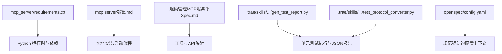
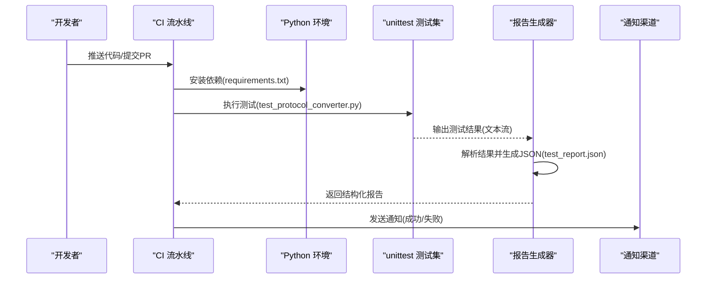
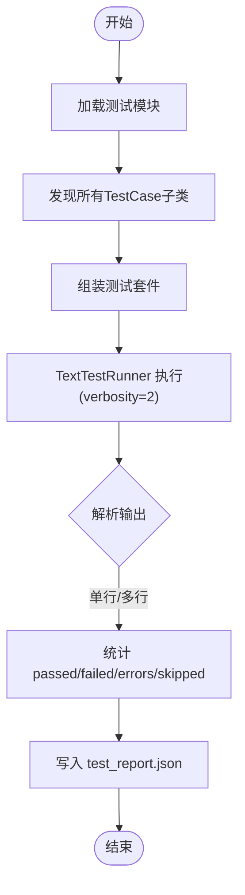
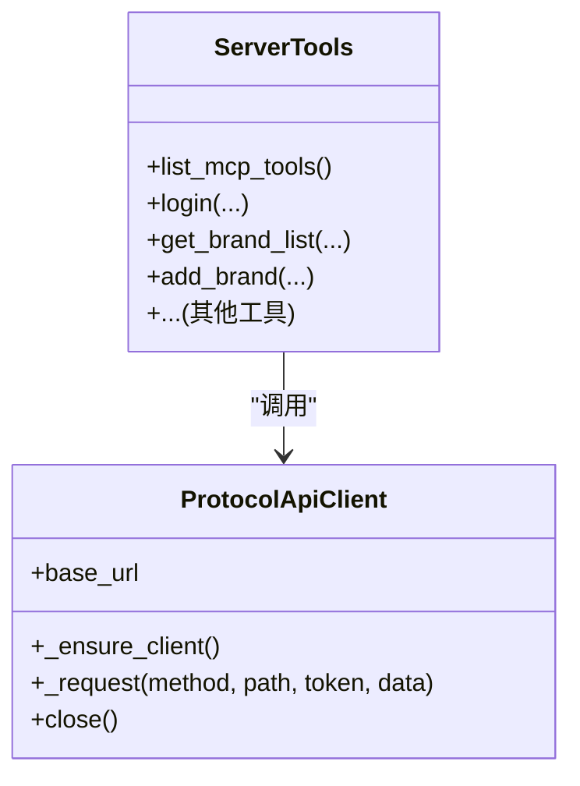
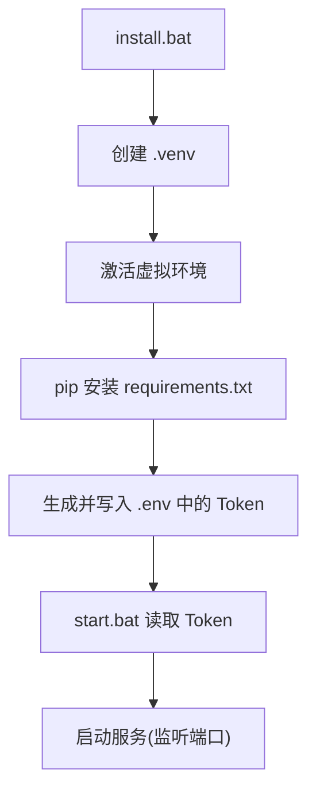
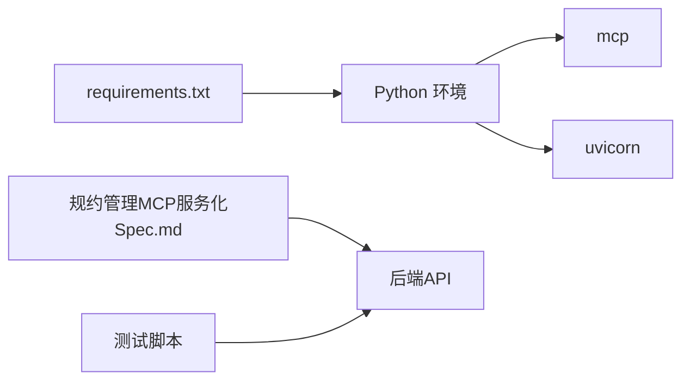

# 测试自动化

<cite>
**本文引用的文件**
- [requirements.txt](file://mcp_server/requirements.txt)
- [mcp server部署.md](file://mcp server部署.md)
- [规约管理MCP服务化Spec.md](file://规约管理MCP服务化Spec.md)
- [gen_test_report.py](file://.trae/skills/protocol-conversion/scripts/gen_test_report.py)
- [test_protocol_converter.py](file://.trae/skills/protocol-conversion/scripts/test_protocol_converter.py)
- [test_report.json](file://.trae/skills/protocol-conversion/scripts/test_report.json)
- [config.yaml](file://openspec/config.yaml)
</cite>

## 目录
1. [简介](#简介)
2. [项目结构](#项目结构)
3. [核心组件](#核心组件)
4. [架构总览](#架构总览)
5. [详细组件分析](#详细组件分析)
6. [依赖分析](#依赖分析)
7. [性能考虑](#性能考虑)
8. [故障排查指南](#故障排查指南)
9. [结论](#结论)
10. [附录](#附录)

## 简介
本文件面向“测试自动化”目标，结合仓库现有脚本与文档，给出CI/CD流水线中的测试集成方案、触发条件、通知机制、Docker容器化构建、报告生成与分析、并行执行优化、失败重试与诊断、以及环境持续维护策略。内容严格基于仓库中已存在的脚本与说明进行设计，确保可落地且与当前代码库一致。

## 项目结构
仓库包含：
- 服务端运行与依赖声明：mcp_server/requirements.txt
- 部署与环境说明：mcp server部署.md（含启动流程、环境变量、常见问题）
- 协议能力与工具清单：规约管理MCP服务化Spec.md（定义了工具与API映射）
- 测试与报告脚本：.trae/skills/protocol-conversion/scripts/gen_test_report.py、test_protocol_converter.py、test_report.json
- 规范配置：openspec/config.yaml

图表来源
- [requirements.txt:1-3](file://mcp_server/requirements.txt#L1-L3)
- [mcp server部署.md:283-460](file://mcp server部署.md#L283-L460)
- [规约管理MCP服务化Spec.md:132-246](file://规约管理MCP服务化Spec.md#L132-L246)
- [gen_test_report.py:1-88](file://.trae/skills/protocol-conversion/scripts/gen_test_report.py#L1-L88)
- [config.yaml:1-33](file://openspec/config.yaml#L1-L33)

章节来源
- [requirements.txt:1-3](file://mcp_server/requirements.txt#L1-L3)
- [mcp server部署.md:283-460](file://mcp server部署.md#L283-L460)
- [规约管理MCP服务化Spec.md:132-246](file://规约管理MCP服务化Spec.md#L132-L246)
- [gen_test_report.py:1-88](file://.trae/skills/protocol-conversion/scripts/gen_test_report.py#L1-L88)
- [config.yaml:1-33](file://openspec/config.yaml#L1-L33)

## 核心组件
- 依赖管理：通过 requirements.txt 声明 mcp 与 uvicorn 版本范围，保证测试与运行环境一致。
- 部署与运行：mcp server部署.md 描述了虚拟环境创建、Token 配置、服务启动流程，为测试环境准备提供依据。
- 工具与API：规约管理MCP服务化Spec.md 明确了工具清单与后端API映射，可作为接口契约测试的输入。
- 测试与报告：gen_test_report.py 使用 unittest 加载测试类并输出结构化 JSON 报告；test_protocol_converter.py 提供被测用例模块；test_report.json 为历史或示例报告。
- 规范配置：openspec/config.yaml 提供规范驱动的上下文，便于在CI中统一约束。

章节来源
- [requirements.txt:1-3](file://mcp_server/requirements.txt#L1-L3)
- [mcp server部署.md:283-460](file://mcp server部署.md#L283-L460)
- [规约管理MCP服务化Spec.md:132-246](file://规约管理MCP服务化Spec.md#L132-L246)
- [gen_test_report.py:1-88](file://.trae/skills/protocol-conversion/scripts/gen_test_report.py#L1-L88)
- [test_protocol_converter.py](file://.trae/skills/protocol-conversion/scripts/test_protocol_converter.py)
- [test_report.json](file://.trae/skills/protocol-conversion/scripts/test_report.json)
- [config.yaml:1-33](file://openspec/config.yaml#L1-L33)

## 架构总览
下图展示从代码变更到测试执行、报告产出与通知的端到端流程，并与仓库现有脚本对齐。

图表来源
- [requirements.txt:1-3](file://mcp_server/requirements.txt#L1-L3)
- [gen_test_report.py:1-88](file://.trae/skills/protocol-conversion/scripts/gen_test_report.py#L1-L88)
- [test_protocol_converter.py](file://.trae/skills/protocol-conversion/scripts/test_protocol_converter.py)
- [test_report.json](file://.trae/skills/protocol-conversion/scripts/test_report.json)

## 详细组件分析

### 测试执行与报告组件
- 测试入口：test_protocol_converter.py 定义测试用例类，供 unittest 发现与执行。
- 报告生成：gen_test_report.py 动态加载所有 TestCase 子类，使用 TextTestRunner 以详细模式运行，解析输出统计并通过 JSON 持久化到 test_report.json。
- 关键行为：
  - 自动发现测试类并组装测试套件
  - 捕获 verbose 输出，按行解析单行/多行格式
  - 汇总 total/passed/failed/errors/skipped/status
  - 输出到固定路径 test_report.json

图表来源
- [gen_test_report.py:1-88](file://.trae/skills/protocol-conversion/scripts/gen_test_report.py#L1-L88)
- [test_protocol_converter.py](file://.trae/skills/protocol-conversion/scripts/test_protocol_converter.py)
- [test_report.json](file://.trae/skills/protocol-conversion/scripts/test_report.json)

章节来源
- [gen_test_report.py:1-88](file://.trae/skills/protocol-conversion/scripts/gen_test_report.py#L1-L88)
- [test_protocol_converter.py](file://.trae/skills/protocol-conversion/scripts/test_protocol_converter.py)
- [test_report.json](file://.trae/skills/protocol-conversion/scripts/test_report.json)

### MCP 工具与API契约测试
- 契约来源：规约管理MCP服务化Spec.md 列出了工具名与对应后端API，可作为契约测试的输入。
- 建议实践：
  - 针对只读接口构造最小请求参数，验证响应结构与业务码
  - 对写操作接口采用隔离数据或Mock后端，避免污染真实环境
  - 将工具调用封装为异步客户端，复用连接与超时配置

图表来源
- [规约管理MCP服务化Spec.md:79-131](file://规约管理MCP服务化Spec.md#L79-L131)
- [规约管理MCP服务化Spec.md:132-246](file://规约管理MCP服务化Spec.md#L132-L246)

章节来源
- [规约管理MCP服务化Spec.md:79-131](file://规约管理MCP服务化Spec.md#L79-L131)
- [规约管理MCP服务化Spec.md:132-246](file://规约管理MCP服务化Spec.md#L132-L246)

### 本地环境与启动流程（用于测试环境准备）
- 依赖安装：requirements.txt 声明 mcp 与 uvicorn 版本范围
- 虚拟环境：install.bat 创建 .venv，激活后安装依赖
- Token 配置：生成并写入 .env，供服务鉴权
- 启动服务：start.bat 读取 Token 并启动服务

图表来源
- [mcp server部署.md:309-460](file://mcp server部署.md#L309-L460)
- [requirements.txt:1-3](file://mcp_server/requirements.txt#L1-L3)

章节来源
- [mcp server部署.md:309-460](file://mcp server部署.md#L309-L460)
- [requirements.txt:1-3](file://mcp_server/requirements.txt#L1-L3)

## 依赖分析
- 运行时依赖：mcp、uvicorn 由 requirements.txt 锁定版本范围，确保测试与生产一致性
- 测试依赖：unittest 为标准库，无需额外声明
- 外部服务：规约管理MCP服务化Spec.md 指定了后端API基地址与鉴权方式，测试需据此构造请求头与URL

图表来源
- [requirements.txt:1-3](file://mcp_server/requirements.txt#L1-L3)
- [规约管理MCP服务化Spec.md:68-78](file://规约管理MCP服务化Spec.md#L68-L78)

章节来源
- [requirements.txt:1-3](file://mcp_server/requirements.txt#L1-L3)
- [规约管理MCP服务化Spec.md:68-78](file://规约管理MCP服务化Spec.md#L68-L78)

## 性能考虑
- 并行执行
  - 使用 unittest 的并发扩展或 pytest-xdist 对测试用例进行并行化，按模块或类划分任务
  - 对网络型契约测试设置合理的超时与重试，避免慢测试阻塞流水线
- 资源隔离
  - 每个并行任务使用独立临时数据库或Mock后端，防止数据竞争
- 缓存与复用
  - 缓存 Python 包与依赖层，减少安装时间
  - 复用 Docker 镜像层，加速构建

[本节为通用指导，不直接分析具体文件]

## 故障排查指南
- 常见环境问题
  - Python 未安装或版本过低：参考部署文档检查版本要求
  - 虚拟环境创建失败：确认权限与磁盘空间
  - 依赖安装失败：检查网络与镜像源
  - 端口占用：释放端口或更换端口
  - Token 未配置：重新运行安装脚本或手动写入 .env
- 测试失败定位
  - 查看 test_report.json 中的 failed/errors/skipped 统计
  - 根据用例名称定位日志与堆栈
  - 对网络错误检查后端可达性与鉴权头
- 重试与恢复
  - 对瞬时网络错误启用有限次重试
  - 对幂等写操作增加前置清理或回滚步骤

章节来源
- [mcp server部署.md:505-642](file://mcp server部署.md#L505-L642)
- [gen_test_report.py:1-88](file://.trae/skills/protocol-conversion/scripts/gen_test_report.py#L1-L88)
- [test_report.json](file://.trae/skills/protocol-conversion/scripts/test_report.json)

## 结论
本项目已具备测试执行与报告生成的基础能力，结合部署文档与规范配置，可在CI中快速搭建稳定的测试流水线。建议优先补齐契约测试与覆盖率采集，完善并行执行与失败重试策略，形成闭环的质量保障体系。

[本节为总结性内容，不直接分析具体文件]

## 附录

### CI/CD 流水线建议（GitHub Actions / Jenkins）
- 触发条件
  - 推送至主分支或创建PR时触发
  - 定时任务用于回归测试
- 阶段设计
  - 环境准备：安装Python、依赖（requirements.txt）
  - 测试执行：运行 unittest 测试集，生成 test_report.json
  - 报告归档：上传 test_report.json 作为制品
  - 通知：根据结果发送消息（邮件/IM）
- 环境变量
  - 后端API地址、Token 等敏感信息通过密钥管理注入
- 并行与重试
  - 按模块并行执行
  - 对网络相关用例启用有限重试

[本节为通用指导，不直接分析具体文件]

### Docker 容器化测试环境
- 镜像构建
  - 基础镜像：官方 Python 镜像
  - 复制 requirements.txt 并安装依赖
  - 复制测试脚本与源码
- 环境变量
  - 注入后端API地址、Token、超时等
- 依赖管理
  - 使用 requirements.txt 锁定版本
  - 可选：使用 pip cache 加速构建
- 运行测试
  - 启动容器执行测试命令，产出 test_report.json
  - 将报告挂载到宿主机或上传至制品库

[本节为通用指导，不直接分析具体文件]

### 测试报告与分析
- 覆盖率报告
  - 使用 coverage 收集覆盖率，生成 HTML 报告并归档
- 性能分析报告
  - 使用 cProfile 或 py-spy 对热点函数进行分析
- 安全扫描报告
  - 使用安全扫描工具对依赖进行漏洞扫描，结果纳入流水线质量门禁

[本节为通用指导，不直接分析具体文件]

### 持续维护与更新策略
- 依赖更新
  - 定期升级依赖并回归测试，关注 breaking changes
- 规范配置
  - 保持 openspec/config.yaml 与团队约定一致
- 脚本维护
  - 测试脚本与报告生成脚本随需求演进持续迭代
  - 记录变更日志与回滚策略

章节来源
- [config.yaml:1-33](file://openspec/config.yaml#L1-L33)