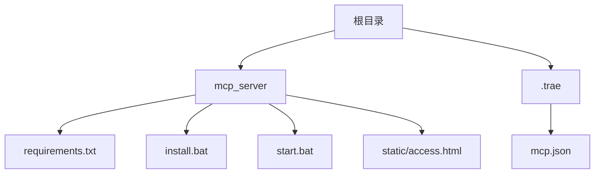
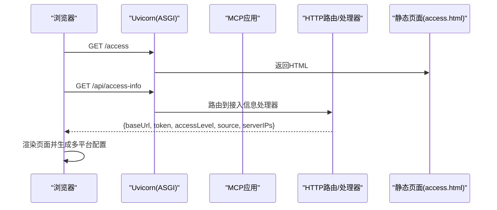
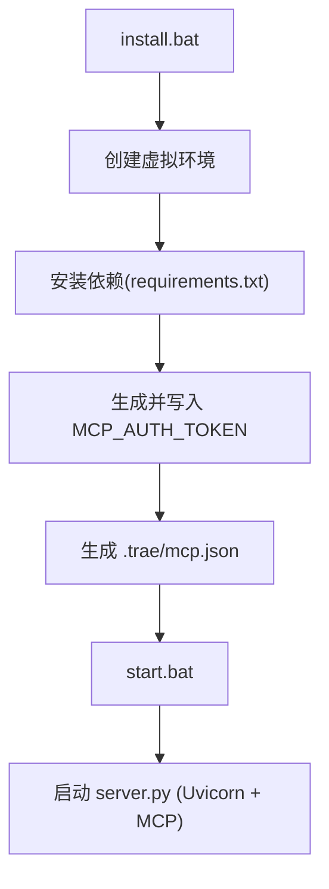

# 集成测试方案

<cite>
**本文引用的文件**
- [requirements.txt](file://mcp_server/requirements.txt)
- [start.bat](file://mcp_server/start.bat)
- [install.bat](file://mcp_server/install.bat)
- [access.html](file://mcp_server/static/access.html)
- [mcp.json](file://.trae/mcp.json)
- [mcp server部署.md](file://mcp server部署.md)
- [规约管理MCP服务化Spec.md](file://规约管理MCP服务化Spec.md)
</cite>

## 目录
1. [引言](#引言)
2. [项目结构](#项目结构)
3. [核心组件](#核心组件)
4. [架构总览](#架构总览)
5. [详细组件分析](#详细组件分析)
6. [依赖关系分析](#依赖关系分析)
7. [性能与并发测试](#性能与并发测试)
8. [故障排查指南](#故障排查指南)
9. [结论](#结论)
10. [附录](#附录)

## 引言
本方案面向 PCA MCP Server 的端到端集成测试，覆盖 HTTP 客户端测试、MCP 协议通信测试、完整业务流程测试。重点验证以下公开能力：
- /mcp 端点的鉴权流程（Bearer Token）
- /access 页面访问与信息获取
- /api/access-info 接口返回的接入信息
- Skills 包下载与导出能力
同时提供协议兼容性测试方法（不同客户端版本）、网络异常处理测试、自动化脚本示例（环境启动、执行、结果验证），以及并发与性能基准测试方案。

## 项目结构
本项目以 mcp_server 为核心运行目录，包含依赖声明、安装与启动脚本、静态页面；根目录 .trae 下维护 IDE 侧的 MCP 客户端配置；文档说明部署与工作原理。

图表来源
- [requirements.txt:1-3](file://mcp_server/requirements.txt#L1-L3)
- [start.bat:1-41](file://mcp_server/start.bat#L1-L41)
- [install.bat:1-85](file://mcp_server/install.bat#L1-L85)
- [access.html:1-562](file://mcp_server/static/access.html#L1-L562)
- [mcp.json:1-1](file://.trae/mcp.json#L1-L1)

章节来源
- [mcp server部署.md:25-126](file://mcp server部署.md#L25-L126)
- [mcp server部署.md:283-501](file://mcp server部署.md#L283-L501)

## 核心组件
- 运行时与依赖
  - 使用 uvicorn 作为 ASGI 服务器，监听端口 8765，承载 MCP 应用。
  - 通过 requirements.txt 声明 mcp SDK 与 uvicorn 的版本范围，确保稳定运行。
- 启动与安装
  - install.bat：创建虚拟环境、安装依赖、生成并写入 MCP_AUTH_TOKEN、生成 .trae/mcp.json。
  - start.bat：激活虚拟环境、读取 .env 中的 Token、打印启动信息、启动 server.py。
- 前端接入页
  - access.html：从 /api/access-info 拉取 baseUrl、token、accessLevel、source、serverIPs，动态生成多平台接入文本，并提供复制与下载功能。
- 客户端配置
  - .trae/mcp.json：定义 MCP 服务端地址与 Authorization 头，便于 IDE 自动连接。

章节来源
- [requirements.txt:1-3](file://mcp_server/requirements.txt#L1-L3)
- [install.bat:12-85](file://mcp_server/install.bat#L12-L85)
- [start.bat:1-41](file://mcp_server/start.bat#L1-L41)
- [access.html:321-558](file://mcp_server/static/access.html#L321-L558)
- [mcp.json:1-1](file://.trae/mcp.json#L1-L1)

## 架构总览
下图展示从浏览器访问 /access 到后端返回接入信息，再到生成多平台配置的整体数据流。

图表来源
- [access.html:401-417](file://mcp_server/static/access.html#L401-L417)
- [mcp server部署.md:163-261](file://mcp server部署.md#L163-L261)

## 详细组件分析

### 1) /mcp 端点鉴权测试
- 目标
  - 验证携带正确 Bearer Token 的请求可成功建立 MCP 会话或调用工具。
  - 验证缺失或错误 Token 被拒绝。
- 前置条件
  - 通过 install.bat 生成 MCP_AUTH_TOKEN，start.bat 启动服务。
  - 确认服务监听 http://localhost:8765/mcp。
- 测试要点
  - 有效 Token：构造 Authorization: Bearer <token> 请求至 /mcp，期望成功握手或返回工具列表。
  - 无效 Token：构造错误 Token，期望鉴权失败。
  - 无 Token：不传 Authorization 头，期望鉴权失败。
- 参考依据
  - 启动脚本会输出 URL 与工具数量，便于定位端点。
  - 部署文档说明 /mcp 为 MCP 协议主端点。

章节来源
- [start.bat:29-41](file://mcp_server/start.bat#L29-L41)
- [mcp server部署.md:74-79](file://mcp server部署.md#L74-L79)

### 2) /access 页面访问测试
- 目标
  - 验证 /access 可正常加载 HTML。
  - 验证页面能成功调用 /api/access-info 并渲染接入信息。
- 测试要点
  - 直接打开文件时，页面会提示需通过服务器访问（前端错误分支）。
  - 通过 http://服务器IP:3000/ 或实际部署地址访问，应显示服务器地址、Token、权限级别、来源 IP。
- 参考依据
  - access.html 在 fetchAccessInfo 中调用 /api/access-info，并在失败时显示错误提示。

章节来源
- [access.html:401-417](file://mcp_server/static/access.html#L401-L417)
- [access.html:225-294](file://mcp_server/static/access.html#L225-L294)

### 3) /api/access-info 接口测试
- 目标
  - 验证返回字段完整性与语义正确性：baseUrl、token、accessLevel、source、serverIPs。
- 断言建议
  - accessLevel 为 system 或 user。
  - serverIPs 非空时，可在页面中拼接出多个可访问地址。
  - token 存在且可用于后续 /mcp 鉴权。
- 参考依据
  - access.html 根据返回数据渲染 UI，并用于生成各平台配置。

章节来源
- [access.html:419-443](file://mcp_server/static/access.html#L419-L443)
- [access.html:445-504](file://mcp_server/static/access.html#L445-L504)

### 4) Skills 包下载与导出测试
- 目标
  - 验证 Skills 包的导出链接可用，内容符合预期结构。
- 测试要点
  - 从页面生成的 Markdown 中包含 Skills ZIP 与 Markdown 导出链接。
  - 下载后校验目录结构与必要文件是否存在。
- 参考依据
  - access.html 在生成的文本中给出 Skills 包与 Markdown 的导出 URL。

章节来源
- [access.html:475-483](file://mcp_server/static/access.html#L475-L483)

### 5) MCP 协议通信测试（端到端）
- 目标
  - 验证客户端通过 /mcp 建立连接并完成一次工具调用。
- 流程
  - 客户端携带 Authorization: Bearer <token> 访问 /mcp。
  - 若支持 SSE，先建立 /sse 长连接，再发送 JSON-RPC 消息。
  - 验证响应格式与业务结果。
- 参考依据
  - 部署文档描述 /sse 与 /mcp 的作用及请求-响应循环。

章节来源
- [mcp server部署.md:74-79](file://mcp server部署.md#L74-L79)
- [mcp server部署.md:185-261](file://mcp server部署.md#L185-L261)

### 6) 协议兼容性测试
- 目标
  - 验证不同客户端版本对 /mcp 与 /sse 的兼容行为。
- 方法
  - 使用多种 MCP 客户端（如 Trae、Cursor、VS Code Copilot、Claude Desktop、Windsurf、Cline、Kimi）进行连接与工具调用。
  - 对比各客户端的配置生成差异与连接稳定性。
- 参考依据
  - access.html 内置多平台配置模板，便于快速切换与验证。

章节来源
- [access.html:330-399](file://mcp_server/static/access.html#L330-L399)

### 7) 网络异常与容错测试
- 场景
  - 网络抖动、超时、后端不可用、Token 过期等。
- 验证点
  - 前端在获取 /api/access-info 失败时显示错误提示。
  - /mcp 连接失败时客户端应有重试或降级策略。
- 参考依据
  - access.html 的错误分支提示“请确保通过服务器访问本页面”。

章节来源
- [access.html:401-417](file://mcp_server/static/access.html#L401-L417)

## 依赖关系分析
- 运行时依赖
  - mcp SDK：实现 MCP 协议与工具注册。
  - uvicorn：ASGI 服务器，承载 MCP 应用。
- 启动链路
  - install.bat → 创建 .venv → 安装依赖 → 生成 Token → 生成 .trae/mcp.json
  - start.bat → 激活 .venv → 读取 .env → 启动 server.py
- 客户端配置
  - .trae/mcp.json 指定 MCP 服务端地址与 Authorization 头，供 IDE 自动连接。

图表来源
- [install.bat:26-85](file://mcp_server/install.bat#L26-L85)
- [requirements.txt:1-3](file://mcp_server/requirements.txt#L1-L3)
- [start.bat:1-41](file://mcp_server/start.bat#L1-L41)
- [mcp.json:1-1](file://.trae/mcp.json#L1-L1)

章节来源
- [mcp server部署.md:309-501](file://mcp server部署.md#L309-L501)

## 性能与并发测试
- 并发模型
  - Uvicorn 基于异步事件循环，适合高并发 I/O 密集型任务。
- 压测建议
  - 使用 HTTP 客户端并发访问 /mcp 与 /api/access-info，观察延迟与吞吐。
  - 模拟网络抖动与超时，验证系统恢复能力。
- 指标
  - 首字节时间、P95/P99 延迟、错误率、资源占用（CPU/内存）。
- 参考依据
  - 部署文档强调 Uvicorn 的高并发特性与异步处理能力。

章节来源
- [mcp server部署.md:82-108](file://mcp server部署.md#L82-L108)
- [mcp server部署.md:265-279](file://mcp server部署.md#L265-L279)

## 故障排查指南
- 常见问题
  - Python 未安装或版本过低：按提示安装 3.10+。
  - 虚拟环境创建失败：检查权限与磁盘空间。
  - 依赖安装失败：检查网络或使用镜像源。
  - 找不到虚拟环境：重新运行 install.bat。
  - Token 未配置：运行 install.bat 或手动创建 .env。
  - 端口被占用：结束占用进程或修改端口。
- 参考依据
  - 部署文档提供了详细的错误信息与解决方案。

章节来源
- [mcp server部署.md:505-643](file://mcp server部署.md#L505-L643)

## 结论
本集成测试方案围绕 /mcp、/access、/api/access-info 与 Skills 导出四大关键能力展开，结合多客户端兼容性、网络异常与并发压测，形成完整的端到端验证闭环。建议在 CI 中固化上述用例，持续保障服务稳定性与兼容性。

## 附录

### A. 自动化测试脚本示例（流程）
- 环境准备
  - 运行 install.bat 完成依赖安装与 Token 配置。
  - 启动 start.bat 启动服务。
- 执行步骤
  - 访问 /access，验证页面加载与 /api/access-info 返回。
  - 使用配置的 Token 访问 /mcp，验证鉴权与会话建立。
  - 下载 Skills 包并校验目录结构。
- 结果验证
  - 断言状态码、关键字段、工具列表可用性。
  - 记录日志与截图，便于回溯。

章节来源
- [install.bat:12-85](file://mcp_server/install.bat#L12-L85)
- [start.bat:29-41](file://mcp_server/start.bat#L29-L41)
- [access.html:401-417](file://mcp_server/static/access.html#L401-L417)

### B. API 接口清单与用例要点
- /mcp
  - 鉴权：Authorization: Bearer <token>
  - 用例：有效 Token、无效 Token、无 Token
- /access
  - 用例：页面加载、错误提示（本地文件打开）
- /api/access-info
  - 用例：字段完整性、accessLevel 取值、serverIPs 可用性
- Skills 导出
  - 用例：ZIP/Markdown 下载、目录结构校验

章节来源
- [access.html:445-504](file://mcp_server/static/access.html#L445-L504)
- [mcp server部署.md:74-79](file://mcp server部署.md#L74-L79)

### C. 协议兼容性矩阵（概念）
- 客户端：Trae、Cursor、VS Code Copilot、Claude Desktop、Windsurf、Cline、Kimi
- 验证项：连接方式、配置模板、工具调用成功率
- 参考：access.html 内置的多平台配置模板

章节来源
- [access.html:330-399](file://mcp_server/static/access.html#L330-L399)