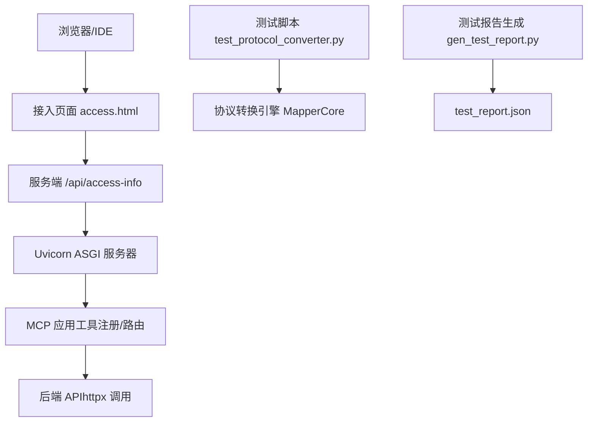
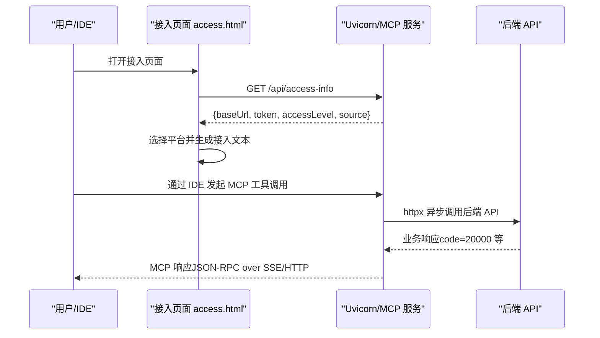
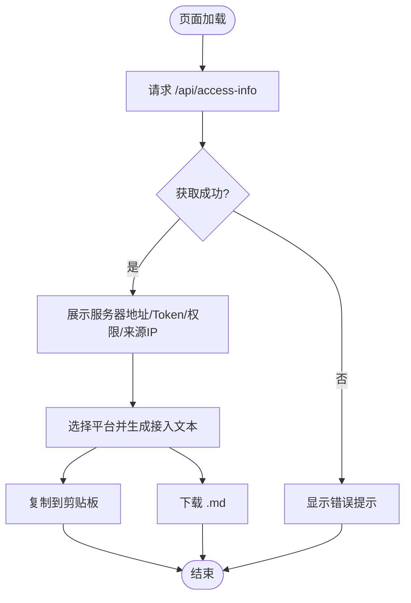
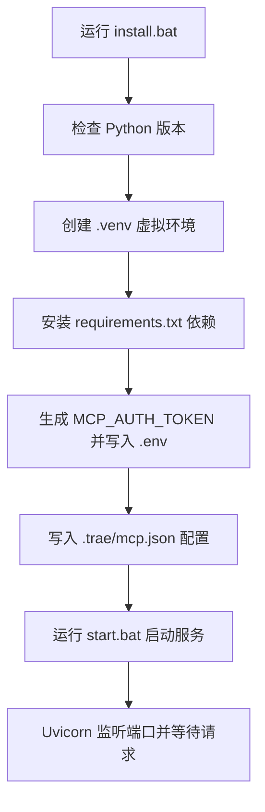
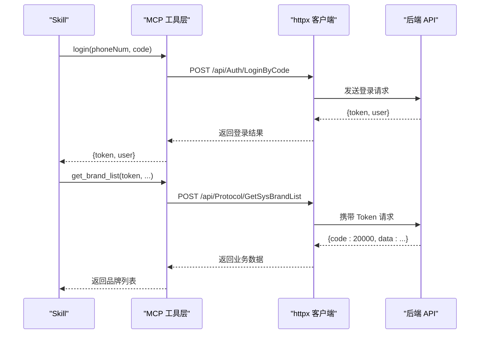
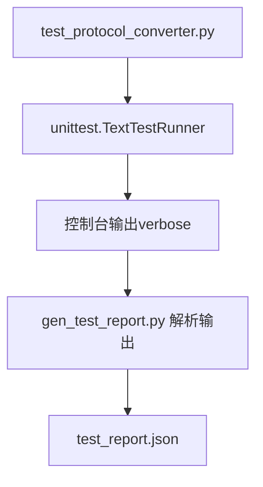
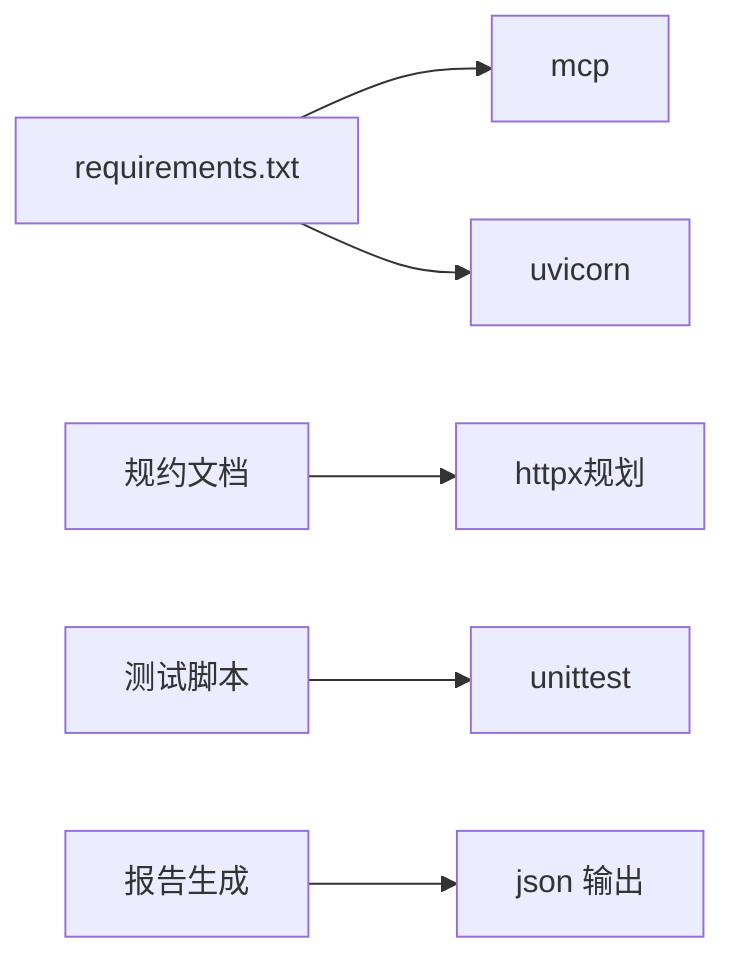

# 调试与测试

<cite>
**本文引用的文件**
- [mcp_server/static/access.html](file://mcp_server/static/access.html)
- [mcp_server/requirements.txt](file://mcp_server/requirements.txt)
- [mcp server部署.md](file://mcp server部署.md)
- [规约管理MCP服务化Spec.md](file://规约管理MCP服务化Spec.md)
- [.trae/skills/protocol-conversion/scripts/test_protocol_converter.py](file://.trae/skills/protocol-conversion/scripts/test_protocol_converter.py)
- [.trae/skills/protocol-conversion/scripts/gen_test_report.py](file://.trae/skills/protocol-conversion/scripts/gen_test_report.py)
</cite>

## 目录
1. [简介](#简介)
2. [项目结构](#项目结构)
3. [核心组件](#核心组件)
4. [架构总览](#架构总览)
5. [详细组件分析](#详细组件分析)
6. [依赖关系分析](#依赖关系分析)
7. [性能考量](#性能考量)
8. [故障排查指南](#故障排查指南)
9. [结论](#结论)
10. [附录](#附录)

## 简介
本指南面向开发与测试人员，聚焦于 MCP Server 的调试技巧、接入页面功能测试、单元测试框架与用例编写、性能测试方法以及常见问题诊断。内容基于仓库中的接入页面、部署说明、规约文档与现有测试脚本进行系统化整理，帮助快速定位问题、提升稳定性与可维护性。

## 项目结构
本项目包含以下与调试和测试密切相关的部分：
- 接入页面：提供 Token 获取、平台配置生成、复制与下载能力，便于端到端验证。
- 部署与启动：通过批处理脚本完成环境初始化、Token 配置与服务启动。
- 规约与工具清单：定义大量 MCP 工具与后端 API 映射，指导集成测试与接口回归。
- 单元测试：针对协议转换引擎的核心函数与完整流程进行覆盖，并输出结构化报告。

**图示来源**
- [mcp_server/static/access.html:401-417](file://mcp_server/static/access.html#L401-L417)
- [mcp server部署.md:163-282](file://mcp server部署.md#L163-L282)
- [规约管理MCP服务化Spec.md:79-131](file://规约管理MCP服务化Spec.md#L79-L131)
- [.trae/skills/protocol-conversion/scripts/test_protocol_converter.py:1-25](file://.trae/skills/protocol-conversion/scripts/test_protocol_converter.py#L1-L25)
- [.trae/skills/protocol-conversion/scripts/gen_test_report.py:1-28](file://.trae/skills/protocol-conversion/scripts/gen_test_report.py#L1-L28)

**章节来源**
- [mcp_server/static/access.html:223-558](file://mcp_server/static/access.html#L223-L558)
- [mcp server部署.md:283-501](file://mcp server部署.md#L283-L501)
- [规约管理MCP服务化Spec.md:132-320](file://规约管理MCP服务化Spec.md#L132-L320)
- [.trae/skills/protocol-conversion/scripts/test_protocol_converter.py:27-800](file://.trae/skills/protocol-conversion/scripts/test_protocol_converter.py#L27-L800)
- [.trae/skills/protocol-conversion/scripts/gen_test_report.py:13-88](file://.trae/skills/protocol-conversion/scripts/gen_test_report.py#L13-L88)

## 核心组件
- 接入页面（access.html）：自动检测服务器地址与 Token，按目标平台生成接入文本，支持复制与下载。
- 部署与启动脚本：一键创建虚拟环境、安装依赖、生成 Token、写入 IDE 配置并启动服务。
- 规约与工具清单：将后端 30+ API 封装为 MCP 工具，统一错误处理策略，明确鉴权方式与响应约定。
- 单元测试与报告：对协议转换引擎的路径解析、类型转换、模板替换、数组遍历、MQTT/HTTP 完整转换等进行覆盖，并生成 JSON 报告。

**章节来源**
- [mcp_server/static/access.html:241-558](file://mcp_server/static/access.html#L241-L558)
- [mcp server部署.md:309-460](file://mcp server部署.md#L309-L460)
- [规约管理MCP服务化Spec.md:132-320](file://规约管理MCP服务化Spec.md#L132-L320)
- [.trae/skills/protocol-conversion/scripts/test_protocol_converter.py:27-800](file://.trae/skills/protocol-conversion/scripts/test_protocol_converter.py#L27-L800)
- [.trae/skills/protocol-conversion/scripts/gen_test_report.py:13-88](file://.trae/skills/protocol-conversion/scripts/gen_test_report.py#L13-L88)

## 架构总览
MCP 服务由 Uvicorn 作为 ASGI 服务器承载，MCP 应用负责工具注册与请求路由；接入页面通过 HTTP 获取接入信息并生成各 IDE 的配置片段；测试脚本直接调用协议转换引擎以验证核心逻辑。

**图示来源**
- [mcp_server/static/access.html:401-417](file://mcp_server/static/access.html#L401-L417)
- [mcp server部署.md:163-282](file://mcp server部署.md#L163-L282)
- [规约管理MCP服务化Spec.md:79-131](file://规约管理MCP服务化Spec.md#L79-L131)

## 详细组件分析

### 接入页面（access.html）调试与测试
- 网络请求监控：页面在加载时调用 /api/access-info，若失败会显示错误提示，建议通过浏览器开发者工具的 Network 面板检查请求状态码与响应体。
- Token 获取与权限级别：返回数据中包含 baseUrl、token、accessLevel（system/user）、source（来源 IP），用于判断本地或远程访问权限。
- 平台配置生成：根据所选平台（Trae/Cursor/VS Code/Claude/Windsurf/Cline/Kimi）构建不同格式的服务器条目与配置文件位置，便于一键粘贴到 IDE。
- 复制与下载：支持复制到剪贴板与导出 .md 文件，便于分发与归档。

**图示来源**
- [mcp_server/static/access.html:401-558](file://mcp_server/static/access.html#L401-L558)

**章节来源**
- [mcp_server/static/access.html:241-558](file://mcp_server/static/access.html#L241-L558)

### 部署与启动（install.bat/start.bat）调试要点
- 首次安装：创建虚拟环境、安装依赖、生成 Token、写入 .env 与 .trae/mcp.json。
- 日常启动：激活虚拟环境、读取 Token、打印启动信息并执行 server.py。
- 常见问题：Python 版本过低、虚拟环境创建失败、依赖安装失败、端口占用、Token 未配置、移动项目后虚拟环境失效等。

**图示来源**
- [mcp server部署.md:309-460](file://mcp server部署.md#L309-L460)

**章节来源**
- [mcp server部署.md:309-643](file://mcp server部署.md#L309-L643)

### 规约与工具（MCP 工具清单与后端 API）
- 工具粒度：每个后端 API 对应一个 MCP 工具，便于细粒度编排与错误隔离。
- 鉴权方式：自定义 Token 请求头（非 Authorization: Bearer），登录接口返回 Token，后续工具需传入。
- 错误处理：统一封装网络异常、业务错误码、HTTP 状态码异常，返回标准结构。
- 典型调用流程：Skill 先调用 login 获取 Token，再依次调用查询/写入类工具，最终生成脚本或导出数据。

**图示来源**
- [规约管理MCP服务化Spec.md:132-320](file://规约管理MCP服务化Spec.md#L132-L320)
- [规约管理MCP服务化Spec.md:79-131](file://规约管理MCP服务化Spec.md#L79-L131)

**章节来源**
- [规约管理MCP服务化Spec.md:132-320](file://规约管理MCP服务化Spec.md#L132-L320)
- [规约管理MCP服务化Spec.md:79-131](file://规约管理MCP服务化Spec.md#L79-L131)

### 单元测试与测试报告
- 测试范围：路径取值/创建、类型转换、生成器、模板替换、数组遍历、MQTT/HTTP 完整转换、引擎差异验证、边界条件。
- 执行方式：使用 unittest 加载所有 TestCase，并通过 TextTestRunner 输出详细结果。
- 报告生成：解析 verbose 输出，统计每个测试类的总数、通过、跳过、失败数，输出 JSON 报告。

**图示来源**
- [.trae/skills/protocol-conversion/scripts/test_protocol_converter.py:1-25](file://.trae/skills/protocol-conversion/scripts/test_protocol_converter.py#L1-L25)
- [.trae/skills/protocol-conversion/scripts/gen_test_report.py:13-88](file://.trae/skills/protocol-conversion/scripts/gen_test_report.py#L13-L88)

**章节来源**
- [.trae/skills/protocol-conversion/scripts/test_protocol_converter.py:27-800](file://.trae/skills/protocol-conversion/scripts/test_protocol_converter.py#L27-L800)
- [.trae/skills/protocol-conversion/scripts/gen_test_report.py:13-88](file://.trae/skills/protocol-conversion/scripts/gen_test_report.py#L13-L88)

## 依赖关系分析
- 运行时依赖：mcp（协议实现）、uvicorn（ASGI 服务器）。
- 扩展依赖（规划中）：httpx（异步 HTTP 客户端，用于后端 API 调用）。
- 测试依赖：unittest（内置）、re（正则解析）、json（报告序列化）。

**图示来源**
- [mcp_server/requirements.txt:1-3](file://mcp_server/requirements.txt#L1-L3)
- [规约管理MCP服务化Spec.md:287-293](file://规约管理MCP服务化Spec.md#L287-L293)
- [.trae/skills/protocol-conversion/scripts/gen_test_report.py:1-12](file://.trae/skills/protocol-conversion/scripts/gen_test_report.py#L1-L12)

**章节来源**
- [mcp_server/requirements.txt:1-3](file://mcp_server/requirements.txt#L1-L3)
- [规约管理MCP服务化Spec.md:287-293](file://规约管理MCP服务化Spec.md#L287-L293)
- [.trae/skills/protocol-conversion/scripts/gen_test_report.py:1-12](file://.trae/skills/protocol-conversion/scripts/gen_test_report.py#L1-L12)

## 性能考量
- 高并发模型：Uvicorn 基于异步事件循环，适合 I/O 密集型任务，可在等待外部 API 时处理其他请求。
- 连接与超时：后端 API 调用建议使用合理的超时设置，避免阻塞事件循环。
- 资源管理：确保 httpx 客户端生命周期管理得当，避免连接泄漏。
- 负载与压力测试：可使用外部工具（如 locust、k6、wrk）对 /sse 与 /mcp 端点进行压测，观察吞吐、延迟与错误率。
- 内存泄漏检测：结合 Python 内置工具（tracemalloc）或第三方库（objgraph）在长连接场景下监测对象增长。

[本节为通用性能建议，不直接分析具体文件]

## 故障排查指南
- 认证失败
  - 现象：后端返回 40100 或 Token 无效。
  - 排查：确认登录接口是否成功返回 Token；后续工具调用是否正确携带 Token；接入页面生成的 Authorization header 是否符合目标 IDE 要求。
  - 参考：鉴权方式与错误处理策略。
- 权限错误
  - 现象：非 localhost 访问仅支持只读操作。
  - 排查：检查 accessLevel 是否为 user；写入操作需在服务器本地进行。
- 端口占用
  - 现象：启动时报端口绑定失败。
  - 排查：查找占用进程并结束，或修改端口。
- 依赖安装失败
  - 现象：pip 安装报错。
  - 排查：检查网络、镜像源、pip 版本。
- 虚拟环境问题
  - 现象：找不到虚拟环境或路径失效。
  - 排查：重新运行安装脚本或重建虚拟环境。

**章节来源**
- [mcp server部署.md:505-643](file://mcp server部署.md#L505-L643)
- [规约管理MCP服务化Spec.md:123-131](file://规约管理MCP服务化Spec.md#L123-L131)

## 结论
通过接入页面快速验证 Token 与平台配置，结合部署脚本稳定启动服务；利用规约文档指导工具与 API 的集成测试；借助单元测试保障协议转换引擎的正确性；在生产环境中关注并发、超时与资源管理，配合负载测试与内存检测提升系统稳定性。

[本节为总结性内容，不直接分析具体文件]

## 附录
- 快速命令参考
  - 首次安装：运行 mcp_server\install.bat
  - 启动服务：运行 mcp_server\start.bat
  - 手动启动：python mcp_server\server.py
  - 激活/退出虚拟环境：activate.bat / deactivate
- 测试命令参考
  - 运行测试：python -m unittest discover -s .trae/skills/protocol-conversion/scripts
  - 生成报告：python .trae/skills/protocol-conversion/scripts/gen_test_report.py

**章节来源**
- [mcp server部署.md:677-687](file://mcp server部署.md#L677-L687)
- [.trae/skills/protocol-conversion/scripts/gen_test_report.py:13-88](file://.trae/skills/protocol-conversion/scripts/gen_test_report.py#L13-L88)