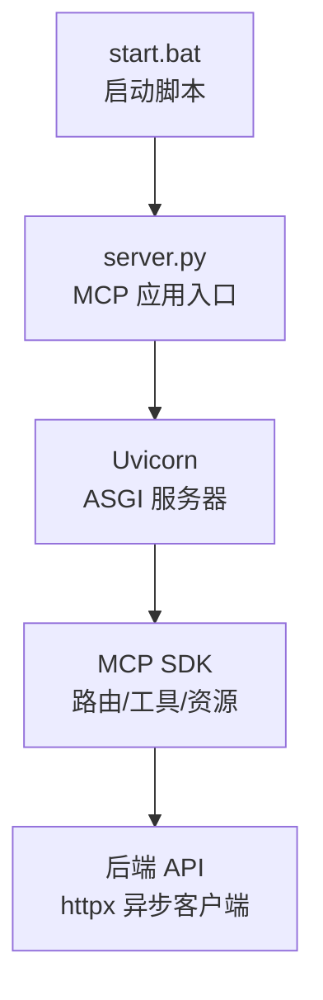
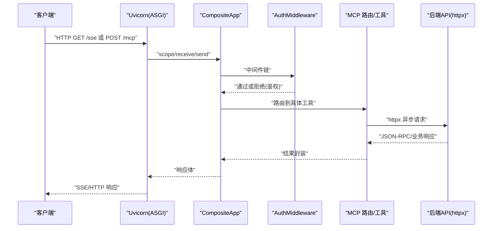
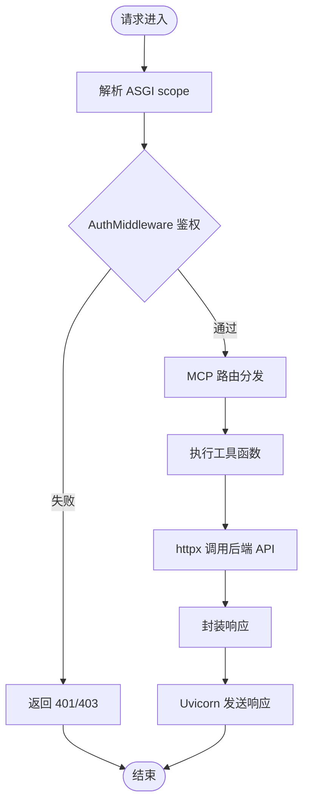
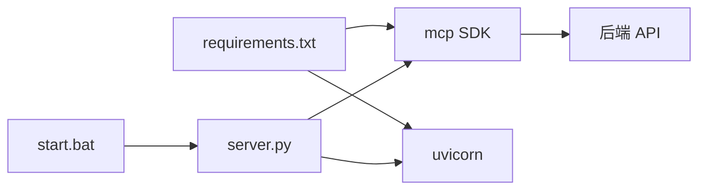

# 调试工具与方法

<cite>
**本文引用的文件**
- [mcp_server/start.bat](file://mcp_server/start.bat)
- [mcp_server/requirements.txt](file://mcp_server/requirements.txt)
- [mcp server部署.md](file://mcp server部署.md)
- [规约管理MCP服务化Spec.md](file://规约管理MCP服务化Spec.md)
</cite>

## 目录
1. [简介](#简介)
2. [项目结构](#项目结构)
3. [核心组件](#核心组件)
4. [架构总览](#架构总览)
5. [详细组件分析](#详细组件分析)
6. [依赖关系分析](#依赖关系分析)
7. [性能注意事项](#性能注意事项)
8. [故障排查指南](#故障排查指南)
9. [结论](#结论)
10. [附录](#附录)

## 简介
本指南面向使用 PCA MCP Server 的开发者与运维人员，提供一套可操作的调试方法与最佳实践。重点覆盖：
- 使用 Python 内置调试器（pdb、breakpoint）在关键组件中设置断点
- 日志输出策略与查看方法（启动日志、请求处理日志、错误日志）
- 网络请求监控技巧（浏览器开发者工具检查 MCP/SSE/HTTP、Token 验证过程）
- ASGI 中间件执行流程调试（请求生命周期、权限验证、路由分发）
- 常见调试场景与解决方案（认证失败、权限问题、性能瓶颈定位）

## 项目结构
当前仓库包含服务端脚本、依赖声明与部署文档。关键路径与职责如下：
- mcp_server/start.bat：启动脚本，负责激活虚拟环境、读取 Token、打印启动信息并调用 server.py
- mcp_server/requirements.txt：声明运行依赖（mcp、uvicorn）
- mcp server部署.md：详细说明 MCP 与 Uvicorn 的工作原理、ASGI 协议、完整工作流程、常见问题排查等
- 规约管理MCP服务化Spec.md：描述 MCP 工具清单、鉴权方式、数据流与典型调用流程

图表来源
- [mcp_server/start.bat:1-41](file://mcp_server/start.bat#L1-L41)
- [mcp server部署.md:110-261](file://mcp server部署.md#L110-L261)

章节来源
- [mcp_server/start.bat:1-41](file://mcp_server/start.bat#L1-L41)
- [mcp_server/requirements.txt:1-3](file://mcp_server/requirements.txt#L1-L3)
- [mcp server部署.md:110-261](file://mcp server部署.md#L110-L261)

## 核心组件
根据项目文档与规范，以下组件是调试的关键切入点：
- TokenManager：负责 Token 的校验与管理，用于鉴权
- AuthMiddleware：ASGI 中间件，拦截请求进行权限验证
- CompositeApp：组合式 ASGI 应用，串联中间件与路由
- server.py：MCP 应用入口，注册工具、暴露 /sse 与 /mcp 端点
- Uvicorn：ASGI 服务器，负责网络 I/O 与事件循环

说明
- 上述组件名称与职责在规范文档中被明确引用，实际实现位于 server.py 及相关模块中
- 调试时优先在这些组件的边界处设置断点，观察请求进入、鉴权、路由与响应返回

章节来源
- [规约管理MCP服务化Spec.md:277-284](file://规约管理MCP服务化Spec.md#L277-L284)

## 架构总览
下图展示从客户端到后端 API 的完整链路，以及调试断点建议位置：

图表来源
- [mcp server部署.md:163-261](file://mcp server部署.md#L163-L261)
- [规约管理MCP服务化Spec.md:295-319](file://规约管理MCP服务化Spec.md#L295-L319)

## 详细组件分析

### 使用 pdb/breakpoint 在关键组件设置断点
- 在 server.py 入口附近设置断点，捕获 ASGI 应用初始化与工具注册阶段
- 在 CompositeApp.__call__ 前后设置断点，观察请求进入与响应返回
- 在 AuthMiddleware.__call__ 内设置断点，检查请求头、Token 提取与鉴权逻辑
- 在 TokenManager 的校验方法上设置断点，确认 Token 格式、来源与有效性判断
- 在工具函数内部设置断点，观察参数校验、httpx 请求构造与响应解析

操作建议
- 使用 breakpoint() 在代码中插入断点，便于交互式调试
- 使用 python -m pdb 启动，或在 IDE 中配置断点
- 结合 print/logging 输出上下文（如 scope、headers、method、path、token）

章节来源
- [规约管理MCP服务化Spec.md:277-284](file://规约管理MCP服务化Spec.md#L277-L284)

### 日志输出策略
- 启动日志：通过 start.bat 输出 Token、URL、工具数量等信息；Uvicorn 会打印服务监听地址与进程信息
- 请求处理日志：建议在 CompositeApp 与 AuthMiddleware 中记录 method、path、client IP、耗时
- 错误日志：统一捕获异常并输出错误码、消息与堆栈，便于定位问题
- SSE/HTTP 通信：在 MCP 路由层记录 JSON-RPC 请求与响应，便于追踪工具调用

查看方法
- 控制台输出：直接查看命令行窗口中的启动与运行日志
- 文件日志：将日志写入文件，便于长期留存与分析
- 结构化日志：使用 JSON 格式输出，便于后续聚合与检索

章节来源
- [mcp_server/start.bat:29-38](file://mcp_server/start.bat#L29-L38)
- [mcp server部署.md:163-261](file://mcp server部署.md#L163-L261)

### 网络请求监控技巧
- 浏览器开发者工具：
  - 打开“网络”面板，过滤 /sse 与 /mcp 请求
  - 查看请求头（是否携带 Token）、状态码、响应体
  - 对 SSE 连接，观察事件流与消息内容
- MCP 协议通信：
  - 关注 JSON-RPC 的 method 字段（如 tools/call）
  - 检查 params 结构与返回值
- Token 验证过程：
  - 在 AuthMiddleware 与 TokenManager 处设置断点，观察 Token 提取与校验
  - 对比请求头中的 Token 与服务端配置的 MCP_AUTH_TOKEN

章节来源
- [mcp server部署.md:185-261](file://mcp server部署.md#L185-L261)
- [规约管理MCP服务化Spec.md:295-319](file://规约管理MCP服务化Spec.md#L295-L319)

### 调试 ASGI 中间件执行流程
- 请求生命周期：
  - Uvicorn 接收 HTTP 请求，封装为 ASGI scope/receive/send
  - 传递给 CompositeApp，按顺序执行中间件链
  - 最终到达 MCP 路由与工具处理器
- 权限验证：
  - AuthMiddleware 检查请求头中的 Token，调用 TokenManager 验证
  - 未通过则返回 401/403；通过则继续下游处理
- 路由分发：
  - MCP 根据 method 与 path 路由到对应工具
  - 工具函数调用 httpx 发起后端 API 请求

流程图（基于文档描述的典型流程）：

图表来源
- [mcp server部署.md:163-261](file://mcp server部署.md#L163-L261)

章节来源
- [mcp server部署.md:163-261](file://mcp server部署.md#L163-L261)

## 依赖关系分析
- 运行时依赖：
  - mcp：提供 MCP 协议支持（工具、资源、提示词、JSON-RPC）
  - uvicorn：ASGI 服务器，处理网络 I/O 与事件循环
- 启动依赖：
  - start.bat：激活虚拟环境、读取 .env 中的 MCP_AUTH_TOKEN、调用 server.py
- 外部依赖：
  - 后端 API：通过 httpx 异步客户端访问（见规范文档）

图表来源
- [mcp_server/requirements.txt:1-3](file://mcp_server/requirements.txt#L1-L3)
- [mcp_server/start.bat:1-41](file://mcp_server/start.bat#L1-L41)
- [规约管理MCP服务化Spec.md:287-293](file://规约管理MCP服务化Spec.md#L287-L293)

章节来源
- [mcp_server/requirements.txt:1-3](file://mcp_server/requirements.txt#L1-L3)
- [mcp_server/start.bat:1-41](file://mcp_server/start.bat#L1-L41)
- [规约管理MCP服务化Spec.md:287-293](file://规约管理MCP服务化Spec.md#L287-L293)

## 性能注意事项
- 高并发模型：Uvicorn 基于异步事件循环，适合 I/O 密集型任务
- SSE 长连接：/sse 端点保持连接，注意连接数与资源占用
- 工具调用：避免阻塞事件循环，使用异步 httpx 调用后端 API
- 日志与调试：生产环境减少高频日志，使用采样或分级日志

章节来源
- [mcp server部署.md:265-279](file://mcp server部署.md#L265-L279)

## 故障排查指南
- 认证失败排查：
  - 检查 start.bat 是否正确读取 MCP_AUTH_TOKEN
  - 在 AuthMiddleware 与 TokenManager 设置断点，确认 Token 来源与校验逻辑
  - 使用浏览器开发者工具检查请求头是否携带正确的 Token
- 权限问题诊断：
  - 确认本地与远程访问的权限模型（参考部署文档）
  - 在中间件中记录被拒绝的请求原因（缺少 Token、无效 Token、权限不足）
- 性能瓶颈定位：
  - 使用 Uvicorn 日志与工具函数耗时统计，识别慢请求
  - 检查 SSE 连接数与后端 API 响应时间
  - 优化 httpx 超时与重试策略

章节来源
- [mcp server部署.md:505-631](file://mcp server部署.md#L505-L631)
- [mcp_server/start.bat:15-27](file://mcp_server/start.bat#L15-L27)

## 结论
通过在本项目的关键组件（TokenManager、AuthMiddleware、CompositeApp、server.py）中合理设置断点，并结合启动日志、请求日志与错误日志，可以有效定位认证、权限与性能问题。配合浏览器开发者工具监控 MCP/SSE/HTTP 通信，能够快速验证 Token 验证与工具调用流程。遵循异步最佳实践与结构化日志策略，有助于提升调试效率与系统稳定性。

## 附录
- 快速命令参考：
  - 首次安装：运行 install.bat（若存在）
  - 启动服务：运行 start.bat
  - 手动启动：python mcp_server/server.py
- 环境变量：
  - MCP_AUTH_TOKEN：从 .env 读取，用于鉴权

章节来源
- [mcp server部署.md:677-687](file://mcp server部署.md#L677-L687)
- [mcp_server/start.bat:15-27](file://mcp_server/start.bat#L15-L27)