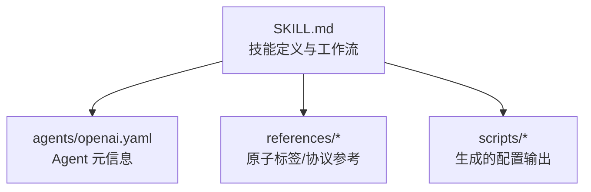
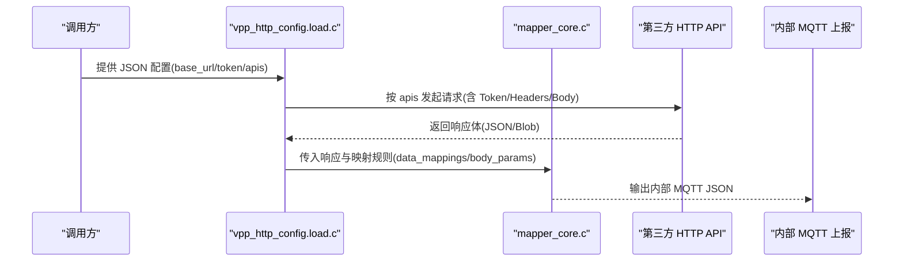
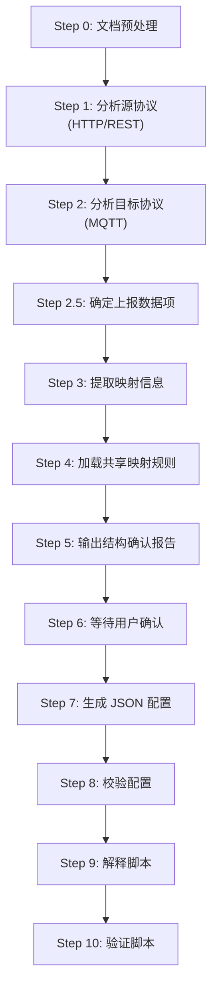
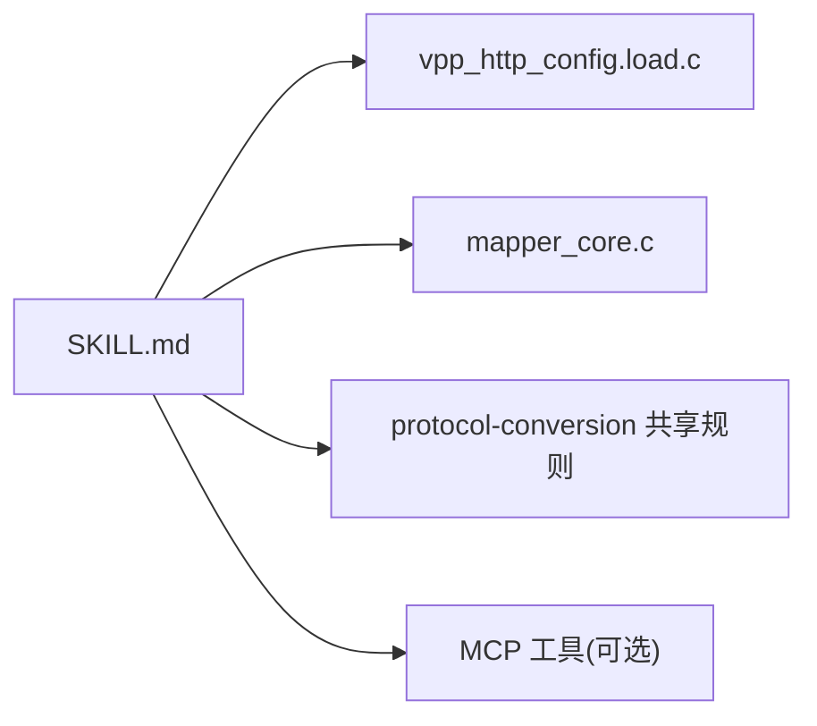

# HTTP转换技能包

<cite>
**本文引用的文件**
- [SKILL.md](file://.trae/skills/http-conversion/SKILL.md)
- [openai.yaml](file://.trae/skills/http-conversion/agents/openai.yaml)
- [mcp server部署.md](file://mcp server部署.md)
- [规约管理MCP服务化Spec.md](file://规约管理MCP服务化Spec.md)
</cite>

## 目录
1. [简介](#简介)
2. [项目结构](#项目结构)
3. [核心组件](#核心组件)
4. [架构总览](#架构总览)
5. [详细组件分析](#详细组件分析)
6. [依赖关系分析](#依赖关系分析)
7. [性能考虑](#性能考虑)
8. [故障排查指南](#故障排查指南)
9. [结论](#结论)
10. [附录](#附录)

## 简介
本技能包用于将第三方 HTTP/REST 接口数据转换为内部 MQTT JSON 格式，供 C 协议转换引擎（vpp_http_config.load.c + mapper_core.c）读取与执行。其能力覆盖：
- RESTful API 调用建模：方法、路径、内容类型、Token 认证、链式调用
- 请求头与参数处理：上下文变量、常量注入、预处理函数
- 响应数据解析：字段映射、数组遍历、键值对模式、类型转换
- 配置生成与校验：结构化 JSON 配置、规则校验、输出命名规范
- 外部 API 集成与认证：登录接口、Token 生命周期、Header 注入
- 安全与性能：超时、并发、错误分类、生产建议

## 项目结构
HTTP 转换技能包位于 .trae/skills/http-conversion，包含技能说明、代理配置、参考文档与脚本输出目录。

**图表来源**
- [.trae/skills/http-conversion/SKILL.md:1-27](file://.trae/skills/http-conversion/SKILL.md#L1-L27)
- [.trae/skills/http-conversion/agents/openai.yaml:1-4](file://.trae/skills/http-conversion/agents/openai.yaml#L1-L4)

**章节来源**
- [.trae/skills/http-conversion/SKILL.md:1-27](file://.trae/skills/http-conversion/SKILL.md#L1-L27)
- [.trae/skills/http-conversion/agents/openai.yaml:1-4](file://.trae/skills/http-conversion/agents/openai.yaml#L1-L4)

## 核心组件
- 配置加载引擎：vpp_http_config.load.c，负责读取 base_url、timeout、domain、token、apis 等根级配置
- 映射执行引擎：mapper_core.c，负责 body_params 与 data_mappings 的字段映射、类型转换、数组遍历与预处理
- 共享映射规则：来自 protocol-conversion skill，统一路径语法、类型系统、数组遍历准则、generator 选择等
- 工作流：11 步流程从源协议分析到目标协议映射，最终生成并校验 JSON 配置

**章节来源**
- [.trae/skills/http-conversion/SKILL.md:23-31](file://.trae/skills/http-conversion/SKILL.md#L23-L31)
- [.trae/skills/http-conversion/SKILL.md:89-107](file://.trae/skills/http-conversion/SKILL.md#L89-L107)

## 架构总览
HTTP→MQTT 转换链路如下：

**图表来源**
- [.trae/skills/http-conversion/SKILL.md:23-31](file://.trae/skills/http-conversion/SKILL.md#L23-L31)

## 详细组件分析

### 配置格式与字段定义
- 根对象：base_url、timeout、domain、token、apis
- Token 配置：login_path、login_method、content_type、token_path、token_header、expires_in、login_params
- API 配置：name、method、path、content_type、use_token、interval、interval_type、interval_offset、skip_on_interval、param_process、after_process、topic_pattern、next_api、body_params、data_mappings
- body_params/data_mappings 规则字段：target/source_type/source/constant/type/scale/preprocess/item_type/sub_mappings；HTTP 特有支持 context、key_value、url_to_base64 等

**章节来源**
- [.trae/skills/http-conversion/SKILL.md:33-87](file://.trae/skills/http-conversion/SKILL.md#L33-L87)

### URL 模板与参数映射
- URL 模板：由 base_url 与 path 组合构成完整请求地址
- 参数映射：
  - 请求体：body_params 使用 source_type=context/constant/path，type 指定数据类型
  - 响应映射：data_mappings 使用 array_foreach/@ 进行数组遍历，item_type 为 object 或 key_value
  - 预处理：preprocess=url_to_base64 用于图片/URL 转 base64
  - 链式调用：next_api 指向下一个 API name，Token 获取不属于链式调用范畴

**章节来源**
- [.trae/skills/http-conversion/SKILL.md:57-87](file://.trae/skills/http-conversion/SKILL.md#L57-L87)
- [.trae/skills/http-conversion/SKILL.md:413-421](file://.trae/skills/http-conversion/SKILL.md#L413-L421)

### 数据转换规则与类型系统
- 类型系统：string/int/object/array 等，int 常量自动修正
- 数组遍历：@ + array_foreach，sub_mappings 非空且 item_type 必须指定
- 键值对模式：item_type=key_value 用于扁平键值列表
- 占位符：${VAR_NAME} 在部署环境替换
- 固定索引 vs 数组：单数对象用 [0]，复数数组用 @

**章节来源**
- [.trae/skills/http-conversion/SKILL.md:396-412](file://.trae/skills/http-conversion/SKILL.md#L396-L412)
- [.trae/skills/http-conversion/SKILL.md:554-573](file://.trae/skills/http-conversion/SKILL.md#L554-L573)

### 认证机制与 Token 管理
- 登录接口：POST/GET，content_type 可自定义
- Token 提取：token_path 指定响应中 Token 的 JSON 路径
- Header 注入：token_header 指定后续请求携带 Token 的头部名称
- 有效期：expires_in 默认 7200，抄表平台 604800
- 登录参数：login_params 使用与 body_params 相同的规则定义

**章节来源**
- [.trae/skills/http-conversion/SKILL.md:45-56](file://.trae/skills/http-conversion/SKILL.md#L45-L56)
- [.trae/skills/http-conversion/SKILL.md:434-444](file://.trae/skills/http-conversion/SKILL.md#L434-L444)

### 工作流程（11 步）

**图表来源**
- [.trae/skills/http-conversion/SKILL.md:89-107](file://.trae/skills/http-conversion/SKILL.md#L89-L107)

**章节来源**
- [.trae/skills/http-conversion/SKILL.md:89-107](file://.trae/skills/http-conversion/SKILL.md#L89-L107)

### 示例：真实协议与生成配置
- 源协议：抄表终端平台接口说明 v1.5.2（HTTP REST），包含登录与历史记录查询
- 目标协议：内部 MQTT 上报格式（businessObjList 结构）
- 生成配置：包含 base_url、token、apis 及完整的 body_params/data_mappings

**章节来源**
- [.trae/skills/http-conversion/SKILL.md:434-522](file://.trae/skills/http-conversion/SKILL.md#L434-L522)

### 示例：链式调用
- 两个 API 依次执行：get_customer_list → query_record
- next_api 指向下一个 API name，Token 获取独立于链式调用

**章节来源**
- [.trae/skills/http-conversion/SKILL.md:524-552](file://.trae/skills/http-conversion/SKILL.md#L524-L552)

## 依赖关系分析
- 引擎依赖：vpp_http_config.load.c（配置加载）、mapper_core.c（映射执行）
- 共享规则：protocol-conversion skill 定义的映射规则字段与准则
- MCP 工具：update_reference_file、analyze_http_protocol、generate_http_config、validate_config_rules、save_conversion_config（可选，未就绪时 AI 直接生成）

**图表来源**
- [.trae/skills/http-conversion/SKILL.md:23-31](file://.trae/skills/http-conversion/SKILL.md#L23-L31)
- [.trae/skills/http-conversion/SKILL.md:422-431](file://.trae/skills/http-conversion/SKILL.md#L422-L431)

**章节来源**
- [.trae/skills/http-conversion/SKILL.md:23-31](file://.trae/skills/http-conversion/SKILL.md#L23-L31)
- [.trae/skills/http-conversion/SKILL.md:422-431](file://.trae/skills/http-conversion/SKILL.md#L422-L431)

## 性能考虑
- 超时控制：timeout 默认 30000ms，meter2 类接口默认 3000ms
- 并发与调度：interval、interval_type、interval_offset、skip_on_interval 控制调用频率与错峰
- 错误分类：网络异常、业务错误码、Token 无效、HTTP 状态码异常，便于快速定位
- 生产建议：结合 Uvicorn/MCP 部署的高并发特性，合理设置超时与重试策略

**章节来源**
- [.trae/skills/http-conversion/SKILL.md:396-412](file://.trae/skills/http-conversion/SKILL.md#L396-L412)
- [mcp server部署.md:82-108](file://mcp server部署.md#L82-L108)
- [规约管理MCP服务化Spec.md:123-131](file://规约管理MCP服务化Spec.md#L123-L131)

## 故障排查指南
- 常见问题：Python 版本、虚拟环境创建失败、依赖安装失败、端口占用、Token 未配置
- 解决方案：检查 Python 版本、重新运行安装脚本、更换镜像源、结束占用进程、手动配置环境变量
- 安全注意事项：Token 管理、权限模型、生产环境建议（HTTPS、进程管理、日志审计、访问限制）

**章节来源**
- [mcp server部署.md:505-673](file://mcp server部署.md#L505-L673)

## 结论
HTTP 转换技能包通过标准化的配置格式与严格的映射规则，实现了第三方 HTTP/REST 接口到内部 MQTT JSON 的高效转换。借助 vpp_http_config.load.c 与 mapper_core.c 引擎，以及 protocol-conversion 共享规则，确保了配置的准确性与可维护性。配合合理的超时、调度与错误处理策略，可在生产环境中稳定运行。

## 附录
- Agent 元信息：display_name、short_description
- 参考文档：原子标签定义、多类型设备集成系统大类号说明、数据采集通信协议、空调协议统计汇总

**章节来源**
- [.trae/skills/http-conversion/agents/openai.yaml:1-4](file://.trae/skills/http-conversion/agents/openai.yaml#L1-L4)
- [.trae/skills/http-conversion/references](file://.trae/skills/http-conversion/references)