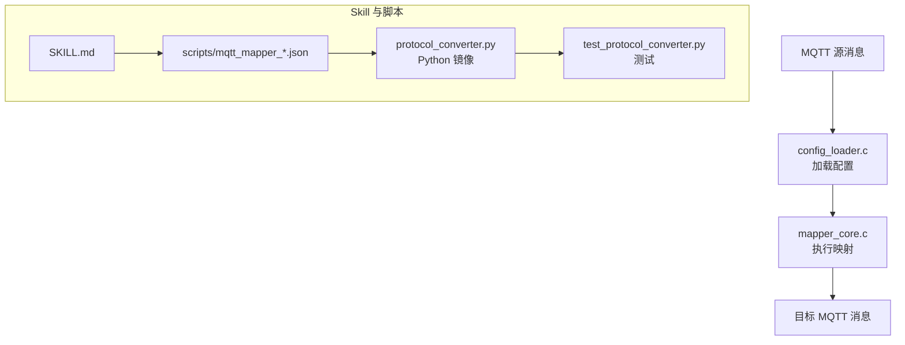
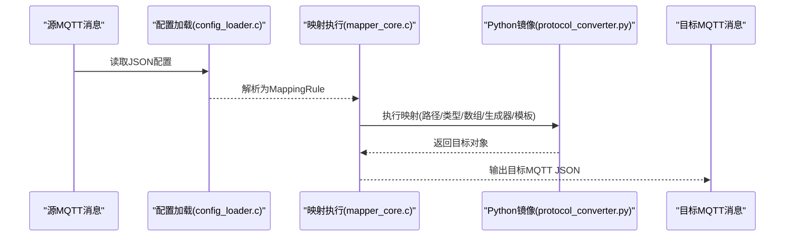
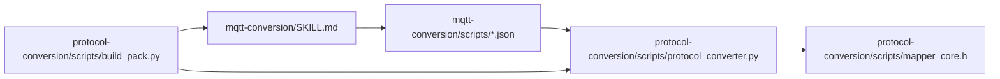
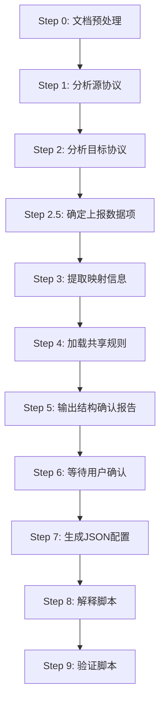

# MQTT转换技能包

<cite>
**本文引用的文件**
- [SKILL.md](file://.trae/skills/mqtt-conversion/SKILL.md)
- [mqtt_mapper_202608261100.json](file://.trae/skills/mqtt-conversion/scripts/mqtt_mapper_202608261100.json)
- [protocol_converter.py](file://.trae/skills/protocol-conversion/scripts/protocol_converter.py)
- [test_protocol_converter.py](file://.trae/skills/protocol-conversion/scripts/test_protocol_converter.py)
- [mapper_core.h](file://.trae/skills/protocol-conversion/scripts/mapper_core.h)
- [build_pack.py](file://.trae/skills/protocol-conversion/scripts/build_pack.py)
- [mcp.json](file://.trae/mcp.json)
</cite>

## 目录
1. [简介](#简介)
2. [项目结构](#项目结构)
3. [核心组件](#核心组件)
4. [架构总览](#架构总览)
5. [详细组件分析](#详细组件分析)
6. [依赖关系分析](#依赖关系分析)
7. [性能考虑](#性能考虑)
8. [故障排查指南](#故障排查指南)
9. [结论](#结论)
10. [附录](#附录)

## 简介
本技能包提供MQTT协议转换能力，将内部MQTT源消息转换为平台要求的MQTT目标格式。其核心由“配置加载引擎”与“映射执行引擎”组成：前者负责读取JSON配置文件并解析为内部规则结构，后者按规则执行字段取值、类型转换、数组遍历、生成器调用与模板替换，最终输出目标MQTT JSON。该方案支持消息发布订阅场景下的主题管理、QoS控制与连接管理的上层编排（具体Broker集成由运行环境实现），并通过可配置的topic_pattern与上下文变量完成主题路由与动态替换。

## 项目结构
MQTT转换技能包位于 .trae/skills/mqtt-conversion，包含技能说明、示例脚本与参考文档；共享映射核心位于 .trae/skills/protocol-conversion，提供Python镜像与C头定义，用于验证与对齐C引擎行为。

图表来源
- [SKILL.md:23-31](file://.trae/skills/mqtt-conversion/SKILL.md#L23-L31)
- [protocol_converter.py:1-16](file://.trae/skills/protocol-conversion/scripts/protocol_converter.py#L1-L16)

章节来源
- [SKILL.md:23-31](file://.trae/skills/mqtt-conversion/SKILL.md#L23-L31)
- [protocol_converter.py:1-16](file://.trae/skills/protocol-conversion/scripts/protocol_converter.py#L1-L16)

## 核心组件
- 配置加载引擎：读取JSON配置文件，解析为MappingRule结构，供映射执行引擎使用。
- 映射执行引擎：按规则进行路径取值、类型转换、数组遍历、生成器调用、模板替换与对象嵌套处理。
- 主题与上下文：通过topic_pattern与上下文变量（如ssl_mqtt_server.gatewayID）实现主题模板替换与运行时注入。
- 生成器与后处理：内置uuid、时间戳、日期格式化等生成器，以及字段级post_process函数（如时间格式转换）。

章节来源
- [SKILL.md:33-55](file://.trae/skills/mqtt-conversion/SKILL.md#L33-L55)
- [protocol_converter.py:204-265](file://.trae/skills/protocol-conversion/scripts/protocol_converter.py#L204-L265)
- [protocol_converter.py:269-376](file://.trae/skills/protocol-conversion/scripts/protocol_converter.py#L269-L376)

## 架构总览
MQTT转换流程遵循“配置驱动”的映射管线：源JSON经配置加载后进入映射执行引擎，逐条处理mappings规则，产出目标JSON。主题层面通过topic_pattern与上下文变量在应用层完成拼接与替换。

图表来源
- [SKILL.md:23-31](file://.trae/skills/mqtt-conversion/SKILL.md#L23-L31)
- [protocol_converter.py:569-583](file://.trae/skills/protocol-conversion/scripts/protocol_converter.py#L569-L583)

## 详细组件分析

### 配置与映射规则
- 根对象字段：platform_name、topic_pattern、post_process、mappings。
- mappings规则字段：target、source_type、source、type、constant、generator、scale、post_process、sub_mappings等，遵循protocol-conversion定义的共享规则。
- MQTT特有：
  - 模板变量替换通过source_type=constant且type=substitute组合触发。
  - item_type支持object与key_value。
  - 数组遍历使用[*]与@锚点配合sub_mappings。

章节来源
- [SKILL.md:33-55](file://.trae/skills/mqtt-conversion/SKILL.md#L33-L55)
- [mqtt_mapper_202608261100.json:1-98](file://.trae/skills/mqtt-conversion/scripts/mqtt_mapper_202608261100.json#L1-L98)

### 主题管理与路由
- topic_pattern：可在配置中声明主题模板，结合上下文变量（如$ssl_mqtt_server.gatewayID$）在运行时替换。
- 上下文变量：通过ctx传入，支持嵌套路径访问，用于模板替换与生成器状态传递。

章节来源
- [SKILL.md:33-42](file://.trae/skills/mqtt-conversion/SKILL.md#L33-L42)
- [protocol_converter.py:240-265](file://.trae/skills/protocol-conversion/scripts/protocol_converter.py#L240-L265)

### QoS级别控制与连接管理
- 本技能包聚焦于“数据内容转换”，QoS与连接管理由上层MQTT客户端/框架负责。建议在应用层根据业务重要性选择QoS（0/1/2），并实现重连、心跳、断线恢复与消息去重策略。

[本节为通用指导，不直接分析具体文件]

### 消息发布与订阅示例
- 发布：将转换后的目标JSON通过MQTT客户端发布到topic_pattern对应的主题。
- 订阅：订阅平台或设备侧的主题，接收源消息后送入转换引擎处理。

[本节为通用指导，不直接分析具体文件]

### 实时数据流处理方案
- 建议采用流式处理：收到源消息→立即构造ctx→执行transform_mqtt→输出目标消息→发布。
- 对高频数据可采用批处理窗口与背压控制，避免阻塞事件循环。

[本节为通用指导，不直接分析具体文件]

### IoT设备集成与消息持久化
- 设备接入：通过MQTT Broker汇聚设备上报，统一入口进入转换流程。
- 持久化：可将转换结果写入消息队列或数据库，确保可靠性与可追溯性。

[本节为通用指导，不直接分析具体文件]

### 安全配置
- 传输安全：启用TLS加密，校验证书链。
- 认证鉴权：使用用户名/密码或Token接入Broker。
- 主题权限：基于ACL限制读写主题范围，防止越权访问。
- 敏感信息：避免在payload中明文传输敏感数据，必要时进行加密或脱敏。

[本节为通用指导，不直接分析具体文件]

### 性能优化建议
- 复用上下文与对象池：减少重复分配。
- 批量转换：合并小消息为批次处理，降低开销。
- 索引与缓存：热点主题或设备ID可缓存映射结果。
- 监控与限流：统计吞吐、延迟与错误率，按需限流。

[本节为通用指导，不直接分析具体文件]

## 依赖关系分析
MQTT转换技能包依赖protocol-conversion提供的共享映射核心（Python镜像与C头定义），并通过构建脚本打包各Skill文件。

图表来源
- [build_pack.py:41-49](file://.trae/skills/protocol-conversion/scripts/build_pack.py#L41-L49)
- [protocol_converter.py:1-16](file://.trae/skills/protocol-conversion/scripts/protocol_converter.py#L1-L16)
- [mapper_core.h:30-64](file://.trae/skills/protocol-conversion/scripts/mapper_core.h#L30-L64)

章节来源
- [build_pack.py:41-49](file://.trae/skills/protocol-conversion/scripts/build_pack.py#L41-L49)
- [protocol_converter.py:1-16](file://.trae/skills/protocol-conversion/scripts/protocol_converter.py#L1-L16)
- [mapper_core.h:30-64](file://.trae/skills/protocol-conversion/scripts/mapper_core.h#L30-L64)

## 性能考虑
- 路径解析复杂度：get_value_by_path对每个字段进行一次路径解析，复杂嵌套会增加开销。建议精简路径与层级。
- 数组遍历：array_foreach会复制与递归处理子规则，注意控制数组规模与深度。
- 生成器与后处理：频繁调用生成器与post_process可能带来CPU压力，尽量复用或批量处理。
- I/O瓶颈：发布与持久化应异步化，避免阻塞转换主流程。

[本节为通用指导，不直接分析具体文件]

## 故障排查指南
- 路径取值失败：检查source/target路径是否正确，确认数组索引与[*]使用是否匹配数据结构。
- 类型转换异常：核对type与source值类型，必要时增加scale或post_process。
- 模板替换未生效：确认context中存在对应键，且模板语法正确（$var$）。
- 数组遍历为空：检查源数组是否为空或路径解析结果为None。
- 测试用例参考：使用test_protocol_converter中的MQTT转换用例进行回归验证。

章节来源
- [test_protocol_converter.py:501-618](file://.trae/skills/protocol-conversion/scripts/test_protocol_converter.py#L501-L618)
- [protocol_converter.py:49-118](file://.trae/skills/protocol-conversion/scripts/protocol_converter.py#L49-L118)
- [protocol_converter.py:395-479](file://.trae/skills/protocol-conversion/scripts/protocol_converter.py#L395-L479)

## 结论
MQTT转换技能包以配置驱动的方式实现了从内部MQTT到平台MQTT的高效、可扩展的数据转换。通过共享映射核心与清晰的规则定义，能够覆盖常见的字段映射、类型转换、数组遍历、生成器与模板替换需求。结合上层的MQTT客户端能力，可实现完整的发布/订阅、主题路由、QoS与连接管理，满足IoT设备的实时数据接入与处理场景。

[本节为总结，不直接分析具体文件]

## 附录

### 工作流程（10步）

图表来源
- [SKILL.md:56-73](file://.trae/skills/mqtt-conversion/SKILL.md#L56-L73)

章节来源
- [SKILL.md:56-73](file://.trae/skills/mqtt-conversion/SKILL.md#L56-L73)

### 真实协议示例与生成配置
- 源协议：iot_agent电气量采集数据（Topic：设备上报，payload为JSON）。
- 目标协议：ywnyems平台协议（Topic：ywnyems/gw/{gatewayId}/up/data，payload为JSON）。
- 生成配置：scripts/mqtt_mapper_YYYYMMDDHHMM.json，包含action、msgId、devId、data.terdata等映射。

章节来源
- [SKILL.md:365-440](file://.trae/skills/mqtt-conversion/SKILL.md#L365-L440)
- [mqtt_mapper_202608261100.json:1-98](file://.trae/skills/mqtt-conversion/scripts/mqtt_mapper_202608261100.json#L1-L98)

### Python镜像与测试
- Python镜像：protocol_converter.py实现MapperCore，镜像C引擎逻辑，提供transform_mqtt入口。
- 测试用例：test_protocol_converter.py覆盖基本字段、数组遍历、substitute、常量与生成器等场景。

章节来源
- [protocol_converter.py:569-583](file://.trae/skills/protocol-conversion/scripts/protocol_converter.py#L569-L583)
- [test_protocol_converter.py:501-618](file://.trae/skills/protocol-conversion/scripts/test_protocol_converter.py#L501-L618)

### MCP服务配置
- mcp.json定义了MCP Server的连接地址与鉴权头，便于Skill与MCP工具协同工作。

章节来源
- [mcp.json:1-1](file://.trae/mcp.json#L1-L1)