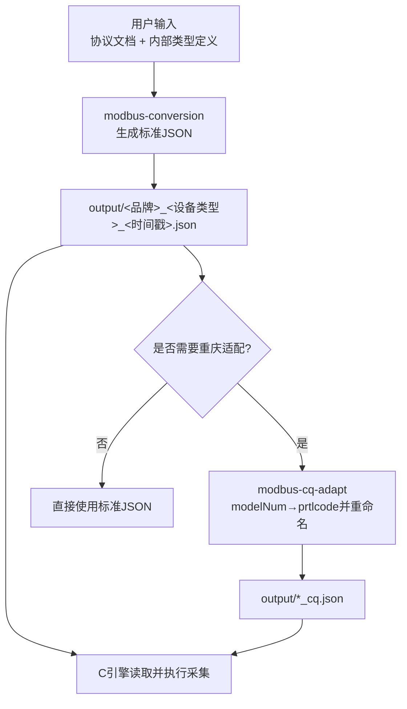
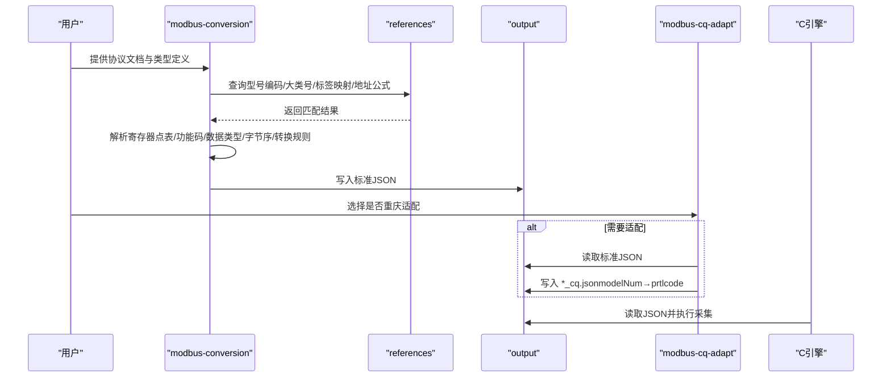
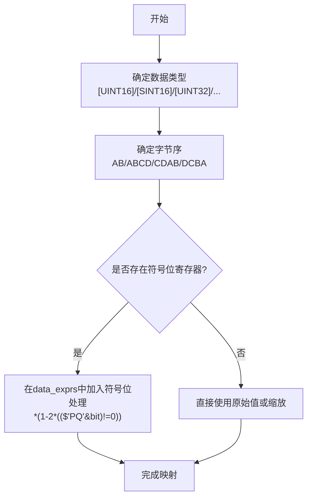
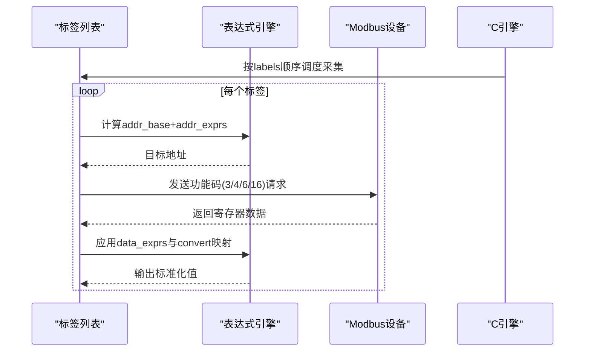
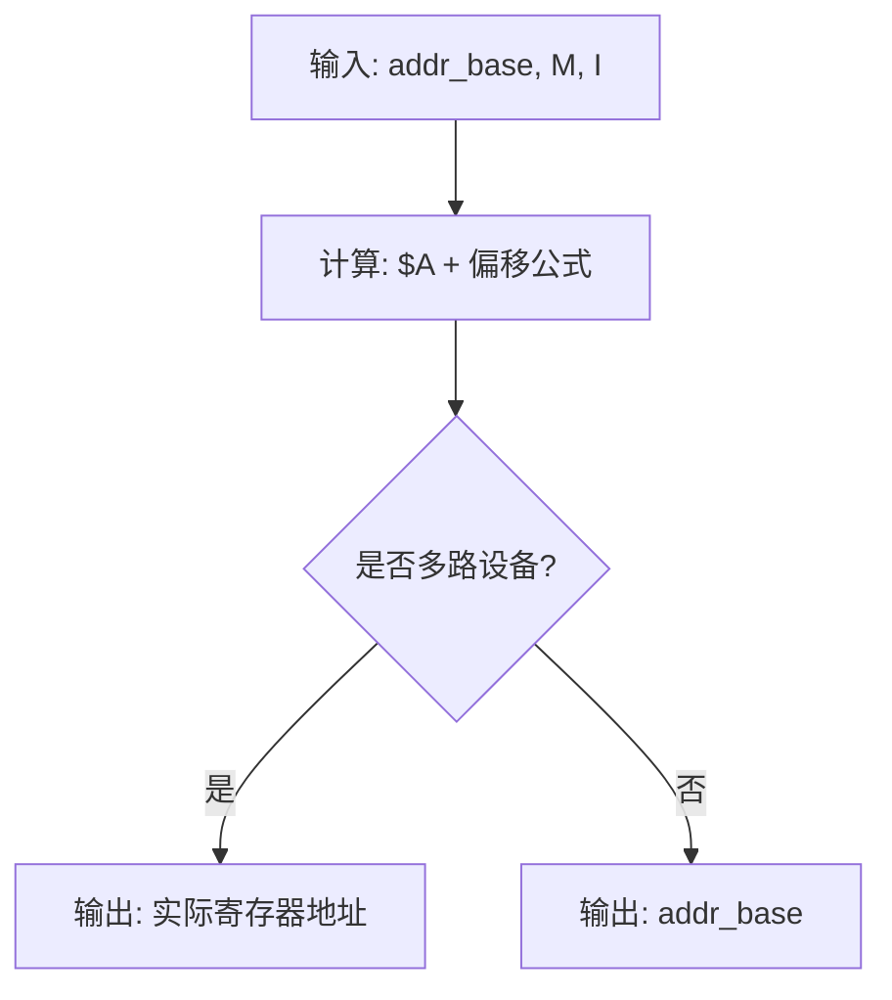
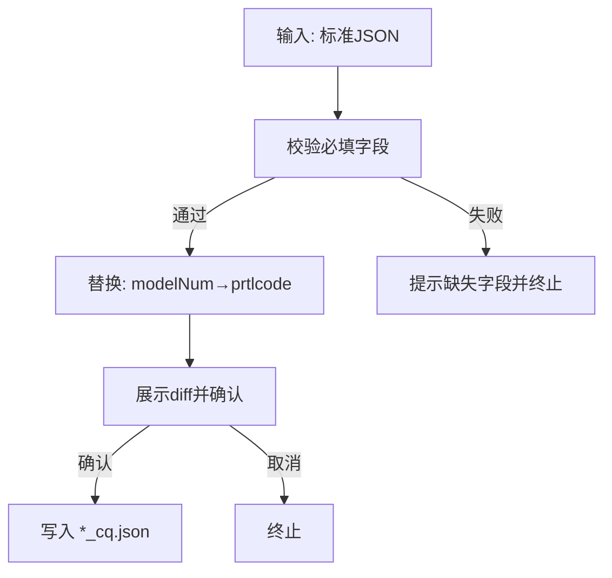
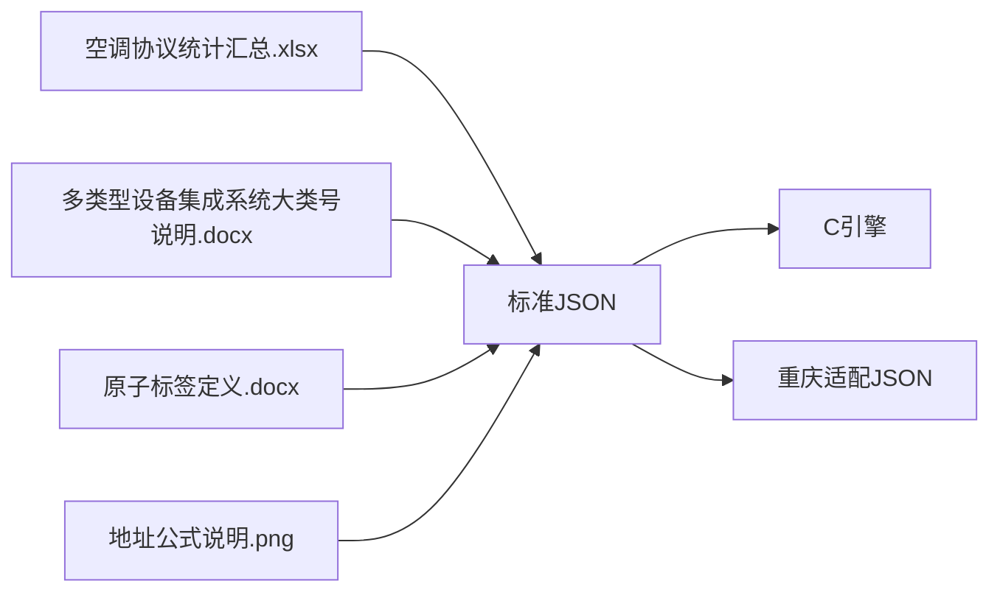

# Modbus转换技能包

<cite>
**本文引用的文件**
- [SKILL.md](file://.trae/skills/modbus-conversion/SKILL.md)
- [SKILL.md](file://.trae/skills/modbus-cq-adapt/SKILL.md)
- [安科瑞_AMC电表_20260827103000.json](file://.trae/skills/modbus-conversion/output/安科瑞_AMC电表_20260827103000.json)
- [蓝控电子科技_环境传感器_20260722152240.json](file://.trae/skills/modbus-conversion/output/蓝控电子科技_环境传感器_20260722152240.json)
- [多类型设备集成系统大类号说明.docx](file://.trae/skills/modbus-conversion/references/多类型设备集成系统大类号说明.docx)
- [原子标签定义.docx](file://.trae/skills/modbus-conversion/references/原子标签定义.docx)
- [地址公式说明.png](file://.trae/skills/modbus-conversion/references/地址公式说明.png)
- [空调协议统计汇总.xlsx](file://.trae/skills/modbus-conversion/references/空调协议统计汇总.xlsx)
</cite>

## 目录
1. [简介](#简介)
2. [项目结构](#项目结构)
3. [核心组件](#核心组件)
4. [架构总览](#架构总览)
5. [详细组件分析](#详细组件分析)
6. [依赖关系分析](#依赖关系分析)
7. [性能与批量处理](#性能与批量处理)
8. [故障诊断与排错](#故障诊断与排错)
9. [结论](#结论)
10. [附录：配置示例与最佳实践](#附录：配置示例与最佳实践)

## 简介
本技能包提供从第三方 Modbus 设备（RTU/TCP）到平台内部统一格式的转换能力，覆盖寄存器映射、数据类型转换、读写操作与批量采集流程。通过“modbus-conversion”生成标准 JSON 配置，再由 C 引擎读取执行；同时提供“modbus-cq-adapt”用于重庆地区脚本适配（字段替换与重命名）。

## 项目结构
- modbus-conversion：负责解析第三方 Modbus 协议文档与内部类型定义，输出供 C 引擎读取的 JSON 配置文件。
- modbus-cq-adapt：对标准 JSON 进行本地字段替换与重命名，生成重庆地区专用版本。
- references：参考文档（型号编码表、大类号说明、原子标签定义、地址公式说明等）。
- output：生成的 JSON 配置文件存放目录。

图表来源
- [SKILL.md:120-136](file://.trae/skills/modbus-conversion/SKILL.md#L120-L136)
- [SKILL.md:79-133](file://.trae/skills/modbus-cq-adapt/SKILL.md#L79-L133)

章节来源
- [SKILL.md:31-45](file://.trae/skills/modbus-conversion/SKILL.md#L31-L45)
- [SKILL.md:28-37](file://.trae/skills/modbus-cq-adapt/SKILL.md#L28-L37)

## 核心组件
- 协议文档分析：提取品牌、型号、协议类型、寄存器点表、功能码、数据类型、字节序、转换规则等。
- 型号与大类号查找：依据参考文档确定 modelNum 与 classNum。
- 数据项映射：将中文名称映射为英文标签，构建 read/write/convert 配置。
- 表达式引擎：支持 $D、$'label_name'、pow、位运算、算术与比较运算。
- 地址表达式：支持多路设备偏移（$A、$M、$I）。
- 枚举映射：convert 将设备原始值映射为内部统一值。
- 重庆适配：将 modelNum 替换为 prtlcode，并重命名输出文件。

章节来源
- [SKILL.md:138-159](file://.trae/skills/modbus-conversion/SKILL.md#L138-L159)
- [SKILL.md:160-191](file://.trae/skills/modbus-conversion/SKILL.md#L160-L191)
- [SKILL.md:192-275](file://.trae/skills/modbus-conversion/SKILL.md#L192-L275)
- [SKILL.md:282-426](file://.trae/skills/modbus-conversion/SKILL.md#L282-L426)
- [SKILL.md:79-133](file://.trae/skills/modbus-cq-adapt/SKILL.md#L79-L133)

## 架构总览
整体流程包括：文档解析 → 型号/大类号定位 → 数据项映射 → 表达式与地址计算 → 生成 JSON →（可选）重庆适配 → C 引擎执行。

图表来源
- [SKILL.md:120-136](file://.trae/skills/modbus-conversion/SKILL.md#L120-L136)
- [SKILL.md:79-133](file://.trae/skills/modbus-cq-adapt/SKILL.md#L79-L133)

## 详细组件分析

### 寄存器映射与数据类型转换
- 数据类型语法：[UINT16]、[SINT16]、[UINT32]、[SINT32]、[FLOAT32]、位提取 [8:15]/[0:7]。
- 字节序：AB（16位大端）、ABCD/CDAB/DCBA（32位不同端序）。
- 符号位处理：当存在符号位寄存器（如 PQ），使用位运算在 data_exprs 中处理符号。
- 跨寄存器引用：data_exprs 中使用 $'label_name' 引用其他标签值，确保辅助参数（PT/CT/DPT/DCT/DPQ/PQ）先于被引用标签采集。

图表来源
- [SKILL.md:284-317](file://.trae/skills/modbus-conversion/SKILL.md#L284-L317)
- [SKILL.md:373-392](file://.trae/skills/modbus-conversion/SKILL.md#L373-L392)

章节来源
- [SKILL.md:284-317](file://.trae/skills/modbus-conversion/SKILL.md#L284-L317)
- [SKILL.md:319-327](file://.trae/skills/modbus-conversion/SKILL.md#L319-L327)
- [SKILL.md:328-346](file://.trae/skills/modbus-conversion/SKILL.md#L328-L346)
- [SKILL.md:373-392](file://.trae/skills/modbus-conversion/SKILL.md#L373-L392)

### 读写操作与批量处理
- 读操作：功能码 3（读保持寄存器）、4（读输入寄存器）。
- 写操作：功能码 6（写单个寄存器）、16（写多个寄存器）。
- 批量处理：taskList.labels 顺序决定采集顺序；辅助参数必须排在被引用标签之前，实现跨寄存器引用与批量采集。

图表来源
- [SKILL.md:59-103](file://.trae/skills/modbus-conversion/SKILL.md#L59-L103)
- [SKILL.md:408-416](file://.trae/skills/modbus-conversion/SKILL.md#L408-L416)
- [SKILL.md:667-678](file://.trae/skills/modbus-conversion/SKILL.md#L667-L678)

章节来源
- [SKILL.md:59-103](file://.trae/skills/modbus-conversion/SKILL.md#L59-L103)
- [SKILL.md:408-416](file://.trae/skills/modbus-conversion/SKILL.md#L408-L416)
- [SKILL.md:667-678](file://.trae/skills/modbus-conversion/SKILL.md#L667-L678)

### 地址表达式与多路设备
- 地址表达式变量：$A（基础地址）、$M（模块号）、$I（通道号）。
- 多路设备偏移：例如 $A+160*16*($M-1)+16*($I-1)。
- 单路设备 addr_exprs 为空字符串。

图表来源
- [SKILL.md:347-355](file://.trae/skills/modbus-conversion/SKILL.md#L347-L355)

章节来源
- [SKILL.md:347-355](file://.trae/skills/modbus-conversion/SKILL.md#L347-L355)

### 重庆地区适配器（modbus-cq-adapt）
- 输入：标准 JSON（含 prtlType、modelNum、classNum、taskList、labelList）。
- 处理：将 modelNum 替换为 prtlcode，其余字段不变。
- 输出：{原文件名}_cq.json，保留原文件。

图表来源
- [SKILL.md:81-133](file://.trae/skills/modbus-cq-adapt/SKILL.md#L81-L133)

章节来源
- [SKILL.md:81-133](file://.trae/skills/modbus-cq-adapt/SKILL.md#L81-L133)

## 依赖关系分析
- 参考文档依赖：
  - 型号编码表：空调协议统计汇总.xlsx（SheetJS1 型号列表）。
  - 大类号说明：多类型设备集成系统大类号说明.docx。
  - 标签映射：原子标签定义.docx。
  - 地址公式：地址公式说明.png。
- 输出依赖：
  - 标准 JSON 由 C 引擎读取执行。
  - 重庆适配 JSON 仅做字段替换，不改变语义。

图表来源
- [SKILL.md:448-472](file://.trae/skills/modbus-conversion/SKILL.md#L448-L472)
- [SKILL.md:81-133](file://.trae/skills/modbus-cq-adapt/SKILL.md#L81-L133)

章节来源
- [SKILL.md:448-472](file://.trae/skills/modbus-conversion/SKILL.md#L448-L472)
- [SKILL.md:81-133](file://.trae/skills/modbus-cq-adapt/SKILL.md#L81-L133)

## 性能与批量处理
- 采集顺序优化：辅助参数（PT/CT/DPT/DCT/DPQ/PQ）优先采集，减少重复读取与表达式求值开销。
- 批量读取：尽量使用功能码 3/4 批量读取连续寄存器，降低通信次数。
- 表达式复杂度控制：避免过深嵌套与频繁跨标签引用，必要时拆分任务或预取辅助参数。
- 多路设备：合理设置 addr_exprs，避免不必要的广播或全总线扫描。

[本节为通用指导，无需具体文件来源]

## 故障诊断与排错
- 常见错误与排查：
  - 网络/串口异常：检查连接、波特率、校验位、停止位与设备地址。
  - 功能码不匹配：确认读/写功能码（3/4/6/16）与设备支持一致。
  - 数据类型/字节序错误：核对 data_type 与 data_order，尤其是 32 位数据的端序。
  - 符号位处理错误：若存在 PQ 等符号位寄存器，需在 data_exprs 中正确应用位运算。
  - 地址偏移错误：多路设备需验证 addr_exprs 是否正确计算模块与通道偏移。
  - 重庆适配失败：确认输入 JSON 包含必填字段，且 modelNum 替换为 prtlcode。
- 建议步骤：
  - 使用抓包工具（Wireshark/tcpdump）或串口调试助手比对报文。
  - 逐步缩小范围：先读取简单寄存器，再增加复杂表达式与批量操作。
  - 对比参考样例：对照已生成的 JSON 样例逐项核对字段。

章节来源
- [SKILL.md:653-678](file://.trae/skills/modbus-conversion/SKILL.md#L653-L678)
- [SKILL.md:81-133](file://.trae/skills/modbus-cq-adapt/SKILL.md#L81-L133)

## 结论
本技能包以“文档驱动”的方式生成标准 Modbus 转换配置，支持 RTU/TCP、多种数据类型与字节序、读写操作与批量采集，并提供重庆地区适配。通过严格的地址与表达式规则、枚举映射与符号位处理，确保工业现场数据的准确采集与统一化。

[本节为总结性内容，无需具体文件来源]

## 附录：配置示例与最佳实践

### 配置示例路径
- 安科瑞 AMC 电表示例：[安科瑞_AMC电表_20260827103000.json](file://.trae/skills/modbus-conversion/output/安科瑞_AMC电表_20260827103000.json)
- 环境传感器示例：[蓝控电子科技_环境传感器_20260722152240.json](file://.trae/skills/modbus-conversion/output/蓝控电子科技_环境传感器_20260722152240.json)

### 最佳实践
- 明确一次值/二次值选择：根据业务需求决定是否乘以 PT/CT 变比。
- 谨慎使用位提取与按位运算：需按位运算时读取整个寄存器，避免位提取冲突。
- 规范标签命名：优先使用原子标签定义的英文标签，确保一致性。
- 充分测试：在沙箱环境中验证表达式与批量采集，再上线生产。
- 重庆适配：仅在需要时使用 modbus-cq-adapt，避免误改标准脚本。

章节来源
- [SKILL.md:473-651](file://.trae/skills/modbus-conversion/SKILL.md#L473-L651)
- [SKILL.md:173-197](file://.trae/skills/modbus-cq-adapt/SKILL.md#L173-L197)