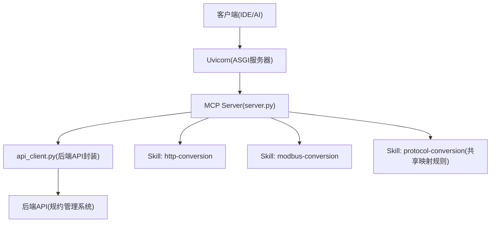
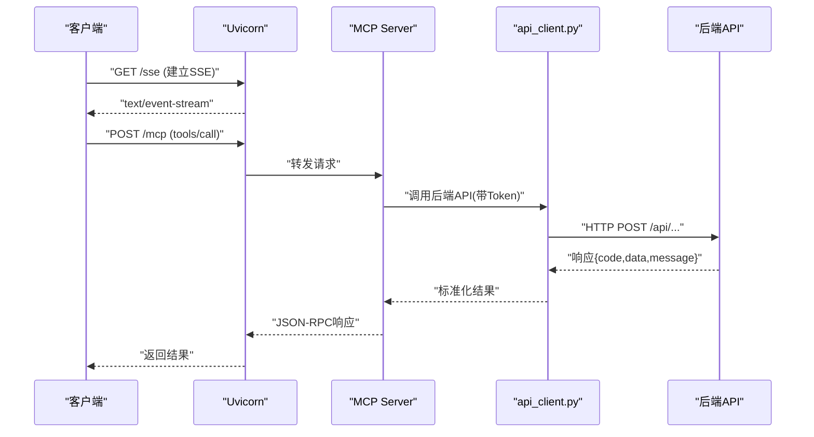
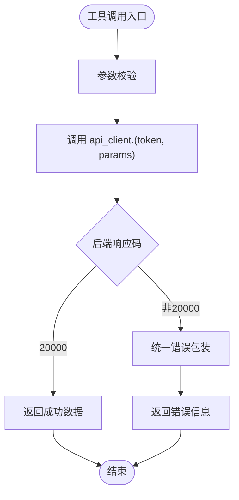
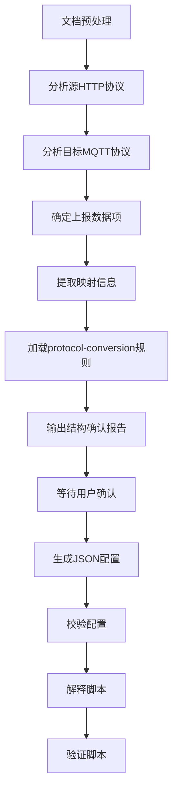
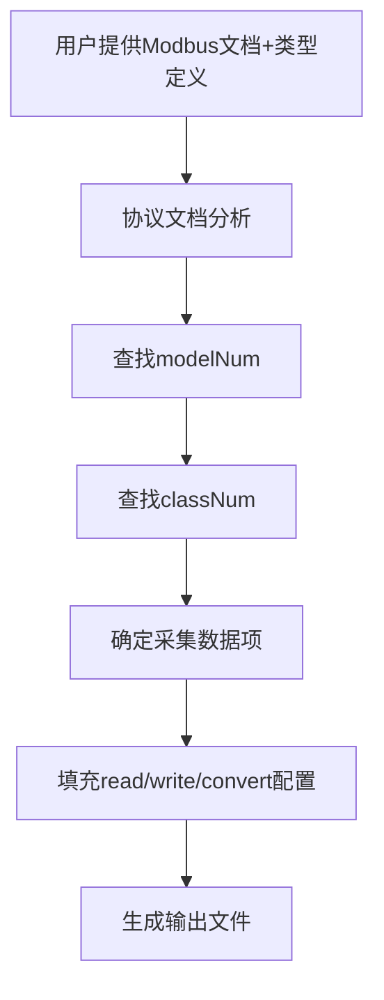
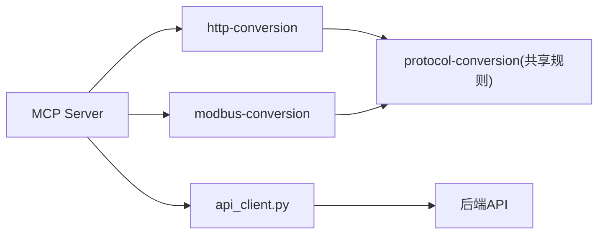

# PCA专用技能包

<cite>
**本文引用的文件**
- [mcp.json](file://.trae/mcp.json)
- [mcp server部署.md](file://mcp server部署.md)
- [规约管理MCP服务化Spec.md](file://规约管理MCP服务化Spec.md)
- [openai.yaml（pca）](file://.trae/skills/pca/agents/openai.yaml)
- [SKILL.md（http-conversion）](file://.trae/skills/http-conversion/SKILL.md)
- [SKILL.md（modbus-conversion）](file://.trae/skills/modbus-conversion/SKILL.md)
- [SKILL.md（protocol-conversion）](file://.trae/skills/protocol-conversion/SKILL.md)
</cite>

## 目录
1. [简介](#简介)
2. [项目结构](#项目结构)
3. [核心组件](#核心组件)
4. [架构总览](#架构总览)
5. [详细组件分析](#详细组件分析)
6. [依赖关系分析](#依赖关系分析)
7. [性能与可靠性](#性能与可靠性)
8. [故障排查指南](#故障排查指南)
9. [结论](#结论)
10. [附录](#附录)

## 简介
本文件为“PCA专用技能包”的权威技术文档，聚焦于该技能包为PCA系统提供的专用功能与工具集。内容涵盖：
- PCA系统的特定业务逻辑、数据模型与操作接口
- 配置选项、业务流程自动化与系统集成示例
- 与其他技能包的协作关系与数据流转方式
- 最佳实践与常见问题解决方案

本项目以MCP协议为核心，通过Uvicorn提供ASGI服务，对外暴露工具能力；同时配套多个Skill（如HTTP转换、Modbus转换、共享映射核心等），形成从协议解析到配置生成的完整流水线。

## 项目结构
- 根目录包含部署说明、规范文档以及IDE/MCP客户端配置文件
- mcp_server 提供服务端脚本与依赖声明
- .trae/skills 下按协议/场景划分多个Skill，其中 pca 作为入口标识，http-conversion、modbus-conversion、protocol-conversion 构成核心转换能力
- openspec 用于变更管理与规范沉淀

图表来源
- [mcp server部署.md:110-280](file://mcp server部署.md#L110-L280)
- [规约管理MCP服务化Spec.md:44-67](file://规约管理MCP服务化Spec.md#L44-L67)

章节来源
- [mcp server部署.md:25-127](file://mcp server部署.md#L25-L127)
- [mcp server部署.md:283-501](file://mcp server部署.md#L283-L501)

## 核心组件
- MCP Server（server.py）：注册工具、处理鉴权中间件、路由SSE与JSON-RPC请求
- API客户端（api_client.py）：封装后端HTTP调用，统一错误处理与Token注入
- Skill集合：
  - http-conversion：生成HTTP→MQTT映射配置
  - modbus-conversion：生成Modbus寄存器→内部格式映射配置
  - protocol-conversion：定义共享映射规则（路径语法、类型系统、数组遍历准则等）
- 部署脚本：install.bat/start.bat 负责环境初始化、Token生成与服务启动

章节来源
- [mcp server部署.md:110-280](file://mcp server部署.md#L110-L280)
- [mcp server部署.md:283-501](file://mcp server部署.md#L283-L501)
- [规约管理MCP服务化Spec.md:44-67](file://规约管理MCP服务化Spec.md#L44-L67)

## 架构总览
PCA技能包采用“MCP工具 + Skill编排 + 后端API”的分层架构：
- 接入层：Uvicorn监听端口，承载SSE长连接与HTTP请求
- 应用层：MCP Server实现工具注册与鉴权，将请求路由至具体工具函数
- 集成层：api_client.py统一调用后端API，返回标准化结果
- 编排层：Skill根据业务场景组织工具调用顺序，完成端到端流程

图表来源
- [mcp server部署.md:163-280](file://mcp server部署.md#L163-L280)
- [规约管理MCP服务化Spec.md:295-319](file://规约管理MCP服务化Spec.md#L295-L319)

## 详细组件分析

### 组件A：MCP Server与工具注册
- 职责：注册工具、鉴权中间件、SSE与JSON-RPC路由
- 关键变更：删除旧桩工具，新增47个工具函数，每个工具对应一个后端API
- 典型模式：工具函数接收token与业务参数，委托api_client执行并返回结果

图表来源
- [规约管理MCP服务化Spec.md:247-286](file://规约管理MCP服务化Spec.md#L247-L286)
- [规约管理MCP服务化Spec.md:132-246](file://规约管理MCP服务化Spec.md#L132-L246)

章节来源
- [规约管理MCP服务化Spec.md:247-286](file://规约管理MCP服务化Spec.md#L247-L286)

### 组件B：HTTP协议转换Skill
- 目标：分析第三方HTTP/REST与内部MQTT目标协议，生成C引擎可读取的JSON配置
- 工作流：文档预处理 → 源/目标协议分析 → 映射表设计 → 用户确认 → 生成配置 → 校验 → 解释与验证
- 核心规则：base_url/domain/timeout/token/apis结构；array_foreach与item_type；preprocess/url_to_base64等

图表来源
- [SKILL.md（http-conversion）:89-107](file://.trae/skills/http-conversion/SKILL.md#L89-L107)

章节来源
- [SKILL.md（http-conversion）:1-117](file://.trae/skills/http-conversion/SKILL.md#L1-L117)
- [SKILL.md（http-conversion）:396-421](file://.trae/skills/http-conversion/SKILL.md#L396-L421)

### 组件C：Modbus协议转换Skill
- 目标：分析Modbus协议与内部类型定义，生成寄存器→内部格式的JSON配置
- 关键点：数据类型语法、字节序、地址表达式、数据表达式、符号位处理、枚举映射
- 输出：output/{品牌}_{设备类型}_{日期}.json

图表来源
- [SKILL.md（modbus-conversion）:120-136](file://.trae/skills/modbus-conversion/SKILL.md#L120-L136)

章节来源
- [SKILL.md（modbus-conversion）:120-136](file://.trae/skills/modbus-conversion/SKILL.md#L120-L136)
- [SKILL.md（modbus-conversion）:282-426](file://.trae/skills/modbus-conversion/SKILL.md#L282-L426)

### 组件D：共享映射核心（protocol-conversion）
- 角色：定义MQTT与HTTP共用的映射规则，被其他Skill在映射步骤加载引用
- 覆盖范围：映射字段、路径语法、类型系统、数组遍历准则、模板变量替换、生成器清单
- 价值：统一不同协议的映射语义，降低重复定义与维护成本

章节来源
- [SKILL.md（protocol-conversion）:1-57](file://.trae/skills/protocol-conversion/SKILL.md#L1-L57)
- [SKILL.md（protocol-conversion）:58-125](file://.trae/skills/protocol-conversion/SKILL.md#L58-L125)
- [SKILL.md（protocol-conversion）:126-200](file://.trae/skills/protocol-conversion/SKILL.md#L126-L200)

## 依赖关系分析
- 运行时依赖：mcp、uvicorn
- 工具链依赖：httpx（用于异步HTTP调用）
- 外部集成：后端规约管理系统API（认证头为自定义Token）
- Skill间依赖：http-conversion与modbus-conversion均依赖protocol-conversion的共享规则

图表来源
- [mcp server部署.md:38-108](file://mcp server部署.md#L38-L108)
- [规约管理MCP服务化Spec.md:44-67](file://规约管理MCP服务化Spec.md#L44-L67)
- [SKILL.md（http-conversion）:23-31](file://.trae/skills/http-conversion/SKILL.md#L23-L31)
- [SKILL.md（modbus-conversion）:47-57](file://.trae/skills/modbus-conversion/SKILL.md#L47-L57)
- [SKILL.md（protocol-conversion）:23-35](file://.trae/skills/protocol-conversion/SKILL.md#L23-L35)

章节来源
- [mcp server部署.md:38-108](file://mcp server部署.md#L38-L108)
- [规约管理MCP服务化Spec.md:44-67](file://规约管理MCP服务化Spec.md#L44-L67)

## 性能与可靠性
- 高并发：Uvicorn基于异步事件循环，适合I/O密集型任务
- 超时与重试：建议为httpx设置合理超时，并在网络异常时进行有限重试
- 错误隔离：每个工具独立调用后端API，失败不影响其他工具
- 资源管理：确保httpx客户端生命周期管理，避免连接泄漏

[本节为通用指导，不直接分析具体文件]

## 故障排查指南
- Python未安装或版本过低：检查Python版本并确保≥3.10
- 虚拟环境创建失败：权限不足或磁盘空间不足
- 依赖安装失败：网络问题或pip版本过低，可使用国内镜像源
- 启动时找不到虚拟环境：先运行install.bat
- Token未配置：运行install.bat或手动创建.env
- 端口被占用：查找并结束占用进程，或修改端口
- 移动项目后虚拟环境失效：删除旧.venv并重新运行install.bat

章节来源
- [mcp server部署.md:505-643](file://mcp server部署.md#L505-L643)

## 结论
PCA专用技能包以MCP协议为核心，结合多Skill与后端API，实现了从协议解析到配置生成的全链路自动化。通过统一的映射规则与清晰的职责分层，提升了扩展性与可维护性。建议在生产环境中强化认证、加密与审计，并结合监控与日志完善可靠性保障。

[本节为总结性内容，不直接分析具体文件]

## 附录

### 配置与集成要点
- MCP客户端配置：.trae/mcp.json中指定URL与Authorization头
- 环境变量：.env中存放MCP_AUTH_TOKEN
- 启动命令：start.bat激活虚拟环境并启动服务

章节来源
- [mcp.json:1-1](file://.trae/mcp.json#L1-L1)
- [mcp server部署.md:309-380](file://mcp server部署.md#L309-L380)
- [mcp server部署.md:415-460](file://mcp server部署.md#L415-L460)

### 业务流程自动化示例（Skill视角）
- 登录获取Token
- 查询列表（如品牌/型号/规约）
- 新增/更新/删除实体
- 生成脚本与导出数据

章节来源
- [规约管理MCP服务化Spec.md:295-319](file://规约管理MCP服务化Spec.md#L295-L319)

### 最佳实践
- 工具粒度：细粒度工具便于复用与错误隔离
- Token传递：显式传入Token，无状态更透明
- 错误处理：统一包装网络、业务与HTTP异常
- 配置校验：生成后执行规则校验，减少部署风险
- 用户确认：关键步骤需用户确认后再继续

章节来源
- [规约管理MCP服务化Spec.md:32-43](file://规约管理MCP服务化Spec.md#L32-L43)
- [SKILL.md（http-conversion）:315-345](file://.trae/skills/http-conversion/SKILL.md#L315-L345)