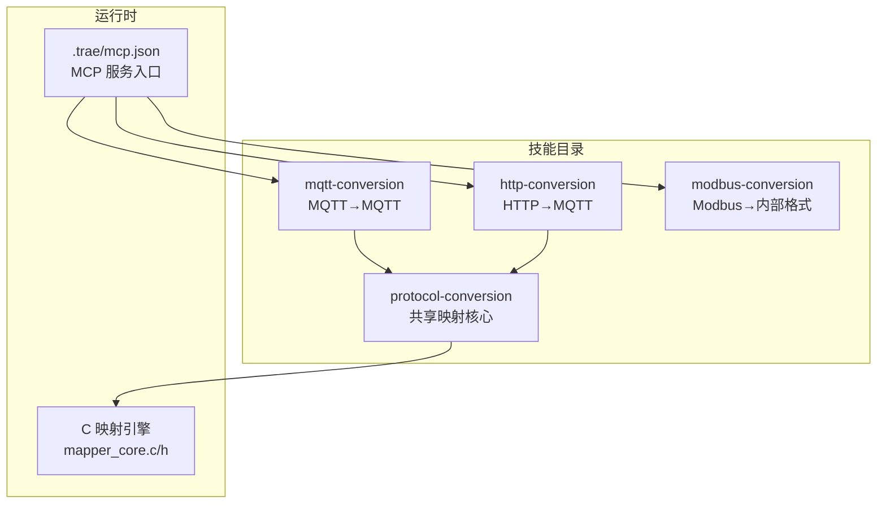
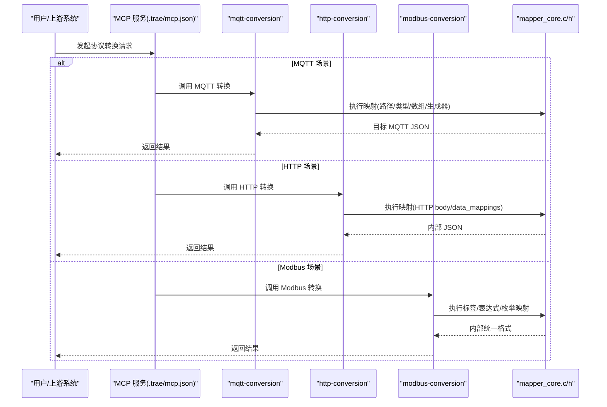
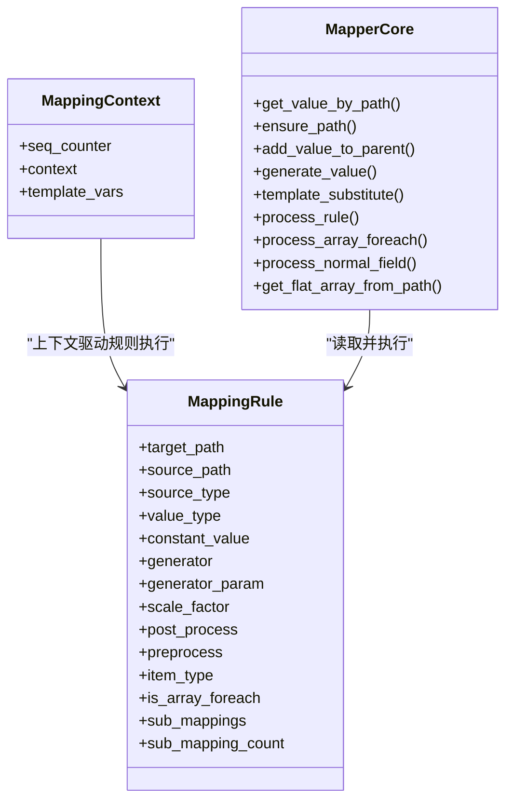
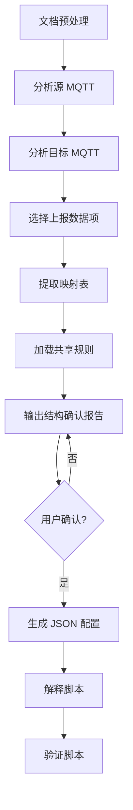
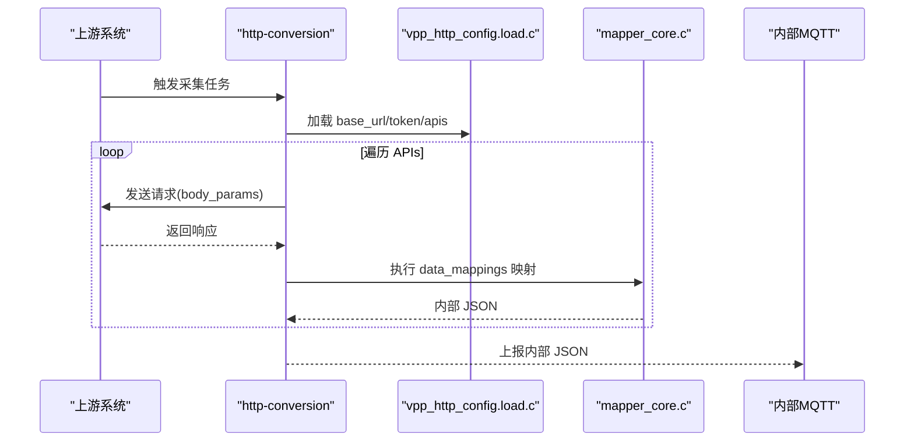
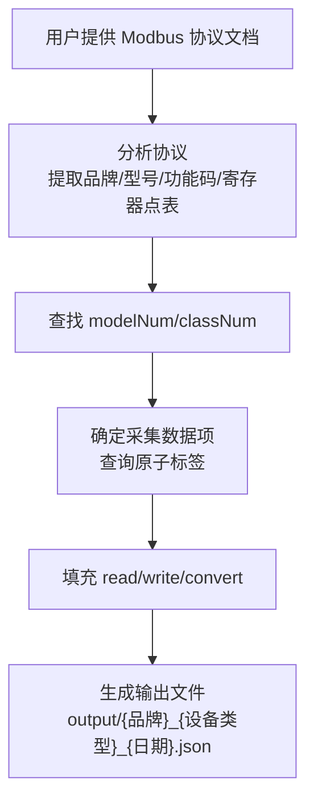
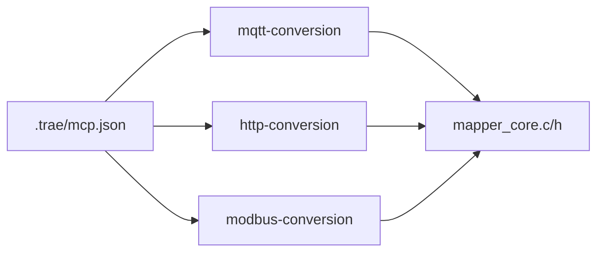

# 内置技能包说明

<cite>
**本文引用的文件**
- [.trae/mcp.json](file://.trae/mcp.json)
- [.trae/skills/protocol-conversion/SKILL.md](file://.trae/skills/protocol-conversion/SKILL.md)
- [.trae/skills/http-conversion/SKILL.md](file://.trae/skills/http-conversion/SKILL.md)
- [.trae/skills/modbus-conversion/SKILL.md](file://.trae/skills/modbus-conversion/SKILL.md)
- [.trae/skills/mqtt-conversion/SKILL.md](file://.trae/skills/mqtt-conversion/SKILL.md)
- [.trae/skills/protocol-conversion/scripts/mapper_core.h](file://.trae/skills/protocol-conversion/scripts/mapper_core.h)
- [.trae/skills/protocol-conversion/scripts/build_pack.py](file://.trae/skills/protocol-conversion/scripts/build_pack.py)
</cite>

## 目录
1. [简介](#简介)
2. [项目结构](#项目结构)
3. [核心组件](#核心组件)
4. [架构总览](#架构总览)
5. [详细组件分析](#详细组件分析)
6. [依赖关系分析](#依赖关系分析)
7. [性能与扩展性](#性能与扩展性)
8. [故障排查指南](#故障排查指南)
9. [结论](#结论)
10. [附录：配置与调用示例](#附录配置与调用示例)

## 简介
本说明文档面向“协议转换”系列内置技能包，覆盖以下能力：
- protocol-conversion（共享映射核心）：定义 MQTT 与 HTTP 共用的映射规则、路径语法、类型系统、数组遍历准则、生成器清单等。
- mqtt-conversion（MQTT 转换）：将内部 MQTT 源消息转换为平台要求的 MQTT 目标格式。
- http-conversion（HTTP 转换）：采集第三方 HTTP/REST 接口数据，转换为内部 JSON 并通过 MQTT 上报。
- modbus-conversion（Modbus 转换）：从 Modbus RTU/TCP 设备读取寄存器数据，按字节序、字序、位序、比例系数、动态精度、符号位等工业规则转换为内部统一格式。

这些技能通过统一的 C 映射引擎（mapper_core.c/h）执行字段取值、类型转换、数组遍历、生成器调用与模板替换；各协议差异仅在“配置加载层”和“外层包装”。

## 项目结构
- .trae/skills 下包含多个独立技能目录，每个技能提供 SKILL.md（使用规范）、agents（Agent 配置）、references（参考文档）、scripts（脚本或工具）等。
- protocol-conversion 是共享核心，被 mqtt-conversion 与 http-conversion 引用。
- mcp.json 定义了 MCP 服务接入点（例如 xl-protocol-agent），用于在运行时调用协议转换能力。

图表来源
- [.trae/skills/protocol-conversion/SKILL.md:23-35](file://.trae/skills/protocol-conversion/SKILL.md#L23-L35)
- [.trae/skills/mqtt-conversion/SKILL.md:23-31](file://.trae/skills/mqtt-conversion/SKILL.md#L23-L31)
- [.trae/skills/http-conversion/SKILL.md:23-31](file://.trae/skills/http-conversion/SKILL.md#L23-L31)
- [.trae/mcp.json:1-1](file://.trae/mcp.json#L1-L1)

章节来源
- [.trae/skills/protocol-conversion/SKILL.md:23-35](file://.trae/skills/protocol-conversion/SKILL.md#L23-L35)
- [.trae/skills/mqtt-conversion/SKILL.md:23-31](file://.trae/skills/mqtt-conversion/SKILL.md#L23-L31)
- [.trae/skills/http-conversion/SKILL.md:23-31](file://.trae/skills/http-conversion/SKILL.md#23-L31)
- [.trae/mcp.json:1-1](file://.trae/mcp.json#L1-L1)

## 核心组件
- 共享映射核心（protocol-conversion）
  - 职责：定义统一的映射规则、路径语法、类型系统、数组遍历准则、生成器清单、模板变量替换机制。
  - 关键数据结构：MappingRule（目标路径、源路径、source_type、value_type、constant、generator、scale、post_process、preprocess、item_type、sub_mappings）。
  - 关键函数：get_value_by_path、ensure_path、add_value_to_parent、generate_value、template_substitute、process_rule、process_array_foreach、process_normal_field、get_flat_array_from_path。
- MQTT 转换（mqtt-conversion）
  - 职责：解析内部 MQTT 源消息，按 platform_name + mappings[] 配置转换为平台 MQTT 目标消息。
  - 配置加载：config_loader.c；映射执行：mapper_core.c。
- HTTP 转换（http-conversion）
  - 职责：解析第三方 HTTP/REST 响应，按 base_url + token + apis[] 配置转换为内部 JSON（随后通过 MQTT 上报）。
  - 配置加载：vpp_http_config.load.c；映射执行：mapper_core.c。
- Modbus 转换（modbus-conversion）
  - 职责：解析 Modbus 寄存器数据，按 prtlType/modelNum/classNum/taskList/labelList 配置完成读/写与枚举映射，输出内部统一格式。

章节来源
- [.trae/skills/protocol-conversion/SKILL.md:37-57](file://.trae/skills/protocol-conversion/SKILL.md#L37-L57)
- [.trae/skills/protocol-conversion/scripts/mapper_core.h:36-64](file://.trae/skills/protocol-conversion/scripts/mapper_core.h#L36-L64)
- [.trae/skills/mqtt-conversion/SKILL.md:33-54](file://.trae/skills/mqtt-conversion/SKILL.md#L33-L54)
- [.trae/skills/http-conversion/SKILL.md:33-88](file://.trae/skills/http-conversion/SKILL.md#L33-L88)
- [.trae/skills/modbus-conversion/SKILL.md:47-119](file://.trae/skills/modbus-conversion/SKILL.md#L47-L119)

## 架构总览
统一映射引擎将“配置加载层”与“映射执行层”解耦：
- MQTT：config_loader.c → mapper_core.c → 目标 MQTT JSON
- HTTP：vpp_http_config.load.c → mapper_core.c → 内部 MQTT JSON
- Modbus：基于标签与表达式引擎，输出内部统一格式

图表来源
- [.trae/mcp.json:1-1](file://.trae/mcp.json#L1-L1)
- [.trae/skills/protocol-conversion/scripts/mapper_core.h:70-152](file://.trae/skills/protocol-conversion/scripts/mapper_core.h#L70-L152)
- [.trae/skills/mqtt-conversion/SKILL.md:23-31](file://.trae/skills/mqtt-conversion/SKILL.md#L23-L31)
- [.trae/skills/http-conversion/SKILL.md:23-31](file://.trae/skills/http-conversion/SKILL.md#L23-L31)

## 详细组件分析

### protocol-conversion（共享映射核心）
- 角色定位：被 mqtt-conversion 与 http-conversion 在“映射步骤”引用，提供统一规则与测试镜像。
- 路径语法：支持 a.b.c、a[0]、a[*]、@ 锚点、$item/$idx、"." 根对象。
- 类型系统：string/double/int/long/bool/object/substitute，支持 scale 缩放。
- source_type：path、constant、generated、array_foreach、context。
- 数组遍历：以目标结构为准决定遍历或固定索引；支持多层嵌套 @ 与 item_type object/key_value。
- 模板替换：constant + type=substitute，变量来自 template_vars.def（如 ssl_mqtt_server.gatewayID）。
- 生成器：uuid、current_timestamp、datetime_compact、md5_sign、batch_id、sequence 等。
- Python 镜像与测试：protocol_converter.py + test_protocol_converter.py（91 项测试）。

图表来源
- [.trae/skills/protocol-conversion/scripts/mapper_core.h:36-64](file://.trae/skills/protocol-conversion/scripts/mapper_core.h#L36-L64)
- [.trae/skills/protocol-conversion/scripts/mapper_core.h:70-152](file://.trae/skills/protocol-conversion/scripts/mapper_core.h#L70-L152)

章节来源
- [.trae/skills/protocol-conversion/SKILL.md:37-57](file://.trae/skills/protocol-conversion/SKILL.md#L37-L57)
- [.trae/skills/protocol-conversion/SKILL.md:58-125](file://.trae/skills/protocol-conversion/SKILL.md#L58-L125)
- [.trae/skills/protocol-conversion/SKILL.md:126-195](file://.trae/skills/protocol-conversion/SKILL.md#L126-L195)
- [.trae/skills/protocol-conversion/SKILL.md:196-279](file://.trae/skills/protocol-conversion/SKILL.md#L196-L279)
- [.trae/skills/protocol-conversion/SKILL.md:301-338](file://.trae/skills/protocol-conversion/SKILL.md#L301-L338)

### mqtt-conversion（MQTT 转换）
- 目标：将内部 MQTT 源消息转换为平台 MQTT 目标消息。
- 配置格式：platform_name + topic_pattern + post_process + mappings[]。
- 工作流：文档预处理 → 源/目标协议分析 → 确定上报数据项 → 提取映射 → 加载共享规则 → 结构确认报告 → 用户确认 → 生成 JSON → 解释 → 验证。
- 关键点：substitute 通过 constant + type=substitute；数组遍历遵循共享规则；可指定全局后处理函数。

图表来源
- [.trae/skills/mqtt-conversion/SKILL.md:56-73](file://.trae/skills/mqtt-conversion/SKILL.md#L56-L73)
- [.trae/skills/mqtt-conversion/SKILL.md:85-113](file://.trae/skills/mqtt-conversion/SKILL.md#L85-L113)
- [.trae/skills/mqtt-conversion/SKILL.md:114-189](file://.trae/skills/mqtt-conversion/SKILL.md#L114-L189)
- [.trae/skills/mqtt-conversion/SKILL.md:191-221](file://.trae/skills/mqtt-conversion/SKILL.md#L191-L221)
- [.trae/skills/mqtt-conversion/SKILL.md:223-309](file://.trae/skills/mqtt-conversion/SKILL.md#L223-L309)

章节来源
- [.trae/skills/mqtt-conversion/SKILL.md:23-54](file://.trae/skills/mqtt-conversion/SKILL.md#L23-L54)
- [.trae/skills/mqtt-conversion/SKILL.md:56-73](file://.trae/skills/mqtt-conversion/SKILL.md#L56-L73)
- [.trae/skills/mqtt-conversion/SKILL.md:85-113](file://.trae/skills/mqtt-conversion/SKILL.md#L85-L113)
- [.trae/skills/mqtt-conversion/SKILL.md:114-189](file://.trae/skills/mqtt-conversion/SKILL.md#L114-L189)
- [.trae/skills/mqtt-conversion/SKILL.md:191-309](file://.trae/skills/mqtt-conversion/SKILL.md#L191-L309)

### http-conversion（HTTP 转换）
- 目标：采集第三方 HTTP/REST 接口数据，转换为内部 JSON 并通过 MQTT 上报。
- 配置格式：base_url + timeout/domain + token{login_params} + apis[{body_params, data_mappings}]。
- 工作流：文档预处理 → 源/目标协议分析 → 确定上报数据项 → 提取映射 → 加载共享规则 → 结构确认报告 → 用户确认 → 生成 JSON → 校验 → 解释 → 验证。
- 关键点：context 上下文变量；链式调用 next_api；url_to_base64 预处理；domain 自动提取；int 常量修正。

图表来源
- [.trae/skills/http-conversion/SKILL.md:23-31](file://.trae/skills/http-conversion/SKILL.md#L23-L31)
- [.trae/skills/http-conversion/SKILL.md:33-88](file://.trae/skills/http-conversion/SKILL.md#L33-L88)
- [.trae/skills/http-conversion/SKILL.md:89-107](file://.trae/skills/http-conversion/SKILL.md#L89-L107)
- [.trae/skills/http-conversion/SKILL.md:396-421](file://.trae/skills/http-conversion/SKILL.md#L396-L421)

章节来源
- [.trae/skills/http-conversion/SKILL.md:23-31](file://.trae/skills/http-conversion/SKILL.md#L23-L31)
- [.trae/skills/http-conversion/SKILL.md:33-88](file://.trae/skills/http-conversion/SKILL.md#L33-L88)
- [.trae/skills/http-conversion/SKILL.md:89-107](file://.trae/skills/http-conversion/SKILL.md#L89-L107)
- [.trae/skills/http-conversion/SKILL.md:119-145](file://.trae/skills/http-conversion/SKILL.md#L119-L145)
- [.trae/skills/http-conversion/SKILL.md:147-260](file://.trae/skills/http-conversion/SKILL.md#L147-L260)
- [.trae/skills/http-conversion/SKILL.md:319-345](file://.trae/skills/http-conversion/SKILL.md#L319-L345)
- [.trae/skills/http-conversion/SKILL.md:396-421](file://.trae/skills/http-conversion/SKILL.md#L396-L421)

### modbus-conversion（Modbus 转换）
- 目标：从 Modbus RTU/TCP 设备读取寄存器数据，转换为内部统一格式。
- 配置格式：prtlType/modelNum/classNum/taskList/labelList（read/write/convert）。
- 工作流：协议文档分析 → 查找 modelNum/classNum → 确定采集数据项 → 填充 read/write/convert → 生成输出文件。
- 关键点：data_type 语法、data_order 字节序、data_exprs 表达式引擎、addr_exprs 地址偏移、convert 枚举映射、符号位处理、一次值/二次值选择。

图表来源
- [.trae/skills/modbus-conversion/SKILL.md:120-136](file://.trae/skills/modbus-conversion/SKILL.md#L120-L136)
- [.trae/skills/modbus-conversion/SKILL.md:138-159](file://.trae/skills/modbus-conversion/SKILL.md#L138-L159)
- [.trae/skills/modbus-conversion/SKILL.md:160-191](file://.trae/skills/modbus-conversion/SKILL.md#L160-L191)
- [.trae/skills/modbus-conversion/SKILL.md:192-275](file://.trae/skills/modbus-conversion/SKILL.md#L192-L275)
- [.trae/skills/modbus-conversion/SKILL.md:276-281](file://.trae/skills/modbus-conversion/SKILL.md#L276-L281)

章节来源
- [.trae/skills/modbus-conversion/SKILL.md:47-119](file://.trae/skills/modbus-conversion/SKILL.md#L47-L119)
- [.trae/skills/modbus-conversion/SKILL.md:120-136](file://.trae/skills/modbus-conversion/SKILL.md#L120-L136)
- [.trae/skills/modbus-conversion/SKILL.md:138-159](file://.trae/skills/modbus-conversion/SKILL.md#L138-L159)
- [.trae/skills/modbus-conversion/SKILL.md:160-191](file://.trae/skills/modbus-conversion/SKILL.md#L160-L191)
- [.trae/skills/modbus-conversion/SKILL.md:192-275](file://.trae/skills/modbus-conversion/SKILL.md#L192-L275)
- [.trae/skills/modbus-conversion/SKILL.md:276-281](file://.trae/skills/modbus-conversion/SKILL.md#L276-L281)

## 依赖关系分析
- 共享核心依赖：所有协议转换均依赖 mapper_core.c/h 提供的统一映射能力。
- 配置加载层差异：
  - MQTT：config_loader.c 负责 platform_name + mappings[]。
  - HTTP：vpp_http_config.load.c 负责 base_url + token + apis[]。
  - Modbus：基于标签与表达式引擎，不直接复用上述两个加载器。
- MCP 集成：.trae/mcp.json 提供协议转换服务的访问入口（URL、鉴权头）。

图表来源
- [.trae/mcp.json:1-1](file://.trae/mcp.json#L1-L1)
- [.trae/skills/protocol-conversion/scripts/mapper_core.h:70-152](file://.trae/skills/protocol-conversion/scripts/mapper_core.h#L70-L152)
- [.trae/skills/mqtt-conversion/SKILL.md:23-31](file://.trae/skills/mqtt-conversion/SKILL.md#L23-L31)
- [.trae/skills/http-conversion/SKILL.md:23-31](file://.trae/skills/http-conversion/SKILL.md#L23-L31)

章节来源
- [.trae/mcp.json:1-1](file://.trae/mcp.json#L1-L1)
- [.trae/skills/protocol-conversion/SKILL.md:23-35](file://.trae/skills/protocol-conversion/SKILL.md#L23-L35)
- [.trae/skills/mqtt-conversion/SKILL.md:23-31](file://.trae/skills/mqtt-conversion/SKILL.md#L23-L31)
- [.trae/skills/http-conversion/SKILL.md:23-31](file://.trae/skills/http-conversion/SKILL.md#L23-L31)

## 性能与扩展性
- 性能特性
  - 统一映射引擎减少重复实现，提升一致性与维护效率。
  - 数组遍历与 ensure_path 自动建路径，降低复杂结构的构建成本。
  - 生成器与模板替换在映射阶段完成，避免额外后处理开销。
- 扩展建议
  - 新增协议时优先复用 mapper_core.c/h，仅实现对应配置加载层。
  - 通过增加 generator/preprocess/post_process 扩展能力，尽量减少硬编码逻辑。
  - 保持配置格式与引擎对齐，避免偏离约定导致兼容性问题。

## 故障排查指南
- 常见错误与修复
  - 引擎引用错误：MQTT 应使用 config_loader.c + mapper_core.c；HTTP 应使用 vpp_http_config.load.c + mapper_core.c。
  - 数组误用：目标为 Object 却使用 @ 遍历；应按目标类型选择固定索引或遍历。
  - 常量键名错误：JSON 键名为 constant，非 constant_value。
  - substitute 配置错误：需使用 source_type="constant" + type="substitute"。
  - 过度依赖后处理：优先使用 scale/constant/substitute/generated 声明式字段。
- 调试建议
  - 使用 Python 镜像与测试套件进行本地验证（protocol_converter.py + test_protocol_converter.py）。
  - 对复杂数组与嵌套结构，逐步缩小范围验证 ensure_path 与 array_foreach。
  - 检查 domain、timeout、token.expires_in 等默认值是否符合预期。

章节来源
- [.trae/skills/protocol-conversion/SKILL.md:408-452](file://.trae/skills/protocol-conversion/SKILL.md#L408-L452)
- [.trae/skills/protocol-conversion/SKILL.md:301-338](file://.trae/skills/protocol-conversion/SKILL.md#L301-L338)
- [.trae/skills/http-conversion/SKILL.md:331-345](file://.trae/skills/http-conversion/SKILL.md#L331-L345)

## 结论
- protocol-conversion 作为共享核心，统一了路径语法、类型系统、数组遍历、生成器与模板替换机制，显著降低了多协议的重复实现成本。
- mqtt-conversion 与 http-conversion 分别针对 MQTT→MQTT 与 HTTP→MQTT 场景，提供清晰的配置格式与工作流，确保可维护性与一致性。
- modbus-conversion 面向工业协议，严格处理字节序、字序、位序、比例系数、动态精度与符号位，满足复杂现场设备的对接需求。
- 通过 MCP 服务入口集中调度，便于在运行时按需调用相应技能，形成可扩展的协议转换体系。

## 附录：配置与调用示例
- MCP 服务接入
  - URL：http://localhost:8765/mcp
  - 鉴权：Authorization: Bearer <token>
- 典型调用流程
  - 通过 MCP 调用 mqtt-conversion 或 http-conversion，传入源协议文档与目标协议文档，按各自工作流生成并校验 JSON 配置。
  - 对于 Modbus，提供设备协议文档与内部类型定义，生成 labelList 与 taskList 配置。
- 配置要点速查
  - MQTT：platform_name + mappings[]；substitute 使用 constant + type=substitute。
  - HTTP：base_url + token + apis[]；context 上下文变量；next_api 链式调用。
  - Modbus：prtlType/modelNum/classNum/taskList/labelList；data_exprs 表达式；convert 枚举映射。

章节来源
- [.trae/mcp.json:1-1](file://.trae/mcp.json#L1-L1)
- [.trae/skills/mqtt-conversion/SKILL.md:33-54](file://.trae/skills/mqtt-conversion/SKILL.md#L33-L54)
- [.trae/skills/http-conversion/SKILL.md:33-88](file://.trae/skills/http-conversion/SKILL.md#L33-L88)
- [.trae/skills/modbus-conversion/SKILL.md:47-119](file://.trae/skills/modbus-conversion/SKILL.md#L47-L119)