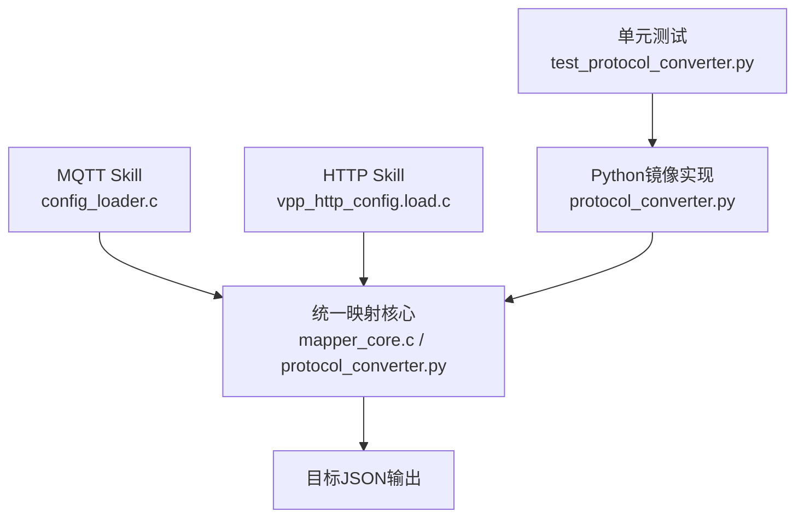
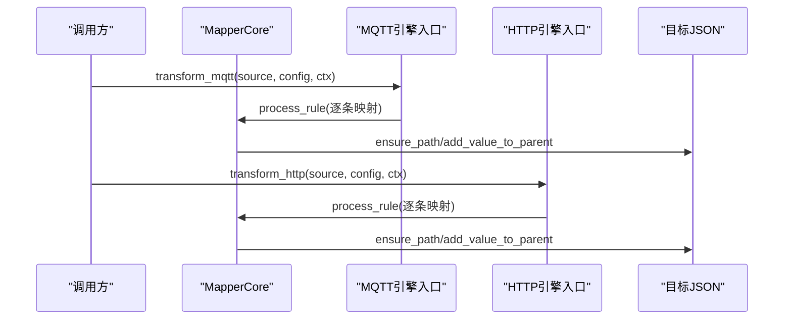
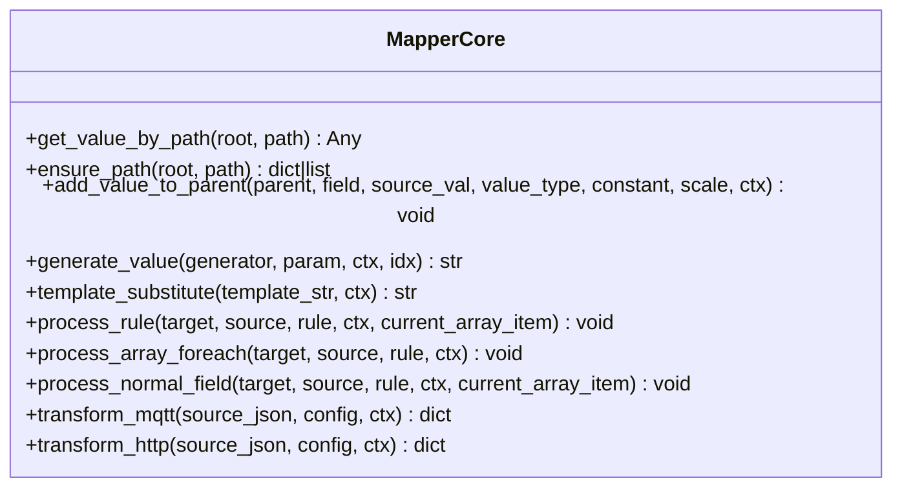
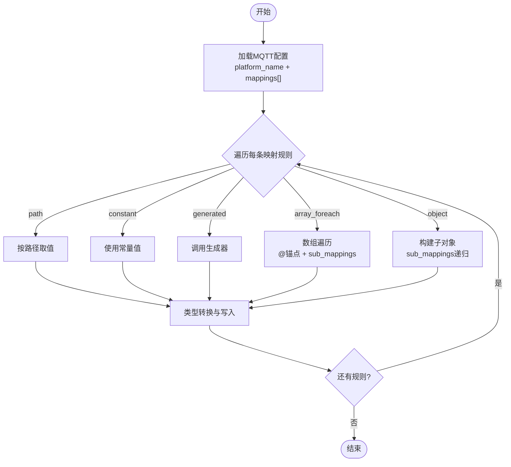
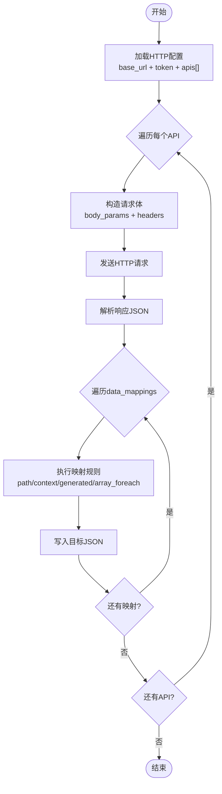

# 协议转换技能包

<cite>
**本文引用的文件**
- [SKILL.md](file://.trae/skills/protocol-conversion/SKILL.md)
- [protocol_converter.py](file://.trae/skills/protocol-conversion/scripts/protocol_converter.py)
- [test_protocol_converter.py](file://.trae/skills/protocol-conversion/scripts/test_protocol_converter.py)
- [mapper_core.h](file://.trae/skills/protocol-conversion/scripts/mapper_core.h)
- [mqtt_mapper_202608261100.json](file://.trae/skills/mqtt-conversion/scripts/mqtt_mapper_202608261100.json)
- [protocol_mapping_output_20260827_113000.json](file://.trae/skills/http-conversion/scripts/protocol_mapping_output_20260827_113000.json)
- [mcp.json](file://.trae/mcp.json)
- [mcp server部署.md](file://mcp server部署.md)
- [规约管理MCP服务化Spec.md](file://规约管理MCP服务化Spec.md)
</cite>

## 目录
1. [简介](#简介)
2. [项目结构](#项目结构)
3. [核心组件](#核心组件)
4. [架构总览](#架构总览)
5. [详细组件分析](#详细组件分析)
6. [依赖关系分析](#依赖关系分析)
7. [性能与优化建议](#性能与优化建议)
8. [故障排查指南](#故障排查指南)
9. [结论](#结论)
10. [附录：配置示例与用法](#附录：配置示例与用法)

## 简介
本技能包提供统一的“协议映射核心”，将多种工业协议（MQTT、HTTP，以及通过上层 Skill 编排的 Modbus、BACnet、OPC-UA 等）的数据源，按声明式映射规则转换为统一目标格式。其核心价值在于：
- 统一映射引擎：MQTT 与 HTTP 共享同一套映射执行逻辑，降低维护成本并保证行为一致。
- 声明式配置：通过 JSON 描述路径、类型、常量、生成器、数组遍历、模板变量替换等，无需硬编码。
- 可测试性：提供 Python 镜像实现与完备单元测试，便于本地验证与回归。
- 可扩展性：支持新增 source_type、value_type、generator、preprocess/post_process 等扩展点。

## 项目结构
- 共享映射核心位于 protocol-conversion skill，定义规则字段、路径语法、类型系统、数组遍历准则、生成器清单等。
- MQTT 与 HTTP 各自 Skill 提供外层配置加载与协议特有能力，内部调用共享核心进行映射。
- 脚本层提供 Python 镜像实现与测试套件，用于本地验证与调试。
- MCP 集成通过 .trae/mcp.json 暴露工具入口，配合部署文档完成服务启动与鉴权。

图表来源
- [SKILL.md:23-35](file://.trae/skills/protocol-conversion/SKILL.md#L23-L35)
- [protocol_converter.py:1-16](file://.trae/skills/protocol-conversion/scripts/protocol_converter.py#L1-L16)

章节来源
- [SKILL.md:23-35](file://.trae/skills/protocol-conversion/SKILL.md#L23-L35)
- [protocol_converter.py:1-16](file://.trae/skills/protocol-conversion/scripts/protocol_converter.py#L1-L16)

## 核心组件
- 统一映射核心 MapperCore：提供路径取值、路径创建、类型转换、生成器、模板替换、数组遍历、普通字段处理、规则分发等能力。
- MQTT 引擎入口 transform_mqtt：以 platform_name + mappings[] 为配置，执行映射。
- HTTP 引擎入口 transform_http：以 base_url/token/apis[] 为配置，仅执行 data_mappings 映射部分。
- 测试套件：覆盖路径解析、类型转换、生成器、模板替换、数组遍历、真实配置集成等场景。

章节来源
- [protocol_converter.py:32-602](file://.trae/skills/protocol-conversion/scripts/protocol_converter.py#L32-L602)
- [test_protocol_converter.py:1-44](file://.trae/skills/protocol-conversion/scripts/test_protocol_converter.py#L1-L44)

## 架构总览

图表来源
- [protocol_converter.py:569-602](file://.trae/skills/protocol-conversion/scripts/protocol_converter.py#L569-L602)
- [protocol_converter.py:379-566](file://.trae/skills/protocol-conversion/scripts/protocol_converter.py#L379-L566)

## 详细组件分析

### 路径与取值
- 支持点号访问对象属性、索引访问数组元素、通配符 [*] 遍历数组、"." 返回根对象（HTTP）。
- 支持嵌套展平：如 "dataObj.itemBody[*].item[*]"，自动递归展开为扁平列表。
- 缺失路径或类型不匹配时安全返回 None，避免异常中断。

章节来源
- [protocol_converter.py:49-118](file://.trae/skills/protocol-conversion/scripts/protocol_converter.py#L49-L118)
- [protocol_converter.py:161-202](file://.trae/skills/protocol-conversion/scripts/protocol_converter.py#L161-L202)

### 路径创建与写入
- ensure_path 根据目标路径逐级创建对象或数组，遇到 [index] 自动补齐到所需长度。
- add_value_to_parent 负责类型转换与写入，支持 string/double/int/long/bool/object/substitute。

章节来源
- [protocol_converter.py:120-159](file://.trae/skills/protocol-conversion/scripts/protocol_converter.py#L120-L159)
- [protocol_converter.py:269-376](file://.trae/skills/protocol-conversion/scripts/protocol_converter.py#L269-L376)

### 值生成器
- 支持 uuid、时间戳（秒/毫秒）、日期字符串、随机串、MD5签名、批次ID、自增序列等。
- sequence 支持基于上下文计数器或传入 idx 生成。

章节来源
- [protocol_converter.py:206-236](file://.trae/skills/protocol-conversion/scripts/protocol_converter.py#L206-L236)
- [SKILL.md:196-212](file://.trae/skills/protocol-conversion/SKILL.md#L196-L212)

### 模板变量替换
- 使用 $var$ 语法在 constant 中嵌入变量，type 为 substitute 时触发替换。
- 支持嵌套路径，如 ssl_mqtt_server.gatewayID。

章节来源
- [protocol_converter.py:240-265](file://.trae/skills/protocol-conversion/scripts/protocol_converter.py#L240-L265)
- [SKILL.md:170-194](file://.trae/skills/protocol-conversion/SKILL.md#L170-L194)

### 数组遍历与锚点
- array_foreach 通过 @ 锚点定位目标数组位置；支持 object 与 key_value 两种 item_type。
- 支持 "$idx" 索引变量替换、"." 源路径（HTTP）和嵌套 [*] 展平（MQTT）。

章节来源
- [protocol_converter.py:395-479](file://.trae/skills/protocol-conversion/scripts/protocol_converter.py#L395-L479)
- [SKILL.md:126-168](file://.trae/skills/protocol-conversion/SKILL.md#L126-L168)

### 普通字段处理
- 支持 path、constant、generated、context、substitute 等多种 source_type。
- 支持 object + sub_mappings 递归构建子对象。
- 支持 scale 数值缩放与 post_process/preprocess 预留扩展点。

章节来源
- [protocol_converter.py:480-566](file://.trae/skills/protocol-conversion/scripts/protocol_converter.py#L480-L566)
- [SKILL.md:81-124](file://.trae/skills/protocol-conversion/SKILL.md#L81-L124)

### 引擎入口
- transform_mqtt：读取 mappings[] 逐条处理。
- transform_http：读取 apis[].data_mappings[] 逐条处理，body_params/header 由 HTTP 业务层构造。

章节来源
- [protocol_converter.py:569-602](file://.trae/skills/protocol-conversion/scripts/protocol_converter.py#L569-L602)

### 类图（代码级）

图表来源
- [protocol_converter.py:32-602](file://.trae/skills/protocol-conversion/scripts/protocol_converter.py#L32-L602)

## 依赖关系分析
- 外部依赖：无强耦合第三方库（Python 镜像实现仅使用标准库）。
- 内部依赖：
  - MQTT/HTTP Skill 通过各自加载器将配置交给统一核心执行。
  - Python 镜像实现与 C 头文件保持结构与语义对齐，便于对照验证。
- 运行时依赖：MCP Server 通过 .trae/mcp.json 暴露工具，结合部署文档完成鉴权与服务启动。

章节来源
- [SKILL.md:23-35](file://.trae/skills/protocol-conversion/SKILL.md#L23-L35)
- [mapper_core.h:1-28](file://.trae/skills/protocol-conversion/scripts/mapper_core.h#L1-L28)
- [mcp.json:1-1](file://.trae/mcp.json#L1-L1)
- [mcp server部署.md:64-100](file://mcp server部署.md#L64-L100)

## 性能与优化建议
- 优先使用声明式字段：scale、constant、substitute、generated，减少后处理函数调用。
- 合理使用数组遍历：仅在目标要求 Array 时使用 array_foreach；否则取首个元素 [0] 避免多余遍历。
- 控制数据规模：对大数组分批处理，避免一次性展开过深层级。
- 复用上下文：利用 context source_type 传递 startTime/endTime 等参数，减少重复计算。
- 网络侧优化（HTTP）：合理设置超时与重试策略，缓存 Token，减少登录开销。

[本节为通用指导，不直接分析具体文件]

## 故障排查指南
- 路径取值失败：检查路径是否存在、类型是否匹配；缺失路径会返回 None，不会抛错。
- 数组遍历为空：确认源是否为数组且非空；若目标为 Object，应使用 [0] 固定索引而非 @。
- 模板变量未替换：确认 type 为 substitute 且 constant 包含 $var$ 形式变量；检查上下文 ctx 是否包含对应键。
- 类型转换异常：确保源值可转为目标类型；数字型默认非数字转 0，布尔型按 true/1 判定。
- HTTP 请求错误：检查 token 注入、Content-Type、接口路径与响应码；参考 Spec 的错误处理约定。

章节来源
- [protocol_converter.py:49-118](file://.trae/skills/protocol-conversion/scripts/protocol_converter.py#L49-L118)
- [protocol_converter.py:269-376](file://.trae/skills/protocol-conversion/scripts/protocol_converter.py#L269-L376)
- [规约管理MCP服务化Spec.md:123-131](file://规约管理MCP服务化Spec.md#L123-L131)

## 结论
本技能包通过统一映射核心，将 MQTT 与 HTTP 的协议差异收敛到一致的规则模型中，借助声明式配置与完备测试，显著降低了多协议转换的复杂度与维护成本。对于 Modbus、BACnet、OPC-UA 等工业协议，可通过上层 Skill 编排与数据适配，复用该核心完成最终的目标格式转换。

[本节为总结，不直接分析具体文件]

## 附录：配置示例与用法

### MQTT 配置示例要点
- 顶层包含 platform_name 与 mappings[]。
- 使用 generated 生成 msgId/msgTime，使用 substitute 注入网关 ID。
- 使用 array_foreach + @ 将 itemBody[*] 映射到目标数组，并在子映射中继续嵌套遍历 item[*]。

章节来源
- [mqtt_mapper_202608261100.json:1-98](file://.trae/skills/mqtt-conversion/scripts/mqtt_mapper_202608261100.json#L1-L98)
- [SKILL.md:23-35](file://.trae/skills/protocol-conversion/SKILL.md#L23-L35)

### HTTP 配置示例要点
- 顶层包含 base_url、token、apis[]。
- body_params 使用 context source_type 注入 startTime/endTime。
- data_mappings 中使用 array_foreach + @ 将 data[*] 映射到目标数组，并使用 "." 源路径将当前项作为单元素数组处理。

章节来源
- [protocol_mapping_output_20260827_113000.json:1-118](file://.trae/skills/http-conversion/scripts/protocol_mapping_output_20260827_113000.json#L1-L118)
- [SKILL.md:23-35](file://.trae/skills/protocol-conversion/SKILL.md#L23-L35)

### 转换流程说明（MQTT）

图表来源
- [protocol_converter.py:379-566](file://.trae/skills/protocol-conversion/scripts/protocol_converter.py#L379-L566)
- [protocol_converter.py:569-583](file://.trae/skills/protocol-conversion/scripts/protocol_converter.py#L569-L583)

### 转换流程说明（HTTP）

图表来源
- [protocol_converter.py:585-602](file://.trae/skills/protocol-conversion/scripts/protocol_converter.py#L585-L602)

### 常见使用场景
- 设备遥测上报：从传感器原始数据提取电压、电流、功率等，转换为统一指标格式。
- 历史数据拉取：HTTP 定时拉取历史曲线，映射为批量上报条目。
- 多协议汇聚：不同厂商设备通过各自 Skill 适配后，统一进入目标平台。

[本节为概念性内容，不直接分析具体文件]

### 运行与测试
- 本地测试：在 scripts 目录下运行单元测试，覆盖路径、类型、生成器、模板替换、数组遍历与真实配置集成。
- 快速验证：使用 Python 镜像实现，直接调用 transform_mqtt/transform_http 进行端到端验证。

章节来源
- [test_protocol_converter.py:1-44](file://.trae/skills/protocol-conversion/scripts/test_protocol_converter.py#L1-L44)
- [SKILL.md:301-338](file://.trae/skills/protocol-conversion/SKILL.md#L301-L338)

### MCP 集成与部署
- 客户端通过 .trae/mcp.json 配置 MCP 服务端地址与鉴权头。
- 服务启动遵循部署文档中的安装与启动流程，确保 Token 与环境正确配置。

章节来源
- [mcp.json:1-1](file://.trae/mcp.json#L1-L1)
- [mcp server部署.md:283-460](file://mcp server部署.md#L283-L460)