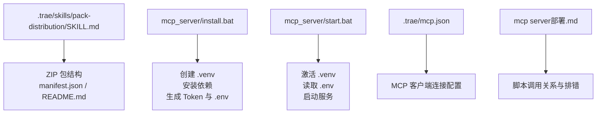
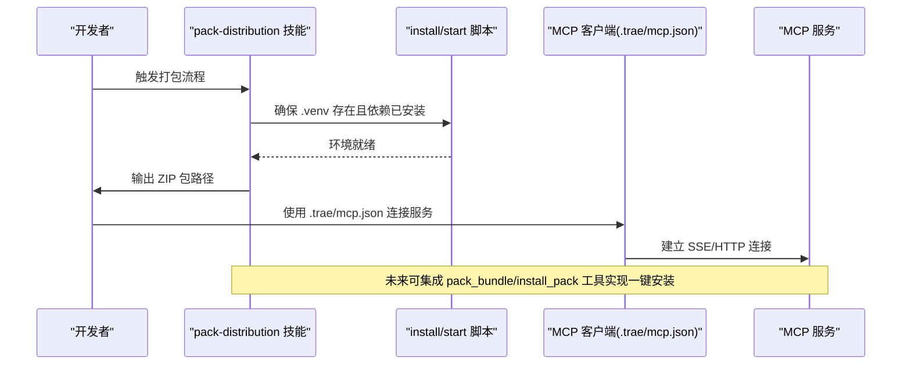
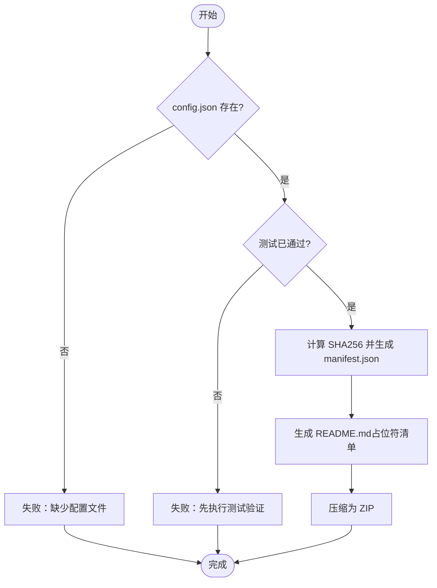
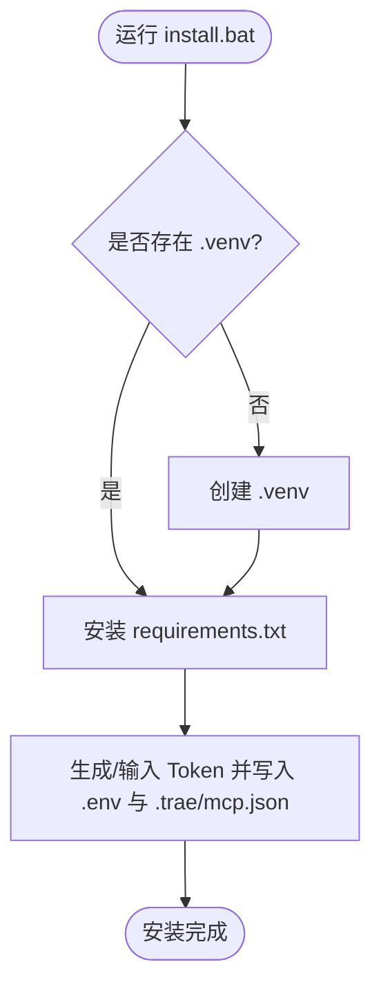
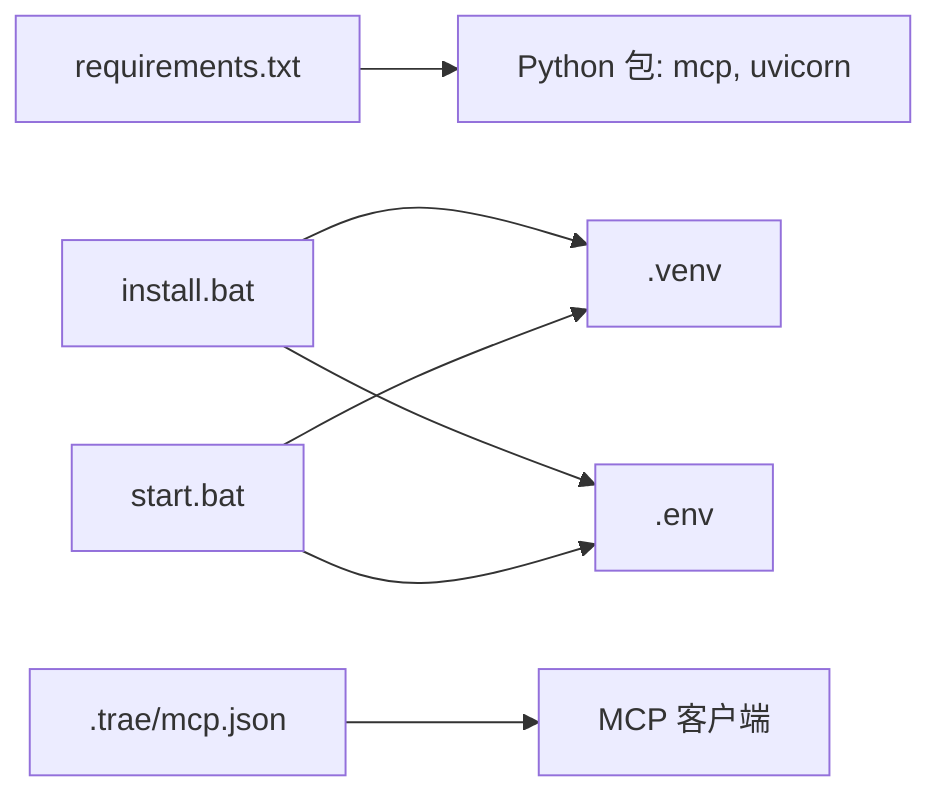
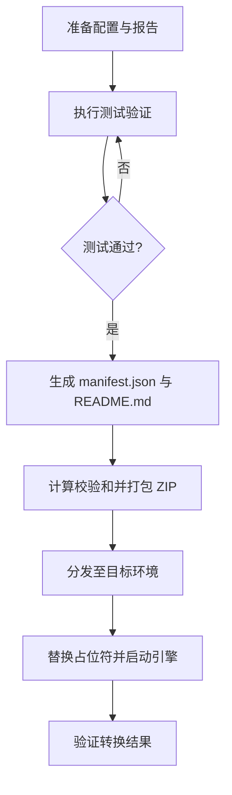

# 打包分发技能包

<cite>
**本文引用的文件**
- [mcp_server/requirements.txt](file://mcp_server/requirements.txt)
- [mcp_server/install.bat](file://mcp_server/install.bat)
- [mcp_server/start.bat](file://mcp_server/start.bat)
- [.trae/mcp.json](file://.trae/mcp.json)
- [.trae/skills/pack-distribution/SKILL.md](file://.trae/skills/pack-distribution/SKILL.md)
- [.trae/skills/pack-distribution/agents/openai.yaml](file://.trae/skills/pack-distribution/agents/openai.yaml)
- [mcp server部署.md](file://mcp server部署.md)
</cite>

## 目录
1. [简介](#简介)
2. [项目结构](#项目结构)
3. [核心组件](#核心组件)
4. [架构总览](#架构总览)
5. [详细组件分析](#详细组件分析)
6. [依赖分析](#依赖分析)
7. [性能考虑](#性能考虑)
8. [故障排查指南](#故障排查指南)
9. [结论](#结论)
10. [附录](#附录)

## 简介
本文件面向“打包分发技能包”的完整生命周期，覆盖包结构规范、依赖声明、版本控制与质量检查，以及创建、测试、发布与更新的端到端流程。同时给出包仓库管理、权限控制与部署策略建议，并总结质量保证与回滚机制的最佳实践。内容基于当前仓库中的技能定义、安装与启动脚本、以及部署文档进行系统化整理。

## 项目结构
围绕打包分发的关键位置与职责如下：
- .trae/skills/pack-distribution：技能定义与使用说明，包含 ZIP 包结构、清单格式、README 模板与操作流程。
- mcp_server：服务端运行环境，提供虚拟环境创建、依赖安装、Token 配置与服务启动能力。
- .trae/mcp.json：IDE/MCP 客户端连接配置（URL、鉴权头）。
- mcp server部署.md：部署脚本说明、调用关系、常见问题与安全注意事项。

图表来源
- [.trae/skills/pack-distribution/SKILL.md:27-65](file://.trae/skills/pack-distribution/SKILL.md#L27-L65)
- [mcp_server/install.bat:26-72](file://mcp_server/install.bat#L26-L72)
- [mcp_server/start.bat:7-27](file://mcp_server/start.bat#L7-L27)
- [.trae/mcp.json:1-1](file://.trae/mcp.json#L1-L1)
- [mcp server部署.md:283-501](file://mcp server部署.md#L283-L501)

章节来源
- [.trae/skills/pack-distribution/SKILL.md:1-162](file://.trae/skills/pack-distribution/SKILL.md#L1-L162)
- [mcp_server/install.bat:1-85](file://mcp_server/install.bat#L1-L85)
- [mcp_server/start.bat:1-41](file://mcp_server/start.bat#L1-L41)
- [.trae/mcp.json:1-1](file://.trae/mcp.json#L1-L1)
- [mcp server部署.md:283-692](file://mcp server部署.md#L283-L692)

## 核心组件
- 技能定义与流程：SKILL.md 定义了打包前检查、清单与文档生成、ZIP 打包、目标环境安装等阶段，以及约束规则（测试门控、校验和、占位符清单、依赖声明、版本管理、文件完整性）。
- 环境与依赖：install.bat 负责 Python 环境检查、虚拟环境创建、依赖安装、Token 生成与写入；start.bat 负责激活环境、读取 Token、启动服务。
- 客户端连接：.trae/mcp.json 指定 MCP 服务 URL 与鉴权头，便于 IDE 或 MCP 客户端直连。
- 部署与排错：部署文档详述脚本调用链、常见问题定位与生产安全建议。

章节来源
- [.trae/skills/pack-distribution/SKILL.md:93-161](file://.trae/skills/pack-distribution/SKILL.md#L93-L161)
- [mcp_server/install.bat:12-72](file://mcp_server/install.bat#L12-L72)
- [mcp_server/start.bat:7-27](file://mcp_server/start.bat#L7-L27)
- [.trae/mcp.json:1-1](file://.trae/mcp.json#L1-L1)
- [mcp server部署.md:309-439](file://mcp server部署.md#L309-L439)

## 架构总览
打包分发流程由“技能定义 + 本地环境脚本 + 客户端配置”共同构成：
- 开发侧通过 SKILL.md 指导完成打包前检查、清单生成、README 生成与 ZIP 打包。
- 运行侧通过 install.bat/start.bat 完成环境准备、依赖安装、Token 配置与服务启动。
- 客户端通过 .trae/mcp.json 连接 MCP 服务，后续可集成自动化打包工具（如 pack_bundle、install_pack）以增强体验。

图表来源
- [.trae/skills/pack-distribution/SKILL.md:93-140](file://.trae/skills/pack-distribution/SKILL.md#L93-L140)
- [mcp_server/install.bat:26-72](file://mcp_server/install.bat#L26-L72)
- [mcp_server/start.bat:7-27](file://mcp_server/start.bat#L7-L27)
- [.trae/mcp.json:1-1](file://.trae/mcp.json#L1-L1)

## 详细组件分析

### 包结构与清单规范
- 包根目录命名：protocol-conversion-pack-{protocol}_{source}_to_{target}_{version}
- 必需文件：config.json、mapping_report.md、test_report.json、source_protocol_spec.json、target_protocol_spec.json、README.md、manifest.json
- manifest.json 关键字段：packId、version、conversionType、sourceProtocol、targetProtocol、createdAt、files（含 size/checksum）、dependencies（engine/engineVersion/libraries）、testStatus、testSummary
- README.md 模板需列出所有占位符及示例值，便于目标环境替换

图表来源
- [.trae/skills/pack-distribution/SKILL.md:27-65](file://.trae/skills/pack-distribution/SKILL.md#L27-L65)
- [.trae/skills/pack-distribution/SKILL.md:93-129](file://.trae/skills/pack-distribution/SKILL.md#L93-L129)

章节来源
- [.trae/skills/pack-distribution/SKILL.md:27-65](file://.trae/skills/pack-distribution/SKILL.md#L27-L65)
- [.trae/skills/pack-distribution/SKILL.md:93-129](file://.trae/skills/pack-distribution/SKILL.md#L93-L129)

### 依赖声明与环境准备
- requirements.txt 声明了 mcp 与 uvicorn 的版本范围，保证运行时一致性。
- install.bat 自动创建 .venv、安装依赖、生成 Token 并写入 .env 与 .trae/mcp.json。
- start.bat 激活 .venv、读取 .env 中的 MCP_AUTH_TOKEN、打印启动信息并启动服务。

图表来源
- [mcp_server/requirements.txt:1-3](file://mcp_server/requirements.txt#L1-L3)
- [mcp_server/install.bat:26-72](file://mcp_server/install.bat#L26-L72)

章节来源
- [mcp_server/requirements.txt:1-3](file://mcp_server/requirements.txt#L1-L3)
- [mcp_server/install.bat:12-72](file://mcp_server/install.bat#L12-L72)
- [mcp_server/start.bat:7-27](file://mcp_server/start.bat#L7-L27)

### 版本管理与标识
- 包名与 manifest.version 体现版本号，packId 唯一标识一次打包产物。
- createdAt 记录打包时间，便于审计与回溯。
- files 数组中每个文件的 checksum 用于完整性校验。

章节来源
- [.trae/skills/pack-distribution/SKILL.md:27-65](file://.trae/skills/pack-distribution/SKILL.md#L27-L65)

### 质量检查与约束
- 测试门控：打包前必须通过测试验证。
- 校验和：config.json 必须计算 SHA256。
- 占位符清单：README.md 必须列出所有需要替换的占位符。
- 依赖声明：manifest.json 必须声明 C 引擎版本与库依赖。
- 文件完整性：ZIP 包必须包含 config.json、测试报告、映射报告。

章节来源
- [.trae/skills/pack-distribution/SKILL.md:152-161](file://.trae/skills/pack-distribution/SKILL.md#L152-L161)

### 安装到目标环境
- 解压 ZIP 到目标目录。
- 替换 config.json 中的占位符为实际值。
- 验证 C 引擎依赖（cJSON、paho.mqtt.c、libmicrohttpd 等）。
- 启动 C 协议转换引擎并验证转换结果。

章节来源
- [.trae/skills/pack-distribution/SKILL.md:131-140](file://.trae/skills/pack-distribution/SKILL.md#L131-L140)

### MCP 客户端连接配置
- .trae/mcp.json 指定 MCP 服务地址与 Authorization 头，便于 IDE 或 MCP 客户端直接连接。
- 该配置由 install.bat 在首次安装时自动生成，也可手动编辑。

章节来源
- [.trae/mcp.json:1-1](file://.trae/mcp.json#L1-L1)
- [mcp_server/install.bat:65-72](file://mcp_server/install.bat#L65-L72)

## 依赖分析
- 运行时依赖：mcp、uvicorn 在 requirements.txt 中声明，版本范围限制避免破坏性升级。
- 脚本依赖：install.bat 依赖 Python 3.10+ 与 venv 模块；start.bat 依赖 .venv 与 .env。
- 客户端依赖：.trae/mcp.json 提供 MCP 客户端连接参数。

图表来源
- [mcp_server/requirements.txt:1-3](file://mcp_server/requirements.txt#L1-L3)
- [mcp_server/install.bat:26-72](file://mcp_server/install.bat#L26-L72)
- [mcp_server/start.bat:7-27](file://mcp_server/start.bat#L7-L27)
- [.trae/mcp.json:1-1](file://.trae/mcp.json#L1-L1)

章节来源
- [mcp_server/requirements.txt:1-3](file://mcp_server/requirements.txt#L1-L3)
- [mcp_server/install.bat:26-72](file://mcp_server/install.bat#L26-L72)
- [mcp_server/start.bat:7-27](file://mcp_server/start.bat#L7-L27)
- [.trae/mcp.json:1-1](file://.trae/mcp.json#L1-L1)

## 性能考虑
- 依赖安装：使用 -q 安静模式减少输出开销；网络不稳定时可切换镜像源。
- 虚拟环境隔离：避免全局污染，提升构建与运行稳定性。
- 启动快速：Uvicorn 轻量高效，适合 MCP 场景的高并发请求处理。

[本节为通用指导，不直接分析具体文件]

## 故障排查指南
- Python 未安装或版本过低：按提示安装 3.10+ 并确保加入 PATH。
- 虚拟环境创建失败：检查权限与磁盘空间，必要时以管理员身份运行。
- 依赖安装失败：检查网络与 pip 版本，或使用国内镜像源。
- 找不到虚拟环境：确认已运行 install.bat，若移动过项目需重新创建。
- Token 未配置：运行 install.bat 或手动创建 .env 并设置 MCP_AUTH_TOKEN。
- 端口被占用：查找并结束占用进程，或修改服务端口。
- 移动项目后虚拟环境失效：删除旧 .venv 并重新运行 install.bat。

章节来源
- [mcp server部署.md:505-642](file://mcp server部署.md#L505-L642)

## 结论
本方案以 SKILL.md 为核心，结合 install/start 脚本与 .trae/mcp.json，形成从环境准备、依赖管理、打包校验到目标环境安装的闭环流程。通过严格的清单与校验和、占位符清单与依赖声明，保障包的一致性与可追溯性。建议在后续迭代中引入自动化打包与安装工具（pack_bundle、install_pack），并完善包仓库与权限控制，以实现更高效的发布与治理。

[本节为总结性内容，不直接分析具体文件]

## 附录

### 完整工作流程（创建-测试-发布-更新）
- 创建：依据 SKILL.md 准备 config.json、映射报告与测试报告。
- 测试：执行测试验证，确保全部用例通过。
- 发布：生成 manifest.json 与 README.md，计算校验和，打包为 ZIP。
- 更新：变更配置后重新测试与打包，更新版本号与 packId。

图表来源
- [.trae/skills/pack-distribution/SKILL.md:93-140](file://.trae/skills/pack-distribution/SKILL.md#L93-L140)

### 包仓库管理、权限控制与部署策略（建议）
- 包仓库：集中存储 ZIP 包与 manifest，支持按版本检索与下载。
- 权限控制：区分只读与发布权限，限制敏感操作（如覆盖生产包）。
- 部署策略：灰度发布与回滚，优先小流量验证后再全量发布。
- 质量门禁：强制测试通过、校验和一致、依赖声明完整方可入库。

[本节为通用建议，不直接分析具体文件]

### 质量保证与回滚最佳实践
- 质量门禁：测试通过率、校验和一致性、依赖声明完整性作为发布前置条件。
- 可追溯性：packId、version、createdAt、checksum 齐全，便于问题定位。
- 回滚机制：保留上一稳定版本包，出现问题时快速切回。
- 审计日志：记录每次打包与发布的操作人与时间。

[本节为通用建议，不直接分析具体文件]